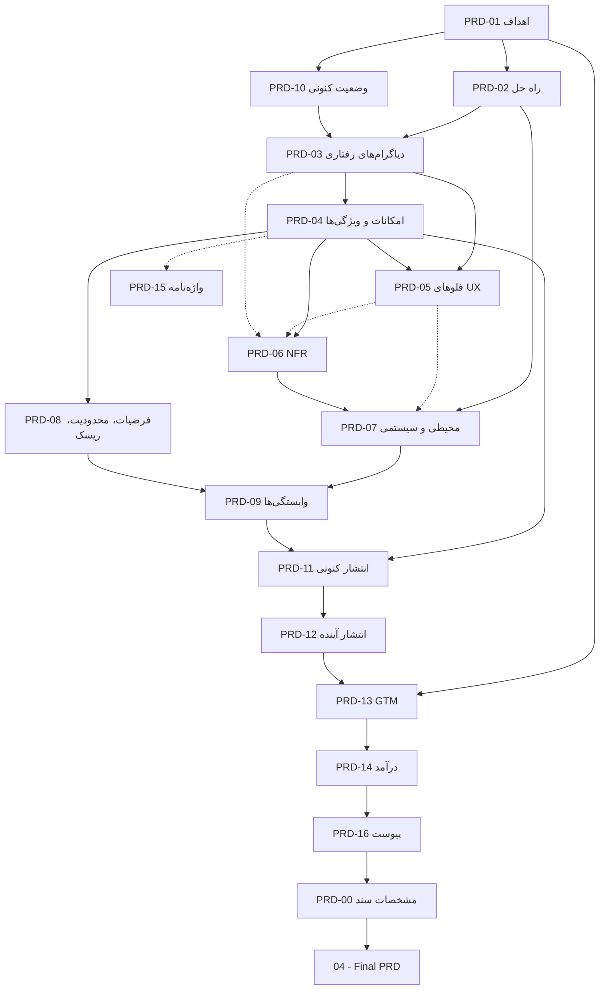

# ‏00 — Master Project Index (منبع حقیقت پروژه)

> ‏این سند **مرجع اصلی** تصمیمات تأییدشده، وضعیت مستندات، فرضیات و سؤالات باز پروژه است. هر چت جدید ابتدا این فایل را می‌خواند و در پایان، آن را به‌روز می‌کند.
>
> ‏**قاعده:** فقط مواردی که در جدول «تصمیمات تأییدشده» (بخش ۶) آمده‌اند قطعی‌اند. هر چیز دیگری یا «برگرفته از منبع» است یا «پیشنهاد/فرض تأییدنشده».
>
> ‏**قاعده نگارش (DEC-18):** متن فارسی باید راست‌به‌چپ نمایش داده شود؛ خط‌ها و خانه‌های جدولی که با کلمه یا شناسه انگلیسی شروع می‌شوند با نویسه RLM یا یک کلمه فارسی آغاز می‌شوند.
>
> ‏**قاعده خوانایی (DEC-25):** هر سند بخش PRD در ابتدا یک «راهنمای شناسه‌ها» دارد که کدهای به‌کاررفته (BO، BR، FR، RULE، NFR، …) را توضیح می‌دهد.

---

## ‏فهرست

1. ‏معرفی محصول و خلاصه ایده
2. ‏اهداف کسب‌وکار و محصول
3. ‏محدوده محصول (Scope)
4. ‏ساختار تمپلیت PRD و نگاشت فایل‌ها
5. ‏فهرست داکیومنت‌ها و وضعیت
6. ‏تصمیمات (تأییدشده / پیشنهادی)
7. ‏فرضیات تأییدنشده
8. ‏سؤالات باز و تصمیمات حل‌نشده
9. ‏وابستگی بین بخش‌های PRD
10. ‏فرایند کار و ترتیب توسعه
11. ‏تاریخچه تغییرات

---

## ۱. ‏معرفی محصول و خلاصه ایده

> ‏**وضعیت:** چشم‌انداز، مسئله و جامعه هدف در **PRD-01 (Approved)**، راه‌حل در **PRD-02 (Approved)**، وضعیت کنونی در **PRD-10 (Approved)**، رفتار محصول در **PRD-03 (Approved؛ شش زیرسند)**، امکانات و ویژگی‌ها در **PRD-04 (Approved؛ ده سند)**، فلوهای تجربه کاربر در **PRD-05 (Approved؛ چهار سند)**، نیازمندی‌های غیرعملکردی در **PRD-06 (Approved؛ یک سند)**، نیازمندی‌های محیطی و سیستمی در **PRD-07 (Approved؛ یک سند)**، فرضیات، محدودیت‌ها و ریسک‌ها در **PRD-08 (Approved؛ یک سند، نسخه 1.3)**، وابستگی‌ها در **PRD-09 (Approved؛ یک سند، نسخه 1.1)** برنامه انتشار کنونی در **PRD-11 (Approved؛ سه سند)** و برنامه انتشار آینده در **PRD-12 (Approved؛ دو سند)** استراتژی فروش و ورود به بازار در **PRD-13 (Approved؛ یک سند، نسخه سبک؛ نسخه 1.1)** و پیش‌بینی درآمد در **PRD-14 (Approved؛ یک سند، نسخه سبک)** و واژه‌نامه در **PRD-15 (Approved؛ یک سند)** و پیوست در **PRD-16 (Approved؛ یک سند، نسخه میانه؛ نسخه 1.1)** و مشخصات سند در **PRD-00 (Approved؛ یک سند، نسخه میانه)** تثبیت شد. **همه بخش‌های تمپلیت Approved شده‌اند. PRD نهایی نسخه 0.9 تجمیع شد (CH-40)؛ پنج تصمیم چت تجمیع (DEC-259 تا DEC-263) در چت Q-42 در همه اسناد بخش‌ها اعمال شدند (CH-41 تا CH-45) و PRD نهایی از اسناد همگام‌شده بازتولید شد (CH-46). Q-42 بسته است؛ گام بعدی بررسی پنج تأییدکننده و تصویب BRD است (DEC-254).** خلاصه زیر برای مرجع سریع است.

- ‏**نام کاری:** دستیار هوشمند پشتیبانی مشتری برای فروشگاه‌های آنلاین — AI-Powered Customer Support Assistant for E-commerce `[SRC-01]`. *(نام تجاری تعیین نشده — Q-08؛ خانه نام: PRD-00 §0.2)*
- ‏**ایده:** دستیار مکالمه‌محور مبتنی بر AI که درخواست مشتری را درک می‌کند، از منابع معتبر فروشگاه پاسخ می‌دهد، در انتخاب محصول راهنمایی می‌کند و در موارد خارج از توان، به انسان ارجاع می‌دهد `[SRC-01 §4]`.
- ‏**جهت نسخه جاری:** پاسخ‌گویی قابل اعتماد + کنترل اعتبار موجودی + صف روشن درخواست‌های نیازمند انسان؛ خروجی دو هفته نخست، Prototype تعاملی قابل ارزیابی `[SRC-02]` ← PRD-01 §1.1.
- ‏**راه‌حل (PRD-02):** شش جزء — ۱ دستیار گفت‌وگو · ۲ ارجاع به انسان · ۳ پنل ادمین · ۴ پیشنهاد پاسخ به ادمین (ترجیحی) · ۵ مدیریت اطلاعات مرجع · ۶ سنجش و ممیزی — تحت ده اصل SP-01 تا SP-10. قاعده کلی: دستیار «اطلاع می‌دهد، می‌پرسد و ثبت می‌کند؛ اقدام نمی‌کند».
- ‏**رفتار (PRD-03):** چهار نقش (ACT-01 مشتری، ACT-02 ادمین، ACT-03 مالک فروشگاه / مالک داده، ACT-04 سرویس مدل)؛ سه مرز منطقی (صفحه گفت‌وگو، پنل ادمین، پنل مدیریت فروشگاه)؛ پنج جزء منطقی (دستیار، کنترل‌گر قواعد، اطلاعات مرجع، صف ارجاع، ثبت رویداد)؛ چرخه وضعیت S1 تا S6 با دوازده انتقال TR-00 تا TR-11.
- ‏**امکانات (PRD-04):** هفت اپیک EP-01 تا EP-07 با **۳۴ استوری** (۳۳ الزامی، ۱ ترجیحی: US-07-06 پیشنهاد پاسخ)؛ چهل «نباید» کلی ND-01 تا ND-40؛ هشت قاعده رفتاری مشترک CR-01 تا CR-08؛ ماتریس مجوز نهایی؛ کاتالوگ ۲۶ رویداد EV و ۱۲ قاعده شمارش KM؛ فرهنگ داده نهایی DS-01 تا DS-09 و ۱۲ فهرست مقدار VL.
- ‏**تجربه کاربر (PRD-05):** سه ورودی جدا (صفحه گفت‌وگو، پنل ادمین، پنل مدیریت فروشگاه)؛ **۱۱ صفحه** SCR-01، SCR-10 تا SCR-12، SCR-20 تا SCR-26 به‌علاوه دو پوسته؛ دوازده حالت صفحه گفت‌وگو و پنج نمای نمای مکالمه؛ هشت فلوی کار UXF-01 تا UXF-08؛ Wireframe به شکل جدول ناحیه‌به‌ناحیه.
- ‏**کیفیت (PRD-06):** پنج دسته (کارایی و تازگی، ظرفیت و مقیاس، پایداری و دسترس‌پذیری، امنیت و حریم خصوصی و ممیزی، کیفیت پاسخ و کاربردپذیری و هزینه)؛ نُه NFR بریف با زیرشناسه‌های NFR-xx-n و سه NFR افزوده NFR-10 تا NFR-12؛ هدف اصلی کارایی: صدک ۹۵ زمان پاسخ ≤ ۱۰ ثانیه با ۵ مکالمه هم‌زمان (فرض A-04)؛ حد تأخیر ۲۰ ثانیه؛ صفحه گفت‌وگو بدون تازه‌سازی (≤ ۵ ثانیه)؛ پیش‌شرط‌های حریم خصوصی پایلوت در PRD-06 §6.9.
- ‏**بستر (PRD-07):** وب‌اپلیکیشن بدون نصب و بدون API بیرونی؛ صفحه گفت‌وگو صفحه مستقل موبایل‌محور با پیوند از یک صفحه نمایشی ساده؛ پنل‌ها دسکتاپ؛ مشتری با شناسه بی‌نام مرورگر و بدون ورود؛ ادمین و مالک با حساب فردی (نام کاربری و رمز) که تیم محصول می‌سازد؛ یک محیط آزمون با قابلیت‌های شبیه‌سازی خطا؛ سرویس مدل تنها سیستم بیرونی و قابل تعویض؛ اصل وابسته‌نبودن به یک کانال؛ ۴۷ ردیف ENV به‌علاوه شش ردیف رفتار دسترسی.
- ‏**فرض، محدودیت و ریسک (PRD-08):** سه فرضیه محصول با شرط اعتبارسنجی (H-01، H-02، A-13) و سه فرض اجرا (A-02، A-08، A-28)؛ **دفتر پارامترهای تأییدنشده** (همه اعداد پیش‌فرض و مقدارهای باز)؛ ۱۳ محدودیت CON-01 تا CON-13؛ ۲۶ ریسک RSK-01 تا RSK-26 در شش دسته با مقیاس کیفی و نقشه احتمال × اثر؛ قاعده توقف خودکارسازی BRD §12. **یافته اصلی:** ریسک‌های با احتمال زیاد همه از آماده‌نبودن اجرا و محدودیت شواهدند (نبود فروشگاه همکار، بودجه و ظرفیت مصوب، خط مبنا)، نه از رفتار محصول. *(نسخه 1.1: ارجاع‌ها به وابستگی‌ها شناسه DEP گرفتند — CH-21؛ نسخه 1.2: روش بررسی A-28 با مجموعه آزمایشی جدا و ارجاع‌های دقیق PRD-11a و PRD-11b — CH-23؛ نسخه 1.3: محرک چهارم توقف خودکارسازی در پایلوت — CH-26)*
- ‏**وابستگی‌ها (PRD-09):** ۲۴ وابستگی Prototype (DEP-01 تا DEP-24؛ DEP-22 تا DEP-24 با CH-24) در سه گروه (سرویس‌ها و زیرساخت بیرونی · افراد و نقش‌ها · کارهای داخلی تیم‌ها) و ۸ وابستگی پایلوت (DEP-30 تا DEP-37)؛ جدول هشت نقش وابستگی (مالک محصول، حامی کسب‌وکار، مسئول فنی، مسئول ارزیابی، مسئول امنیت، نماینده فروشگاه نمایشی، تیم فنی، تیم محصول)؛ **۱۱ پیش‌شرط روز صفر**؛ دیاگرام زنجیره زمانی. **یافته اصلی:** امروز هیچ وابستگی‌ای آماده نیست و همه کارهای داخلی به ظرفیت تیم و بودجه (DEP-05، D-03) گره خورده‌اند.
- ‏**انتشار کنونی (PRD-11):** Prototype ده روز کاری با روزهای نسبی؛ **امروز اجراپذیر نیست** تا D-03 و نام نقش‌های ⓪ (Q-07) روشن شوند (DEC-201). سه سند: فهرست (تعریف انتشار، سناریوهای UC-01 تا UC-08، جدول «اپیک | استوری‌ها»، هسته محافظت‌شده)، **PRD-11a برنامه اجرا** (فهرست بررسی روز صفر، برنامه روزبه‌روز در سه مسیر، قاعده عقب‌افتادن، اجرای آزمایشی سرویس مدل روز ۴، پیشنهاد تصویب D-07) و **PRD-11b پذیرش** (۶۰ سناریوی TS، ≥ ۱۰ آزمون منفی، ۲۰ مکالمه مختلط MX، پنج دور آزمون، کارت‌های AT-01 تا AT-12، آزمون‌های کیفی و کاربردپذیری، دروازه پذیرش، گزارش روز ۱۰ با سه گزینه تصمیم پایلوت).
- ‏**انتشار آینده (PRD-12):** چهار انتشار با سه سطح تعهد: انتشار ۱ Prototype (تعهدشده) · **انتشار ۲ پایلوت عملیاتی** (مشروط به تصمیم روز ۱۰ و دروازه) · انتشار ۳ AI Shopping Assistant و انتشار ۴ Agentic Commerce (جهت، تعهدنشده). دو سند: فهرست (جدول تمپلیت با ۱۵ سناریوی FS-01 تا FS-15، هدف یادگیری LG-02، ۱۷ قابلیت نامزد پایلوت، سنجش پایلوت بدون عدد، تصمیم پایان پایلوت، ۱۶ مورد «بدون برنامه») و **PRD-12a دروازه ورود به پایلوت** (۲۲ شرط EC-01 تا EC-22، ترتیب شرط‌ها، قاعده توقف با چهار محرک). **یافته اصلی:** پایلوت بیشتر «همان هسته در شرایط واقعی» است تا امکانات تازه؛ تصمیم‌های پایلوت (D-01، D-04، D-06، D-08) شرط ورودند، نه تصمیم PRD.
- ‏**وضعیت کنونی (PRD-10):** محصولی وجود ندارد و از صفر ساخته می‌شود (DEC-27). محصول جایگزین هم **پاسخ دستی** و هم **بات ناکارآمد** است (DEC-28). ورکفلو و کانال فروشگاه‌ها متفاوت است (A-13).
- ‏**بازار و زبان:** فروشگاه‌های آنلاین کوچک و متوسط فارسی‌زبان با تمرکز پیشنهادی بر اینستاشاپ‌ها (فرض A-01)؛ بازارگاه‌های بزرگ بیرون از بخش هدف (C-06 بسته — DEC-219)؛ حوزه کالایی باز (D-01) ← PRD-01 §1.3، PRD-13 §13.3.
- ‏**ورود به بازار (PRD-13):** نسخه سبک (DEC-217). «ورود» در این مرحله یعنی رسیدن به نخستین فروشگاه همکار در پنج گام (تحقیق ورکفلو ← Prototype ← انتخاب فروشگاه همکار ← دروازه ← پایلوت)؛ معیار انتخاب و «می‌خواهیم و می‌دهیم» برگرفته از شرط‌های PRD-12a؛ جمله جایگاه و پنج پیام اصلی از PRD-02؛ نُه وعده ممنوع (قواعد پیام)؛ جدول کوتاه رقبا و دو عدد بازار با برچسب تأییدنشده؛ هشت پرسش باز برای تیم فروش و مارکتینگ؛ چهار ریسک بازار بدون ارزیابی. **یافته اصلی:** ورود تجاری به تصمیم‌هایی گره خورده که هیچ‌جا برنامه ندارند: مدل کسب‌وکار (Q-38)، چندفروشگاهی و راه‌اندازی هر فروشگاه، و کانال (D-04).
- ‏**درآمد (PRD-14):** نسخه سبک، بدون هیچ عدد (DEC-224، DEC-230). فرمول منفعت خالص BRD به دو معادله شکسته شد: منفعت فروشگاه = سقف قیمت و حاشیه ما = کف قیمت، با شش جزء هزینه ه۱ تا ه۶ (ه۶ راه‌اندازی و آموزش هر فروشگاه، افزوده برای مدل اشتراکی — DEC-229). مدل کسب‌وکار فرض کاری A-29 است: اشتراک ماهانه هر فروشگاه با سطح‌بندی بر پایه حجم گفت‌وگو + هزینه راه‌اندازی (DEC-226)؛ چهار اهرم کنار گذاشته شد (DEC-227). پایلوت بدون هزینه نرم‌افزار، با گفت‌وگوی قیمت پس از پایلوت (DEC-228). مدل پیش‌بینی فقط فرمول و متغیر است. **یافته اصلی:** بزرگ‌ترین جزء ارزش برای فروشگاه («زمان انسانی به‌ازای درخواست») روش سنجش ندارد (Q-41).
- ‏**واژه‌نامه (PRD-15):** نام مرجع هر مفهوم و هم‌ارزهای پذیرفته؛ حدود ۲۰۰ مدخل در دوازده گروه؛ اختصارها؛ **خانه قرارداد شناسه‌ها** (DEC-234)؛ جدول هم‌نام‌ها (مالک، تحویل، مشتری، خریدار، درخواست، …) و نگاشت «مرحله» به «انتشار». «دستیار» نام مرجع در رابط است و «بات» هم‌ارز در متن (DEC-239). **یافته اصلی:** مفهوم‌ها سازگارند، ولی برچسب‌های رابط در چند سند با چند نام آمده‌اند (CH-31).
- ‏**پیوست (PRD-16):** نسخه میانه (DEC-242)؛ یک سند با شش پیوست عددی (DEC-246): ۱ منابع، تناقض‌های بسته‌شده و مراجع تدوین · ۲ طرف‌های بیرونی بدون نام (DEC-245) · ۳ **تفاوت‌های PRD با BRD** در ۳۷ ردیف (ردیف ۳۷ با CH-38)، ورودی تصویب BRD (DEC-247) · ۴ سؤال‌ها و تصمیم‌های باز و ۵ ثبت تصمیم‌ها، تغییرها و خانه فرض‌ها، هر دو **در چت PRD نهایی از همین Index استخراج می‌شوند** (DEC-243) · ۶ ارجاع به PRD-15. **یافته اصلی:** بدون پیوست ۴ و ۵، ارجاع‌های DEC، CH، Q و A در PRD نهایی بی‌مقصد می‌ماندند؛ و تأمین‌کننده یا پارتنری امروز انتخاب نشده است (DEC-182).
- ‏**مشخصات سند (PRD-00):** نسخه میانه (DEC-249). جدول هشت‌فیلدی تمپلیت به‌علاوه «سند مبنا» و «آخرین به‌روزرسانی»؛ جدول ۱۲ نقش و افراد (همه TBD — DEC-250)؛ پنج تأییدکننده سند با دامنه: مالک محصول، نماینده فروشگاه نمایشی، مسئول فنی، مسئول ارزیابی، مسئول امنیت (DEC-255)؛ مالک سند = مالک محصول = «مدیر محصول» BRD (DEC-251)؛ تضمین کیفیت = مسئول ارزیابی و «طراح محصول» نقش تازه (DEC-252)؛ نسخه 0.9 در تجمیع و 1.0 با تأیید (DEC-253)؛ وضعیت «پیش‌نویس» تا تصویب BRD و تأیید همه (DEC-254)؛ کنترل تغییر پس از تصویب از BRD §14 (DEC-258). **یافته اصلی:** «تأیید سند» با سه تأیید دیگر (دروازه پذیرش، D-07، دروازه پایلوت) فرق دارد؛ و هیچ سند Approved نقش طراح نداشت.
- ‏**پرسوناها (نقش‌محور):** PER-01 مشتری · PER-02 ادمین پشتیبانی · PER-03 مالک فروشگاه/داده ← PRD-01 §1.3.
- ‏**مسیر بلندمدت (جهت استراتژیک — DEC-21):** AI Customer Support → AI Shopping Assistant → Agentic Commerce `[SRC-01 §10]`.

## ۲. ‏اهداف کسب‌وکار و محصول

> ‏**وضعیت:** **تأییدشده در PRD-01 (DEC-12، DEC-14).** جزئیات و KPI در `PRD-01 - Goals.md` §1.5. **قواعد شمارش هر شاخص در PRD-04-EP06 §6.2 (KM-01 تا KM-12).** **حدود کیفی در PRD-06 (KPIها آنجا تکرار نمی‌شوند).** **اعداد پیش‌فرض تأییدنشده در دفتر پارامترهای PRD-08 §8.2.3.**

| ‏شناسه | ‏هدف | ‏شاخص اصلی | ‏هدف Prototype (پیشنهادی — A-04) | ‏منبع |
|---|---|---|---|---|
| ‏BO-01 | ‏دسترسی آسان مشتری به پاسخ معتبر | ‏صحت پاسخ؛ کاربردپذیری مشتری | ‏≥ ۹۰٪؛ ۴ از ۵ | ‏SRC-02 §2، §11 |
| ‏BO-02 | ‏کاهش زمان تشخیص درخواست نیازمند انسان | ‏تشخیص صف؛ تشخیص ارجاع | ‏۴ از ۵ ادمین در ۶۰ ثانیه؛ ≥ ۹۵٪ | ‏SRC-02 §2، §11 |
| ‏BO-03 | ‏کاهش اطلاعات نادرست درباره موجودی و سیاست‌ها | ‏موجودی نامعتبر؛ ادعای حساس | ‏۱۰۰٪؛ صفر | ‏SRC-02 §2، §11 |
| ‏BO-04 | ‏کاهش کار تکراری پشتیبانی | ‏زمان انسانی به‌ازای درخواست | ‏**در Prototype سنجیده نمی‌شود**؛ فقط آمادگی سنجش | ‏SRC-02 §2، §4 |
| ‏BO-05 | ‏جلوگیری از رهاشدن درخواست حل‌نشده | ‏ثبت ارجاع | ‏۱۰۰٪ + رفتار خطای صحیح | ‏SRC-02 §2، §11 |
| ‏LG-01 | ‏هدف یادگیری Prototype: آزمودن رفتار ایمن در برابر موجودی قدیمی و سهولت تشخیص درخواست انسانی | ‏گزارش شواهد و تصمیم پایلوت | ‏— | ‏SRC-02 §4، §12 |

> ‏اهداف پایلوت پس از ثبت خط مبنا تعیین می‌شوند (D-08). خط مبنا هنوز تعیین نشده است (PRD-10 §10.6؛ CON-09). افزایش فروش، نرخ تبدیل و کاهش مرجوعی فقط فرضیه آینده‌اند (DEC-16).

## ۳. ‏محدوده محصول (Scope)

> ‏**وضعیت:** **اسکوپ در سطح مسئله تأیید شد (PRD-01 §1.6، §1.7 — حوزه‌های PS-01 تا PS-05).** **اجزای راه‌حل در سطح کلی تأیید شد (PRD-02 §2.3).** **رفتار و Use Caseها تأیید شد (PRD-03).** **اسکوپ در سطح قابلیت و استوری تأیید شد (PRD-04).** **صفحه‌ها و فلوها تأیید شد (PRD-05).** **حدود کیفی تأیید شد (PRD-06).** **بستر و محیط تأیید شد (PRD-07).** **محدودیت‌ها و ریسک‌ها تأیید شد (PRD-08).** **وابستگی‌ها تأیید شد (PRD-09)؛ اسکوپ محصول تغییر نکرد.** **انتشار کنونی تأیید شد (PRD-11)؛ اسکوپ محصول تغییر نکرد.** **انتشار آینده تأیید شد (PRD-12)؛ اسکوپ Prototype تغییر نکرد.** **ورود به بازار تأیید شد (PRD-13)؛ اسکوپ محصول تغییر نکرد.** **مدل درآمدی تأیید شد (PRD-14)؛ اسکوپ محصول تغییر نکرد.** **پیوست تأیید شد (PRD-16)؛ اسکوپ محصول تغییر نکرد؛ تفاوت‌های PRD با BRD در PRD-16 پیوست ۳.** **مشخصات سند تأیید شد (PRD-00)؛ اسکوپ محصول تغییر نکرد.**

| ‏دسته | ‏محتوا |
|---|---|
| ‏**حوزه‌های مسئله (تأییدشده — PRD-01)** | ‏PS-01 پرسش‌های پیش از خرید · PS-02 پرسش‌های پس از خرید · PS-03 اعتبار موجودی و سیاست · PS-04 تشخیص و انتقال درخواست انسانی · PS-05 قابل‌بررسی‌بودن کیفیت و نتیجه |
| ‏**اجزای راه‌حل (تأییدشده — PRD-02)** | ‏جزء ۱ دستیار گفت‌وگو (EP-01، EP-02) · جزء ۲ ارجاع به انسان (EP-04) · جزء ۳ پنل ادمین (EP-03، EP-07) · جزء ۴ پیشنهاد پاسخ — ترجیحی (EP-07، US-07-06) · جزء ۵ مدیریت اطلاعات مرجع (EP-05، EP-02) · جزء ۶ سنجش و ممیزی (EP-06) |
| ‏**Use Caseها (تأییدشده — PRD-03b)** | ‏صفحه گفت‌وگو: UCD-01 تا UCD-05 · پنل ادمین: UCD-06 تا UCD-14 (UCD-14 ترجیحی) · پنل مدیریت فروشگاه: UCD-15 تا UCD-19 |
| ‏**استوری‌ها (تأییدشده — PRD-04)** | ‏EP-01: US-01-01 تا 06 · EP-02: US-02-01 تا 03 · EP-03: US-03-01 تا 06 · EP-04: US-04-01 تا 06 · EP-05: US-05-01 تا 04 · EP-06: US-06-01 تا 03 · EP-07: US-07-01 تا 06 (US-07-06 ترجیحی) |
| ‏**صفحه‌ها (تأییدشده — PRD-05)** | ‏صفحه گفت‌وگو: SCR-01 · پنل ادمین: پوسته، SCR-10 صف اقدام، SCR-11 نمای مکالمه، SCR-12 گفت‌وگوهای بات · پنل مدیریت فروشگاه: پوسته، SCR-20 مغایرت‌ها، SCR-21 اصلاح موجودی، SCR-22 محصولات و گونه‌ها، SCR-23 دانش و سیاست، SCR-24 تنظیمات، SCR-25 مجوزها، SCR-26 گزارش |
| ‏**نیازمندی‌های کیفی (تأییدشده — PRD-06)** | ‏NFR-01 تا NFR-09 با زیرشناسه‌ها · NFR-10 تازگی داده · NFR-11 ظرفیت · NFR-12 دسترس‌پذیری |
| ‏**بستر و محیط (تأییدشده — PRD-07)** | ‏ENV-01 تا ENV-07 بستر و ورودی‌ها · ENV-10 تا ENV-14 دستگاه، مرورگر و شبکه مرجع · ENV-20 تا ENV-26 شناسایی مشتری · ENV-30 تا ENV-40f حساب، ورود و دسترسی · ENV-41 تا ENV-50 محیط‌ها و میزبانی · ENV-60 تا ENV-67 سیستم‌های بیرونی و کانال · صفحه ورود و «دسترسی رد شد» بدون شناسه SCR (DEC-162) · صفحه نمایشی ساده فروشگاه (ENV-04) |
| ‏**محدودیت‌های نسخه جاری (تأییدشده — PRD-08)** | ‏CON-01 یک فروشگاه · CON-02 یک کانال بدون اتصال · CON-03 فقط داده ساختگی · CON-04 فارسی و فقط متن · CON-05 بازه ۱۰ روز کاری با قاعده حفاظت هسته · CON-06 بودجه و ظرفیت تعیین‌نشده · CON-07 ساخت از صفر · CON-08 سرویس مدل تنها سیستم بیرونی · CON-09 نبود خط مبنا · CON-10 شواهد کیفی و محدود · CON-11 محدودیت اثبات · CON-12 BRD تصویب‌نشده · CON-13 بدون SLA |
| ‏**وابستگی‌های نسخه جاری (تأییدشده — PRD-09)** | ‏بیرونی: DEP-01 سرویس مدل · DEP-02 سرویس‌دهنده جایگزین · DEP-03 میزبان و محیط آزمون · افراد و نقش‌ها: DEP-04 مالک محصول · DEP-05 ظرفیت و بودجه · DEP-06 مسئول فنی · DEP-07 نماینده فروشگاه نمایشی · DEP-08 مسئول ارزیابی · DEP-09 مسئول امنیت · DEP-10 کاربران ارزیابی · کارهای داخلی: DEP-11 طراحی فنی · DEP-12 مجموعه آزمون · DEP-13، DEP-14 داده ساختگی · DEP-15 حساب‌ها · DEP-16 قابلیت‌های آزمون · DEP-17 ماندگاری · DEP-18 بارگذاری، بازنشانی و ساعت · DEP-19 صفحه نمایشی · DEP-20 دستگاه‌ها و نمایه‌های مرجع · DEP-21 حذف داده · DEP-22 مجموعه آزمایشی سرویس مدل · DEP-23 پروتکل و تسهیل‌گر کاربردپذیری · DEP-24 روش اجرای هم‌زمان و بار · **پایلوت:** DEP-30 تا DEP-37 |
| ‏**برنامه انتشار کنونی (تأییدشده — PRD-11)** | ‏Prototype ده روز کاری با روزهای نسبی (DEC-201) · هر ۳۴ استوری در این انتشار (US-07-06 ترجیحی) · هسته محافظت‌شده و ترتیب کاهش (DEC-196) · جای استوری‌ها در روزها (DEC-197) · مجموعه آزمون TS و MX (DEC-190) · دروازه پذیرش و آزمون‌های بحرانی (DEC-195) · سه گزینه تصمیم پایلوت (DEC-202) |
| ‏**برنامه انتشار آینده (تأییدشده — PRD-12)** | ‏انتشار ۲ پایلوت عملیاتی: سناریوهای FS-01 تا FS-08، قابلیت‌های نامزد PRD-12 §12.5.4 (پیش از ساخت با CH به PRD افزوده می‌شوند — EC-17)، دروازه ورود PRD-12a (EC-01 تا EC-22) · انتشار ۳ (FS-09 تا FS-13) و انتشار ۴ (FS-14، FS-15): جهت، تعهدنشده · «استفاده عملیاتی» مقصد پایلوت موفق است، نه انتشار (Q-37) · موارد بی‌جایگاه در PRD-12 §12.8 (DEC-212) |
| ‏**رفتارهای افزوده به BRD (تأییدشده — PRD-03)** | ‏فهرست مغایرت داده در پنل مدیریت فروشگاه بدون اعلان (DEC-34، 35) · تحویل مستقیم مکالمه بات توسط ادمین (DEC-42؛ از راه ارجاع پایدار — DEC-261) · توقف بات به‌عنوان پرچم فروشگاه و هدایت پیام‌ها به صف (DEC-38) · گزینه همیشه در دسترس برای درخواست انسان (DEC-50) · بررسی مالکیت و بررسی متن مدل پیش از ارسال (DEC-51، 52) |
| ‏**رفتارهای افزوده به BRD (تأییدشده — PRD-04)** | ‏تنظیمات فروشگاه: ساعات کاری، زمان پاسخ و مسیر تماس جایگزین (DEC-64، CH-10) · جست‌وجو در صف (DEC-66) · تأیید دوباره موجودی بدون تغییر مقدار (DEC-111) · نشانه بازبینی پاسخ خودکار و نمونه تصادفی (DEC-117) · استخراج CSV رویدادها (DEC-118) · منطقه زمانی فروشگاه (DEC-120) · پیشنهاد پاسخ به ادمین بدون BR والد (DEC-62، CH-09) |
| ‏**رفتارهای افزوده (تأییدشده — PRD-05)** | ‏فیلتر «بسته» در صف برای مکالمات بسته با سابقه انسانی (DEC-127، CH-13) · گزینه درخواست انسان در مکالمه بسته (CH-14) · سه ورودی جدا و منوی وابسته به نقش (DEC-126) · اصلاح موجودی از صفحه محصولات (DEC-129) · برچسب «نسخه نمایشی» در صفحه گفت‌وگو (DEC-134) · بنر اطلاعی توقف بات در پنل فروشگاه (DEC-143) · پیش‌نمایش پیام مشتری در تنظیمات (DEC-146) |
| ‏**کیفیت افزوده به BRD (تأییدشده — PRD-06)** | ‏به‌روزرسانی بدون تازه‌سازی صفحه گفت‌وگو و نمای مالک (NFR-10؛ DEC-152) · ورود الزامی برای پنل‌ها، اجرای ماتریس مجوز در سمت سیستم، ارتباط رمزنگاری‌شده (DEC-154) — همه با CH-16 |
| ‏**بستر افزوده به BRD (تأییدشده — PRD-07)** | ‏قابلیت‌های آزمون در محیط Prototype: شبیه‌سازی کندی و قطع سرویس مدل، شکست ذخیره و ازکارافتادن ثبت رویداد (ENV-45؛ DEC-163) · استقلال از سرویس‌دهنده مدل (ENV-64؛ DEC-164) — هر دو با CH-18 |
| ‏**نبایدهای کلی (تأییدشده — PRD-04-00)** | ‏ND-01 تا ND-40 در پنج گروه: مرز اختیارات، مرز صحت، مرز مالکیت، مرز داده و حریم خصوصی، «آنچه نیستیم» |
| ‏**Prototype — الزامی** | ‏گفت‌وگوی فارسی و دانش تأییدشده؛ موجودی نمونه با زمان تأیید و اصلاح دستی؛ پنل ادمین (صف، وضعیت، سابقه، تحویل)؛ ارجاع پایدار به انسان؛ راهنمایی ساده محصول از کاتالوگ؛ سفارش و مرجوعی آزمایشی؛ خلاصه ارجاع؛ اندازه‌گیری رویدادها |
| ‏**Prototype — ترجیحی** | ‏پیشنهاد پاسخ به ادمین (جزء ۴ — US-07-06) · به‌روزرسانی خودکار صف هر ۳۰ ثانیه (NFR-10-3) |
| ‏**پایلوت عملیاتی** | ‏منابع و کانال واقعی، همگام‌سازی موجودی، نقش‌ها و شیفت، داده واقعی پس از کنترل دسترسی. **به‌علاوه (PRD-04):** انتقال مکالمه بین ادمین‌ها (DEC-95). *(اعطای مجوز آستانه به ادمین با DEC-259 به Prototype آمد.)* **به‌علاوه (PRD-06):** پیش‌شرط‌های حریم خصوصی و دسترس‌پذیری PRD-06 §6.9. **به‌علاوه (PRD-07):** ابزارک یا پیوند در کانال واقعی (D-04)، ساخت حساب ادمین توسط مالک، بازیابی رمز و قفل حساب، ورود قوی‌تر، ادامه مکالمه بین دستگاه‌ها، استفاده از پنل‌ها روی موبایل. **به‌علاوه (PRD-08):** قاعده توقف خودکارسازی (PRD-08 §8.5)؛ پاسخ به دستگاه مشترک مشتری (RSK-12)؛ ثبت خط مبنا پیش از پایلوت (RSK-23). **به‌علاوه (PRD-09):** وابستگی‌های DEP-30 تا DEP-37 (فروشگاه همکار، کانال، منبع موجودی، مسئول شیفت، قرارداد سرویس‌دهنده، محل پردازش، سقف هزینه، آموزش ادمین). **به‌علاوه (PRD-12):** همه این موارد در دروازه PRD-12a به‌شکل ۲۲ شرط EC آمده‌اند؛ محرک چهارم توقف: ادعای حساس تأییدشده (DEC-208؛ CH-26) |
| ‏**خارج از محدوده (مرحله نخست)** | ‏اتصال اینستاگرام (در Prototype)، جست‌وجوی تصویری، پیشنهاد ست، جایگزین شخصی‌سازی‌شده، پرو مجازی، چندزبانه، چندفروشگاهی، CRM کامل، پرداخت، ثبت سفارش، بازپرداخت خودکار. **به‌علاوه (PRD-01):** Purchase Rescue و Agentic Commerce به‌عنوان آینده؛ SLA ۲۴ ساعته؛ اثبات صرفه‌جویی یا رشد فروش در Prototype. **به‌علاوه (PRD-03):** اعلان مغایرت به مالک فروشگاه؛ بستن خودکار با زمان‌سنج؛ تشخیص خودکار «موضوع جدید / ادامه» در بازگشایی. **به‌علاوه (PRD-04):** پاسخ‌های آماده ادمین (DEC-97)؛ ورود گروهی داده و ویرایش سفارش نمونه در پنل (DEC-109)؛ توقف خودکار بات بر پایه خطا (DEC-88)؛ آستانه جداگانه برای هر محصول (DEC-83). **به‌علاوه (PRD-05):** نمودار در گزارش سنجش (DEC-147)؛ بازگشایی مکالمه توسط ادمین (US-03-01). **به‌علاوه (PRD-07):** اپلیکیشن بومی؛ API یا وب‌سرویس بیرونی؛ ثبت‌نام آزاد و صفحه مدیریت حساب؛ کنش «شروع مکالمه تازه» برای مشتری |
| ‏**ورود به بازار (تأییدشده — PRD-13)** | ‏بخش هدف: A-01 (فرض)، بازارگاه‌ها بیرون (DEC-219) · ورود اولیه گ۱ تا گ۵ (DEC-220) · قواعد پیام: نُه وعده ممنوع (DEC-221) · ورود تجاری فقط پرسش باز (DEC-217) · مدل کسب‌وکار و قیمت ← PRD-14 (DEC-223) |
| ‏**مدل درآمدی (تأییدشده — PRD-14)** | ‏خریدار مالک فروشگاه؛ فرض کاری A-29: اشتراک ماهانه هر فروشگاه (سطح‌بندی با حجم گفت‌وگو) + هزینه راه‌اندازی (DEC-226) · کنارگذاشته: درآمد مشارکتی، قیمت به‌ازای کانال، فریمیوم تا Q-37، قیمت به‌ازای پاسخ خودکار (DEC-227) · پایلوت بدون هزینه نرم‌افزار (DEC-228) · بدون پیش‌بینی عددی (DEC-230) |
| ‏**مرز اختیارات بات** | ‏مجاز: ارائه اطلاعات، سؤال تکمیلی، ثبت درخواست رسیدگی. غیرمجاز: رزرو، تغییر سفارش، وعده قطعی تحویل، استثنای مرجوعی، تراکنش مالی (اصل SP-05؛ ND-01 تا ND-07) |
| ‏**نیاز در انتظار جایابی** | ‏سازگاری محصول با روندهای معمول فروشگاه‌ها (Q-25): **بخش PRD-07 بسته شد** (ENV-66، ENV-67؛ DEC-165)؛ **بخش پایلوت ← شرط ورود EC-02 و EC-03 در PRD-12a (DEC-209)** |

## ۴. ‏ساختار تمپلیت PRD و نگاشت فایل‌ها

> ‏**وضعیت:** **تأییدشده (DEC-04، DEC-05).**
> ‏تمپلیت اصلی دو بخش با شماره «۱۰» دارد؛ شماره فایل‌ها بر اساس **ترتیب** بخش‌ها است (۱ تا ۱۶). عنوان‌ها دست نخورده‌اند.

| ‏فایل | ‏بخش تمپلیت (شماره اصلی) | ‏عنوان | ‏اختیاری در تمپلیت؟ |
|---|---|---|---|
| ‏`PRD-00 - Document Header.md` | ‏جدول مشخصات | ‏مشخصات سند (نسخه، وضعیت، مالک، طراح، برنامه‌نویسان، QA، تأییدکنندگان، تاریخ) | ‏— |
| ‏`PRD-01 - Goals.md` | ‏۱ | ‏اهداف | ‏خیر |
| ‏`PRD-02 - Solution.md` | ‏۲ | ‏راه حل | ‏خیر |
| ‏`PRD-03 - Behavioral Diagrams.md` (+ شش زیرسند) | ‏۳ | ‏دیاگرام‌های رفتاری | ‏بله |
| ‏`PRD-04 - Features.md` (+ نُه زیرسند) | ‏۴ | ‏امکانات و ویژگی‌ها | ‏خیر |
| ‏`PRD-05 - UX Flows.md` (+ سه زیرسند) | ‏۵ | ‏فلوهای تجربه کاربر | ‏بله |
| ‏`PRD-06 - Non-Functional Requirements.md` | ‏۶ | ‏نیازمندی‌های غیرعملکردی | ‏بله |
| ‏`PRD-07 - Environment & System Requirements.md` | ‏۷ | ‏نیازمندی‌های محیطی و سیستمی *(برچسب «Functional Requirements» تمپلیت خطا شمرده شد — DEC-156)* | ‏خیر |
| ‏`PRD-08 - Assumptions, Constraints & Risks.md` | ‏۸ | ‏فرضیات، محدودیت‌ها و ریسک‌ها | ‏خیر |
| ‏`PRD-09 - Dependencies.md` | ‏۹ | ‏وابستگی‌ها | ‏خیر |
| ‏`PRD-10 - Current Product State.md` | ‏۱۰ | ‏وضعیت کنونی محصول | ‏خیر |
| ‏`PRD-11 - Current Release Plan.md` (+ دو زیرسند) | ‏۱۱ | ‏برنامه انتشار کنونی | ‏خیر |
| ‏`PRD-12 - Future Release Plan.md` (+ یک زیرسند) | ‏«۱۰» (تکراری) | ‏برنامه انتشار آینده | ‏خیر |
| ‏`PRD-13 - Go-to-Market Strategy.md` | ‏۱۲ | ‏استراتژی فروش و ورود به بازار | ‏با تیم فروش/مارکتینگ |
| ‏`PRD-14 - Revenue Forecast.md` | ‏۱۳ | ‏پیش‌بینی درآمد | ‏با تیم فروش |
| ‏`PRD-15 - Glossary.md` | ‏۱۴ | ‏واژه‌نامه، اصطلاحات و عبارات اختصاری | ‏بله |
| ‏`PRD-16 - Appendix.md` | ‏۱۵ | ‏پیوست | ‏بله |

‏**تفکیک بخش‌های سنگین (DEC-06):**

- ‏**PRD-03 — نهایی (DEC-29):** فایل فهرست `PRD-03 - Behavioral Diagrams.md` + شش زیرسند به ترتیب مطالعه: `PRD-03a - Scenarios & Actors` ← `PRD-03f - State` ← `PRD-03b - Use Case` ← `PRD-03c - Activity` ← `PRD-03d - Sequence` ← `PRD-03e - Data Flow`.
- ‏**PRD-04 — نهایی (DEC-57):** فایل فهرست `PRD-04 - Features.md` + `PRD-04-00 - Product-wide Rules & Don'ts` + هفت زیرسند اپیک `PRD-04-EP01` تا `PRD-04-EP07` + `PRD-04-DD - Data Dictionary`. ترتیب مطالعه: فهرست ← 00 ← EP01 ← EP02 ← EP04 ← EP07 ← EP03 ← EP05 ← EP06 ← DD.
- ‏**PRD-05 — نهایی (DEC-122):** فایل فهرست `PRD-05 - UX Flows.md` + `PRD-05a - Chat Page` + `PRD-05b - Admin Panel` + `PRD-05c - Store Management Panel` (یک زیرسند برای هر مرز منطقی). ترتیب مطالعه: فهرست ← a ← b ← c.
- ‏**PRD-06 — نهایی (DEC-149):** یک سند بدون زیرسند.
- ‏**PRD-07 — نهایی (DEC-166):** یک سند بدون زیرسند.
- ‏**PRD-08 — نهایی (DEC-167):** یک سند بدون زیرسند.
- ‏**PRD-09 — نهایی (DEC-178):** یک سند بدون زیرسند.
- ‏**PRD-11 — نهایی (DEC-188):** فایل فهرست `PRD-11 - Current Release Plan.md` + `PRD-11a - Execution Plan` + `PRD-11b - Acceptance`. ترتیب مطالعه: فهرست ← a ← b.
- ‏**PRD-12 — نهایی (DEC-204):** فایل فهرست `PRD-12 - Future Release Plan.md` + `PRD-12a - Pilot Entry Gate`. ترتیب مطالعه: فهرست ← a.
- ‏**PRD-13 — نهایی (DEC-218):** یک سند بدون زیرسند (۱۳.۱ تا ۱۳.۹).
- ‏**PRD-14 — نهایی (DEC-225):** یک سند بدون زیرسند (۱۴.۱ تا ۱۴.۹).
- ‏**PRD-15 — نهایی (DEC-237):** یک سند بدون زیرسند (۱۵.۱ تا ۱۵.۷).
- ‏**PRD-16 — نهایی (DEC-246):** یک سند بدون زیرسند (۱۶.۱ تا ۱۶.۸؛ پیوست ۱ تا ۶).

### ‏ساختار پوشه

```
Customer Support PRD/
├── 00 - Master Project Index.md
├── 01 - Source Documents Index.md
├── 02 - Source Documents/
│   ├── SRC-01 - Product Idea.md
│   ├── SRC-02 - BRD.md
│   ├── SRC-03 - PRD Template.md
│   ├── SRC-04 - Market Research (FA).md
│   ├── SRC-05 - Market Research (EN).md
│   └── SRC-06 - PRD Method Reference.md
├── 03 - PRD Sections/
│   ├── PRD-00 - Document Header.md
│   ├── PRD-01 - Goals.md
│   ├── PRD-02 - Solution.md
│   ├── PRD-03 - Behavioral Diagrams.md
│   ├── PRD-03a … PRD-03f
│   ├── PRD-04 - Features.md
│   ├── PRD-04-00 - Product-wide Rules & Don'ts.md
│   ├── PRD-04-EP01 - Conversation & Knowledge.md
│   ├── PRD-04-EP02 - Inventory Validity.md
│   ├── PRD-04-EP03 - Queue & Lifecycle.md
│   ├── PRD-04-EP04 - Handoff & Errors.md
│   ├── PRD-04-EP05 - Reference Data Management.md
│   ├── PRD-04-EP06 - Measurement & Audit.md
│   ├── PRD-04-EP07 - Human Control.md
│   ├── PRD-04-DD - Data Dictionary.md
│   ├── PRD-05 - UX Flows.md
│   ├── PRD-05a - Chat Page.md
│   ├── PRD-05b - Admin Panel.md
│   ├── PRD-05c - Store Management Panel.md
│   ├── PRD-06 - Non-Functional Requirements.md
│   ├── PRD-07 - Environment & System Requirements.md
│   ├── PRD-08 - Assumptions, Constraints & Risks.md
│   ├── PRD-09 - Dependencies.md
│   ├── PRD-10 - Current Product State.md
│   ├── PRD-11 - Current Release Plan.md
│   ├── PRD-11a - Execution Plan.md
│   ├── PRD-11b - Acceptance.md
│   ├── PRD-12 - Future Release Plan.md
│   ├── PRD-12a - Pilot Entry Gate.md
│   ├── PRD-13 - Go-to-Market Strategy.md
│   ├── PRD-14 - Revenue Forecast.md
│   ├── …
│   └── PRD-16 - Appendix.md
├── 04 - Final PRD.md
└── 05 - Architecture/
    ├── architecture.md
    ├── research.md
    ├── data-model.md
    ├── tech-stack.md
    └── architecture-diagram.html
```

‏همین ساختار در Project Knowledge با پیشوند `PRD Workspace/` ذخیره می‌شود تا چت‌های بعدی به آن دسترسی داشته باشند.

## ۵. ‏فهرست داکیومنت‌ها و وضعیت

‏**تعریف وضعیت‌ها:** Not Started → In Discussion → Sample / Prototype → In Progress → Pending Review → Approved

| ‏سند | ‏وضعیت | ‏نسخه | ‏آخرین به‌روزرسانی | ‏چت |
|---|---|---|---|---|
| ‏00 - Master Project Index | ‏Approved (زنده؛ دائماً به‌روز می‌شود) | ‏1.10 | ‏2026-11-20 | ‏متن رابط بررسی موجودی؛ CH-53 |
| ‏01 - Source Documents Index | ‏Approved | ‏**1.2 (CH-35)** | ‏2026-11-11 | ‏Kickoff؛ PRD-16 |
| ‏SRC-01 … SRC-06 (Markdown) | ‏Approved | ‏1.0 | ‏2026-11-10 | ‏Kickoff |
| ‏PRD-00 - Document Header | ‏Approved | ‏**1.1 (CH-44، CH-45)** | ‏2026-11-12 | ‏PRD-00؛ Q-42 |
| ‏PRD-01 - Goals | ‏Approved | ‏**1.1 (CH-44)** | ‏2026-11-12 | ‏PRD-01؛ Q-42 |
| ‏PRD-02 - Solution | ‏Approved | ‏**1.2 (CH-32، CH-42)** | ‏2026-11-12 | ‏PRD-02؛ PRD-15؛ Q-42 |
| ‏PRD-03 - Behavioral Diagrams (فهرست + 03a تا 03f) | ‏Approved | ‏**فهرست، 03a، 03b، 03d، 03e: 1.1؛ 03c و 03f: 1.2 (CH-31، CH-41 تا CH-44)** | ‏2026-11-12 | ‏PRD-03؛ CH-31؛ Q-42 |
| ‏PRD-04 - Features (فهرست) | ‏Approved | ‏**1.1 (CH-41، CH-44)** | ‏2026-11-12 | ‏PRD-04؛ Q-42 |
| ‏PRD-04-00 - Product-wide Rules & Don'ts | ‏Approved | ‏**1.1 (CH-41، CH-42)** | ‏2026-11-12 | ‏PRD-04؛ Q-42 |
| ‏PRD-04-EP01 - Conversation & Knowledge | ‏Approved | ‏**1.2 (CH-31، CH-42)** | ‏2026-11-12 | ‏PRD-04؛ CH-31؛ Q-42 |
| ‏PRD-04-EP02 - Inventory Validity | ‏Approved | ‏**1.1 (CH-41، CH-42، CH-44)** | ‏2026-11-12 | ‏PRD-04؛ Q-42 |
| ‏PRD-04-EP03 - Queue & Lifecycle | ‏Approved | ‏**1.3 (CH-13، CH-14، CH-31، CH-43، CH-44)** | ‏2026-11-12 | ‏PRD-04؛ PRD-05؛ CH-31؛ Q-42 |
| ‏PRD-04-EP04 - Handoff & Errors | ‏Approved | ‏**1.2 (CH-14، CH-42، CH-43)** | ‏2026-11-12 | ‏PRD-04؛ PRD-05؛ Q-42 |
| ‏PRD-04-EP05 - Reference Data Management | ‏Approved | ‏**1.3 (CH-31، CH-41، CH-53)** | ‏2026-11-20 | ‏PRD-04؛ CH-31؛ Q-42 |
| ‏PRD-04-EP06 - Measurement & Audit | ‏Approved | ‏**1.2 (CH-31، CH-41، CH-43، CH-44)** | ‏2026-11-12 | ‏PRD-04؛ CH-31؛ Q-42 |
| ‏PRD-04-EP07 - Human Control | ‏Approved | ‏**1.3 (CH-31، CH-43، CH-52)** | ‏2026-11-20 | ‏PRD-04؛ CH-31؛ Q-42 |
| ‏PRD-04-DD - Data Dictionary | ‏Approved | ‏**1.3 (CH-31، CH-41، CH-43، CH-52)** | ‏2026-11-20 | ‏PRD-04؛ CH-31؛ Q-42 |
| ‏PRD-05 - UX Flows (فهرست) | ‏Approved | ‏**1.2 (CH-31، CH-41 تا CH-43)** | ‏2026-11-12 | ‏PRD-05؛ CH-31؛ Q-42 |
| ‏PRD-05a - Chat Page | ‏Approved | ‏**1.4 (CH-52)** | ‏2026-11-20 | ‏PRD-05؛ Q-42 |
| ‏PRD-05b - Admin Panel | ‏Approved | ‏**1.5 (CH-52)** | ‏2026-11-20 | ‏PRD-05؛ CH-31؛ Q-42 |
| ‏PRD-05c - Store Management Panel | ‏Approved | ‏**1.4 (CH-48، CH-53)** | ‏2026-11-20 | ‏PRD-05؛ CH-31؛ Q-42 |
| ‏PRD-06 - Non-Functional Requirements | ‏Approved | ‏**1.1 (CH-44)** | ‏2026-11-12 | ‏PRD-06؛ Q-42 |
| ‏PRD-07 - Environment & System Requirements | ‏Approved | ‏**1.2 (CH-31، CH-41)** | ‏2026-11-12 | ‏PRD-07؛ CH-31؛ Q-42 |
| ‏PRD-08 - Assumptions, Constraints & Risks | ‏Approved | ‏**1.4 (CH-21، CH-23، CH-26، CH-44، CH-45)** | ‏2026-11-12 | ‏PRD-08؛ PRD-09؛ PRD-11؛ PRD-12؛ Q-42 |
| ‏PRD-09 - Dependencies | ‏Approved | ‏**1.2 (CH-24، CH-44، CH-45)** | ‏2026-11-12 | ‏PRD-09؛ PRD-11؛ Q-42 |
| ‏PRD-10 - Current Product State | ‏Approved | ‏**1.1 (CH-45)** | ‏2026-11-12 | ‏PRD-10؛ Q-42 |
| ‏PRD-11 - Current Release Plan (فهرست) | ‏Approved | ‏**1.1 (CH-44، CH-45)** | ‏2026-11-12 | ‏PRD-11؛ Q-42 |
| ‏PRD-11a - Execution Plan | ‏Approved | ‏**1.2 (CH-44، CH-45، CH-47)** | ‏2026-11-15 | ‏PRD-11؛ Q-42؛ CH-47 |
| ‏PRD-11b - Acceptance | ‏Approved | ‏**1.2 (CH-31، CH-42 تا CH-44)** | ‏2026-11-12 | ‏PRD-11؛ CH-31؛ Q-42 |
| ‏PRD-12 - Future Release Plan (فهرست) | ‏Approved | ‏**1.1 (CH-41، CH-45)** | ‏2026-11-12 | ‏PRD-12؛ Q-42 |
| ‏PRD-12a - Pilot Entry Gate | ‏Approved | ‏**1.1 (CH-45)** | ‏2026-11-12 | ‏PRD-12؛ Q-42 |
| ‏PRD-13 - Go-to-Market Strategy | ‏Approved | ‏**1.1 (CH-29)** | ‏2026-11-11 | ‏PRD-13؛ PRD-14 |
| ‏PRD-14 - Revenue Forecast | ‏Approved | ‏1.0 | ‏2026-11-11 | ‏PRD-14 |
| ‏PRD-15 - Glossary | ‏Approved | ‏**1.5 (CH-31، CH-37، CH-41 تا CH-45، CH-52، CH-53)** | ‏2026-11-20 | ‏PRD-15؛ CH-31؛ PRD-00؛ Q-42 |
| ‏PRD-16 - Appendix | ‏Approved | ‏**1.2 (CH-38، CH-41 تا CH-44)** | ‏2026-11-12 | ‏PRD-16؛ PRD-00؛ Q-42 |
| ‏**04 - Final PRD** | ‏**Pending Review** — پیش‌نویس برای بررسی پنج تأییدکننده و تصویب BRD (DEC-254) | ‏0.9 (بازتولید CH-46) | ‏2026-11-12 | ‏04 - Final PRD؛ Q-42 |
| ‏`05 - Architecture/architecture.md` (P-03) | ‏Pending Review — معماری 0.1 و تک‌استک 0.2: تأیید مالک محصول (۲۰۲۶-۱۱-۱۸)؛ منتظر بررسی تیم؛ میزبانی و سرویس مدل منتظر بحث گروه | ‏**0.2 (CH-50)** | ‏2026-11-18 | ‏P-03؛ P-03 تک‌استک |
| ‏`05 - Architecture/research.md` (P-03) | ‏Pending Review — همان؛ §۱۹ و §۲۰ منتظر بحث گروه | ‏**0.2 (CH-50)** | ‏2026-11-18 | ‏P-03؛ P-03 تک‌استک |
| ‏`05 - Architecture/data-model.md` (P-03) | ‏Pending Review — تأیید مالک محصول (۲۰۲۶-۱۱-۱۸)؛ منتظر بررسی تیم؛ جدول `pending_job` در نسخه بعد (DEC-288) | ‏0.1 | ‏2026-11-18 | ‏P-03 |
| ‏`05 - Architecture/tech-stack.md` (P-03) | ‏Pending Review — تأیید مالک محصول (۲۰۲۶-۱۱-۱۸)؛ منتظر بررسی تیم؛ ردیف‌های میزبانی و سرویس مدل منتظر بحث گروه | ‏**0.1 (CH-50)** | ‏2026-11-18 | ‏P-03 تک‌استک |

## ۶. ‏تصمیمات

### ‏۶.۱ تصمیمات تأییدشده

| ‏شناسه | ‏تصمیم | ‏تاریخ | ‏مرجع / چت | ‏جایگزین |
|---|---|---|---|---|
| ‏DEC-01 | ‏**BRD (SRC-02 v0.2) مبنای PRD است.** تغییرات نسبت به BRD به‌عنوان Change ثبت می‌شوند. *(BRD هنوز تصویب نشده — CON-12، RSK-19)* | ‏2026-11-10 | ‏Kickoff | ‏Q-02 |
| ‏DEC-02 | ‏**تحقیقات بازار (SRC-04 و SRC-05) ابتدایی‌اند و مبنای تصمیم نیستند؛ فقط برای دید و زمینه.** هر عدد یا ادعای آن‌ها در PRD فقط با برچسب «تأییدنشده» می‌آید. در نتیجه تناقض‌های C-01، C-03، C-04، C-05، C-07، C-08، C-09 به نفع BRD بسته می‌شوند. | ‏2026-11-10 | ‏Kickoff | ‏Q-01 |
| ‏DEC-03 | ‏PRD حول **Prototype** نوشته می‌شود؛ پایلوت عملیاتی در PRD-11/PRD-12 به‌عنوان انتشار بعدی. | ‏2026-11-10 | ‏Kickoff | ‏Q-03 |
| ‏DEC-04 | ‏ساختار پوشه و نام‌گذاری فایل‌ها طبق بخش ۴؛ Source Index با نام `01 - Source Documents Index.md`. | ‏2026-11-10 | ‏Kickoff | ‏P-01، P-09 |
| ‏DEC-05 | ‏فایل‌های PRD بر اساس ترتیب بخش‌ها شماره‌گذاری می‌شوند (PRD-00 تا PRD-16)؛ عنوان‌های تمپلیت دست نمی‌خورند. | ‏2026-11-10 | ‏Kickoff | ‏P-02 |
| ‏DEC-06 | ‏**PRD-03 و PRD-04 به زیرسند خرد می‌شوند.** فهرست دقیق زیرسندها در شروع چت هر کدام توافق می‌شود. *(PRD-05 هم با DEC-122 خرد شد؛ PRD-06، PRD-07، PRD-08 و PRD-09 خرد نشدند — DEC-149، DEC-166، DEC-167، DEC-178؛ PRD-11 با DEC-188 به دو زیرسند خرد شد.)* | ‏2026-11-10 | ‏Kickoff | ‏P-03 |
| ‏DEC-07 | ‏هر بخش در یک چت جداگانه، با پرامپت شروع بخش ۱۰.۳، **به ترتیب بخش ۱۰.۲ و یکی‌یکی** (چت بعدی بعد از Approved شدن قبلی). | ‏2026-11-10 | ‏Kickoff | ‏P-04، P-06 |
| ‏DEC-08 | ‏ذخیره دوگانه: MD برای دانلود + نسخه در Project Knowledge زیر `PRD Workspace/`. **نسخه پروژه مرجع است**؛ اگر فایلی را محلی ویرایش کردید، دوباره در پروژه آپلود کنید. | ‏2026-11-10 | ‏Kickoff | ‏P-05 |
| ‏DEC-09 | ‏حفظ شناسه‌های BRD و قرارداد شناسه بخش ۱۰.۴؛ ارجاع منبع به شکل `[SRC-xx §n]` با تفکیک «منبع / پیشنهاد / فرض». | ‏2026-11-10 | ‏Kickoff | ‏P-07، P-08 |
| ‏DEC-10 | ‏جای موارد بدون جای مشخص در تمپلیت: KPI ← PRD-01 ؛ سناریوها و چرخه وضعیت ← PRD-03 ؛ FR، قواعد داده، مجوزها، معیار پذیرش و رویدادهای سنجش ← PRD-04 ؛ Open Questions ← این Index و در PRD نهایی به پیوست. *(قاعده استخراج: PRD-16 §16.5 — DEC-243)* | ‏2026-11-10 | ‏Kickoff | ‏Q-04 |
| ‏DEC-11 | ‏زبان PRD: فارسی با اصطلاحات انگلیسی. | ‏2026-11-10 | ‏Kickoff | ‏Q-10 |
| ‏DEC-12 | ‏**PRD-01 v1.0 تأیید شد.** «منافع» از نگاه **فروشگاهِ استفاده‌کننده** تعریف می‌شود (BO-01 تا BO-05) به‌علاوه هدف یادگیری **LG-01**؛ اهداف درآمدی شرکت سازنده ← PRD-13/PRD-14. | ‏2026-11-10 | ‏PRD-01 | ‏Q-A |
| ‏DEC-13 | ‏**جامعه هدف:** بازار عام SMB با تمرکز پیشنهادی بر اینستاشاپ‌ها (فرض A-01)؛ پوشاک فقط مثال سناریو. پرسوناها **نقش‌محور**‌اند (PER-01 مشتری، PER-02 ادمین، PER-03 مالک فروشگاه/داده)؛ بقیه ذی‌نفعان فقط در جدول ذی‌نفعان. | ‏2026-11-10 | ‏PRD-01 | ‏Q-B، Q-C، Q-D |
| ‏DEC-14 | ‏**ساختار KPI:** برای هر BO شاخص با دو ستون «هدف Prototype» (عدد پیشنهادی BRD، فرض A-04) و «هدف پایلوت» (TBD تا خط مبنا). مجموعه ۶۰ سناریو، معیار پذیرش استوری‌ها و دروازه پذیرش ← PRD-04 و PRD-11. | ‏2026-11-10 | ‏PRD-01 | ‏Q-E |
| ‏DEC-15 | ‏ارقام بازار ایران (A-07) در PRD-01 نمی‌آیند؛ فقط در PRD-13 و با برچسب «تأییدنشده». | ‏2026-11-10 | ‏PRD-01 | ‏Q-F |
| ‏DEC-16 | ‏افزایش فروش، نرخ تبدیل و کاهش مرجوعی **فقط فرضیه آینده‌اند** و هدف نسخه جاری نیستند (تبعیت از BRD §12 به‌جای SRC-01 §7). | ‏2026-11-10 | ‏PRD-01 | ‏Q-G |
| ‏DEC-17 | ‏**پیشوندهای شناسه جدید:** `PER` (پرسونا)، `LG` (هدف یادگیری)، `PS` (حوزه مسئله) — بخش ۱۰.۴. پرسوناها ابتدا P-01..P-03 نام داشتند و به‌دلیل تداخل با پیشوند P-xx (تصمیم پیشنهادی) به PER تغییر کردند. | ‏2026-11-10 | ‏PRD-01 | ‏— |
| ‏DEC-18 | ‏**قاعده نگارش راست‌به‌چپ:** در همه پیام‌ها و فایل‌ها، خط‌ها و خانه‌هایی که با کلمه یا شناسه انگلیسی شروع می‌شوند، با RLM یا یک کلمه فارسی آغاز شوند تا راست‌به‌چپ نمایش داده شوند. | ‏2026-11-10 | ‏PRD-01 | ‏— |
| ‏DEC-19 | ‏**PRD-02 v1.0 تأیید شد.** ساختار ۲.۱ تا ۲.۹؛ **شش جزء راه‌حل** با شماره‌گذاری ساده «جزء ۱» تا «جزء ۶» (بدون پیشوند جدید)؛ همه اپیک‌های EP-01 تا EP-07 پوشش دارند؛ راه‌حل برای بازار یکسان و فقط به تفکیک نقش‌ها متفاوت است؛ یک دیاگرام «نمای کلی راه‌حل» (پرسوناها، اجزا، داده مرجع). | ‏2026-11-10 | ‏PRD-02 | ‏Q-14، Q-15 |
| ‏DEC-20 | ‏**پیشوند `SP` (اصل راه‌حل):** ده اصل SP-01 تا SP-10 در PRD-02 §2.2؛ بخش‌های بعدی (به‌ویژه معیار پذیرش PRD-04) به آن‌ها ارجاع می‌دهند. | ‏2026-11-10 | ‏PRD-02 | ‏— |
| ‏DEC-21 | ‏**جهت استراتژیک:** چون سند استراتژی شرکت در منابع نیست، مسیر سه‌مرحله‌ای `[SRC-01 §10]` مبنای «هم‌راستایی با استراتژی» است و نبود سند استراتژی صریحاً ثبت می‌شود. | ‏2026-11-10 | ‏PRD-02 | ‏Q-11 |
| ‏DEC-22 | ‏**نقش AI رفتاری تعریف می‌شود، نه فنی:** AI برای فهم درخواست، حفظ زمینه، رفع ابهام و خلاصه‌سازی؛ موجودی، سیاست و اختیارات با قواعد قطعی مستقل از مدل کنترل می‌شوند (SP-09). | ‏2026-11-10 | ‏PRD-02 | ‏Q-13 |
| ‏DEC-23 | ‏**«مدیریت اطلاعات مرجع» (جزء ۵) جزء منطقی مستقل است**؛ اینکه پنل جداست یا بخشی از پنل ادمین، در PRD-03 تعیین می‌شود. *(تکمیل‌شده با DEC-31 و DEC-126)* | ‏2026-11-10 | ‏PRD-02 | ‏Q-12 (بخشی) |
| ‏DEC-24 | ‏**روش و منابع PRD-02:** هرجا SRC-06 نمونه دارد، سبک آن رعایت می‌شود (Solution: فهرست کوتاه از محصول، بستر و قواعد کلی — اسلاید ۲۰)؛ اصول اعتماد SRC-05 فقط در پانویس و با برچسب «تأییدنشده»؛ تمایز از رقبا ← PRD-13؛ پیشنهاد پاسخ به ادمین «ترجیحی»؛ وب نمایشی بستر آزمون و کانال واقعی وابسته به D-04. | ‏2026-11-10 | ‏PRD-02 | ‏Q-16 |
| ‏DEC-25 | ‏**قاعده خوانایی:** هر سند بخش PRD در ابتدا «راهنمای شناسه‌ها» دارد. | ‏2026-11-10 | ‏PRD-02 | ‏— |
| ‏DEC-26 | ‏**PRD-10 v1.0 تأیید شد.** دامنه بخش: «وضعیت محصول» + «سناریوی As-Is». ساختار ۱۰.۱ تا ۱۰.۷. As-Is به سبک سناریوی روایی SRC-06 (اسلاید ۱۹ تا ۲۳) نوشته شد: یک سناریوی اصلی + سه گونه، با جدول پشتوانه برای هر جمله، و استخراج نقش‌ها و کارها به‌عنوان ورودی PRD-03. دیاگرام ندارد. ابزارهای رقیب ← PRD-13. | ‏2026-11-10 | ‏PRD-10 | ‏Q-19، Q-21، Q-22، Q-23، Q-24 |
| ‏DEC-27 | ‏**محصول از صفر ساخته می‌شود.** هیچ دارایی‌ای (کد، طراحی، Wireframe، Prototype قبلی، داده نمونه آماده، فروشگاه همکار) وجود ندارد. *(محدودیت CON-07 — PRD-08)* | ‏2026-11-10 | ‏PRD-10 | ‏Q-18 |
| ‏DEC-28 | ‏**جایگاه محصول در برابر وضعیت کنونی:** محصول هم جایگزین **پاسخ دستی** است و هم جایگزین **بات ناکارآمد** (با توجه به E-01، بخشی از فروشگاه‌ها امروز بات ساده دارند). | ‏2026-11-10 | ‏PRD-10 | ‏Q-20 |
| ‏DEC-29 | ‏**ساختار PRD-03:** فایل فهرست + شش زیرسند به ترتیب 03a ← 03f ← 03b ← 03c ← 03d ← 03e. روش State: `stateDiagram-v2` با جدول انتقال به سبک BRD؛ پیشوند `TR` برای انتقال‌ها. | ‏2026-11-11 | ‏PRD-03 | ‏Q-06 (تکمیل) |
| ‏DEC-30 | ‏**یک نقش «مالک فروشگاه / مالک داده» (ACT-03).** اصلاح منبع برای ادمین فقط مجوز قابل اعطاست. | ‏2026-11-11 | ‏PRD-03a | ‏A-10 |
| ‏DEC-31 | ‏**سه مرز منطقی:** صفحه گفت‌وگو (مشتری)، پنل ادمین (ادمین)، پنل مدیریت فروشگاه (مالک). جای فیزیکی ← PRD-05، PRD-07. *(PRD-05: سه ورودی جدا — DEC-126؛ PRD-07: صفحه گفت‌وگوی مستقل و سه نشانی جدا — DEC-158، ENV-02)* | ‏2026-11-11 | ‏PRD-03a | ‏Q-12 |
| ‏DEC-32 | ‏**اجزای منطقی سیستم:** دستیار، کنترل‌گر قواعد، اطلاعات مرجع، صف ارجاع، ثبت رویداد؛ «سرویس مدل» سیستم بیرونی (ACT-04). پیشوندهای `ACT` (نقش) و `UCD` (Use Case). *(وابستگی سرویس مدل: DEP-01 — PRD-09)* | ‏2026-11-11 | ‏PRD-03a | ‏— |
| ‏DEC-33 | ‏**مرز PRD-03 و PRD-04:** شرح کامل سناریوها در PRD-03؛ متن رابط، معیار پذیرش و نمایش زمان تأیید موجودی به مشتری در PRD-04 و PRD-05. | ‏2026-11-11 | ‏PRD-03a | ‏— |
| ‏DEC-34 | ‏**«بررسی انسانی» در FR-04** یعنی ثبت «مورد مغایرت داده» برای مالک فروشگاه؛ مکالمه نزد بات می‌ماند و مسیر انسان به مشتری پیشنهاد می‌شود. *(بخش «مکالمه نزد بات می‌ماند» جایگزین‌شده با DEC-260 — CH-42)* | ‏2026-11-11 | ‏PRD-03a | ‏— |
| ‏DEC-35 | ‏**مالک فروشگاه از مغایرت‌ها با «فهرست مغایرت‌ها» در پنل مدیریت فروشگاه باخبر می‌شود**؛ اعلان در اسکوپ نیست. | ‏2026-11-11 | ‏PRD-03a | ‏— |
| ‏DEC-36 | ‏بستن مکالمه از S3 بدون تحویل در Prototype مجاز نیست. | ‏2026-11-11 | ‏PRD-03f | ‏03f-2 |
| ‏DEC-37 | ‏هر پاسخ اطلاعاتی با درخواست تأیید حل تمام می‌شود و مکالمه به S2 می‌رود؛ بستن فقط دستی (TR-08). | ‏2026-11-11 | ‏PRD-03f | ‏03f-1 |
| ‏DEC-38 | ‏توقف بات پرچم سطح فروشگاه است؛ پیام تازه در S1 یا S2 هنگام توقف با TR-10 به صف می‌رود. | ‏2026-11-11 | ‏PRD-03f | ‏03f-3 |
| ‏DEC-39 | ‏واگذاری به بات (TR-06) هنگام توقف کلی بات مجاز نیست. | ‏2026-11-11 | ‏PRD-03f | ‏— |
| ‏DEC-40 | ‏برچسب بازگشایی «موضوع جدید / ادامه / نامشخص»: در مسیر انسانی ادمین ثبت می‌کند؛ در مسیر بات «نامشخص»؛ تشخیص خودکار در اسکوپ نیست. | ‏2026-11-11 | ‏PRD-03f | ‏03f-4 |
| ‏DEC-41 | ‏خارج از ساعات کاری وضعیت همان S3 است؛ فقط پیام به مشتری متفاوت است (D-05). | ‏2026-11-11 | ‏PRD-03f | ‏03f-5 |
| ‏DEC-42 | ‏**تحویل مستقیم:** ادمین می‌تواند مکالمه S1 یا S2 را مستقیم تحویل بگیرد (TR-11)؛ تغییر نسبت به جدول BRD §8 (CH-06). «سابقه انسانی» = دست‌کم یک بار در S4. *(مسیر مستقیم S1/S2 به S4 جایگزین‌شده با DEC-261 — CH-43)* | ‏2026-11-11 | ‏PRD-03f | ‏03f-6 |
| ‏DEC-43 | ‏**دیاگرام Use Case:** بدون include و extend؛ فقط نقش‌های انسانی؛ UCD-01 تا UCD-19 در سه مرز. | ‏2026-11-11 | ‏PRD-03b | ‏— |
| ‏DEC-44 | ‏توقف و فعال‌سازی بات (UCD-12) فقط در اختیار ادمین است. | ‏2026-11-11 | ‏PRD-03b | ‏— |
| ‏DEC-45 | ‏**سبک Activity:** ستون برای هر نقش و یک ستون سیستم؛ یادداشت داده؛ لوزی و جدول تصمیم؛ برچسب TR؛ هفت دیاگرام ACD-01 تا ACD-07 (ادغام UC-01 و UC-05)؛ پیشوند `ACD`. | ‏2026-11-11 | ‏PRD-03c | ‏— |
| ‏DEC-46 | ‏تعارض داده مثل «نامشخص» رفتار می‌شود: اعلام عدم قطعیت، پیشنهاد مسیر انسان، ثبت مورد مغایرت؛ ارجاع فقط با درخواست مشتری. *(جایگزین‌شده با DEC-260 — CH-42)* | ‏2026-11-11 | ‏PRD-03c | ‏— |
| ‏DEC-47 | ‏**شش علت ارجاع** (PRD-03c §3c.4) مبنای ستون «علت» صف است. *(علت هفتم با DEC-261 — CH-43)* | ‏2026-11-11 | ‏PRD-03c | ‏— |
| ‏DEC-48 | ‏**سبک Sequence:** شرکت‌کنندگان منطقی و سرویس مدل؛ پیام‌های فارسی رفتاری؛ شش دیاگرام SQD-01 تا SQD-06 فقط برای تعامل‌های حساس؛ پیشوند `SQD`. | ‏2026-11-11 | ‏PRD-03d | ‏— |
| ‏DEC-49 | ‏بازگشایی با سابقه انسانی **ارجاع تازه** می‌سازد که به ارجاع قبلی پیوند دارد. | ‏2026-11-11 | ‏PRD-03d | ‏03f-7 |
| ‏DEC-50 | ‏ثبت ارجاع به سرویس مدل وابسته نیست؛ درخواست انسان با **گزینه همیشه در دسترس** و بدون AI ممکن است (شکل ← PRD-05؛ نهایی در DEC-130). | ‏2026-11-11 | ‏PRD-03d | ‏— |
| ‏DEC-51 | ‏دستیار پیش از انتشار هر پاسخ، مالکیت مکالمه را بررسی می‌کند (منع پاسخ دیرهنگام پس از تحویل). | ‏2026-11-11 | ‏PRD-03d | ‏— |
| ‏DEC-52 | ‏متن تولیدشده مدل پیش از ارسال با نتیجه قواعد سنجیده می‌شود؛ در ناهمخوانی، پاسخ قالبی بر پایه نتیجه. | ‏2026-11-11 | ‏PRD-03d | ‏— |
| ‏DEC-53 | ‏**سبک DFD:** سطح صفر و سطح یک (دو بخش)؛ نشانه‌های SRC-06؛ پیشوند `DS` برای محل ذخیره داده. | ‏2026-11-11 | ‏PRD-03e | ‏— |
| ‏DEC-54 | ‏**محل‌های ذخیره تازه:** DS-07 مورد مغایرت، DS-08 رویداد، DS-09 تنظیمات و مجوزها، و دو فیلد تازه ارجاع (پیوند به قبلی، برچسب بازگشایی)؛ فیلدها در PRD-04 نهایی می‌شوند (CH-07). *(نهایی‌شده در PRD-04-DD)* | ‏2026-11-11 | ‏PRD-03e | ‏— |
| ‏DEC-55 | ‏نام مالک‌های داده مطابق BRD حفظ می‌شود؛ «مسئول کاتالوگ» و «مسئول موجودی» همان ACT-03‌اند. | ‏2026-11-11 | ‏PRD-03e | ‏— |
| ‏DEC-56 | ‏**مرز داده با سرویس مدل** (PRD-03e §3e.5): فقط پیام و تاریخچه همین مکالمه، نتیجه قواعد و داده مرجع لازم؛ مبنای الزام حریم خصوصی در PRD-06. *(الزام: NFR-06-2؛ بستر: ENV-62؛ قرارداد پایلوت: DEP-34)* | ‏2026-11-11 | ‏PRD-03e | ‏— |
| ‏DEC-57 | ‏**ساختار PRD-04:** فایل فهرست + PRD-04-00 + هفت زیرسند اپیک PRD-04-EP01 تا EP07 + PRD-04-DD؛ ترتیب توسعه فهرست ← 00 ← EP01 ← EP02 ← EP04 ← EP07 ← EP03 ← EP05 ← EP06 ← DD. | ‏2026-11-11 | ‏PRD-04 | ‏— |
| ‏DEC-58 | ‏هر FR یک «اپیک خانه» دارد (PRD-04 §4.4.1)؛ FR-12 بین EP-04 (خطا) و EP-07 (توقف) تقسیم می‌شود؛ FR-03 در EP-01؛ UCD-05 در EP-03. | ‏2026-11-11 | ‏PRD-04 | ‏— |
| ‏DEC-59 | ‏شناسه استوری `US-EE-NN` با EE = شماره اپیک؛ US-07-01 در BRD (متصل به FR-07) همان **US-03-01** است. | ‏2026-11-11 | ‏PRD-04 | ‏— |
| ‏DEC-60 | ‏**قالب استوری** (PRD-04 §4.2) با ده بخش ثابت؛ **معیار پذیرش** به شکل جدول «با فرض / وقتی / آنگاه / مرجع» با شناسه `AC-EE-NN-x`؛ نمونه US-03-01. | ‏2026-11-11 | ‏PRD-04 | ‏— |
| ‏DEC-61 | ‏متن رابط: تیم PRD متن پیشنهادی کامل می‌نویسد با برچسب «پیشنهاد»؛ نگارش نهایی با مالک محصول. *(موعد: پیش از روز ۸ — DEP-04)* | ‏2026-11-11 | ‏PRD-04 | ‏— |
| ‏DEC-62 | ‏جزء ۴ (UCD-14) یک استوری **ترجیحی** در EP-07 (US-07-06)، متصل به BO-04؛ بدون BR والد؛ ثبت CH-09. | ‏2026-11-11 | ‏PRD-04 | ‏Q-17 |
| ‏DEC-63 | ‏A-09 با عدد ۲ به‌عنوان پیش‌فرض و برچسب فرض؛ آستانه D-02 در معیار پذیرش به‌صورت پارامتر «آستانه مصوب». *(هر دو در دفتر پارامترهای PRD-08 §8.2.3)* | ‏2026-11-11 | ‏PRD-04 | ‏— |
| ‏DEC-64 | ‏D-05 به **تنظیمات فروشگاه** تبدیل می‌شود: ساعات کاری، زمان پاسخ تأییدشده و مسیر تماس جایگزین در DS-09 (CH-10). مقادیر واقعی همچنان با مالک فروشگاه است. *(در Prototype مقدار آزمون از DEP-07)* | ‏2026-11-11 | ‏PRD-04 | ‏— |
| ‏DEC-65 | ‏برای هر گونه و هر نوع مغایرت فقط یک مورد **باز**؛ رخداد بعدی به همان مورد افزوده می‌شود (تعداد و زمان آخرین رخداد). | ‏2026-11-11 | ‏PRD-04 | ‏— |
| ‏DEC-66 | ‏جست‌وجو در صف یک استوری جدا در EP-03 (US-03-02) است. *(دامنه جست‌وجو = فیلتر فعال صف؛ شامل فیلتر «بسته» — اصلاح با CH-13، DEC-127)* | ‏2026-11-11 | ‏PRD-04؛ PRD-05 | ‏— |
| ‏DEC-67 | ‏به‌روزرسانی صف: کمینه تازه‌سازی دستی؛ به‌روزرسانی خودکار ← PRD-06. *(بسته‌شده با DEC-152: خودکار هر ۳۰ ثانیه ترجیحی)* | ‏2026-11-11 | ‏PRD-04؛ PRD-06 | ‏— |
| ‏DEC-68 | ‏مجوز تغییر آستانه اعتبار در Prototype به ادمین قابل اعطا نیست؛ فقط مالک فروشگاه. *(پایلوت: «نامزد بررسی» — DEC-216)* *(جایگزین‌شده با DEC-259 — CH-41)* | ‏2026-11-11 | ‏PRD-04-00 | ‏Q-28 |
| ‏DEC-69 | ‏نمایش تاریخ با **تقویم شمسی و ارقام فارسی** برای همه نقش‌ها. | ‏2026-11-11 | ‏PRD-04-00 | ‏Q-29 |
| ‏DEC-70 | ‏پیشوندهای `ND` (نباید کلی محصول) و `CR` (قاعده رفتاری مشترک)؛ ادمینِ دارای مجوز اصلاح منبع فهرست مغایرت را هم می‌بیند؛ تنظیمات فروشگاه فقط در اختیار مالک است. | ‏2026-11-11 | ‏PRD-04-00 | ‏Q-30 |
| ‏DEC-71 | ‏پیام پشت‌سرهم پیش از انتشار پاسخ: پاسخ منتشرنشده کنار گذاشته و پاسخ تازه با هر دو پیام ساخته می‌شود. | ‏2026-11-11 | ‏PRD-04-EP01 | ‏— |
| ‏DEC-72 | ‏پرسش عمومیِ بی‌منبع (مثل شست‌وشو) فقط از منبع فروشگاه پاسخ می‌گیرد؛ در نبود منبع، اعلام نبود پاسخ. | ‏2026-11-11 | ‏PRD-04-EP01 | ‏— |
| ‏DEC-73 | ‏منبع پاسخ در Prototype به مشتری نمایش داده نمی‌شود؛ فقط برای ادمین ثبت می‌شود. | ‏2026-11-11 | ‏PRD-04-EP01 | ‏— |
| ‏DEC-74 | ‏منبعی که تاریخ اعتبارش گذشته، مثل نبود منبع رفتار می‌شود. | ‏2026-11-11 | ‏PRD-04-EP01 | ‏— |
| ‏DEC-75 | ‏تعریف «نوبت ناموفق» رفع ابهام طبق US-01-03؛ با پرسش درباره محصول دیگر، شمارش صفر می‌شود. | ‏2026-11-11 | ‏PRD-04-EP01 | ‏— |
| ‏DEC-76 | ‏سقف گزینه‌های پیشنهاد کاتالوگ: ۳. | ‏2026-11-11 | ‏PRD-04-EP01 | ‏— |
| ‏DEC-77 | ‏شناسه سفارش نادرست: یک بار دیگر خواسته می‌شود، سپس پیشنهاد ارجاع. *(تکمیل‌شده با DEC-268: سپس ارجاع خودکار)* | ‏2026-11-11 | ‏PRD-04-EP01 | ‏— |
| ‏DEC-78 | ‏زمان تأیید موجودی فقط همراه نتیجه **قطعی** به مشتری نمایش داده می‌شود؛ در «نامشخص» نه (DEC-33 بسته شد). | ‏2026-11-11 | ‏PRD-04-EP02 | ‏— |
| ‏DEC-79 | ‏«زمان تأیید به‌طور غیرموجه در آینده» = بیش از ۵ دقیقه جلوتر از اکنون. *(ساعت مرجع سیستم — ENV-47)* | ‏2026-11-11 | ‏PRD-04-EP02 | ‏— |
| ‏DEC-80 | ‏تعداد دقیق موجودی یا «کم‌بودن» به مشتری گفته نمی‌شود. | ‏2026-11-11 | ‏PRD-04-EP02 | ‏— |
| ‏DEC-81 | ‏تعارض در Prototype: چند رکورد تأییدشده فعال با وضعیت متفاوت، یا ناسازگاری وضعیت و تعداد. | ‏2026-11-11 | ‏PRD-04-EP02 | ‏— |
| ‏DEC-82 | ‏پنج نوع مورد مغایرت متناظر با شرط‌های ۱ تا ۵ جدول تصمیم: آستانه تنظیم‌نشده، بدون منبع، زمان تأیید نامعتبر، متعارض، منقضی. *(داده آزمون باید هر پنج نوع را داشته باشد — DEP-14)* | ‏2026-11-11 | ‏PRD-04-EP02 | ‏— |
| ‏DEC-83 | ‏آستانه اعتبار: یکی برای کل فروشگاه؛ بر حسب ساعت؛ ۱ تا ۷۲۰؛ بدون پیش‌فرض. *(مقدار باز D-02؛ ریسک «امن ولی بی‌فایده» — RSK-18)* | ‏2026-11-11 | ‏PRD-04-EP02 | ‏— |
| ‏DEC-84 | ‏خطا در دسترسی به داده موجودی: «نامشخص» بدون مورد مغایرت · خطای مدل در نگارش: پاسخ قالبی نتیجه. | ‏2026-11-11 | ‏PRD-04-EP02 | ‏— |
| ‏DEC-85 | ‏مورد مغایرت با تغییر آستانه خودکار بسته نمی‌شود؛ ثبت آن به مشتری گفته نمی‌شود. | ‏2026-11-11 | ‏PRD-04-EP02 | ‏— |
| ‏DEC-86 | ‏تلاش مجدد خودکار ذخیره ارجاع حداکثر ۲ بار، با پیام «در حال ثبت…». *(سقف زمانی کل: ۱۵ ثانیه — DEC-151)* | ‏2026-11-11 | ‏PRD-04-EP04 | ‏— |
| ‏DEC-87 | ‏در نبود مسیر تماس جایگزین: پیام عدم ثبت با «کمی بعد دوباره امتحان کنید» و هشدار در پنل مالک. | ‏2026-11-11 | ‏PRD-04-EP04 | ‏— |
| ‏DEC-88 | ‏خطاهای پیاپی سرویس مدل بات را خودکار متوقف نمی‌کنند؛ تصمیم با ادمین است. | ‏2026-11-11 | ‏PRD-04-EP04 | ‏— |
| ‏DEC-89 | ‏ساعات کاری: یک بازه برای هر روز هفته؛ زمان پاسخ از گزینه ثابت یا متن کوتاه تأییدشده. | ‏2026-11-11 | ‏PRD-04-EP04 | ‏— |
| ‏DEC-90 | ‏ساعات کاری تنظیم‌نشده = همیشه «داخل ساعات» و بدون وعده زمانی. | ‏2026-11-11 | ‏PRD-04-EP04 | ‏— |
| ‏DEC-91 | ‏در S3 دستیار پاسخ محتوایی نمی‌دهد؛ صفحه گفت‌وگو نشان پایدار «درخواست ثبت شده» دارد. | ‏2026-11-11 | ‏PRD-04-EP04 | ‏— |
| ‏DEC-92 | ‏برچسب خلاصه برای ادمین: «خلاصه خودکار؛ مرجع نهایی تاریخچه است». | ‏2026-11-11 | ‏PRD-04-EP04 | ‏— |
| ‏DEC-93 | ‏پاسخ دیرهنگام مدل پس از پیام خطا منتشر نمی‌شود. | ‏2026-11-11 | ‏PRD-04-EP04 | ‏— |
| ‏DEC-94 | ‏اطلاع مشتری از تحویل با «پشتیبان فروشگاه به گفت‌وگو پیوست»؛ نام ادمین به مشتری نشان داده نمی‌شود. *(بخش نام جایگزین‌شده با DEC-303 — CH-52)* | ‏2026-11-11 | ‏PRD-04-EP07 | ‏— |
| ‏DEC-95 | ‏انتقال مکالمه به ادمین دیگر یا برگرداندن به صف در Prototype نیست (پایلوت). | ‏2026-11-11 | ‏PRD-04-EP07 | ‏— |
| ‏DEC-96 | ‏تحویل مستقیم ارجاع جدا نمی‌سازد؛ برچسب نمایشی «تحویل مستقیم» فقط برای مکالمه S4 بدون ارجاع؛ فهرست شش علت DEC-47 تغییر نمی‌کند. *(جایگزین‌شده با DEC-261 — CH-43)* | ‏2026-11-11 | ‏PRD-04-EP07 | ‏— |
| ‏DEC-97 | ‏پاسخ‌های آماده ادمین در Prototype نیست. | ‏2026-11-11 | ‏PRD-04-EP07 | ‏— |
| ‏DEC-98 | ‏واگذاری به بات، ارجاع باز را «واگذارشده» می‌بندد؛ بات فقط به پیام تازه پاسخ می‌دهد. | ‏2026-11-11 | ‏PRD-04-EP07 | ‏— |
| ‏DEC-99 | ‏تحویل مستقیم در شاخص «تشخیص ارجاع» جدا و به‌عنوان «ارجاع ازدست‌رفته احتمالی» شمرده می‌شود. *(می‌ماند؛ شمارش ارجاع تحویل مستقیم: DEC-267)* | ‏2026-11-11 | ‏PRD-04-EP07 | ‏— |
| ‏DEC-100 | ‏جست‌وجوی صف: شناسه، متن پیام مشتری و نام محصول/گونه/سفارش؛ تطبیق «شامل‌بودن» با یکسان‌سازی «ی/ي»، «ک/ك»، نیم‌فاصله و ارقام. *(دامنه = فیلتر فعال صف — CH-13)* | ‏2026-11-11 | ‏PRD-04-EP03؛ PRD-05 | ‏— |
| ‏DEC-101 | ‏خوانده‌نشده برای هر ادمین جدا پاک می‌شود؛ رویداد «مکالمه باز شد» برای سنجش BO-02. | ‏2026-11-11 | ‏PRD-04-EP03 | ‏— |
| ‏DEC-102 | ‏تأیید حل با متن روشن در S2 پذیرفته است؛ در S4 ادمین درخواست تأیید می‌فرستد. | ‏2026-11-11 | ‏PRD-04-EP03 | ‏— |
| ‏DEC-103 | ‏دسترسی ادمین به مکالمات S2 برای بستن بدون تأیید از فهرست مکالمات بات در EP-06 با فیلتر «منتظر مشتری». | ‏2026-11-11 | ‏PRD-04-EP03 | ‏— |
| ‏DEC-104 | ‏بستن مستند: یادداشت کوتاه الزامی · بستن بدون تأیید: دلیل از فهرست ثابت. | ‏2026-11-11 | ‏PRD-04-EP03 | ‏— |
| ‏DEC-105 | ‏شکست ثبت ارجاع بازگشایی: مکالمه بسته می‌ماند، پیام در تاریخچه ثبت است، رفتار US-04-04. | ‏2026-11-11 | ‏PRD-04-EP03 | ‏— |
| ‏DEC-106 | ‏سازنده پیش‌نویس اطلاعات مرجع می‌تواند آن را تأیید کند؛ تأیید دونفره لازم نیست. | ‏2026-11-11 | ‏PRD-04-EP05 | ‏— |
| ‏DEC-107 | ‏ویرایش هم‌زمان: ذخیره دوم رد و نسخه تازه نشان داده می‌شود. | ‏2026-11-11 | ‏PRD-04-EP05 | ‏— |
| ‏DEC-108 | ‏کنش «برگرداندن» نسخه وجود ندارد؛ برگشت با نسخه تازه‌ای با همان مقادیر. | ‏2026-11-11 | ‏PRD-04-EP05 | ‏— |
| ‏DEC-109 | ‏داده ساختگی اولیه را تیم محصول بارگذاری می‌کند؛ ورود گروهی نیست؛ سفارش نمونه در پنل ویرایش نمی‌شود. *(بستر: ENV-46؛ محدودیت CON-03؛ ریسک RSK-15؛ وابستگی: DEP-13، DEP-14، DEP-18)* | ‏2026-11-11 | ‏PRD-04-EP05 | ‏— |
| ‏DEC-110 | ‏ترتیب فهرست مغایرت: بیشترین تعداد رخداد، سپس تازه‌ترین. | ‏2026-11-11 | ‏PRD-04-EP05 | ‏— |
| ‏DEC-111 | ‏کنش «هنوز درست است — تأیید دوباره»: نسخه تازه با زمان تأیید تازه بدون تغییر مقدار. | ‏2026-11-11 | ‏PRD-04-EP05 | ‏— |
| ‏DEC-112 | ‏تاریخ اعتبار سیاست اختیاری است؛ خالی یعنی بدون انقضا. | ‏2026-11-11 | ‏PRD-04-EP05 | ‏— |
| ‏DEC-113 | ‏یک مجوز واحد «اصلاح منبع» برای محصول، موجودی و سیاست، همراه با دیدن فهرست مغایرت‌ها. | ‏2026-11-11 | ‏PRD-04-EP05 | ‏— |
| ‏DEC-114 | ‏پیشوندهای `EV` (نوع رویداد) و `KM` (قاعده شمارش شاخص). | ‏2026-11-11 | ‏PRD-04-EP06 | ‏— |
| ‏DEC-115 | ‏فرض A-16 (بازه بازگشایی ۷ روز) پیش‌فرض است تا تصمیم D-07. *(جایگزین‌شده با DEC-262)* | ‏2026-11-11 | ‏PRD-04-EP06 | ‏— |
| ‏DEC-116 | ‏شکست ثبت رویداد کار اصلی را متوقف نمی‌کند؛ شکست‌ها در گزارش شمرده می‌شوند. | ‏2026-11-11 | ‏PRD-04-EP06 | ‏— |
| ‏DEC-117 | ‏بازبینی نمونه‌ای با کنش «۱۰ گفت‌وگوی تصادفی» و نشانه بازبینی (درست / نادرست / باید ارجاع می‌داد). | ‏2026-11-11 | ‏PRD-04-EP06 | ‏— |
| ‏DEC-118 | ‏مالک فروشگاه رویدادهای یک بازه را به‌صورت فایل CSV استخراج می‌کند. | ‏2026-11-11 | ‏PRD-04-EP06 | ‏— |
| ‏DEC-119 | ‏پیشوند `VL` برای فهرست‌های مقادیر مجاز. | ‏2026-11-11 | ‏PRD-04-DD | ‏— |
| ‏DEC-120 | ‏منطقه زمانی فروشگاه یک تنظیم DS-09 است. *(نمایش مستقل از ساعت دستگاه کاربر — ENV-07)* | ‏2026-11-11 | ‏PRD-04-DD | ‏— |
| ‏DEC-121 | ‏فیلدهای افزوده PRD-04 به فرهنگ داده به‌عنوان یک تغییر ثبت می‌شوند (CH-11). | ‏2026-11-11 | ‏PRD-04-DD | ‏— |
| ‏DEC-122 | ‏**ساختار PRD-05:** فایل فهرست + PRD-05a (صفحه گفت‌وگو) + PRD-05b (پنل ادمین) + PRD-05c (پنل مدیریت فروشگاه)؛ ترتیب فهرست ← a ← b ← c. | ‏2026-11-11 | ‏PRD-05 | ‏— |
| ‏DEC-123 | ‏**قالب Wireframe:** جدول ناحیه‌به‌ناحیه + ناوبری Mermaid + جدول حالت‌ها + پوشش AC؛ بدون Wireframe تصویری؛ متن‌ها با ارجاع به استوری و متن تازه با برچسب پیشنهاد (PRD-05 §5.2). نمونه: SCR-10. | ‏2026-11-11 | ‏PRD-05 | ‏— |
| ‏DEC-124 | ‏پیشوندهای `SCR` (صفحه؛ ۰۱ تا ۰۹ گفت‌وگو، ۱۰ تا ۱۹ پنل ادمین، ۲۰ تا ۲۹ پنل فروشگاه) و `UXF` (فلوی کار). | ‏2026-11-11 | ‏PRD-05 | ‏— |
| ‏DEC-125 | ‏فرض A-17 مبنای ابعاد Wireframe تا PRD-07. *(A-17 با DEC-157 تأیید شد)* | ‏2026-11-11 | ‏PRD-05 | ‏— |
| ‏DEC-126 | ‏**سه ورودی جدا**؛ پنل ادمین و پنل فروشگاه پوسته و منوی مشترک ندارند؛ ادمینِ دارای مجوز اصلاح منبع از ورودی پنل فروشگاه وارد می‌شود و فقط SCR-20 تا SCR-23 را می‌بیند؛ آیتم‌های بی‌مجوز در منو نمایش داده نمی‌شوند. صفحه پیش‌فرض: SCR-01 · SCR-10 · SCR-20. *(اجرای مجوز در سمت سیستم هم لازم است — NFR-04-3؛ رفتار دسترسی — DEC-162)* | ‏2026-11-11 | ‏PRD-05 | ‏G7 |
| ‏DEC-127 | ‏فیلتر «بسته» در صف اقدام برای مکالمات S5 و S6 با سابقه انسانی؛ فقط‌خواندنی؛ پیش‌فرض نیست؛ جست‌وجو روی آن هم کار می‌کند (CH-13). | ‏2026-11-11 | ‏PRD-05 | ‏G1 |
| ‏DEC-128 | ‏**Q-32 بسته شد**: جهت در PRD-05 §5.8؛ جزئیات در DEC-130، DEC-131، DEC-136، DEC-143، DEC-146. | ‏2026-11-11 | ‏PRD-05 | ‏Q-32 |
| ‏DEC-129 | ‏موجودی یک گونه از SCR-22 (محصولات و گونه‌ها) هم قابل اصلاح است، نه فقط از فهرست مغایرت‌ها. | ‏2026-11-11 | ‏PRD-05 | ‏G4 |
| ‏DEC-130 | ‏دکمه «گفت‌وگو با پشتیبان» ثابت در سرصفحه صفحه گفت‌وگو و مستقل از سرویس مدل؛ در «در حال ثبت» غیرفعال؛ در S3 و S4 جایش نوار وضعیت؛ در مکالمه بسته دیده می‌شود (CH-14). | ‏2026-11-11 | ‏PRD-05a | ‏Q-32 |
| ‏DEC-131 | ‏نشان پایدار S4 متن جدا دارد: «پشتیبان فروشگاه در گفت‌وگوست…» | ‏2026-11-11 | ‏PRD-05a | ‏G5 |
| ‏DEC-132 | ‏گزینه‌های رفع ابهام قابل انتخاب‌اند و همان متن را به‌عنوان پیام مشتری می‌فرستند؛ پیشنهاد کاتالوگ فهرست ساده درون پیام، بدون تصویر و کنش. | ‏2026-11-11 | ‏PRD-05a | ‏G3 |
| ‏DEC-133 | ‏فقط اجزای کنش‌دار **آخرین** پیام کنش‌پذیرند؛ پس از ورود به S3 همه دکمه‌های ثبت قبلی غیرفعال‌اند. | ‏2026-11-11 | ‏PRD-05a | ‏— |
| ‏DEC-134 | ‏برچسب ثابت «نسخه نمایشی» در سرصفحه صفحه گفت‌وگو. | ‏2026-11-11 | ‏PRD-05a | ‏G6 |
| ‏DEC-135 | ‏در حالت «در حال ثبت» ارسال پیام غیرفعال است؛ شمارنده نویسه از ۹۰۰ دیده می‌شود. | ‏2026-11-11 | ‏PRD-05a | ‏— |
| ‏DEC-136 | ‏کنترل پاسخ خودکار در پوسته پنل ادمین با وضعیت متنی؛ بنر توقف روی همه صفحه‌های پنل ادمین با کنش فعال‌سازی. | ‏2026-11-11 | ‏PRD-05b | ‏Q-32 |
| ‏DEC-137 | ‏نمای مکالمه (SCR-11) دوستونه با پنج نما: صف، بات، مالک، ناظر، بسته. | ‏2026-11-11 | ‏PRD-05b | ‏— |
| ‏DEC-138 | ‏در نمای مالک، «درخواست تأیید از مشتری» اول و برجسته می‌آید (SP-08). | ‏2026-11-11 | ‏PRD-05b | ‏— |
| ‏DEC-139 | ‏«بازگشت» به صفحه منشأ با همان فیلترها. | ‏2026-11-11 | ‏PRD-05b | ‏— |
| ‏DEC-140 | ‏گفت‌وگوهای بات (SCR-12): فیلتر وضعیت، نوع پاسخ و بازه؛ ستون‌های شمار بازبینی‌شده و نشان نوع پاسخ؛ ترتیب تازه‌ترین پیام و در «منتظر مشتری» طولانی‌ترین انتظار. | ‏2026-11-11 | ‏PRD-05b | ‏— |
| ‏DEC-141 | ‏پنجره تأیید ساده برای واگذاری به دستیار. | ‏2026-11-11 | ‏PRD-05b | ‏— |
| ‏DEC-142 | ‏برچسب بازگشایی در پنجره‌های بستن فقط برای بازگشایی با سابقه انسانی الزامی است. | ‏2026-11-11 | ‏PRD-05b | ‏— |
| ‏DEC-143 | ‏منوی پنل فروشگاه وابسته به نقش با شمارنده مغایرت‌ها؛ سه بنر (توقف بات اطلاعی، آستانه، مسیر جایگزین) با دید مشخص برای هر نقش. | ‏2026-11-11 | ‏PRD-05c | ‏Q-32 |
| ‏DEC-144 | ‏اصلاح موجودی (SCR-21): کنش‌ها بسته به وجود نسخه و مورد باز؛ رکوردهای متعارض با کنش «این رکورد درست است»؛ پیش‌نویس موجود جدا. | ‏2026-11-11 | ‏PRD-05c | ‏— |
| ‏DEC-145 | ‏محصولات و گونه‌ها (SCR-22) و دانش و سیاست (SCR-23): هرکدام فهرست + نمای ویرایش؛ ستون نتیجه فعلی موجودی در جدول گونه‌ها. | ‏2026-11-11 | ‏PRD-05c | ‏— |
| ‏DEC-146 | ‏تنظیمات فروشگاه (SCR-24): پنج بخش با ذخیره جدا (آستانه، ساعات کاری، زمان پاسخ، مسیر جایگزین، منطقه زمانی)؛ پیش‌نمایش پیام مشتری؛ «آخرین تغییر» زیر هر بخش. | ‏2026-11-11 | ‏PRD-05c | ‏Q-32 |
| ‏DEC-147 | ‏گزارش سنجش (SCR-26): عدد و جدول بدون نمودار در هفت گروه؛ KM-09 و KM-10 فقط از CSV؛ خط سلامت داده. | ‏2026-11-11 | ‏PRD-05c | ‏G8 |
| ‏DEC-148 | ‏پرسش ترک صفحه با تغییر ذخیره‌نشده در صفحه‌های ویرایش و تنظیمات. | ‏2026-11-11 | ‏PRD-05c | ‏— |
| ‏DEC-149 | ‏**ساختار PRD-06:** یک سند بدون زیرسند؛ پنج دسته (الف کارایی و تازگی، ب ظرفیت و مقیاس، ج پایداری و دسترس‌پذیری، د امنیت و حریم خصوصی و ممیزی، ه کیفیت پاسخ و کاربردپذیری و هزینه)؛ ستون‌های «شناسه / الزام / معیار / شرط آزمون / هدف Prototype / هدف پایلوت / مرجع»؛ زیرشناسه `NFR-xx-n` زیر والد BRD و `NFR-10` به بعد برای نیازمندی بی‌والد؛ KPIهای PRD-01 تکرار نمی‌شوند. | ‏2026-11-11 | ‏PRD-06 | ‏— |
| ‏DEC-150 | ‏**شرایط مرجع آزمون و تعریف NFR-02** (PRD-06 §6.2): زمان پاسخ کامل از EV-01 تا نمایش کامل؛ پاسخ‌های رسیده به حد تأخیر با زمان حد در صدک ۹۵ شمرده و جدا هم گزارش می‌شوند؛ خطای صریح سرویس جدا گزارش می‌شود. *(دستگاه و شبکه مرجع — DEC-157)* | ‏2026-11-11 | ‏PRD-06 | ‏— |
| ‏DEC-151 | ‏**Q-26 بسته شد:** حد پاسخ دستیار ۲۰ ثانیه (A-18)، حد ساخت خلاصه ۸ ثانیه (A-19)، سقف «در حال ثبت» با ۲ تلاش مجدد ۱۵ ثانیه (A-20)؛ هدف صدک ۹۵ ≤ ۱۰ ثانیه جدا می‌ماند. | ‏2026-11-11 | ‏PRD-06 | ‏Q-26 |
| ‏DEC-152 | ‏**Q-33 بسته شد:** صفحه گفت‌وگو و نمای مالک بدون تازه‌سازی به‌روز می‌شوند، الزامی و ≤ ۵ ثانیه (A-21)؛ صف: کمینه تازه‌سازی دستی و خودکار هر ۳۰ ثانیه ترجیحی (A-22)؛ بنر توقف با بارگذاری بعدی یا نخستین کنش؛ هر کنش با وضعیت لحظه کنش سنجیده می‌شود (CH-16). *(بستر: ENV-43)* | ‏2026-11-11 | ‏PRD-06 | ‏Q-33 |
| ‏DEC-153 | ‏**D-06 — بخش Prototype بسته شد:** داده مکالمه، ارجاع، مغایرت و رویداد حداکثر ۳۰ روز پس از تحویل گزارش روز ۱۰ نگهداری و سپس کامل حذف می‌شود (A-24)؛ CSV متن پیام و داده شخصی ندارد. بخش پایلوت باز و به‌صورت پیش‌شرط در PRD-06 §6.9 ثبت شد. *(بستر حذف: ENV-48؛ وابستگی: DEP-21)* | ‏2026-11-11 | ‏PRD-06 | ‏D-06 (بخشی) |
| ‏DEC-154 | ‏**پایه امنیت افزوده به BRD:** ورود الزامی برای پنل‌ها (NFR-04-2)، اجرای ماتریس مجوز در سمت سیستم و نه فقط پنهان‌کردن منو (NFR-04-3)، ارتباط رمزنگاری‌شده (NFR-06-3) — CH-16. *(سازوکار: ENV-30 تا ENV-41)* | ‏2026-11-11 | ‏PRD-06 | ‏— |
| ‏DEC-155 | ‏**کارایی پنل‌ها:** فقط بارگذاری صف، فیلتر و جست‌وجو هدف عددی دارد (صدک ۹۵ ≤ ۳ ثانیه، A-23)، چون آزمون «تشخیص صف» به آن وابسته است. | ‏2026-11-11 | ‏PRD-06 | ‏— |
| ‏DEC-156 | ‏**Q-05 و C-10 بسته شد:** محتوای راهنمای بخش ۷ تمپلیت (بستر و زیرساخت) مبنای PRD-07 است؛ عنوان دست نمی‌خورد و برچسب «Functional Requirements» در یادداشت سند خطای تمپلیت ثبت می‌شود. | ‏2026-11-11 | ‏PRD-07 | ‏Q-05 |
| ‏DEC-157 | ‏**A-17 تأیید شد:** صفحه گفت‌وگو موبایل‌محور و پنل‌ها دسکتاپ؛ دستگاه و مرورگر مرجع طبق ENV-11 تا ENV-13 (A-26)؛ شبکه مرجع طبق ENV-14 (اتصال پایدار + یک اجرای کنترلی روی اینترنت همراه). | ‏2026-11-11 | ‏PRD-07 | ‏A-17 |
| ‏DEC-158 | ‏**شکل فیزیکی صفحه گفت‌وگو:** صفحه مستقل تمام‌صفحه با نشانی خودش، با پیوند از یک صفحه نمایشی ساده فروشگاه (ENV-03، ENV-04)؛ ابزارک یا کانال واقعی در پایلوت (D-04). | ‏2026-11-11 | ‏PRD-07 | ‏— |
| ‏DEC-159 | ‏**شناسایی مکالمه مشتری:** شناسه بی‌نام، تصادفی و حدس‌ناپذیر در همان مرورگر؛ همان مرورگر = همان مکالمه؛ مرورگر یا دستگاه دیگر = مکالمه تازه؛ نشانی صفحه شناسه ندارد؛ کنش «شروع مکالمه تازه» نیست (ENV-20 تا ENV-26). *(ریسک دستگاه مشترک — RSK-12)* | ‏2026-11-11 | ‏PRD-07 | ‏— |
| ‏DEC-160 | ‏**حساب و ورود ادمین و مالک:** حساب فردی با نام کاربری و رمز عبور؛ ساخت، نقش و غیرفعال‌سازی حساب‌ها با تیم محصول و خارج از پنل‌ها؛ بدون ثبت‌نام آزاد و بازیابی خودکار رمز؛ نشست تا خروج یا ۸ ساعت بی‌کاری (A-27)؛ چند تب و دستگاه مجاز (ENV-30 تا ENV-39). *(وابستگی: DEP-15)* | ‏2026-11-11 | ‏PRD-07 | ‏— |
| ‏DEC-161 | ‏**مالکی که نقش ادمین دارد یک حساب با دو نقش دارد** و با همان حساب از هر دو ورودی وارد می‌شود؛ هر ورودی منوی خودش را نشان می‌دهد. | ‏2026-11-11 | ‏PRD-07 | ‏— |
| ‏DEC-162 | ‏**رفتار دسترسی:** وارد نشده ← صفحه ورود همان ورودی و بازگشت به صفحه خواسته‌شده؛ بی‌نقش در ورودی ← «دسترسی رد شد» با «خروج»؛ صفحه بی‌مجوز ← «دسترسی رد شد» با «رفتن به صفحه اصلی»؛ فراخوانی مستقیم ← رد در سمت سیستم؛ لغو مجوز یا غیرفعال‌سازی حساب از نخستین کنش بعدی (ENV-40a تا ENV-40f). صفحه ورود و «دسترسی رد شد» شناسه SCR نمی‌گیرند. | ‏2026-11-11 | ‏PRD-07 | ‏— |
| ‏DEC-163 | ‏**الزام‌های محیط آزمون در PRD-07:** شبیه‌سازی تأخیر و قطع سرویس مدل، شکست ذخیره و ازکارافتادن ثبت رویداد (ENV-45)؛ بارگذاری و بازنشانی داده پیش از هر دور (ENV-46)؛ ساعت دقیق (ENV-47)؛ حذف کامل داده و نسخه پشتیبان (ENV-48). PRD-06 تغییر نمی‌کند (CH-18). *(وابستگی‌ها: DEP-16، DEP-18، DEP-21)* | ‏2026-11-11 | ‏PRD-07 | ‏— |
| ‏DEC-164 | ‏**استقلال از سرویس‌دهنده مدل (ENV-64):** تعویض سرویس‌دهنده بدون تغییر قواعد، صف، داده یا رابط؛ پس از تعویض، مجموعه پذیرش دوباره اجرا می‌شود (CH-18). *(سرویس‌دهنده جایگزین شناسایی‌شده: DEP-02)* | ‏2026-11-11 | ‏PRD-07 | ‏— |
| ‏DEC-165 | ‏**Q-25 — بخش PRD-07 بسته شد:** اصل وابسته‌نبودن به یک کانال (ENV-66) و سازگاری با روند فروشگاه‌ها بدون نصب، کدنویسی و اتصال (ENV-67)؛ بخش پایلوت ← PRD-12. | ‏2026-11-11 | ‏PRD-07 | ‏Q-25 (بخشی) |
| ‏DEC-166 | ‏**ساختار PRD-07:** یک سند بدون زیرسند؛ جدول پاسخ به پرسش‌های تمپلیت + جدول‌های الزام با پیشوند `ENV` و ستون‌های «شناسه / الزام / Prototype / پایلوت / مرجع»؛ یک دیاگرام نمای بستر. | ‏2026-11-11 | ‏PRD-07 | ‏— |
| ‏DEC-167 | ‏**ساختار PRD-08:** یک سند بدون زیرسند؛ سه جدول جدا (فرض، محدودیت، ریسک) به‌علاوه دفتر پارامترهای تأییدنشده، قاعده توقف خودکارسازی، نگاشت BRD و نقشه احتمال × اثر به‌شکل جدول. | ‏2026-11-11 | ‏PRD-08 | ‏— |
| ‏DEC-168 | ‏**پیشوندهای `CON` (محدودیت) و `RSK` (ریسک).** `C` برای تناقض و `R0…Rn` برای ناحیه‌های صفحه گرفته شده بودند؛ فرض‌ها همان `A-xx`‌اند. | ‏2026-11-11 | ‏PRD-08 | ‏— |
| ‏DEC-169 | ‏**تعریف‌ها و ارزیابی ریسک:** آزمون تشخیص فرض، محدودیت و ریسک (PRD-08 §8.1.1)؛ احتمال سه‌سطحی و اثر چهارسطحی با «بحرانی» به معنای BRD §11؛ قاعده سطح §8.1.3؛ احتمال و اثر = ریسک باقی‌مانده پس از کنترل‌های موجود PRD. | ‏2026-11-11 | ‏PRD-08 | ‏— |
| ‏DEC-170 | ‏**مرز PRD-08 و PRD-09:** وابستگی (چه، چه کسی، تا کِی) در PRD-09؛ عدم قطعیت آن در PRD-08؛ ارجاع بدون شناسه تا PRD-09 شناسه بدهد. *(بسته‌شده با DEC-187 و CH-21: ارجاع‌ها شناسه DEP گرفتند)* | ‏2026-11-11 | ‏PRD-08 | ‏— |
| ‏DEC-171 | ‏**پیش‌شرط‌های پایلوت:** فهرست حریم خصوصی، هزینه و دسترس‌پذیری در PRD-06 §6.9؛ دروازه کامل ورود در PRD-12؛ PRD-08 فقط ریسک تحقق‌نیافتن (RSK-25). *(دروازه: PRD-12a، ۲۲ شرط EC — DEC-209)* *(تأمین‌کننده و موعد: DEP-34 تا DEP-36 — PRD-09)* | ‏2026-11-11 | ‏PRD-08 | ‏— |
| ‏DEC-172 | ‏**قاعده توقف خودکارسازی** BRD §12 در PRD-08 §8.5 ثبت می‌شود (محرک، توقف فوری، بررسی، رفع و آزمون مجدد، بازگشت با تأیید مالک محصول و فروشگاه) و PRD-12 به آن ارجاع می‌دهد. *(PRD-12a §12a.4؛ محرک چهارم در پایلوت — DEC-208، CH-26)* | ‏2026-11-11 | ‏PRD-08 | ‏— |
| ‏DEC-173 | ‏**H-01، H-02 و A-13 فرض می‌مانند** (فرضیه محصول) با شرط اعتبارسنجی و ریسک مرتبط؛ H-01 در Prototype آزمودنی نیست و H-02 فقط بخشی آزموده می‌شود. | ‏2026-11-11 | ‏PRD-08 | ‏— |
| ‏DEC-174 | ‏**A-03 و A-11 بسته شدند:** به محدودیت‌های CON-03 و CON-10 تبدیل شدند؛ آماده‌کردن داده ساختگی ← PRD-09 (Q-31). *(Q-31 بسته — DEC-183؛ DEP-13، DEP-14)* | ‏2026-11-11 | ‏PRD-08 | ‏A-03، A-11 |
| ‏DEC-175 | ‏**دفتر پارامترهای تأییدنشده** (PRD-08 §8.2.3) خانه همه اعداد پیش‌فرض و مقدارهای باز است؛ تصویب D-07 در PRD-11 و به‌روزرسانی دفتر پس از هر تصویب. *(PRD-11: D-07 به‌شکل «پیشنهاد برای تصویب» در PRD-11a §11a.7.1 — DEC-200)* | ‏2026-11-11 | ‏PRD-08 | ‏— |
| ‏DEC-176 | ‏**ریسک‌های اعتماد و پذیرش کسب‌وکار** `[SRC-04 §7]` **و رقابت پلتفرم‌ها** `[SRC-05]` ← PRD-13. | ‏2026-11-11 | ‏PRD-08 | ‏— |
| ‏DEC-177 | ‏**مالک ریسک به‌شکل نقش** و طبق «مسئول پیشنهادی» BRD هرجا موجود است، تا تعیین نام افراد (Q-07). *(تعریف نقش‌ها: PRD-09 §9.2 — DEC-185)* | ‏2026-11-11 | ‏PRD-08 | ‏— |
| ‏DEC-178 | ‏**ساختار PRD-09:** یک سند بدون زیرسند؛ §9.1 دامنه و قواعد، §9.2 نقش‌ها، §9.3 وابستگی‌های Prototype در سه گروه (سرویس‌ها و زیرساخت بیرونی · افراد و نقش‌ها · کارهای داخلی)، §9.4 وابستگی‌های پایلوت، §9.5 زنجیره زمانی و نگاشت روز صفر، §9.6 نگاشت BRD؛ ستون‌ها: شناسه · وابستگی و تحویل‌دادنی · نوع · تأمین‌کننده · مصرف‌کننده · موعد · روز صفر؟ · وضعیت · بدیل · ریسک · مرجع؛ پنج مقدار وضعیت؛ یک دیاگرام زنجیره زمانی. | ‏2026-11-11 | ‏PRD-09 | ‏— |
| ‏DEC-179 | ‏**پیشوند `DEP` (وابستگی):** DEP-01 تا DEP-29 برای Prototype و DEP-30 به بعد برای پایلوت؛ در راهنمای شناسه‌ها از `D-xx` تفکیک می‌شود. | ‏2026-11-11 | ‏PRD-09 | ‏— |
| ‏DEC-180 | ‏**آزمون تشخیص وابستگی و مرزها** (PRD-09 §9.1.1): وابستگی = تأمین‌کننده + تحویل‌دادنی + موعد؛ عدم قطعیت در PRD-08؛ تصمیم در D یا Q می‌ماند و تحویل نتیجه آن اگر شرط شروع یا آزمون باشد DEP می‌گیرد. | ‏2026-11-11 | ‏PRD-09 | ‏— |
| ‏DEC-181 | ‏**Q-35 بسته شد — نماینده فروشگاه نمایشی:** در Prototype این نقش را یک فرد نام‌دار با سابقه کار فروشگاهی بر عهده دارد که **مالک محصول نیست** (حفظ کنترل دونفره دروازه پذیرش). D-02 و D-05 را به‌عنوان مقدار آزمون می‌دهد، سیاست‌ها را تا پایان روز ۲ و گزارش روز ۱۰ را تأیید می‌کند (DEP-07). مقدار آزمون‌بودن D-02 و D-05 در فهرست محدودیت‌های گزارش می‌آید (RSK-20). نام فرد ← Q-07. | ‏2026-11-11 | ‏PRD-09 | ‏Q-35 |
| ‏DEC-182 | ‏**سرویس مدل در PRD-09:** PRD الزام وابستگی را می‌نویسد، نه انتخاب را (DEP-01: دسترسی، پرداخت، سقف زمانی، گزارش مصرف، فهم فارسی، تعویض‌پذیری). یک سرویس‌دهنده جایگزین پیش از روز ۸ **شناسایی** می‌شود، بدون راه‌اندازی کامل (DEP-02). ستون «بدیل» برای همه وابستگی‌های Prototype. شرایط قرارداد فقط در پایلوت (DEP-34). | ‏2026-11-11 | ‏PRD-09 | ‏— |
| ‏DEC-183 | ‏**Q-31 بسته شد — داده ساختگی دو بخش دارد:** داده پایه (کاتالوگ، گونه، موجودی، پیش‌نویس سیاست‌ها، سفارش نمونه) تا روز صفر (DEP-13)؛ موارد مرزی پنج نوع مغایرت و تأیید سیاست‌ها توسط نماینده فروشگاه تا پایان روز ۲ (DEP-14)؛ هر دو با تیم محصول. تناقض BRD §3 (پیش‌شرط شروع) و §12 (روز ۱ و ۲) با این تقسیم جمع شد. | ‏2026-11-11 | ‏PRD-09 | ‏Q-31 |
| ‏DEC-184 | ‏**طراحی فنی و مجموعه آزمون وابستگی داخلی‌اند:** انتخاب سرویس‌دهنده مدل تا روز صفر و بقیه انتخاب‌های واگذارشده (ENV-21، ENV-35، ENV-43، معماری) تا پایان روز ۲ (DEP-11)؛ مجموعه ۶۰ سناریو و ۲۰ مکالمه مختلط با برچسب، پیش‌نویس تا پایان روز ۲ و قطعی پیش از روز ۸ (DEP-12)؛ محتوای مجموعه ← PRD-11. *(ترکیب و قواعد: PRD-11b — DEC-190 تا DEC-193)* | ‏2026-11-11 | ‏PRD-09 | ‏— |
| ‏DEC-185 | ‏**Q-34 بسته شد — نقش‌های وابستگی** (PRD-09 §9.2): مالک محصول، حامی کسب‌وکار، مسئول فنی، مسئول ارزیابی، مسئول امنیت، نماینده فروشگاه نمایشی، تیم فنی و تیم محصول، با مسئولیت و زمان لازم‌شدن. مسئول فنی (با فهرست دسترسی‌های ENV-49) از روز صفر و مسئول امنیت پیش از روز ۱۰ لازم‌اند. یک نفر می‌تواند چند نقش داشته باشد، جز مالک محصول و نماینده فروشگاه. نام افراد ← Q-07. | ‏2026-11-11 | ‏PRD-09 | ‏Q-34 |
| ‏DEC-186 | ‏**تأمین‌کننده داخلی دوسطحی:** تیم فنی قابلیت‌ها را می‌سازد، تیم محصول روی محیط اجرا می‌کند؛ هیچ ردیف ENV تغییر نمی‌کند. | ‏2026-11-11 | ‏PRD-09 | ‏— |
| ‏DEC-187 | ‏**ارجاع‌های بی‌شناسه «← PRD-09» در PRD-08** با جایگزینی درون‌متنی به شناسه DEP تبدیل شدند (PRD-08 نسخه 1.1؛ CH-21). ارجاع‌های «← PRD-09» در PRD-06 و PRD-07 به خود بخش‌اند و درست می‌مانند. | ‏2026-11-11 | ‏PRD-09 | ‏— |
| ‏DEC-188 | ‏**ساختار PRD-11:** فایل فهرست + PRD-11a (برنامه اجرا) + PRD-11b (پذیرش)؛ ترتیب مطالعه فهرست ← a ← b. دلیل: فهرست روز صفر و کارت‌های آزمون در اجرا مدام به‌روز می‌شوند، ولی جدول تمپلیت ثابت است. | ‏2026-11-11 | ‏PRD-11 | ‏— |
| ‏DEC-189 | ‏**شکل محتوای انتشار:** سناریوهای کلی = UC-01 تا UC-08 با ارجاع به PRD-03a؛ جدول دوستونه تمپلیت «اپیک / استوری‌ها» بدون تغییر و یک جدول ردیابی جدا (PRD-11 §11.3، §11.4). | ‏2026-11-11 | ‏PRD-11 | ‏— |
| ‏DEC-190 | ‏**پیشوندهای `TS` و `MX`:** TS-01 تا TS-60 مجموعه کارکردی و TS-61 به بعد آزمون‌های منفی؛ MX-01 تا MX-20 مکالمه‌های مختلط صف. بندهای فهرست روز صفر همان شناسه DEP‌اند و خطاهای بحرانی پیشوند نمی‌گیرند (تا با `C-xx` اشتباه نشوند). | ‏2026-11-11 | ‏PRD-11 | ‏— |
| ‏DEC-191 | ‏**نتیجه مورد انتظار سه‌حالته + پرچم «حساس»:** «پاسخ مستند» / «خودداری درست» / «ارجاع»، دقیقاً یکی برای هر سناریو؛ مخرج KM-01 فقط «پاسخ مستند» و مخرج KM-02 فقط «ارجاع» (PRD-11b §11b.3). | ‏2026-11-11 | ‏PRD-11 | ‏— |
| ‏DEC-192 | ‏**سطح جزئیات مجموعه آزمون:** در PRD فقط ترکیب، قواعد ساخت و یک نمونه برای هر گروه؛ فهرست کامل تحویل‌دادنی DEP-12 است و پیش از اجرا به تیم فنی نشان داده نمی‌شود. | ‏2026-11-11 | ‏PRD-11 | ‏— |
| ‏DEC-193 | ‏**آزمون‌های منفی NFR-07 بیرون از ۶۰ سناریو** (TS-61 به بعد، ≥ ۱۰ مورد)؛ در KM-05 هر دو مجموعه شمرده می‌شوند. | ‏2026-11-11 | ‏PRD-11 | ‏— |
| ‏DEC-194 | ‏**اجرای آزمایشی سرویس مدل با «مجموعه آزمایشی» جدا** از مجموعه پذیرش (DEP-22)، در روز ۴ و تصمیم تا پایان روز ۵؛ ادامه با KM-01 ≥ ۸۵٪ و صدک ۹۵ ≤ ۱۰ ثانیه، بررسی تعویض با < ۷۵٪ یا صدک ۹۵ > ۱۵ ثانیه (PRD-11a §11a.6). متن A-28 در PRD-08 اصلاح شد (CH-23). | ‏2026-11-11 | ‏PRD-11 | ‏— |
| ‏DEC-195 | ‏**آزمون‌های بحرانی:** AT-02، AT-04، AT-05، AT-06، AT-08، AT-12 و NFR-01-2، NFR-04-1 تا 04-3، NFR-05-1، NFR-05-3، NFR-06-2، NFR-07-1؛ و دسته‌بندی هر ردیف PRD-06 به «مانع پذیرش» یا «فقط گزارش» (PRD-11b §11b.8، §11b.9). | ‏2026-11-11 | ‏PRD-11 | ‏— |
| ‏DEC-196 | ‏**هسته محافظت‌شده و قاعده عقب‌افتادن:** ترتیب کاهش (ترجیحی ← وسعت کاتالوگ و سناریو)؛ برنامه فشرده نمی‌شود؛ روز ۱۰ با گزارش وضعیت واقعی برگزار می‌شود؛ تمدید فقط با تصمیم مالک محصول و ثبت CH؛ تعویض سرویس‌دهنده پس از روز ۵ روز ۱۰ را جابه‌جا می‌کند (PRD-11 §11.5؛ PRD-11a §11a.5). | ‏2026-11-11 | ‏PRD-11 | ‏— |
| ‏DEC-197 | ‏**جای استوری‌ها در روزها:** EP-01، EP-02، US-05-01 تا 03 و US-06-01 در روز ۳ تا ۵؛ EP-03، EP-04، EP-07 و US-05-04، US-06-02، 03 در روز ۶ و ۷؛ ترجیحی‌ها (US-07-06، NFR-10-3) فقط پس از کامل‌شدن همه الزامی‌ها و هرگز در روز ۸ تا ۱۰ (PRD-11a §11a.4). | ‏2026-11-11 | ‏PRD-11 | ‏— |
| ‏DEC-198 | ‏**دورهای آزمون با پیکربندی مشخص:** الف تنظیم‌نشده · ب پایه · ج خارج از ساعات · د خطا · ه کارایی، با بازنشانی محیط پیش از هر دور (PRD-11b §11b.7). | ‏2026-11-11 | ‏PRD-11 | ‏— |
| ‏DEC-199 | ‏**اجراهای کارایی و پایداری جدا از اجرای کارکردی** تا اندازه نمونه A-25 برآورده شود. | ‏2026-11-11 | ‏PRD-11 | ‏— |
| ‏DEC-200 | ‏**D-07 به‌شکل «پیشنهاد برای تصویب»:** تصویب‌کننده مالک محصول و مسئول ارزیابی؛ هدف روز صفر، سقف پایان روز ۷. D-07 فقط A-04، A-16، A-18 تا A-21، A-23 و A-25 را می‌گیرد و بقیه پارامترها تصویب‌کننده خود را در دفتر PRD-08 نگه می‌دارند (PRD-11a §11a.7). *(جایگزین‌شده با DEC-262)* | ‏2026-11-11 | ‏PRD-11 | ‏— |
| ‏DEC-201 | ‏**شرط اجراپذیری:** برنامه با روزهای نسبی نوشته شد؛ روز صفر تا بسته‌شدن D-03 و نام نقش‌های ⓪ (Q-07) تاریخ ندارد (PRD-11 §11.2.1). *(بخش D-03 فقط بودجه — DEC-263)* | ‏2026-11-11 | ‏PRD-11 | ‏— |
| ‏DEC-202 | ‏**سه گزینه تصمیم پایلوت در گزارش روز ۱۰:** «رفتن به آماده‌سازی پایلوت» / «تکرار بخشی از Prototype» / «توقف»، با انتخاب مالک محصول و نماینده فروشگاه نمایشی؛ پذیرش Prototype به‌تنهایی ورود به پایلوت نیست؛ دروازه ورود ← PRD-12 (PRD-11b §11b.14). *(دروازه: PRD-12a، EC-01؛ تصمیم پایان پایلوت: DEC-214)* | ‏2026-11-11 | ‏PRD-11 | ‏— |
| ‏DEC-203 | ‏**سه وابستگی تازه در PRD-09:** DEP-22 مجموعه آزمایشی سرویس مدل (مسئول ارزیابی؛ پایان روز ۳)؛ DEP-23 پروتکل و تسهیل‌گر آزمون‌های کاربردپذیری (پیش از روز ۸)؛ DEP-24 روش اجرای هم‌زمان و بار (تیم فنی می‌سازد، مسئول ارزیابی اجرا می‌کند؛ نسخه ساده روز ۴، کامل پیش از روز ۸) — CH-24. | ‏2026-11-11 | ‏PRD-11 | ‏— |
| ‏DEC-204 | ‏**ساختار PRD-12:** فایل فهرست (نقشه راه) + PRD-12a (دروازه ورود به پایلوت)؛ ترتیب مطالعه فهرست ← a. دلیل: وضعیت شرط‌های دروازه در آماده‌سازی پایلوت مدام به‌روز می‌شود (همان دلیل DEC-188). | ‏2026-11-11 | ‏PRD-12 | ‏— |
| ‏DEC-205 | ‏**انتشارها و سطح تعهد:** انتشار ۱ Prototype (تعهدشده) · ۲ پایلوت عملیاتی (مشروط به تصمیم روز ۱۰ و دروازه) · ۳ AI Shopping Assistant و ۴ Agentic Commerce (جهت، تعهدنشده). قواعد هسته (SP، ND-01 تا ND-29، RULE) در هیچ انتشاری بدون تصمیم صریح و CH سست نمی‌شوند. | ‏2026-11-11 | ‏PRD-12 | ‏— |
| ‏DEC-206 | ‏**شناسه‌ها:** انتشارها بدون پیشوند («انتشار ۲»)؛ پیشوند `FS` برای سناریوی انتشار آینده (شماره پشت‌سرهم، FS-01 تا FS-15) و `EC` برای شرط ورود به پایلوت (EC-01 تا EC-22). | ‏2026-11-11 | ‏PRD-12 | ‏— |
| ‏DEC-207 | ‏**قالب سناریو:** جدول تمپلیت «انتشار \| سناریوها» + کارت هفت‌بخشی برای انتشار ۲ (سناریو، تازه، بدون تغییر، قابلیت و منبع، شرط، آنچه می‌آزماید، وضعیت)؛ برای انتشار ۳ و ۴ سناریوی یک‌جمله‌ای و «شواهد لازم پیش از ورود»؛ بدون استوری. | ‏2026-11-11 | ‏PRD-12 | ‏— |
| ‏DEC-208 | ‏**Q-36 بسته شد:** «ادعای حساس بدون منبع» در پایلوت هم محرک توقف خودکارسازی است، به شرط تأیید در بازبینی انسانی یا شکایت بررسی‌شده. تغییر نسبت به BRD §12 (CH-26)؛ PRD-08 → 1.3. | ‏2026-11-11 | ‏PRD-12a | ‏Q-36 |
| ‏DEC-209 | ‏**تصمیم‌های باز پایلوت** (D-01، D-04، D-06 بخش پایلوت، D-08، Q-25 بخش پایلوت، پاسخ دستگاه مشترک RSK-12) در PRD تصمیم گرفته نمی‌شوند؛ هرکدام شرط ورود با مالک BRD و موعد «پیش از تعهد پایلوت» است (PRD-12a §12a.2 جدول و). | ‏2026-11-11 | ‏PRD-12a | ‏Q-25 (بخش پایلوت) |
| ‏DEC-210 | ‏**LG-02 — هدف یادگیری پایلوت:** اعتبارسنجی H-01، آزمون کامل H-02، اعتبارسنجی A-13، و سنجش BO-04 و شش شاخص پایلوت BRD در برابر خط مبنا. | ‏2026-11-11 | ‏PRD-12 | ‏— |
| ‏DEC-211 | ‏**قاعده توقف در PRD-12:** فقط ارجاع به PRD-08 §8.5، به‌علاوه شرط ورود EC-15 «آزمون توقف و بازگشت دستی در محیط پایلوت با ادمین‌های آموزش‌دیده»؛ جزئیات اجرایی تازه افزوده نمی‌شود. | ‏2026-11-11 | ‏PRD-12a | ‏— |
| ‏DEC-212 | ‏**موارد بی‌جایگاه** در PRD-12 §12.8 «بدون برنامه — در انتظار شواهد» می‌مانند و انتقالشان به انتشار CH می‌گیرد؛ ثبت سفارش و درخواست تعویض با برچسب «برداشت» در انتشار ۴ (SRC-01 §6.5)؛ پرداخت و بازپرداخت خودکار بی‌جایگاه. | ‏2026-11-11 | ‏PRD-12 | ‏— |
| ‏DEC-213 | ‏**ایده‌های SRC-04 و SRC-05** در نقشه راه فقط پانویس تأییدنشده‌اند؛ «تحلیل بازخورد در سطح محصول» (SRC-05) وارد نقشه راه نمی‌شود. | ‏2026-11-11 | ‏PRD-12 | ‏— |
| ‏DEC-214 | ‏**تصمیم پایان پایلوت:** «گسترش به استفاده عملیاتی» / «تکرار یا اصلاح پایلوت» / «توقف»، با انتخاب مالک محصول و مالک فروشگاه پایلوت؛ فقط ساختار، بدون عدد. | ‏2026-11-11 | ‏PRD-12 | ‏— |
| ‏DEC-215 | ‏**«استفاده عملیاتی» انتشار جدا نیست**؛ مقصد پایلوت موفق است و تعریف آن سؤال باز Q-37 است. | ‏2026-11-11 | ‏PRD-12 | ‏— |
| ‏DEC-216 | ‏**اعطای مجوز تغییر آستانه به ادمین در پایلوت «نامزد بررسی» است**، نه قابلیت تعهدشده (رفع ناسازگاری ردیف پایلوت §3 با DEC-68). *(جایگزین‌شده با DEC-259 — CH-41)* | ‏2026-11-11 | ‏PRD-12 | ‏— |
| ‏DEC-217 | ‏**Q-09 بسته شد — PRD-13 نسخه سبک:** آنچه از اسناد Approved برمی‌آید نوشته می‌شود؛ فضای بازار در حد نمای کلی و تأییدنشده؛ برای ورود تجاری فقط پرسش‌های باز (بریف فروش و مارکتینگ، PRD-13 §13.6)؛ بدون تحقیق بازار تازه. | ‏2026-11-11 | ‏PRD-13 | ‏Q-09 |
| ‏DEC-218 | ‏**ساختار PRD-13:** یک سند بدون زیرسند، ۱۳.۱ تا ۱۳.۹ (پاسخ کوتاه به پرسش‌های تمپلیت، فضا در یک نگاه، بخش هدف و جایگاه، ورود اولیه، قواعد پیام، پرسش‌های باز، ریسک‌های بازار، مرزها، تصمیم‌ها). | ‏2026-11-11 | ‏PRD-13 | ‏— |
| ‏DEC-219 | ‏**C-06 به نفع BRD بسته شد:** بازارگاه‌های بزرگ بیرون از بخش هدف‌اند. **A-01 فرض می‌ماند** و با تحقیق ورکفلو (A-13؛ گام گ۱) سنجیده می‌شود؛ D-01 همچنان شرط EC-02 است. | ‏2026-11-11 | ‏PRD-13 | ‏C-06 |
| ‏DEC-220 | ‏**ورود اولیه = رسیدن به نخستین فروشگاه همکار** در پنج گام گ۱ تا گ۵؛ تحقیق گ۱ هرچه زودتر، حتی پیش از روز صفر (پیشنهاد: هم‌زمان یافتن نامزد DEP-07 و DEP-10؛ PRD-09 تغییر نمی‌کند)؛ معیار انتخاب و «می‌خواهیم و می‌دهیم» برگرفته از شرط‌های PRD-12a (PRD-13 §13.4). | ‏2026-11-11 | ‏PRD-13 | ‏— |
| ‏DEC-221 | ‏**قواعد پیام** (PRD-13 §13.5؛ نُه وعده ممنوع بر پایه ND-01 تا ND-05، ND-30 تا ND-40، SP-02، DEC-16) بر همه تماس‌ها و متن‌های بازاریابی حاکم‌اند؛ ادعای «۲۴/۷ و شخصی‌سازی» SRC-04 استفاده نمی‌شود. | ‏2026-11-11 | ‏PRD-13 | ‏— |
| ‏DEC-222 | ‏**رقبا و ریسک‌های بازار سبک:** جدول کوتاه رقبا در PRD-13 با برچسب تأییدنشده (پاسخ DEC-26 و A-07)؛ چهار ریسک بازار بدون شناسه و بدون ارزیابی احتمال و اثر (پاسخ DEC-176)؛ PRD-08 تغییر نمی‌کند. | ‏2026-11-11 | ‏PRD-13 | ‏— |
| ‏DEC-223 | ‏**مرزها و مالکیت PRD-13:** مدل کسب‌وکار، قیمت و مشوق پایلوت ← PRD-14؛ تعریف «استفاده عملیاتی» در PRD-13 گرفته نمی‌شود (Q-37)؛ تا تعیین نقش فروش و مارکتینگ (Q-40)، پیگیری با مالک محصول است. | ‏2026-11-11 | ‏PRD-13 | ‏— |
| ‏DEC-224 | ‏**PRD-14 نسخه سبک:** منطق مدل درآمدی و قیمت با گزینه‌ها و پرسش برای تیم فروش؛ بدون تحقیق بازار تازه و بدون عدد ساختگی. | ‏2026-11-11 | ‏PRD-14 | ‏— |
| ‏DEC-225 | ‏**ساختار PRD-14:** یک سند بدون زیرسند، ۱۴.۱ تا ۱۴.۹؛ شناسه‌های محلی ف۱ تا ف۸ (پرسش برای فروش) و ه۱ تا ه۶ (جزء هزینه). | ‏2026-11-11 | ‏PRD-14 | ‏— |
| ‏DEC-226 | ‏**Q-38 بسته شد به‌شکل فرض کاری A-29:** خریدار مالک فروشگاه (PRD-13 §13.3.1)؛ اشتراک ماهانه هر فروشگاه با سطح‌بندی بر پایه حجم گفت‌وگو + هزینه راه‌اندازی یک‌باره؛ هزینه سرویس مدل در اشتراک؛ سنجش با تیم فروش (ف۱ تا ف۸) و گفت‌وگوی قیمت پس از پایلوت. | ‏2026-11-11 | ‏PRD-14 | ‏Q-38 |
| ‏DEC-227 | ‏**اهرم‌های کنارگذاشته‌شده:** درآمد مشارکتی از افزایش فروش (DEC-16، ND-40، DEC-219)، قیمت به‌ازای کانال (ENV-66، CON-02)، فریمیوم تا Q-37 (CON-01، DEC-109)، قیمت به‌ازای پاسخ خودکار (انگیزه نادرست در برابر SP-02). | ‏2026-11-11 | ‏PRD-14 | ‏— |
| ‏DEC-228 | ‏**Q-39 بسته شد:** پایلوت بدون هزینه نرم‌افزار برای فروشگاه همکار؛ هزینه سرویس مدل (در سقف EC-20)، زیرساخت، راه‌اندازی و آموزش با ما؛ در برابر تعهدهای «می‌خواهیم» PRD-13 §13.4.3؛ گفت‌وگوی قیمت پس از پایلوت برای سنجش تمایل به پرداخت، بدون تعهد خرید و بدون وعده قیمت آینده. | ‏2026-11-11 | ‏PRD-14 | ‏Q-39 |
| ‏DEC-229 | ‏**اقتصاد دوطرفه:** فرمول منفعت خالص BRD §12 به دو معادله شکسته شد (منفعت فروشگاه = سقف قیمت؛ حاشیه ما = کف قیمت) با نسبت‌دادن هر جزء به پرداخت‌کننده و افزودن ه۶ (راه‌اندازی و آموزش)؛ قیمت قابل دفاع میان کف و سقف سنجیده‌شده است و فقط بر داده سنجیده‌شده تکیه می‌کند. تفسیر BRD است، نه تغییر آن. | ‏2026-11-11 | ‏PRD-14 | ‏— |
| ‏DEC-230 | ‏**بدون پیش‌بینی عددی:** فقط مدل پیش‌بینی (فرمول، متغیر، شاهد لازم، زودترین زمان)؛ هیچ عدد درآمدی در هیچ سند یا ارائه‌ای پیش از قیمت مصوب، نرخ تبدیل پایلوت و ظرفیت راه‌اندازی. | ‏2026-11-11 | ‏PRD-14 | ‏— |
| ‏DEC-231 | ‏**D-08، بخش اقتصادی:** «هدف اقتصادی پایلوت» از دو معادله PRD-14 §14.2.2 ساخته می‌شود؛ اعداد همچنان در EC-18 مصوب می‌شوند (DEC-209). | ‏2026-11-11 | ‏PRD-14 | ‏— |
| ‏DEC-232 | ‏**PRD-13 → نسخه 1.1:** جدول «می‌دهیم» §13.4.3 به تصمیم Q-39 ارجاع می‌دهد و Q-38 و Q-39 در §13.9 بسته علامت خوردند (CH-29). | ‏2026-11-11 | ‏PRD-14 | ‏— |
| ‏DEC-233 | ‏**دامنه PRD-15:** فقط واژه‌های به‌کاررفته در اسناد Approved که معنای ویژه دارند یا ممکن است خواننده تیم نشناسد؛ اصطلاح عمومی فقط اگر در متن آمده باشد. | ‏2026-11-11 | ‏PRD-15 | ‏— |
| ‏DEC-234 | ‏**PRD-15 خانه قرارداد شناسه‌ها است** (§15.4)؛ کدهای جاافتاده (دور آزمون، روز نسبی و ⓪، گام‌های Activity، 03f-n، قاعده مشترک EP-05، مرحله و انتشار) افزوده شدند؛ §10.4 این Index به ارجاع تبدیل شد (CH-33)؛ پیشوند تازه با CH به PRD-15 افزوده می‌شود؛ «راهنمای شناسه‌ها»ی هر سند (DEC-25) بدون تغییر. | ‏2026-11-11 | ‏PRD-15 | ‏— |
| ‏DEC-235 | ‏**یکسان‌سازی دوسطحی:** هر مفهوم یک نام مرجع و هم‌ارزهای پذیرفته دارد؛ نام وضعیت جدا از برچسب نمایشی است؛ برچسب‌های رابط و VL با CH در سند منبع اصلاح می‌شوند و متن اسناد در چت PRD نهایی یکدست می‌شود. | ‏2026-11-11 | ‏PRD-15 | ‏— |
| ‏DEC-236 | ‏**PRD-15 کامل از نظر پوشش، سبک از نظر متن:** هر تعریف یک جمله با ارجاع به محل تعریف اصلی. | ‏2026-11-11 | ‏PRD-15 | ‏— |
| ‏DEC-237 | ‏**ساختار PRD-15:** یک سند، ۱۵.۱ تا ۱۵.۷ (قواعد، واژه‌نامه در دوازده گروه، اختصارها، قرارداد شناسه‌ها، هم‌نام‌ها و نگاشت مرحله و انتشار، یکسان‌سازی، تصمیم‌ها). | ‏2026-11-11 | ‏PRD-15 | ‏— |
| ‏DEC-238 | ‏مقدارهای VL در PRD-15 تکرار نمی‌شوند و به PRD-04-DD §DD.2 ارجاع می‌گیرند. | ‏2026-11-11 | ‏PRD-15 | ‏— |
| ‏DEC-239 | ‏**«دستیار» نام مرجع در رابط است؛** «بات» هم‌ارز پذیرفته در متن اسناد و نام وضعیت‌های BRD؛ برچسب‌های رابط پنل ادمین یکدست می‌شوند (CH-31). | ‏2026-11-11 | ‏PRD-15 | ‏— |
| ‏DEC-240 | ‏**ناسازگاری PRD-02 §2.3** (بازگشایی توسط ادمین) با CH-32 رفع شد؛ PRD-02 → 1.1. | ‏2026-11-11 | ‏PRD-15 | ‏— |
| ‏DEC-241 | ‏**CH-31 در یک چت جداگانه، پیش از PRD-16 اعمال می‌شود** (نه در چت PRD-15 و نه در چت PRD-16)؛ دلیل: بازنویسی کامل حدود ۹ سند Approved. یادداشت شروع آن چت در §10.3. | ‏2026-11-11 | ‏PRD-15 | ‏— |
| ‏DEC-242 | ‏**دامنه PRD-16 نسخه میانه:** چهار مورد سپرده‌شده، به‌علاوه فهرست منابع و مراجع، تناقض‌های بسته‌شده و ثبت تفاوت‌های PRD با BRD؛ کپی کامل DEC و CH در PRD-16 نمی‌آید. | ‏2026-11-11 | ‏PRD-16 | ‏— |
| ‏DEC-243 | ‏**رابطه با Master Index:** پیوست ۴ (سؤال‌ها و تصمیم‌های باز) و پیوست ۵ (تصمیم‌ها، تغییرهای دیگر، خانه فرض‌ها) در چت PRD نهایی با قاعده استخراج PRD-16 §16.5 و §16.6 از همین Index ساخته می‌شوند؛ Index منبع حقیقت می‌ماند. ابهام تازه چت تجمیع با Q تازه در Index و پیوست ۴ ثبت می‌شود. | ‏2026-11-11 | ‏PRD-16 | ‏DEC-10 (تکمیل) |
| ‏DEC-244 | ‏**رقبا در پیوست:** فقط ارجاع به PRD-13 §13.2.2؛ جدول تکرار نمی‌شود. | ‏2026-11-11 | ‏PRD-16 | ‏— |
| ‏DEC-245 | ‏**طرف‌های بیرونی بدون نام** (PRD-16 پیوست ۲): هشت ردیف با الزام، انتخاب‌کننده، موعد، جزء هزینه و وضعیت؛ ستون نام را انتخاب‌کننده پس از انتخاب پر می‌کند و این کار CH نمی‌خواهد، ولی تاریخ و نام در Index ثبت می‌شود. | ‏2026-11-11 | ‏PRD-16 | ‏— |
| ‏DEC-246 | ‏**ساختار PRD-16:** یک سند بدون زیرسند (۱۶.۱ تا ۱۶.۸)؛ پیوست‌ها با شماره عددی ۱ تا ۶ تا با «ه» و «پ» تداخل نکنند؛ پیشوند تازه‌ای ساخته نشد و PRD-15 تغییر نکرد. | ‏2026-11-11 | ‏PRD-16 | ‏— |
| ‏DEC-247 | ‏**PRD-16 پیوست ۳ ثبت رسمی تفاوت‌های PRD با BRD است** (۱۱ تغییر، ۱۰ افزوده، ۵ محدودسازی، ۱۰ تفسیر) و ورودی تصویب BRD (CON-12)؛ هر تغییر تازه نسبت به BRD ردیفش را با CH به این پیوست می‌افزاید. محدودسازی DEC-68 نسبت به ماتریس مجوز BRD نخستین بار اینجا ثبت شد. | ‏2026-11-11 | ‏PRD-16 | ‏— |
| ‏DEC-248 | ‏**Source Index → نسخه 1.2:** C-06 و C-10 در §4 بسته علامت خوردند (DEC-219، DEC-156)؛ پیوندهای SRC-05 در ماتریس §3 «بدون نشانی» ثبت شد (CH-35). | ‏2026-11-11 | ‏PRD-16 | ‏— |
| ‏DEC-249 | ‏**ساختار PRD-00، نسخه میانه:** یک سند، §۰.۱ تا §۰.۹: قواعد، جدول مشخصات تمپلیت با دو ردیف افزوده (سند مبنا، آخرین به‌روزرسانی)، نقش‌ها و افراد، تأییدکنندگان، نسخه و وضعیت و تاریخ، سند مبنا، کنترل تغییر، ثبت نام‌ها. | ‏2026-11-11 | ‏PRD-00 | ‏— |
| ‏DEC-250 | ‏**نام‌ها:** Q-07 و Q-08 امروز پاسخ ندارند؛ جدول با نقش و TBD نوشته شد. PRD-00 تنها خانه نام‌هاست؛ پر کردن نام فرد CH نمی‌خواهد ولی تاریخ آن در این Index ثبت می‌شود؛ نام تجاری با CH به PRD-15 می‌رود (PRD-00 §0.8). | ‏2026-11-11 | ‏PRD-00 | ‏— |
| ‏DEC-251 | ‏**مالک سند = مالک محصول (DEP-04)** = «مدیر محصول» و مالک سند در BRD = مالک BRD. *(PRD-15 هم‌ارز — CH-37؛ PRD-16 تفسیر ۳۷ — CH-38)* | ‏2026-11-11 | ‏PRD-00 | ‏— |
| ‏DEC-252 | ‏**تضمین کیفیت = مسئول ارزیابی (DEP-08)؛ «طراح محصول» نقش تازه** که فقط نام می‌گیرد و DEP ندارد. *(مدخل PRD-15 — CH-37)* | ‏2026-11-11 | ‏PRD-00 | ‏— |
| ‏DEC-253 | ‏**نسخه PRD نهایی:** 0.x پیش‌نویس؛ 0.9 نخستین تجمیع؛ 1.0 با تأیید؛ نسخه‌های تدوین بخش‌ها در PRD نهایی نمی‌آیند. | ‏2026-11-11 | ‏PRD-00 | ‏— |
| ‏DEC-254 | ‏**وضعیت PRD نهایی:** «پیش‌نویس — برای بررسی و تصویب» تا تصویب BRD و تأیید هر پنج تأییدکننده؛ «Approved» بخش‌ها در فرایند تدوین تأیید سند نیست. | ‏2026-11-11 | ‏PRD-00 | ‏— |
| ‏DEC-255 | ‏**تأییدکنندگان سند:** مالک محصول، نماینده فروشگاه نمایشی، مسئول فنی، مسئول ارزیابی (چهار نقش BRD §14 با دامنه خود) و مسئول امنیت؛ حامی کسب‌وکار نقش است، نه تأییدکننده؛ دروازه پذیرش، D-07 و دروازه پایلوت فقط ارجاع می‌گیرند. | ‏2026-11-11 | ‏PRD-00 | ‏— |
| ‏DEC-256 | ‏**سند مبنا** در جدول مشخصات (BRD-AICS-001 نسخه ۰.۲، تصویب‌نشده)، با ارجاع به PRD-16 پیوست ۳ به‌عنوان ورودی تصویب BRD؛ پیشنهاد بررسی هم‌زمان BRD و PRD. | ‏2026-11-11 | ‏PRD-00 | ‏— |
| ‏DEC-257 | ‏**تاریخ‌های جدول مشخصات** شمسی، با میلادی در پرانتز. | ‏2026-11-11 | ‏PRD-00 | ‏— |
| ‏DEC-258 | ‏**کنترل تغییر پس از تصویب** طبق BRD §14 (شناسه، علت، اثر بر زمان و هزینه، الزامات متأثر، معیار پذیرش تازه؛ شناسه حذف‌شده دوباره به کار نمی‌رود)، با تأیید دوباره تأییدکننده متأثر. | ‏2026-11-11 | ‏PRD-00 | ‏— |
| ‏DEC-259 | ‏**مجوز تغییر آستانه اعتبار به ادمین قابل اعطاست** (مجوز جدا از «اصلاح منبع»؛ ثبت با EV-24؛ مطابق BRD §10). جایگزین DEC-68 و DEC-216؛ پیوست ۳ ردیف ۲۲ برداشته شد. *(در اسناد بخش‌ها همگام شد — CH-41)* | ‏2026-11-12 | ‏04 - Final PRD | ‏— |
| ‏DEC-260 | ‏**نبود پاسخ معتبر، موجودی «نامشخص» یا «متعارض» و درخواست خارج از اختیار، پس از اعلام صریح، خودکار به ارجاع می‌رسند** (TR-03؛ BRD §8، UC-01، UC-04، UC-05)؛ مورد مغایرت همچنان ثبت می‌شود؛ سناریوهای «خودداری درست» در مخرج KM-02 هم شمرده می‌شوند. جایگزین DEC-46 و بخش «مکالمه نزد بات می‌ماند» در DEC-34 *(در اسناد بخش‌ها همگام شد — CH-42)* | ‏2026-11-12 | ‏04 - Final PRD | ‏— |
| ‏DEC-261 | ‏**تحویل مستقیم (TR-11) نخست ارجاع پایدار با علت «تحویل به درخواست ادمین» می‌سازد (S3) و سپس همان ادمین با TR-04 تحویل می‌گیرد (S4)**؛ مسیر مستقیم S1/S2 به S4 حذف شد؛ VL-03 علت هفتم می‌گیرد؛ DEC-99 می‌ماند. جایگزین مسیر DEC-42، DEC-96 و فهرست شش‌تایی DEC-47 *(در اسناد بخش‌ها همگام شد — CH-43)* | ‏2026-11-12 | ‏04 - Final PRD | ‏— |
| ‏DEC-262 | ‏**D-07 بسته شد:** همه اعداد Prototype دفتر پارامترها (A-04، A-09، A-14 تا A-16، A-18 تا A-27) تثبیت شدند؛ A-25 = دست‌کم ۱۰۰ نمونه برای هر معیار صدکی. مقدارهای آزمون D-02 و D-05: آستانه ۲۴ ساعت، Asia/Tehran، شنبه تا چهارشنبه ۹ تا ۱۷، پنجشنبه و جمعه تعطیل، زمان پاسخ «از آغاز ساعت کاری بعدی»، مسیر جایگزین «تماس با مسئول جلسه آزمون از طریق تسهیل‌گر». جایگزین «پیشنهاد برای تصویب» DEC-200 *(در اسناد بخش‌ها همگام شد — CH-44)* | ‏2026-11-12 | ‏04 - Final PRD | ‏D-07 |
| ‏DEC-263 | ‏**توسعه و آزمون فنی با ابزارهای AI (Codex یا Claude)** زیر نظر مسئول فنی؛ تیم توسعه انسانی پیش‌شرط نیست؛ بودجه و سقف هزینه سرویس مدل و میزبانی در D-03 باز می‌ماند. نقش‌های تأیید و ارزیابی انسانی تغییر نمی‌کنند *(در اسناد بخش‌ها همگام شد — CH-45)* | ‏2026-11-12 | ‏04 - Final PRD | ‏D-03 (بخشی) |
| ‏DEC-264 | ‏**شکل PRD نهایی:** یک فایل MD؛ راهنمای شناسه‌های واحد در ابتدا با ارجاع به PRD-15 §15.4؛ برچسب «(پیشنهاد)» حذف (متن رابط همچنان طبق DEC-61)؛ متن عین اسناد با حذف frontmatter، تاریخچه نسخه، راهنمای شناسه هر سند و جدول‌های تصمیم و نقاط باز هر بخش؛ §0.3 تا §0.8 زیر جدول مشخصات؛ بخش‌ها ۱ تا ۱۶ به ترتیب تمپلیت | ‏2026-11-12 | ‏04 - Final PRD | ‏پرسش‌های یادداشت شروع §10.3 |
| ‏DEC-265 | ‏**بسته ویرایشی هم‌تیمی (PRD_Prototype_10_Days_Consolidated) جایگزین اسناد نمی‌شود**؛ شاخه‌ای جدا با شماره‌گذاری DEC متداخل و بدون PRD-00 و PRD-12 تا PRD-16 بود. فقط DEC-259 تا DEC-263 از آن پذیرفته شد؛ برچسب‌های مستقل آزمون (DEC-191 می‌ماند) و جابه‌جایی معیارهای پذیرش پذیرفته نشد؛ نام مالک محصول ثبت نشد | ‏2026-11-12 | ‏04 - Final PRD | ‏— |
| ‏DEC-266 | ‏**Q-43 بسته شد — جای تنظیم آستانه برای ادمین دارای مجوز (DEC-259):** ادمین دارای مجوز «تغییر آستانه اعتبار» وارد پنل مدیریت فروشگاه می‌شود و در SCR-24 فقط بخش «آستانه» را می‌بیند؛ چهار بخش دیگر برایش نمایش داده نمی‌شوند؛ بنر «آستانه تنظیم نشده» برای او کنش «رفتن به تنظیمات» دارد | ‏2026-11-12 | ‏Q-42 | ‏Q-43 |
| ‏DEC-267 | ‏**Q-44 بسته شد — شمارش ارجاعِ تحویل مستقیم (DEC-261):** ارجاع با علت «تحویل به درخواست ادمین» در صورت KM-02، «ارجاع اضافی» و شاخص‌های زمان انتظار (KM-09، KM-10) شمرده نمی‌شود و در KM-03 شمرده می‌شود؛ DEC-99 می‌ماند؛ منشأ EV-09 «ادمین»؛ مشتری فقط «پشتیبان فروشگاه به گفت‌وگو پیوست» را می‌بیند | ‏2026-11-12 | ‏Q-42 | ‏Q-44 |
| ‏DEC-268 | ‏**Q-45 بسته شد — دامنه «نبود پاسخ معتبر» (DEC-260):** شناسه سفارشی که پس از یک بار درخواست دوباره یافت نمی‌شود و کاتالوگ خالی، خودکار به ارجاع می‌رسند؛ «محصول منطبق نداریم» پاسخ معتبر است و ارجاع خودکار ندارد؛ «نه، هنوز نه» و «حل نشد» پیشنهاد ارجاع می‌مانند؛ پیامد DEC-91 (بی‌پاسخ‌ماندن پرسش‌های بعدی تا پاسخ ادمین) پذیرفته و در EP04 ثبت شد | ‏2026-11-12 | ‏Q-42 | ‏Q-45 |
| ‏DEC-269 | ‏**فاز آماده‌سازی پیش از روز صفر (تصمیم جلسه تیم، ۲۳ آبان ۱۴۰۵):** دیزاین سیستم و طراحی صفحه‌ها با Claude Design، سند تک‌استک و معماری (DEP-11 بند ۲)، انتخاب و دسترسی سرویس مدل، دیپلوی نسخه خالی و بستن پیش‌شرط‌های روز صفر، از ۲۴ آبان تا ۱ آذر؛ روز صفر هدف ۱ آذر و روز ۱ تا ۱۰ از ۲ تا ۱۵ آذر. از ۱۰ روز Prototype چیزی کم نمی‌شود؛ قاعده «روز صفر جابه‌جا می‌شود، برنامه فشرده نمی‌شود» و شرط اجراپذیری DEC-201 برقرار می‌مانند (PRD-11a §11a.1.1؛ CH-47) | ‏2026-11-15 | ‏جلسه تیم؛ BACKLOG | ‏— |
| ‏DEC-270 | ‏**بلوک خوش‌آمد ح۱:** نشانه و نام فروشگاه و زیرعنوان «دستیار پشتیبانی فروشگاه» بالای پیام خوش‌آمد. | ‏2026-11-16 | ‏PRD-05a/b/c | ‏CH-48 |
| ‏DEC-271 | ‏**C12 پیشنهاد شروع در ح۱:** چهار گزینه («موجودی محصول»، «هزینه و زمان ارسال»، «پیگیری سفارش»، «مرجوعی کالا»)؛ زدن = ارسال همان متن به‌عنوان پیام مشتری؛ پس از نخستین پیام پنهان؛ متن‌ها طبق DEC-61 پیشنهادند. | ‏2026-11-16 | ‏PRD-05a/b/c | ‏CH-48 |
| ‏DEC-272 | ‏**سلسله‌مراتب بصری صفحه گفت‌وگو:** بخش کنش جدا و تمام‌عرض؛ C8 دکمه سفید با قاب (هم‌رنگ پیام مشتری نیست)؛ دکمه سرصفحه کم‌وزن‌تر با رفتار DEC-130؛ نشانه فروشگاه برای دستیار و «پ» برای پشتیبان؛ نوار ح۷ روشن؛ مسیر جایگزین ح۱۰ در سطر جدا. | ‏2026-11-16 | ‏PRD-05a/b/c | ‏CH-48 |
| ‏DEC-273 | ‏**پنل ادمین:** «پیام تازه» درون خانه آخرین پیام SCR-10؛ رنگ زمان انتظار (آستانه‌ها Q-46)؛ کادر پاسخ SCR-11 ثابت؛ «بستن بدون تأیید» در نمای مالک در منوی «بیشتر» و در نمای بات دیده (DEC-103). | ‏2026-11-16 | ‏PRD-05a/b/c | ‏CH-48 |
| ‏DEC-274 | ‏**پنل فروشگاه:** بنر ۳ ← کارت «راه‌اندازی فروشگاه» در SCR-20 و هشدار درون SCR-24؛ بنر ۲ در پوسته می‌ماند (AC-02-03-1)؛ SCR-21 پرسش دوگزینه‌ای پیش از فرم اصلاح؛ SCR-26 بدون کد شاخص در رابط و کارت مشترک «نیازمند برچسب». | ‏2026-11-16 | ‏PRD-05a/b/c | ‏CH-48 |
| ‏DEC-294 | ‏**رفع ابهام چندویژگی:** هر گروه گزینه (سایز، رنگ) تک‌انتخابی و قابل تغییر؛ ارسال فقط پس از انتخاب همه گروه‌ها؛ متن راهنما زیر گزینه‌ها؛ نوشتن پاسخ هم ممکن است. تکمیل DEC-132. | ‏2026-11-19 | ‏PRD-05a | ‏CH-51 |
| ‏DEC-295 | ‏**کلید Enter:** دسکتاپ Enter = ارسال و Shift+Enter = خط تازه؛ موبایل Enter = خط تازه و ارسال با دکمه. | ‏2026-11-19 | ‏PRD-05a | ‏CH-51 |
| ‏DEC-296 | ‏**پس از پاسخ به «جواب سؤالتان را گرفتید؟»** هر دو گزینه با انتخاب مشتری غیرفعال می‌مانند؛ پس از «نه، هنوز نه» پیشنهاد C8 (DEC-268)؛ پیام تازه گزینه‌های پاسخ‌نداده را غیرفعال می‌کند (DEC-133). | ‏2026-11-19 | ‏PRD-05a | ‏CH-51 |
| ‏DEC-297 | ‏**پیگیری سفارش و مرجوعی در گفت‌وگو:** پرسیدن شماره سفارش پیش از پاسخ؛ پرسیدن کالا در سفارش چندکالایی؛ پاسخ مرجوعی = سیاست و مهلت، ثبت با پشتیبان (C8). | ‏2026-11-19 | ‏PRD-05a | ‏CH-51 |
| ‏DEC-298 | ‏**SCR-10:** علت زیر وضعیت؛ «انتظار مشتری» با راهنمای رنگ؛ راهنمای وضعیت‌ها؛ ردیف پیام تازه برجسته؛ مسئول «—» یا نشان + نام؛ صف متوقف با همان چیدمان. | ‏2026-11-19 | ‏PRD-05b | ‏CH-51 |
| ‏DEC-299 | ‏**SCR-12:** ستون «بازبینی» = «x از n»؛ ستون «نوع پاسخ»؛ راهنمای ستون‌ها؛ نوار نمونه با «نمونه تازه» و «بازگشت به فهرست». تکمیل DEC-140 و DEC-117. | ‏2026-11-19 | ‏PRD-05b | ‏CH-51 |
| ‏DEC-300 | ‏نام ادمین در پوسته متن ساده و بدون کنش (صفحه حساب خارج از محدوده). | ‏2026-11-19 | ‏PRD-05b | ‏CH-51 |
| ‏DEC-301 | ‏**Q-46 بسته شد:** آستانه رنگ «انتظار مشتری» ۱۵ دقیقه کهربایی و ۳۰ دقیقه قرمز؛ با تعیین BO-02 بازبینی می‌شود. | ‏2026-11-19 | ‏PRD-05b | ‏Q-46 |
| ‏DEC-302 | ‏**سوی پیام‌ها:** پیام مشتری سمت راست صفحه گفت‌وگو؛ دستیار و پشتیبان سمت چپ. | ‏2026-11-20 | ‏PRD-05a | ‏CH-52 |
| ‏DEC-303 | ‏**نام پشتیبان برای مشتری:** پس از پیوستن، نام و نام خانوادگی ادمینی که گفت‌وگو را تحویل گرفته در خط پیوستن، زیر پیام‌هایش و در نوار ح۷ نمایش داده می‌شود؛ جای دیگری نام ادمین به مشتری نشان داده نمی‌شود. **جایگزین بخش «نام ادمین نشان داده نمی‌شود» در DEC-94** *(همگام شد: PRD-04-EP07 1.3، PRD-04-DD 1.3، PRD-15 1.4 — CH-52)* | ‏2026-11-20 | ‏PRD-05a | ‏CH-52 |
| ‏DEC-304 | ‏**هشدار «بی‌پاسخ» در صف اقدام:** «انتظار مشتری» از آخرین پیام بی‌پاسخ مشتری (S3 و S4)؛ ردیف S4 با ۱۵ دقیقه یا بیشتر بی‌پاسخ، هایلایت هشدار و برچسب «بی‌پاسخ» می‌گیرد (از ۳۰ دقیقه قرمز)؛ بدون اعلان صوتی یا بیرونی (CON-13). | ‏2026-11-20 | ‏PRD-05b | ‏CH-52 |
| ‏DEC-305 | ‏**نشانه پیش‌فرض فروشگاه:** تا تعیین حوزه کالا (D-01؛ احتمالاً پوشاک)، تصویر عمومی کیف خرید؛ با لوگوی فروشگاه جایگزین می‌شود. داده نمونه پروتوتایپ پوشاک می‌ماند. | ‏2026-11-20 | ‏PRD-05a | ‏CH-52 |
| ‏DEC-306 | ‏اسکرول‌بار کادر نوشتن مشتری فقط وقتی متن از ۴ خط بیشتر شود. | ‏2026-11-20 | ‏PRD-05a | ‏CH-52 |
| ‏DEC-307 | ‏**برچسب «منتظر تأیید»** جای «پیش‌نویس دارد» در جدول‌های محصولات و دانش و سیاست، با راهنمای «تا تأیید نشود، دستیار از آن استفاده نمی‌کند»؛ همین متن در نمای اصلاح (SCR-21 R3). دکمه «ذخیره پیش‌نویس» و قاعده دوگامی تغییر نکرد. | ‏2026-11-20 | ‏PRD-05c؛ PRD-15 | ‏CH-53 |
| ‏DEC-308 | ‏**متن رابط بررسی موجودی:** منو «بررسی موجودی»؛ توضیح زیر عنوان SCR-20؛ راهنمای کار زیر برچسب هر نوع (برچسب‌های VL-09 تغییر نکرد)؛ سرستون‌های «مشتری‌هایی که پرسیدند» و «آخرین پرسش»؛ حالت خالی تازه؛ «بستن بدون اصلاح» و «بستن مورد». «مغایرت» نام مرجع اسناد می‌ماند. داده و رفتار تغییر نکرد. | ‏2026-11-20 | ‏PRD-04-EP05؛ PRD-05c؛ PRD-15 | ‏CH-53 |

### ‏۶.۲ تصمیمات پیشنهادی (منتظر تأیید)

| ‏شناسه | ‏پیشنهاد | ‏دلیل |
|---|---|---|
| ‏DEC-275 | ‏**معماری Prototype:** یک برنامه ماژولار واحد (گزینه الف)؛ دو برنامه جدا، BaaS و ارکستراسیون کم‌کد رد شدند | ‏سند P-03 (`05 - Architecture/`)؛ تأیید مالک محصول ۲۰۲۶-۱۱-۱۸، منتظر بررسی تیم؛ پس از تأیید تیم به §6.1 می‌رود |
| ‏DEC-276 | ‏**تک‌استک:** TypeScript، Next.js (App Router، runtime Node)، React، Tailwind، shadcn/ui؛ PostgreSQL با Prisma؛ Vitest و Playwright *(نسخه PostgreSQL از ۱۶ به ۱۸ — DEC-286)* | ‏سند P-03 (`05 - Architecture/`)؛ تأیید مالک محصول ۲۰۲۶-۱۱-۱۸، منتظر بررسی تیم؛ پس از تأیید تیم به §6.1 می‌رود |
| ‏DEC-277 | ‏**ENV-21:** توکن تصادفی ۲۵۶ بیتی در کوکی httpOnly با عمر یک سال؛ فقط هش آن ذخیره می‌شود | ‏سند P-03 (`05 - Architecture/`)؛ تأیید مالک محصول ۲۰۲۶-۱۱-۱۸، منتظر بررسی تیم؛ پس از تأیید تیم به §6.1 می‌رود |
| ‏DEC-278 | ‏**ENV-35 و نشست:** argon2id؛ نشست سمت سرور با پایان پس از ۸ ساعت بی‌کاری؛ نقش و مجوز در هر درخواست از پایگاه داده | ‏سند P-03 (`05 - Architecture/`)؛ تأیید مالک محصول ۲۰۲۶-۱۱-۱۸، منتظر بررسی تیم؛ پس از تأیید تیم به §6.1 می‌رود |
| ‏DEC-279 | ‏**ENV-43:** Server-Sent Events با گذرگاه درون‌برنامه و بازیابی با Last-Event-ID | ‏سند P-03 (`05 - Architecture/`)؛ تأیید مالک محصول ۲۰۲۶-۱۱-۱۸، منتظر بررسی تیم؛ پس از تأیید تیم به §6.1 می‌رود |
| ‏DEC-280 | ‏**آداپتور مدل:** رابط ModelPort با سه کار (فهم، نگارش، خلاصه)، خروجی ساخت‌یافته، سقف زمانی و سازنده واحد ورودی؛ دو فراخوانی در هر پاسخ، سنجش در روز ۴ | ‏سند P-03 (`05 - Architecture/`)؛ تأیید مالک محصول ۲۰۲۶-۱۱-۱۸، منتظر بررسی تیم؛ پس از تأیید تیم به §6.1 می‌رود |
| ‏DEC-281 | ‏**سنجش متن (پیاده‌سازی DEC-52):** مقایسه ادعاهای ساخت‌یافته مدل با نتیجه قواعد و منابع مجاز؛ ناهمخوانی = پاسخ قالبی | ‏سند P-03 (`05 - Architecture/`)؛ تأیید مالک محصول ۲۰۲۶-۱۱-۱۸، منتظر بررسی تیم؛ پس از تأیید تیم به §6.1 می‌رود |
| ‏DEC-282 | ‏**مرز ماژول‌ها:** هسته بی‌خبر از فریم‌ورک، پایگاه داده و سرویس‌دهنده؛ کنترل با lint در CI | ‏سند P-03 (`05 - Architecture/`)؛ تأیید مالک محصول ۲۰۲۶-۱۱-۱۸، منتظر بررسی تیم؛ پس از تأیید تیم به §6.1 می‌رود |
| ‏DEC-283 | ‏**استقرار:** یک سرور، Docker Compose (برنامه، PostgreSQL، Caddy)؛ محل میزبان در P-05 *(اصلاح پیشنهادی با DEC-292 — منتظر بحث گروه)* | ‏سند P-03 (`05 - Architecture/`)؛ تأیید مالک محصول ۲۰۲۶-۱۱-۱۸، منتظر بررسی تیم؛ پس از تأیید تیم به §6.1 می‌رود |
| ‏DEC-284 | ‏**ابزار محیط آزمون:** اسکریپت‌های خط فرمان و جدول کلیدهای خطا؛ غیرفعال در محیط عملیاتی | ‏سند P-03 (`05 - Architecture/`)؛ تأیید مالک محصول ۲۰۲۶-۱۱-۱۸، منتظر بررسی تیم؛ پس از تأیید تیم به §6.1 می‌رود |
| ‏DEC-285 | ‏**درگاه اتصال فروشگاه:** فقط در طراحی؛ بدون کد در Prototype (A-30) | ‏سند P-03 (`05 - Architecture/`)؛ تأیید مالک محصول ۲۰۲۶-۱۱-۱۸، منتظر بررسی تیم؛ پس از تأیید تیم به §6.1 می‌رود |
| ‏DEC-286 | ‏**نسخه‌ها و قفل:** Node.js 24 LTS، TypeScript 6.0، Next.js 16، React 19، Tailwind 4، Zod 4، PostgreSQL 18 (اصلاح متن DEC-276)، Prisma ORM 7.10 قفل‌شده (نه 8)؛ بدون نسخه RC؛ وصله در `package-lock.json` | ‏سند تک‌استک P-03 (research §۱۵؛ tech-stack)؛ تأیید مالک محصول ۲۰۲۶-۱۱-۱۸، منتظر بررسی تیم |
| ‏DEC-287 | ‏**زمان:** ذخیره به UTC؛ محاسبه قواعد در منطقه زمانی فروشگاه با Temporal (polyfill در Node 24)؛ نمایش با `Intl` | ‏research §۱۶؛ تأیید مالک محصول ۲۰۲۶-۱۱-۱۸، منتظر بررسی تیم |
| ‏DEC-288 | ‏**کار در انتظار:** جدول `pending_job`؛ هنگام شروع برنامه، پاسخ در انتظار پس از ۲۰ ثانیه = پیام خطای US-04-03 و خلاصه در انتظار = «ساخته نشد»؛ رفتار تازه‌ای افزوده نمی‌شود | ‏research §۱۸؛ تأیید مالک محصول ۲۰۲۶-۱۱-۱۸، منتظر بررسی تیم |
| ‏DEC-289 | ‏**SQL خام محدود:** قفل ردیف، شاخص یکتای جزئی و upsert مغایرت فقط در `src/server/db` | ‏research §۱۷؛ تأیید مالک محصول ۲۰۲۶-۱۱-۱۸، منتظر بررسی تیم |
| ‏DEC-290 | ‏**پایش سبک:** pino، `/api/health`، پایش دسترس‌پذیری بیرونی، سنجش عملکرد از رویدادها؛ بدون سرویس خارجی | ‏research §۲۱؛ تأیید مالک محصول ۲۰۲۶-۱۱-۱۸، منتظر بررسی تیم |
| ‏DEC-291 | ‏**P-04 — سرویس مدل:** شرط‌های ش۱ تا ش۶ و معیارهای امتیازی research §۱۹؛ فقط واسط داخلی با پرداخت ریالی (پرداخت خارجی ممکن نیست)؛ هوش مصنوعی لیارا نخست و AvalAI جایگزین (DEP-02)؛ مدل پس از سنجش ۱۰ پیامی جدا از DEP-12 و DEP-22 | ‏research §۱۹؛ **منتظر بحث گروه** |
| ‏DEC-292 | ‏**P-05 — میزبانی:** پلتفرم ابری لیارا (یک نمونه) و PostgreSQL مدیریت‌شده لیارا؛ استقرار با GitHub Actions و `liara deploy`؛ بدیل: سرور ابری لیارا با Docker Compose (متن اصلی DEC-283)؛ انتخاب نهایی پس از آزمون‌های آ۱ تا آ۸ | ‏research §۲۰؛ **منتظر بحث گروه**؛ اصلاح DEC-283 |
| ‏DEC-293 | ‏**یکپارچه‌سازی پایلوت:** دو درگاه جدا `StoreIntegrationPort` و `ChannelPort`؛ روش‌های pull، webhook و بارگذاری فایل؛ قطع همگام‌سازی با آستانه اعتبار پوشش داده می‌شود؛ بدون کد در Prototype (بسط DEC-285) | ‏research §۲۲؛ تأیید مالک محصول ۲۰۲۶-۱۱-۱۸، منتظر بررسی تیم |

## ۷. ‏فرضیات تأییدنشده

> ‏**04 - Final PRD (DEC-262):** A-04، A-09، A-14 تا A-16 و A-18 تا A-27 برای Prototype تثبیت شدند؛ همچنان در این جدول می‌مانند چون برای پایلوت عدد نیستند.
>
> ‏**PRD-08 (DEC-175):** همه اعداد پیش‌فرض در دفتر پارامترهای PRD-08 §8.2.3 هم آمده‌اند، با تصویب‌کننده و موعد. ستون آخر «خانه» فعلی فرض را نشان می‌دهد.

| ‏شناسه | ‏فرض | ‏منبع | ‏خانه / تعیین تکلیف |
|---|---|---|---|
| ‏A-01 | ‏بازار اولیه: فروشگاه‌های کوچک و متوسط با تمرکز بر اینستاشاپ‌ها *(در PRD-01 به‌عنوان فرض ثبت شد؛ PRD-13: بازارگاه‌ها بیرون — DEC-219)* | ‏SRC-02 (پیشنهادی) | ‏**ثبت‌شده در PRD-13 §13.3.1**؛ فرض می‌ماند؛ اعتبارسنجی با تحقیق ورکفلو (گ۱؛ A-13)؛ حوزه کالایی ← D-01 (EC-02) |
| ‏A-02 | ‏Prototype دوهفته‌ای (۱۰ روز کاری) مشروط به آماده‌بودن پیش‌نیازها *(PRD-08: ثبت نهایی به‌شکل «پیش‌نیازهای روز صفر آماده‌اند»؛ بازه ثابت = CON-05؛ ریسک تأخیر = RSK-13. PRD-09: بندها به وابستگی‌ها شکسته شدند — §9.5.2؛ ۱۱ پیش‌شرط روز صفر)* | ‏SRC-02 §3، §12 | ‏**ثبت‌شده در PRD-08 §8.2.2**؛ فهرست وابستگی‌ها PRD-09 §9.5.2؛ **فهرست بررسی روز صفر: PRD-11a §11a.2** (۱۱ بند با «نشانه آماده‌بودن») |
| ‏~~A-03~~ | ‏✅ بسته شد ← CON-03 (DEC-174)؛ آماده‌کردن داده ← DEP-13، DEP-14 (DEC-183) | | |
| ‏A-04 | ‏حدود عددی پذیرش (۹۰٪، ۹۵٪، ۱۰۰٪، ۴ از ۵، صدک ۹۵ ≤ ۱۰ ثانیه، ۵ مکالمه هم‌زمان، ۶۰ سناریو) *(در KPI های PRD-01 با این برچسب آمده؛ قواعد شمارش در PRD-04-EP06؛ صدک ۹۵ و هم‌زمانی در PRD-06 NFR-02-1، 02-5، 02-7 به‌عنوان هدف Prototype)* | ‏SRC-02 §10، §11 (پیشنهادی) | ‏**تثبیت‌شده برای Prototype (DEC-262)**؛ PRD-11a §11a.7.1 |
| ‏A-05 | ‏H-01: بخش معناداری از پرسش‌ها از اطلاعات فروشگاه قابل پاسخ است *(در Prototype آزمودنی نیست)* | ‏SRC-02 §1 | ‏**ثبت‌شده در PRD-08 §8.2.1** با شرط اعتبارسنجی؛ ریسک RSK-21؛ اعتبارسنجی پیش از یا در آغاز پایلوت؛ داده از DEP-30؛ **شرط ورود EC-19 و LG-02 (PRD-12)** |
| ‏A-06 | ‏H-02: پاسخ سریع و ارجاع روشن تجربه مشتری را بهتر می‌کند *(در Prototype فقط بخشی آزموده می‌شود)* | ‏SRC-02 §1 | ‏**ثبت‌شده در PRD-08 §8.2.1**؛ ریسک RSK-20؛ کامل در پایلوت (**LG-02 — PRD-12**) |
| ‏A-07 | ‏ارقام اندازه بازار ایران | ‏SRC-04 (ارجاع غیرقابل بازیابی) | ‏**ثبت‌شده در PRD-13 §13.2.1** با برچسب تأییدنشده و هشدار «بازار قابل‌دسترس نیست»؛ مبنای هیچ هدفی نیست (DEC-15، DEC-222) |
| ‏A-08 | ‏بودجه MVP حدود ۱۰–۲۰ میلیون تومان *(تأییدنشده؛ معلوم نیست هزینه سرویس مدل در آن هست)* | ‏SRC-04 | ‏**ثبت‌شده در PRD-08 §8.2.2**؛ تصویب با D-03 (DEP-05). *(PRD-14: بودجه ساخت است، نه ورودی مدل درآمدی)* |
| ‏A-09 | ‏حد «دو نوبت» رفع ابهام پیش از ارجاع *(در PRD-04 پیش‌فرض ۲ با برچسب فرض — DEC-63، US-01-03)* | ‏SRC-02 UC-02 (پیشنهادی) | ‏**دفتر پارامترهای PRD-08**؛ تصویب مالک محصول پیش از AT-03 |
| ‏~~A-10~~ | ‏✅ بسته شد ← DEC-30 | | |
| ‏~~A-11~~ | ‏✅ بسته شد ← CON-10 (DEC-174)؛ تحقیق کاربر در پایلوت | | |
| ‏A-12 | ‏اجزای نسخه جاری زیربنای مراحل ۲ و ۳اند (داده مرجع معتبر، الگوی «اطلاع بده، اقدام نکن»، سنجش) | ‏PRD-02 §2.6 (پیشنهاد تیم PRD) | ‏**PRD-12 §12.6، §12.7:** شاهد لازم پیش از ورود انتشار ۳ و ۴؛ فرض می‌ماند |
| ‏A-13 | ‏فروشگاه‌ها ورکفلو، کانال (اینستاگرام، وب‌سایت، پیام‌رسان و…) و محل نگهداری اطلاعات متفاوتی دارند؛ As-Is به‌صورت الگوی مشترک نوشته شده است (پیام‌ها خوانده و دسته‌بندی می‌شوند، پاسخ از منابع پراکنده پیدا می‌شود، پیگیری به حافظه و مرور ادمین متکی است) *(PRD-07: اصل وابسته‌نبودن به کانال — ENV-66)* | ‏PRD-10 §10.3، §10.5 (مالک محصول) | ‏**ثبت‌شده در PRD-08 §8.2.1** با شرط اعتبارسنجی؛ ریسک RSK-22؛ تحقیق کاربر پیش از انتخاب فروشگاه پایلوت (DEP-30)؛ **شرط ورود EC-02 و LG-02 (PRD-12)** |
| ‏A-14 | ‏حد طول پیام مشتری: ۱۰۰۰ نویسه *(PRD-06: NFR-11-4)* | ‏PRD-04-EP01 (US-01-01) | ‏**دفتر پارامترهای PRD-08**؛ تصویب مالک محصول |
| ‏A-15 | ‏حد طول پاسخ ادمین: ۲۰۰۰ نویسه *(PRD-06: NFR-11-4)* | ‏PRD-04-EP07 (US-07-03) | ‏**دفتر پارامترهای PRD-08**؛ تصویب مالک محصول |
| ‏A-16 | ‏بازه بازگشایی برای شاخص «حل بدون بازگشایی»: ۷ روز پس از بستن | ‏PRD-04-EP06 (KM-07؛ DEC-115) | ‏**تثبیت‌شده برای Prototype (DEC-262)**؛ PRD-11a §11a.7.1 |
| ‏~~A-17~~ | ‏✅ بسته شد ← DEC-157 (دستگاه‌های مرجع در A-26) | | |
| ‏A-18 | ‏حد تأخیر پاسخ دستیار: ۲۰ ثانیه | ‏PRD-06 NFR-02-3 (DEC-151) | ‏**دفتر پارامترهای PRD-08**؛ **تثبیت‌شده برای Prototype (DEC-262)**؛ PRD-11a §11a.7.1 |
| ‏A-19 | ‏حد زمان ساخت خلاصه: ۸ ثانیه | ‏PRD-06 NFR-02-4 (DEC-151) | ‏**دفتر پارامترهای PRD-08**؛ **تثبیت‌شده برای Prototype (DEC-262)**؛ PRD-11a §11a.7.1 |
| ‏A-20 | ‏سقف حالت «در حال ثبت» شامل ۲ تلاش مجدد: ۱۵ ثانیه | ‏PRD-06 NFR-02-5 (DEC-151) | ‏**دفتر پارامترهای PRD-08**؛ **تثبیت‌شده برای Prototype (DEC-262)**؛ PRD-11a §11a.7.1 |
| ‏A-21 | ‏تازگی صفحه گفت‌وگو و نمای مالک: صدک ۹۵ ≤ ۵ ثانیه | ‏PRD-06 NFR-10-1، 10-2 (DEC-152) | ‏**دفتر پارامترهای PRD-08**؛ **تثبیت‌شده برای Prototype (DEC-262)**؛ PRD-11a §11a.7.1 |
| ‏A-22 | ‏به‌روزرسانی خودکار صف (ترجیحی): هر ۳۰ ثانیه | ‏PRD-06 NFR-10-3 (DEC-152) | ‏**دفتر پارامترهای PRD-08**؛ تصویب مالک محصول |
| ‏A-23 | ‏بارگذاری صف، فیلتر و جست‌وجو: صدک ۹۵ ≤ ۳ ثانیه | ‏PRD-06 NFR-02-6 (DEC-155) | ‏**دفتر پارامترهای PRD-08**؛ **تثبیت‌شده برای Prototype (DEC-262)**؛ PRD-11a §11a.7.1 |
| ‏A-24 | ‏نگهداری داده Prototype: ۳۰ روز پس از تحویل گزارش روز ۱۰ | ‏PRD-06 NFR-06-5 (DEC-153) | ‏**دفتر پارامترهای PRD-08**؛ تصویب نماینده فروشگاه نمایشی (DEP-07) و مسئول امنیت (DEP-09) پیش از روز ۱۰ |
| ‏A-25 | ‏اندازه نمونه‌های آزمون: ≥ ۱۰۰ نمونه برای معیارهای صدکی، مکالمه ۵۰ پیامی، ≥ ۱۰ آزمون منفی دستور مخرب | ‏PRD-06 §6.2، NFR-11-5، NFR-07-1 | ‏**تثبیت‌شده برای Prototype (DEC-262)**؛ PRD-11a §11a.7.1؛ اجراهای کارایی جدا (DEC-199) و آزمون‌های منفی TS-61+ (DEC-193) در PRD-11b |
| ‏A-26 | ‏دستگاه مرجع موبایل: گوشی اندرویدی میان‌رده، عمودی، عرض ۳۶۰ تا ۴۱۲ پیکسل، Chrome به‌روز؛ دسکتاپ مرجع: ≥ ۱۳۶۶×۷۶۸ و Chrome به‌روز | ‏PRD-07 ENV-11، ENV-12 (DEC-157) | ‏**دفتر پارامترهای PRD-08**؛ تصویب مالک محصول پیش از روز ۸؛ بازبینی در پایلوت؛ تأمین دستگاه‌ها: DEP-20 |
| ‏A-27 | ‏پایان نشست ادمین و مالک پس از ۸ ساعت بی‌کاری | ‏PRD-07 ENV-36 (DEC-160) | ‏**دفتر پارامترهای PRD-08**؛ تصویب مالک محصول و مسئول فنی |
| ‏A-28 | ‏یک سرویس مدل در دسترس است که فهم فارسی کافی (محاوره، فینگلیش، غلط املایی) و هزینه‌ای در حد بودجه دارد | ‏PRD-08 §8.2.2؛ `[SRC-02 §3، §12]`؛ `[SRC-04 §7]` (تأییدنشده) | ‏**ثبت‌شده در PRD-08**؛ **اجرای آزمایشی روز ۴ با مجموعه آزمایشی جدا (DEP-22)، تصمیم تا پایان روز ۵ — PRD-11a §11a.6 (DEC-194؛ CH-23)**؛ انتخاب سرویس ← DEP-11 (تا روز صفر)؛ دسترسی ← DEP-01؛ ریسک‌های RSK-05، RSK-07، RSK-09 *(P-03 تک‌استک: سنجش ۱۰ پیامی پیش از انتخاب — research §۱۹.۵)* |
| ‏A-29 | ‏مدل اشتراک ماهانه هر فروشگاه (سطح‌بندی با حجم گفت‌وگو) + هزینه راه‌اندازی، برای فروشگاه‌های کوچک و متوسط فارسی‌زبان پذیرفتنی و برای ما پایدار است | ‏PRD-14 §14.3 (DEC-226؛ برگرفته از `[SRC-04 §4]` تأییدنشده) | ‏**ثبت‌شده در PRD-14 §14.9**؛ سنجش با ف۱ تا ف۶ (تیم فروش — Q-40) و گفت‌وگوی قیمت پس از پایلوت؛ مقایسه کف و سقف PRD-14 §14.5؛ پایان پایلوت؛ مالک محصول |
| ‏A-30 | ‏اتصال به سیستم‌های موجود فروشگاه (انبار، سفارش، کانال) در پایلوت، اگر لازم شود، از راه دو درگاه در بک‌اند (`StoreIntegrationPort`، `ChannelPort`) ممکن است و هسته را تغییر نمی‌دهد؛ امکان و روش آن **معلوم نیست** | ‏P-03 (architecture §5.5؛ research §13، §22) | ‏آماده‌سازی پایلوت؛ وابسته به D-04 و A-13؛ Prototype متأثر نیست |
| ‏A-31 | ‏میزبان داخلی (پیشنهاد: لیارا) هم برای آزمون‌کنندگان و هم برای رسیدن به سرویس مدل از راه واسط داخلی پایدار است *(به‌روز با P-03 تک‌استک؛ قید: پرداخت خارجی ممکن نیست)* | ‏P-03 (research §10، §20)؛ ENV-50 | ‏P-04 و P-05 (آزمون‌های آ۱ تا آ۸)؛ مسئول فنی |
| ‏A-32 | ‏یک نمونه از برنامه برای بار Prototype کافی است؛ گذرگاه رویداد درون‌برنامه است | ‏P-03 (research §6) | ‏اجرای هم‌زمانی روز ۴ و دور ه؛ مسئول فنی |
| ‏A-33 | ‏واسط داخلی انتخابی API سازگار با OpenAI و خروجی JSON ساخت‌یافته دارد *(مستندات لیارا سازگاری با OpenAI SDK را می‌گوید؛ پشتیبانی `json_schema` برای هر مدل در سنجش P-04 آزموده می‌شود)* | ‏P-03 (research §7، §19) | ‏P-04؛ مسئول فنی |
| ‏A-34 | ‏واسط داخلی سرویس مدل سقف نرخ و پایداری کافی برای ۵ مکالمه هم‌زمان دارد و مصرف را در هر پاسخ گزارش می‌کند | ‏P-03 تک‌استک (research §19؛ architecture §12) | ‏P-04 (سنجش) و اجرای آزمایشی روز ۴؛ مسئول فنی؛ ریسک RSK-07 |
| ‏A-35 | ‏میزبان انتخابی اتصال SSE طولانی را با heartbeat نگه می‌دارد و پاسخ را بافر نمی‌کند | ‏P-03 تک‌استک (research §20.4، آزمون آ۱) | ‏P-05؛ مسئول فنی؛ بدیل: پرس‌وجوی دوره‌ای یا سرور ابری |

## ۸. ‏سؤالات باز و تصمیمات حل‌نشده

### ‏۸.۱ سؤالات ساختاری و روشی

| ‏شناسه | ‏سؤال | ‏گزینه‌ها / پیشنهاد | ‏مانع کدام بخش |
|---|---|---|---|
| ‏~~Q-01~~ | ‏✅ بسته شد ← DEC-01، DEC-02 | | |
| ‏~~Q-02~~ | ‏✅ بسته شد ← DEC-01 | | |
| ‏~~Q-03~~ | ‏✅ بسته شد ← DEC-03 | | |
| ‏~~Q-04~~ | ‏✅ بسته شد ← DEC-10 | | |
| ‏~~Q-05~~ | ‏✅ بسته شد ← DEC-156 (محتوای راهنما مبنا؛ C-10 هم بسته شد) | | |
| ‏~~Q-06~~ | ‏✅ بسته شد ← DEC-06؛ فهرست زیرسندهای PRD-03 ← DEC-29؛ PRD-04 ← DEC-57؛ PRD-05 ← DEC-122؛ PRD-06 ← DEC-149؛ PRD-07 ← DEC-166؛ PRD-08 ← DEC-167؛ PRD-09 ← DEC-178؛ PRD-11 ← DEC-188 | | |
| ‏Q-07 | ‏نام افراد جدول مشخصات سند (مالک، طراح، برنامه‌نویسان، QA، تأییدکنندگان)؟ **و نام افراد هشت نقش وابستگی PRD-09 §9.2** (مالک محصول، حامی کسب‌وکار، مسئول فنی، مسئول ارزیابی، مسئول امنیت، نماینده فروشگاه نمایشی). *(تا آن زمان مالک ریسک‌ها و تأمین‌کننده وابستگی‌ها به‌شکل نقش — DEC-177، DEC-185)* | ‏نام نقش‌های ⓪ پیش از روز صفر لازم است (DEP-04، DEP-06، DEP-07، DEP-08). *(PRD-11: یکی از دو شرط اجراپذیری برنامه — DEC-201)* **PRD-00: جدول ۱۲ نقش آماده است و همه نام‌ها TBD‌اند (DEC-250)؛ نام‌ها فقط در PRD-00 §0.3 پر می‌شوند و تاریخ هرکدام اینجا ثبت می‌شود؛ همچنان باز** | ‏روز صفر (PRD-11a §11a.2)؛ PRD نهایی (پیوست ۴) |
| ‏Q-08 | ‏نام محصول؟ | ‏تا اینجا با «نام کاری» پیش رفتیم. **PRD-00: عنوان جدول مشخصات با نام کاری و برچسب Q-08؛ با تعیین نام، CH به PRD-15 §15.2.1 و سرآغاز PRD-15 و PRD-16 و بازبینی PRD-13 §13.3.3 (PRD-00 §0.8)؛ همچنان باز** | ‏پیش از ورود تجاری؛ ترجیحاً پیش از تجمیع |
| ‏~~Q-09~~ | ‏✅ بسته شد ← DEC-217 (PRD-13 نسخه سبک: هسته مستند + نمای کلی فضا + پرسش‌های باز برای فروش و مارکتینگ). PRD-14 هم نسخه سبک شد (DEC-224) | | |
| ‏~~Q-10~~ | ‏✅ بسته شد ← DEC-11 | | |
| ‏~~Q-A … Q-H (چت PRD-01)~~ | ‏✅ بسته شدند ← DEC-12 تا DEC-16 (Q-H: نام کاری؛ Q-08 همچنان باز) | | |
| ‏~~Q-11~~ | ‏✅ بسته شد ← DEC-21 | | |
| ‏~~Q-12~~ | ‏✅ بسته شد ← DEC-31 (سه مرز منطقی؛ سه ورودی جدا — DEC-126؛ شکل فیزیکی — DEC-158) | | |
| ‏~~Q-13~~ | ‏✅ بسته شد ← DEC-22 | | |
| ‏~~Q-14، Q-15~~ | ‏✅ بسته شدند ← DEC-19 | | |
| ‏~~Q-16~~ | ‏✅ بسته شد ← DEC-24 | | |
| ‏~~Q-17~~ | ‏✅ بسته شد ← DEC-62 (US-07-06 ترجیحی، BO-04، CH-09) | | |
| ‏~~Q-18 … Q-24 (چت PRD-10)~~ | ‏✅ بسته شدند ← DEC-26 تا DEC-28؛ فرض A-13 | | |
| ‏~~Q-25~~ | ‏✅ **بسته شد** ← DEC-165 (بخش PRD-07) و DEC-209 (بخش پایلوت = شرط ورود EC-02، EC-03 در PRD-12a). *متن اصلی:* مالک محصول خواسته محصول «تا حد خوبی با روندهای معمول فروشگاه‌ها سازگار شود» (ورکفلو و کانال متفاوت — A-13). این نیازمندی چگونه تعریف شود؟ | ‏**بخش PRD-07 بسته شد** ← DEC-165 (ENV-66 اصل وابسته‌نبودن به کانال؛ ENV-67 سازگاری بدون نصب و اتصال). **باقی‌مانده:** کانال‌ها و روندهای فروشگاه پایلوت *(PRD-08: ریسک RSK-22؛ PRD-09: DEP-30، DEP-31)* | ‏— |
| ‏~~03f-1 … 03f-7 (چت PRD-03)~~ | ‏✅ بسته شدند ← DEC-36 تا DEC-42، DEC-49 | | |
| ‏~~Q-26~~ | ‏✅ بسته شد ← DEC-151 (۲۰ / ۸ / ۱۵ ثانیه؛ A-18 تا A-20) | | |
| ‏~~Q-27~~ | ‏✅ بسته شد ← PRD-04-DD و متن‌های رابط زیرسندهای اپیک | | |
| ‏~~Q-28، Q-29، Q-30~~ | ‏✅ بسته شدند ← DEC-68، DEC-69، DEC-70 | | |
| ‏~~Q-31~~ | ‏✅ بسته شد ← DEC-183 (داده پایه تا روز صفر — DEP-13؛ موارد مرزی و تأیید تا پایان روز ۲ — DEP-14؛ تیم محصول) | | |
| ‏~~Q-32~~ | ‏✅ بسته شد ← DEC-128 (DEC-130، 131، 136، 143، 146) | | |
| ‏~~Q-33~~ | ‏✅ بسته شد ← DEC-152 (NFR-10؛ CH-16) | | |
| ‏~~Q-34~~ | ‏✅ بسته شد ← DEC-185 (نقش‌های وابستگی PRD-09 §9.2؛ مسئول فنی DEP-06 از روز صفر؛ مسئول امنیت DEP-09 پیش از روز ۱۰)؛ نام افراد ← Q-07 | | |
| ‏~~Q-35~~ | ‏✅ بسته شد ← DEC-181 (نماینده فروشگاه نمایشی، جدا از مالک محصول؛ DEP-07)؛ نام فرد ← Q-07 | | |
| ‏~~Q-36~~ | ‏✅ بسته شد ← DEC-208 (محرک چهارم توقف در پایلوت، با شرط تأیید؛ CH-26) | | |
| ‏Q-37 | ‏**(PRD-12)** «استفاده عملیاتی» یا «نسخه عملیاتی» پس از پایلوت موفق چیست؟ منابع آن را از پایلوت جدا می‌دانند (هدف ۲۴ ساعته `[SRC-02 §10]`، ND-39، NFR-12-1) ولی تعریفش نکرده‌اند: توافق سطح خدمت، چندفروشگاهی، محیط عملیاتی. *(PRD-13: پیش‌نیازهای محصولی ورود تجاری — چند فروشگاه روی یک نصب، راه‌اندازی و ورود داده هر فروشگاه، کانال، دسترس‌پذیری — هم به آن گره خوردند؛ PRD-13 §13.6 پ۶)* *(PRD-14: پیش‌شرط فریمیوم — DEC-227 — و متغیر «فروشگاه‌های تازه در ماه» در مدل پیش‌بینی §14.6)* | ‏مقصد گزینه «گسترش» در تصمیم پایان پایلوت (DEC-214، DEC-215)؛ مالک: مالک محصول | ‏پیش از ورود تجاری؛ مدل پیش‌بینی PRD-14 |
| ‏~~Q-38~~ | ‏✅ **بسته شد** ← DEC-226 (فرض کاری A-29). *متن اصلی:* مدل کسب‌وکار و خریدار: چه کسی برای چه چیزی پول می‌دهد؟ | | |
| ‏~~Q-39~~ | ‏✅ **بسته شد** ← DEC-228 (پایلوت بدون هزینه نرم‌افزار؛ گفت‌وگوی قیمت پس از پایلوت). *متن اصلی:* مشوق یا قیمت پایلوت برای فروشگاه همکار | | |
| ‏Q-40 | ‏**(PRD-13)** مسئول فروش و مارکتینگ کیست و پرسش‌های پ۱ تا پ۶ PRD-13 §13.6 را چه زمانی پاسخ می‌دهد؟ (در نقش‌های PRD-09 §9.2 نیست) *(PRD-14: پرسش‌های قیمت ف۱ تا ف۸ هم به همین نقش سپرده شد)* | ‏تا تعیین: مالک محصول (DEC-223)؛ نام ← Q-07. *(PRD-00: نقش در §0.3 و مدخل PRD-15 — CH-37)* | ‏PRD-13 نسخه 2.0؛ PRD-14 (قیمت) |
| ‏Q-41 | ‏**(PRD-14)** روش سنجش «زمان انسانی به‌ازای هر درخواست» (پیش از محصول برای خط مبنا و در پایلوت)، زمان مسئول داده و بازبینی (ه۴، ه۵) و ارزش ریالی ساعت کار ادمین. شاخص پایلوت BRD قاعده KM ندارد؛ KM-09 و KM-10 فقط زمان یافتن، شروع و انتظار را می‌شمرند | ‏بزرگ‌ترین جزء منفعت فروشگاه و سقف قیمت (PRD-14 §14.2.3)؛ مالک: مالک محصول و مسئول ارزیابی؛ موعد پیش از EC-18 | ‏PRD-12a (EC-18)؛ آماده‌سازی پایلوت |
| ‏~~Q-42~~ | ‏✅ **بسته شد** ← CH-41 تا CH-46 (چت Q-42): DEC-259 تا DEC-263 در ۳۶ سند بخش‌ها اعمال شدند و PRD نهایی بازتولید شد. *متن اصلی:* اسناد بخش‌ها با DEC-259 تا DEC-263 همگام نشده‌اند | | |
| ‏~~Q-43~~ | ‏✅ **بسته شد** ← DEC-266 (چت Q-42). *متن اصلی:* ادمین دارای مجوز آستانه کجا آستانه را تغییر می‌دهد، وقتی DEC-126 او را به SCR-20 تا SCR-23 محدود می‌کند و SCR-24 فقط برای مالک است (DEC-70، DEC-146)؟ | | |
| ‏~~Q-44~~ | ‏✅ **بسته شد** ← DEC-267 (چت Q-42). *متن اصلی:* ارجاعِ تحویل مستقیم در کدام شاخص‌ها شمرده می‌شود و مشتری چه می‌بیند؟ | | |
| ‏~~Q-45~~ | ‏✅ **بسته شد** ← DEC-268 (چت Q-42). *متن اصلی:* آیا شناسه سفارش یافت‌نشده و کاتالوگ خالی «نبود پاسخ معتبر»اند؟ پیامد DEC-91 پذیرفته است؟ | | |
| ‏~~Q-46~~ | ‏✅ **بسته شد** ← DEC-301 (CH-51): ۱۵ و ۳۰ دقیقه. *متن اصلی:* آستانه‌های رنگی زمان انتظار در صف اقدام — وابسته به هدف «زمان انتظار پاسخ انسان» (BO-02، TBD). | | |
| ‏Q-47 | ‏آیا «جواب سؤالتان را گرفتید؟» پس از **هر** پاسخ اطلاعاتی بیاید (CR-01، AC-01-02-6) یا با قاعده‌ای کمتر (مثلاً یک بار در هر موضوع)؟ تغییر بر شاخص حل (KM-06) اثر دارد. | ‏تا تصمیم بی‌تغییر | ‏PRD-04-EP01، EP03؛ PRD-05a |
| ‏Q-48 | ‏یکسان‌سازی پوسته پنل ادمین (نوار بالا) و پنل فروشگاه (نوار کناری) برای کاربری که هر دو نقش را دارد. | ‏نوار کناری برای هر دو، یا بی‌تغییر | ‏PRD-05b، PRD-05c |

### ‏۸.۲ تصمیمات باز محصولی (از منابع)

| ‏شناسه | ‏موضوع | ‏منبع | ‏مانع کدام بخش |
|---|---|---|---|
| ‏D-01 | ‏فروشگاه و حوزه پایلوت؛ عمومی یا پوشاک (و C-06: دامنه بازار هدف) — *PRD-01 با بازار عام و فرض A-01 بسته شد؛ PRD-02 تا PRD-07 مستقل از حوزه کالایی نوشته شدند (پوشاک فقط مثال)؛ PRD-10: هنوز فروشگاه همکاری وجود ندارد. PRD-08: CON-01؛ تحقیق A-13 پیش از انتخاب؛ ریسک RSK-17. PRD-09: وابستگی پایلوت DEP-30 (فروشگاه همکار، همراه با خط مبنا و داده H-01). PRD-12: شرط ورود EC-02 (پس از تحقیق A-13) — DEC-209. PRD-13: بخش هدف (C-06) بسته شد — بازارگاه‌ها بیرون (DEC-219)؛ حوزه کالایی همچنان باز؛ تحقیق ورکفلو گام گ۱* | ‏SRC-02 §14 | ‏PRD-12a (EC-02)؛ پیش از تعهد پایلوت |
| ‏D-02 | ‏مرجع موجودی و آستانه زمانی اعتبار — ***04 - Final PRD: مقدار آزمون ۲۴ ساعت تعیین شد (DEC-262)؛ فقط مقدار واقعی پایلوت (EC-05) باز است.*** *PRD-04: مرجع در Prototype «ثبت دستی در پنل»؛ آستانه پارامتر بدون پیش‌فرض، ۱ تا ۷۲۰ ساعت، فقط مالک (DEC-63، DEC-68، DEC-83). PRD-05: محل تنظیم SCR-24. PRD-08: در دفتر پارامترها با موعد روز ۱ و ۲؛ نبود آن = «امن ولی بی‌فایده» (RSK-18). PRD-09: مقدار آزمون را نماینده فروشگاه نمایشی تا **پایان روز ۲** می‌دهد (DEP-07). **مقدار مصوب همچنان باز است**؛ پیش از آزمون FR-04. PRD-11: در دفتر «سایر پارامترهای لازم پیش از آزمون» (PRD-11a §11a.7.2)؛ مقدار آزمون پیش‌شرط دور ب. PRD-12: مقدار واقعی فروشگاه پایلوت در EC-05* | ‏SRC-02 §14 | ‏DEP-07؛ پایان روز ۲ (PRD-11a §11a.7.2) |
| ‏D-03 | ‏ظرفیت تیم، بودجه و سقف هزینه سرویس (C-07) — ***04 - Final PRD: ظرفیت ساخت با ابزارهای AI (Codex یا Claude) تأمین است (DEC-263)؛ بودجه و سقف هزینه سرویس مدل و میزبانی همچنان باز است.*** *PRD-06: سقف هزینه پیش‌شرط پایلوت (§6.9؛ NFR-09-1). PRD-07: سرویس مدل وابستگی تعیین‌کننده زیرساخت است (§7.9). PRD-08: «تعیین‌نشدن» محدودیت CON-06 است؛ A-08 فرض تأییدنشده؛ ریسک‌های RSK-09 و RSK-13. PRD-09: **وابستگی ریشه‌ای** DEP-05 (پیش‌شرط روز صفر؛ همه کارهای داخلی تا آن «مسدود»اند) و DEP-36 (سقف هزینه پایلوت). PRD-11: **شرط اجراپذیری برنامه** — تا تصمیم آن روز صفر تاریخ ندارد (DEC-201). **همچنان باز**. PRD-12: سقف هزینه پایلوت = EC-20. PRD-14: هزینه پایلوت بدون هزینه نرم‌افزار در همین سقف است (DEC-228). P-03 تک‌استک: پرداخت خارجی ممکن نیست؛ هزینه سرویس مدل و میزبانی ریالی (پیشنهاد: لیارا — DEC-291، DEC-292)* | ‏SRC-02 §14 | ‏روز صفر (PRD-11a §11a.2) |
| ‏D-04 | ‏کانال واقعی و امکان اتصال رسمی (C-04) — *PRD-10: کانال‌های فروشگاه‌ها متغیرند (A-13). PRD-07: Prototype صفحه مستقل با پیوند از صفحه نمایشی است (DEC-158)؛ ابزارک یا پیوند در کانال واقعی و اتصال‌ها به این تصمیم وابسته‌اند؛ هسته مستقل از کانال است (ENV-66). PRD-08: CON-02؛ ریسک RSK-24. PRD-09: امکان‌سنجی DEP-31 با مسئول فنی، پیش از تعهد پایلوت. PRD-12: شرط ورود EC-03 — DEC-209. P-03 تک‌استک: نامزدهای کانال و درگاه `ChannelPort` در research §22 (DEC-293)* | ‏SRC-02 §14 | ‏PRD-12a (EC-03)؛ پیش از تعهد پایلوت |
| ‏D-05 | ‏ساعات انسانی و مسیر تماس جایگزین — ***04 - Final PRD: مقدارهای آزمون تعیین شد (DEC-262)؛ فقط مقدار واقعی پایلوت (EC-13) باز است.*** *PRD-04: به تنظیمات فروشگاه تبدیل شد (DEC-64، DEC-89، DEC-90). PRD-05: محل تنظیم SCR-24. PRD-08: در دفتر پارامترها؛ ریسک RSK-18. PRD-09: مقدار آزمون از نماینده فروشگاه نمایشی پیش از AT-06، حداکثر **پایان روز ۷** (DEP-07). **مقادیر واقعی همچنان با مالک فروشگاه است**؛ پیش از آزمون ارجاع. PRD-11: پیش‌شرط دور ج «خارج از ساعات» (PRD-11b §11b.7). PRD-12: مقدار واقعی در EC-13* | ‏SRC-02 §14 | ‏DEP-07؛ پایان روز ۷ (PRD-11a §11a.7.2) |
| ‏D-06 | ‏نگهداری داده، حذف و احراز سفارش — *به‌علاوه دسترسی سرویس‌دهنده مدل، محل پردازش و داده CSV. **PRD-06: بخش Prototype بسته شد (DEC-153؛ A-24).** بخش پایلوت (مدت نگهداری، روش حذف، دسترسی سرویس‌دهنده مدل، محل پردازش، احراز سفارش، رمزنگاری داده ذخیره‌شده) پیش‌شرط پایلوت در PRD-06 §6.9؛ مالک: مالک فروشگاه و مسئول امنیت. PRD-07: محل میزبانی در Prototype آزاد است (ENV-50). PRD-08: ریسک‌های RSK-10، RSK-12، RSK-25. PRD-09: مسئول امنیت DEP-09؛ قرارداد سرویس‌دهنده DEP-34؛ محل پردازش DEP-35. PRD-12: شرط‌های ورود EC-06 تا EC-10 — DEC-209. P-03 تک‌استک: میزبان داخلی پیشنهادی؛ واسط داخلی سرویس مدل طرف سوم است و شرط‌های DEP-34 باید از آن هم گرفته شوند (research §19.6)* | ‏SRC-02 §14 | ‏PRD-12a (EC-06 تا EC-10)؛ پیش از بارگذاری داده واقعی |
| ‏~~D-07~~ | ‏✅ **بسته شد ← DEC-262 (چت تجمیع).** *متن اصلی:* حدود عددی پذیرش و بازه بازگشایی شاخص حل — *PRD-04: قواعد شمارش KM-01 تا KM-12؛ بازه بازگشایی پیش‌فرض ۷ روز (A-16، DEC-115). PRD-06: حدود کیفی A-18 تا A-25 هم باید تصویب شوند. PRD-08: همه در دفتر پارامترها با تصویب‌کننده و موعد (DEC-175)؛ ریسک RSK-18. PRD-09: فقط ارجاع (تصمیم داخلی). **PRD-11: به‌شکل «پیشنهاد برای تصویب» در PRD-11a §11a.7.1؛ دامنه A-04، A-16، A-18 تا A-21، A-23، A-25؛ تصویب‌کننده مالک محصول و مسئول ارزیابی؛ هدف روز صفر، سقف پایان روز ۷ (DEC-200). همچنان باز*** | ‏SRC-02 §14 | ‏اجرای Prototype (پیش از دور ب) |
| ‏D-08 | ‏خط مبنا و اهداف اقتصادی پایلوت (ستون پایلوت KPI در PRD-01) — *PRD-10 §10.6: هنوز هیچ شاخص وضعیت کنونی اندازه‌گیری نشده. PRD-08: محدودیت CON-09؛ ثبت خط مبنا شرط ورود پایلوت (RSK-23)؛ اعتبارسنجی H-01 همراه با آن (A-05). PRD-09: همکاری فروشگاه پایلوت در DEP-30. PRD-11: نبود خط مبنا در فهرست الزامی محدودیت‌های گزارش روز ۱۰ (PRD-11b §11b.14.1). PRD-12: شرط ورود EC-18 (خط مبنا و اهداف پایلوت) — DEC-209. PRD-14: ترکیب «هدف اقتصادی» از دو معادله §14.2.2 (DEC-231)؛ روش سنجش زمان انسانی Q-41؛ **اعداد همچنان باز**؛ PRD-14 دیگر مانع نیست* | ‏SRC-02 §14 | ‏PRD-12a (EC-18) |
| ‏C-02…C-09 | ‏تناقض‌های بین‌منبعی دیگر — **همه بسته‌اند؛ C-06 با DEC-219 (PRD-13)** | ‏01 - Source Index §4 | ‏— |

## ۹. ‏وابستگی بین بخش‌های PRD



| ‏بخش | ‏وابسته به | ‏تأمین‌کننده ورودی برای |
|---|---|---|
| ‏PRD-01 ✅ | ‏منابع | ‏همه |
| ‏PRD-02 ✅ | ‏01 | ‏03، 07 (و 04، 06، 12، 13) |
| ‏PRD-03 ✅ | ‏01، 02، 10 | ‏04، 05 (و 06، 07) |
| ‏PRD-04 ✅ | ‏03 | ‏05، 06، 08، 11، 15 (و 07، 09) |
| ‏PRD-05 ✅ | ‏03، 04 | ‏06، 07، 11، 15 |
| ‏PRD-06 ✅ | ‏04 (و 03e، 05) | ‏07 (و 08، 09، 11، 12) |
| ‏PRD-07 ✅ | ‏02، 06 (و 05) | ‏09 (و 08، 11، 12) |
| ‏PRD-08 ✅ | ‏04 (و همه) | ‏09 (و 11، 12، 13، 00) |
| ‏PRD-09 ✅ | ‏07، 08 (و 04، 06، 10) | ‏11 (و 12، 00، 08) |
| ‏PRD-10 ✅ | ‏01 | ‏03 (و 07، 08، 12) |
| ‏PRD-11 ✅ | ‏04، 09 (و 05، 06، 07، 08) | ‏12 (و 00، 15، 09، 08) |
| ‏PRD-12 ✅ | ‏11 (و 08، 09، 06، 07، 01، 02) | ‏13 (و 14، 15، 00، 08) |
| ‏PRD-13 ✅ | ‏01، 12 (و 08، 02، 10، 04-00) | ‏14 (و 00، 15) |
| ‏PRD-14 ✅ | ‏13 (و 12، 12a، 01، 08، 04-EP06) | ‏16 (و 13، 12a، 15، 00) |
| ‏PRD-15 ✅ | ‏همه | ‏16، Final PRD (و یکسان‌سازی همه اسناد — CH-31) |
| ‏PRD-16 ✅ | ‏همه (به‌ویژه Index §3، §6 تا §8؛ 09؛ 13؛ 14؛ 15) | ‏Final PRD (پیوست ۴ و ۵)؛ 00؛ تصویب BRD (پیوست ۳) |
| ‏PRD-00 ✅ | ‏09، 11b، 12a، 15، 16 (و 08، 13، 14) | ‏Final PRD (سرآغاز)؛ تصویب BRD و PRD؛ روز صفر (نام‌ها) |

‏**ورودی‌های PRD-01 برای بخش‌های بعدی:**

- ‏**PRD-03:** ✅ پرسوناهای PER-01..03 به Actorها تبدیل شدند؛ A-10 بسته شد (DEC-30).
- ‏**PRD-04:** ✅ BOها و حوزه‌های PS در ردیابی اپیک‌ها؛ KPI در قواعد شمارش KM.
- ‏**PRD-08:** ✅ A-05، A-06 (فرضیه‌های محصول) و A-11 (به CON-10 تبدیل شد).
- ‏**PRD-10:** ✅ مقایسه As-Is / To-Be (§1.4.4) استفاده شد.
- ‏**PRD-12:** ✅ استفاده شد (§12.6، §12.7، §12.8): موارد آینده در خارج از اسکوپ (§1.7)، از جمله Purchase Rescue.

‏**ورودی‌های PRD-02 برای بخش‌های بعدی:**

- ‏**PRD-03:** ✅ شش جزء به مرزها و اجزای منطقی تبدیل شدند؛ Q-12 بسته شد (DEC-31).
- ‏**PRD-04:** ✅ جدول جزء ↔ اپیک و اصول SP استفاده شد؛ Q-17 بسته شد (DEC-62).
- ‏**PRD-06:** ✅ زمان پاسخ (درد «انتظار برای پاسخ دستی» — §2.5) ← NFR-02-1.
- ‏**PRD-07:** ✅ بستر در سطح کلی (§2.7) و روش ورود ادمین ← ENV-01 تا ENV-07، ENV-30 تا ENV-39.
- ‏**PRD-08:** ✅ A-12 فقط ارجاع گرفت (← PRD-12).
- ‏**PRD-12:** ✅ تکامل راه‌حل (§2.8) ← انتشار ۲ تا ۴؛ فرض A-12 ← شواهد لازم انتشار ۳ و ۴.
- ‏**PRD-13:** ✅ (§13.3.2، §13.3.3) قول‌های §2.4 ← جمله جایگاه و پیام‌های اصلی؛ نبود سند استراتژی ← مدل کسب‌وکار سؤال باز Q-38.

‏**ورودی‌های PRD-10 برای بخش‌های بعدی:**

- ‏**PRD-03:** ✅ استفاده شد (03a §3a.4 مقایسه نقش‌ها).
- ‏**PRD-07:** ✅ تنوع کانال‌ها (§10.5، A-13) و Q-25 ← ENV-66، ENV-67 (DEC-165).
- ‏**PRD-08:** ✅ فرض A-13 با شرط اعتبارسنجی؛ نبود خط مبنا ← CON-09 و RSK-23؛ ساخت از صفر ← CON-07.
- ‏**PRD-09:** ✅ نبود دارایی، فروشگاه همکار و بودجه (§10.1) ← وضعیت همه وابستگی‌ها و DEP-05، DEP-07، DEP-13.
- ‏**PRD-12:** ✅ (EC-02، EC-18) Q-25 برای پایلوت؛ نیاز به ثبت خط مبنا پیش از پایلوت (§10.6، D-08).
- ‏**PRD-13:** ✅ (§13.2.2) دو دسته «پاسخ دستی» و «بات ساده» در جدول رقبا؛ جایگاه DEC-28 در جمله جایگاه.

‏**ورودی‌های PRD-03 برای بخش‌های بعدی:**

- ‏**PRD-04:** ✅ همه استفاده شد (UCD ← استوری‌ها؛ TR ← معیار پذیرش؛ جدول تصمیم و علت‌ها ← قواعد؛ DS ← فرهنگ داده).
- ‏**PRD-05:** ✅ ACD-01 تا ACD-07 به فلوهای UXF-01 تا UXF-07 تبدیل شدند؛ سه مرز به سه ورودی (DEC-126)؛ گزینه همیشه در دسترس (DEC-130).
- ‏**PRD-06:** ✅ مرز داده با سرویس مدل (NFR-06-2)؛ Q-26 (DEC-151)؛ D-06 (DEC-153 و §6.9).
- ‏**PRD-07:** ✅ جای فیزیکی سه مرز (DEC-158، ENV-02)؛ روش ورود ادمین و مالک (DEC-160)؛ سرویس مدل به‌عنوان سیستم بیرونی (ENV-60 تا ENV-64).
- ‏**PRD-09:** ✅ ACT-04 سرویس مدل ← DEP-01.

‏**ورودی‌های PRD-04 برای بخش‌های بعدی:**

- ‏**PRD-05:** ✅ همه استفاده شد (۳۴ استوری ← SCR؛ متن‌های حساس ← جای متن‌ها؛ Q-32 بسته شد).
- ‏**PRD-06:** ✅ همه استفاده شد (Q-26، DEC-67، A-14، A-15، US-04-02، DEC-86، D-06، ND-28، ماتریس مجوز ← NFR-04).
- ‏**PRD-07:** ✅ شناسایی مکالمه مشتری بدون ورود (US-01-01 ← ENV-20 تا ENV-26)؛ حساب‌ها و ورود ادمین و مالک (US-05-04 ← ENV-30 تا ENV-39)؛ منطقه زمانی فروشگاه (DEC-120 ← ENV-07).
- ‏**PRD-08:** ✅ فرض‌های A-14، A-15، A-16 و پیش‌فرض‌های DEC-63، DEC-83 در دفتر پارامترها؛ نبایدهای گروه ه و ND-40 در محدودیت‌ها؛ کنترل‌ها در ستون «کنترل موجود» ریسک‌ها.
- ‏**PRD-09:** ✅ داده ساختگی اولیه با تیم محصول (DEC-109 ← DEP-13، DEP-14؛ Q-31 بسته)؛ سرویس مدل (ACT-04 ← DEP-01)؛ پنج نوع مغایرت (DEC-82 ← DEP-14).
- ‏**PRD-11:** ✅ همه استفاده شد: جدول اپیک و استوری (PRD-04 §4.3، §4.4.3)؛ معیارهای پذیرش به‌عنوان محتوای AT-01 تا AT-12؛ قواعد شمارش KM برای دروازه پذیرش؛ D-02، D-05، D-07 پیش از آزمون.
- ‏**PRD-12:** ✅ (§12.5.4، §12.8؛ DEC-216) موارد «پایلوت» در نبایدها و تصمیم‌ها (DEC-68، DEC-95، ND-30 تا ND-39).
- ‏**PRD-15:** ✅ (§15.2؛ ارجاع به DD.2 — DEC-238؛ CH-31) اصطلاحات و برچسب‌های VL-01 تا VL-12.

‏**ورودی‌های PRD-05 برای بخش‌های بعدی:**

- ‏**PRD-06:** ✅ همه استفاده شد (Q-33 ← NFR-10؛ شمارنده نویسه ← NFR-11-4؛ بارگذاری صف و جست‌وجو ← NFR-02-6؛ راست‌به‌چپ و برچسب متنی ← NFR-03).
- ‏**PRD-07:** ✅ همه استفاده شد (A-17 ← DEC-157؛ شکل فیزیکی ← DEC-158؛ ورود، خروج و «دسترسی رد شد» ← DEC-160، DEC-162؛ مالک با نقش ادمین ← DEC-161). پوسته‌های 05b و 05c از پیش «نام کاربر و خروج» دارند و تغییری لازم نشد.
- ‏**PRD-11:** ✅ همه استفاده شد (PRD-11b §11b.10): صفحه‌های آزمون کاربردپذیری: SCR-10 برای تشخیص صف در ۶۰ ثانیه (BO-02) و SCR-01 برای کاربردپذیری مشتری (BO-01)؛ فلوهای UXF-01 تا UXF-08 به‌عنوان سناریوهای انتهابه‌انتها.
- ‏**PRD-15:** ✅ (§15.2.6؛ CH-31) برچسب‌های رابط و متن‌های تازه PRD-05 (05a §5a.6، 05b §5b.6، 05c §5c.10)؛ واژه‌های «نما»، «پوسته»، «حالت».

‏**ورودی‌های PRD-06 برای بخش‌های بعدی:**

- ‏**PRD-07:** ✅ همه استفاده شد (§6.2 دستگاه و شبکه ← ENV-11 تا ENV-14؛ NFR-03-3 ← ENV-11؛ NFR-04-1 ← ENV-24؛ NFR-04-2 ← ENV-30؛ NFR-06-3 ← ENV-41؛ NFR-05 ← ENV-44، ENV-45؛ NFR-10 ← ENV-43).
- ‏**PRD-08:** ✅ فرض‌های A-18 تا A-25 در دفتر پارامترها؛ ریسک کندی و قطع سرویس مدل (RSK-06، RSK-07)؛ ریسک تحریم و محل پردازش (RSK-08، RSK-10)؛ §6.9 فقط ارجاع گرفت (RSK-25).
- ‏**PRD-09:** ✅ سرویس‌دهنده مدل و شرایط قرارداد (§6.9 ← DEP-01، DEP-34)؛ کار حذف داده (NFR-06-5 ← DEP-21)؛ Q-34 مسئول امنیت (← DEP-09؛ DEC-185)؛ محل پردازش و سقف هزینه (← DEP-35، DEP-36).
- ‏**PRD-11:** ✅ همه استفاده شد (PRD-11b §11b.9؛ PRD-11a §11a.7): ستون «شرط آزمون» همه ردیف‌های PRD-06 به‌عنوان ورودی آزمون‌ها؛ ۸ سناریوی «خطای سرویس و دسترسی» و ≥ ۱۰ آزمون منفی NFR-07؛ تصویب A-04 و A-18 تا A-25 (D-07).
- ‏**PRD-12:** ✅ (EC-07 تا EC-10، EC-20 تا EC-22؛ §12.5.5) پیش‌شرط‌های پایلوت PRD-06 §6.9 و ستون «هدف پایلوت» (همه TBD).

‏**ورودی‌های PRD-07 برای بخش‌های بعدی:**

- ‏**PRD-08:** ✅ همه استفاده شد (A-26، A-27 ← دفتر پارامترها؛ سرویس مدل ← RSK-06 تا RSK-08؛ اینترنت همراه ← RSK-11؛ دستگاه مشترک ← RSK-12؛ نبود زیرساخت ← CON-07؛ یک فروشگاه، یک کانال، بدون اتصال ← CON-01، CON-02؛ قابلیت‌های آزمون ← RSK-16).
- ‏**PRD-09:** ✅ همه استفاده شد (ENV-60 تا ENV-64 ← DEP-01، DEP-02، DEP-11؛ ENV-42، ENV-50 ← DEP-03؛ ENV-49 ← DEP-06؛ ENV-33 ← DEP-15؛ ENV-44 تا ENV-48 ← DEP-16 تا DEP-18، DEP-21؛ ENV-04 ← DEP-19؛ ENV-11 تا ENV-14 و §7.6.1 ← DEP-20؛ D-04 ← DEP-31).
- ‏**PRD-11:** ✅ همه استفاده شد (PRD-11a §11a.3؛ PRD-11b §11b.7؛ PRD-11a §11a.5.1): آماده‌بودن محیط آزمون و قابلیت‌های ENV-45 پیش از روز ۸ و ۹؛ دستگاه‌ها و مرورگرهای مرجع (ENV-11 تا ENV-13)؛ نمایه‌های جدای مرورگر برای آزمون هم‌زمانی و کاربردپذیری (§7.6.1)؛ اجرای دوباره مجموعه پذیرش پس از تعویض سرویس‌دهنده (ENV-64).
- ‏**PRD-12:** ✅ (FS-01، FS-05، FS-06؛ §12.5.4؛ EC-03، EC-11، EC-12، EC-16) ابزارک یا پیوند در کانال واقعی (D-04)؛ بخش پایلوت Q-25؛ ساخت حساب توسط مالک، بازیابی رمز، قفل حساب، ورود قوی‌تر؛ ادامه مکالمه بین دستگاه‌ها؛ پنل‌ها روی موبایل؛ محل میزبانی و پردازش؛ پشتیبان‌گیری.
- ‏**PRD-15:** ✅ واژه‌های «ورودی»، «صفحه نمایشی»، «شناسه بی‌نام»، «نشست»، «محیط آزمون»، «دسترسی رد شد».

‏**ورودی‌های PRD-08 برای بخش‌های بعدی:**

- ‏**PRD-09:** ✅ همه استفاده شد: سرویس‌دهنده مدل، قرارداد و سرویس جایگزین (RSK-06 تا RSK-10؛ A-28 ← DEP-01، DEP-02، DEP-11، DEP-34، DEP-35)؛ داده ساختگی با موارد مرزی (RSK-15؛ Q-31 ← DEP-13، DEP-14)؛ محیط آزمون و ENV-45 پیش از روز ۸ (RSK-16 ← DEP-16)؛ کاربران ارزیابی و نماینده فروشگاه (RSK-17؛ Q-35 ← DEP-07، DEP-10)؛ مسئول امنیت (RSK-25؛ Q-34 ← DEP-09)؛ ظرفیت تیم و بودجه (CON-06؛ D-03 ← DEP-05). ارجاع‌های «← PRD-09» در PRD-08 با CH-21 شناسه گرفتند (PRD-08 نسخه 1.1).
- ‏**PRD-11:** ✅ همه استفاده شد (اجرای آزمایشی با DEP-22 و تغییر روش A-28 — CH-23): دفتر پارامترهای تأییدنشده (§8.2.3) با تصویب‌کننده و موعد هر پارامتر؛ تصویب D-07؛ فهرست بررسی پیش‌نیازهای روز صفر (A-02)؛ اجرای آزمایشی سرویس مدل روز ۳ تا ۵ (A-28)؛ آستانه D-02 تا پایان روز ۲ (RSK-18)؛ پیام‌های محاوره و فینگلیش در مجموعه پذیرش (RSK-05)؛ قاعده حفاظت هسته (CON-05)؛ فهرست محدودیت‌ها در گزارش روز ۱۰ (RSK-20، CON-11).
- ‏**PRD-12:** ✅ (PRD-12a §12a.4؛ EC-02، EC-19؛ Q-36 بسته — DEC-208) قاعده توقف خودکارسازی (§8.5)؛ ریسک‌های پایلوت RSK-04، RSK-10، RSK-12، RSK-21 تا RSK-26؛ اعتبارسنجی A-05 و A-13؛ Q-36.
- ‏**PRD-13:** ✅ (§13.7؛ DEC-222) ریسک‌های اعتماد و پذیرش کسب‌وکار `[SRC-04 §7]` و رقابت `[SRC-05 §1]`، به‌علاوه دو ریسک برداشتی (گره بازار و کانال؛ مقیاس‌پذیری فروش)؛ بدون شناسه و بدون تغییر در PRD-08.
- ‏**PRD-00:** ✅ (§0.3، §0.4؛ DEC-255) مسئول امنیت به‌عنوان تأییدکننده؛ نام مالکان نقش‌ها (Q-07 — TBD).
- ‏**PRD-15:** ✅ واژه‌های «فرض»، «محدودیت»، «ریسک باقی‌مانده»، «دفتر پارامترها»، «قاعده حفاظت هسته»، «محرک توقف».

‏**ورودی‌های PRD-09 برای بخش‌های بعدی:**

- ‏**PRD-11:** ✅ همه استفاده شد (PRD-11a §11a.2، §11a.3؛ PRD-11b؛ سه وابستگی تازه DEP-22 تا DEP-24 — CH-24): (۱) **فهرست بررسی روز صفر** از PRD-09 §9.5.2 و ستون «روز صفر؟»: ۱۱ پیش‌شرط ⓪ (DEP-01، 03، 04، 05، 06، 07، 08، 10، 11 بند ۱، 13، 15 بخش اول) با قاعده «روز صفر جابه‌جا می‌شود، برنامه فشرده نمی‌شود»؛ (۲) **جدول پیش‌شرط‌های پس از روز صفر** (پایان روز ۲، روز ۳، پایان روز ۷، پیش از روز ۸، روز ۸ و ۹، روز ۱۰) به‌عنوان پیش‌شرط هر آزمون؛ (۳) **محتوای مجموعه آزمون** که DEP-12 فقط تأمین‌کننده و موعدش را گذاشته است؛ (۴) دیاگرام زنجیره زمانی §9.5.1 به‌عنوان پایه زمان‌بندی روزبه‌روز؛ (۵) تأییدکنندگان دروازه پذیرش: DEP-04 و DEP-07؛ (۶) ستون «وضعیت» وابستگی‌ها برای پیگیری در اجرا.
- ‏**PRD-12:** ✅ (PRD-12a §12a.3، §12a.5) وابستگی‌های پایلوت DEP-30 تا DEP-37 و ترتیب آن‌ها در دروازه ورود؛ نگاشت شرایط ورود BRD §12 (PRD-09 §9.6.2).
- ‏**PRD-00:** ✅ (§0.3؛ §0.1 قاعده ۵) هشت نقش وابستگی §9.2 و نیاز به نام افراد پیش از روز صفر (Q-07 — TBD).
- ‏**PRD-15:** ✅ واژه‌های «وابستگی»، «تأمین‌کننده»، «تحویل‌دادنی»، «روز صفر»، «پیش‌شرط روز صفر»، «بدیل»، «نماینده فروشگاه نمایشی»، «حامی کسب‌وکار»، «مسئول ارزیابی».

‏**ورودی‌های PRD-11 برای بخش‌های بعدی:**

- ‏**PRD-12:** ✅ همه استفاده شد (EC-01؛ §12.5.4؛ §12.5.3 «آنچه می‌آزماید»؛ PRD-12a؛ DEC-208): (۱) **سه گزینه تصمیم پایلوت** گزارش روز ۱۰ (PRD-11b §11b.14.2؛ DEC-202): «رفتن به آماده‌سازی پایلوت» آغاز کار دروازه ورود PRD-12 است، نه شروع پایلوت؛ (۲) **قابلیت‌های ترجیحی ساخته‌نشده** (US-07-06 پیشنهاد پاسخ، NFR-10-3 به‌روزرسانی خودکار صف) که در گزارش روز ۱۰ ثبت می‌شوند و نامزد انتشار بعدی‌اند؛ (۳) **فهرست الزامی محدودیت‌های گزارش روز ۱۰** (PRD-11b §11b.14.1؛ ۱۲ بند) به‌عنوان چیزهایی که پایلوت باید بیازماید؛ (۴) دروازه ورود به پایلوت با DEP-30 تا DEP-37 و PRD-06 §6.9؛ (۵) Q-36؛ (۶) قاعده توقف خودکارسازی PRD-08 §8.5.
- ‏**PRD-00:** ✅ (§0.3 ستون «کجا تأیید می‌کند»؛ §0.1 قاعده ۳ و ۴) تأییدکنندگان دروازه پذیرش (مالک محصول DEP-04 و نماینده فروشگاه نمایشی DEP-07، دو فرد جدا)؛ تصویب‌کنندگان D-07 (مالک محصول و مسئول ارزیابی)؛ تسهیل‌گر کاربردپذیری (DEP-23)؛ نام افراد (Q-07 — TBD).
- ‏**PRD-15:** ✅ واژه‌های «روز صفر»، «روز نسبی»، «هسته محافظت‌شده»، «مجموعه آزمایشی»، «مجموعه کارکردی»، «مکالمه مختلط»، «دور آزمون»، «پاسخ مستند»، «خودداری درست»، «پرچم حساس»، «آزمون بحرانی»، «مانع پذیرش»، «دروازه پذیرش»، «تصمیم پایلوت».

‏**ورودی‌های PRD-12 برای بخش‌های بعدی:**

- ‏**PRD-13:** ✅ (§13.4؛ §13.6 پ۶؛ §13.7) جذب فروشگاه همکار ← گام‌های گ۱ تا گ۵، معیار انتخاب و «می‌خواهیم و می‌دهیم»؛ «استفاده عملیاتی» ← پیش‌نیازهای ورود تجاری گره‌خورده به Q-37؛ بازار انتشار ۳ ← فقط وعده ممنوع (ND-33، ND-34) در قواعد پیام؛ جایگزین‌های بومی ← ریسک رقابت.
- ‏**PRD-14:** ✅ (§14.2، §14.4، §14.5؛ DEC-228، DEC-231) اهداف اقتصادی پایلوت (D-08؛ EC-18)؛ شش شاخص پایلوت و قواعد BRD (ظرفیت آزادشده جدا از کاهش هزینه نقدی؛ فرضیه‌های فروش — DEC-16) در PRD-12 §12.5.5؛ سقف هزینه سرویس (EC-20).
- ‏**PRD-00:** ✅ (§0.3) مالک فروشگاه پایلوت، مسئول امنیت (EC-06) و تأییدکنندگان دروازه (PRD-12a §12a.6)؛ نام افراد (Q-07 — TBD).
- ‏**PRD-15:** ✅ واژه‌های «انتشار»، «سطح تعهد» (تعهدشده / مشروط / جهت)، «پایلوت عملیاتی»، «استفاده عملیاتی»، «دروازه ورود»، «شرط ورود»، «نشانه برقراری»، «نامزد» و «نامزد بررسی»، «خط مبنا»، «محرک توقف»، «Shopping Assistant»، «Agentic Commerce»، «Purchase Rescue».
- ‏**PRD-08:** ✅ محرک چهارم توقف در §8.5 و RSK-26 (CH-26؛ نسخه 1.3).

‏**ورودی‌های PRD-13 برای بخش‌های بعدی:**

- ‏**PRD-14:** ✅ همه استفاده شد (Q-38 ← DEC-226؛ Q-39 ← DEC-228؛ پ۶ ← ه۶ و DEC-227؛ ND-40 ← DEC-230): (۱) **Q-38** مدل کسب‌وکار و خریدار؛ (۲) **Q-39** مشوق یا قیمت پایلوت برای فروشگاه همکار (گام گ۳ و جدول «می‌دهیم» PRD-13 §13.4.3)؛ (۳) پیش‌نیازهای محصولی ورود تجاری (PRD-13 §13.6 پ۶؛ Q-37) که هزینه و قیمت را تعیین می‌کنند: یک فروشگاه در هر نصب، راه‌اندازی دستی هر فروشگاه؛ (۴) قاعده پیام ND-40: هیچ پیش‌بینی درآمدی بر پایه صرفه‌جویی یا افزایش فروش ادعا نشود؛ (۵) مدل درآمدی SRC-04 §4 فقط تأییدنشده (DEC-217).
- ‏**PRD-00:** ✅ (§0.3، §0.8) نقش مسئول فروش و مارکتینگ (Q-40 — باز)؛ نام تجاری (Q-08 — باز) که پیام‌های PRD-13 §13.3.3 به آن نیاز دارند.
- ‏**PRD-15:** ✅ واژه‌های «ورود اولیه»، «فروشگاه همکار»، «جایگاه»، «قواعد پیام»، «وعده ممنوع»، «ورود تجاری»، «بازار قابل‌دسترس».

‏**ورودی‌های PRD-14 برای بخش‌های بعدی:**

- ‏**PRD-12a (آماده‌سازی پایلوت):** ترکیب «هدف اقتصادی» برای EC-18 (DEC-231)؛ Q-41 پیش از EC-18؛ ثبت زمان تیم در راه‌اندازی و آموزش فروشگاه پایلوت (ه۶) برای کف هزینه راه‌اندازی؛ بند «گفت‌وگوی قیمت پس از پایلوت» در توافق آغاز پایلوت (DEC-228). *(هیچ شرط EC تازه‌ای افزوده نشد)*
- ‏**PRD-16:** ✅ (پیوست ۲، ردیف ۱ و ۲؛ DEC-245) سرویس‌دهنده مدل و جایگزین با جزء هزینه ه۱، بدون نام (DEC-182).
- ‏**PRD-00:** ✅ (§0.3) نقش مسئول فروش که ف۱ تا ف۸ را هم دارد (Q-40 — باز).
- ‏**PRD-15:** ✅ واژه‌های «منفعت خالص»، «ظرفیت آزادشده»، «کف قیمت»، «سقف قیمت»، «اقتصاد واحد»، «اشتراک»، «هزینه راه‌اندازی»، «سطح اشتراک»، «حجم گفت‌وگو»، «تمایل به پرداخت»، «مدل پیش‌بینی»، «فرض کاری»؛ و قید شناسه‌های محلی ف و ه.

‏**ورودی‌های PRD-15 برای بخش‌های بعدی:**

- ‏**اسناد Approved (CH-31):** ✅ اعمال شد در چت CH-31 — PRD-03c، PRD-03f، PRD-04-DD، EP01، EP03، EP05، EP06، EP07، PRD-05، 05b، 05c، PRD-07 و PRD-11b؛ فهرست در PRD-15 §15.6 (v1.1).
- ‏**PRD-16:** ✅ (پیوست ۶) فقط ارجاع به §15.4 و §15.5؛ واژه یا پیشوند تازه‌ای ساخته نشد (DEC-246).
- ‏**04 - Final PRD:** قرارداد شناسه‌ها از PRD-15 §15.4 خوانده می‌شود (نه از §10.4)؛ هم‌ارزهای متن (بات، گفت‌وگو، صف، پرونده، مسیر جایگزین، صفحه نمایشی، فروشگاه پایلوت) و هم‌نام‌ها (مالک، تحویل، مشتری، خریدار، درخواست) طبق §15.2 و §15.5 یکدست می‌شوند.
- ‏**PRD-00:** ✅ (§0.8) نام تجاری (Q-08) هنگام تعیین با CH جای «نام کاری» را در PRD-15 §15.2.1 می‌گیرد؛ دو مدخل نقش تازه با CH-37.

‏**ورودی‌های PRD-16 برای بخش‌های بعدی:**

- ‏**04 - Final PRD:** (۱) ساختن پیوست ۴ از §8.1 و §8.2 این Index طبق قاعده PRD-16 §16.5.1 (فقط ردیف‌های باز؛ ترتیب بر پایه موعد؛ شاهد کنترل امروز: ۵ Q و ۸ D)؛ (۲) ساختن پیوست ۵ از §6.1 (همه DEC)، §11 (فقط CH مانده در متن و نه در پیوست ۳) و §7 (فرض‌های باز با خانه) طبق §16.6.1؛ (۳) ثبت هر ابهام تازه با Q تازه، به‌جای حدس؛ (۴) جدول §16.1.1 برای حل ارجاع شناسه‌ها.
- ‏**PRD-00:** ✅ (§0.1 قاعده ۱؛ §0.6) نام تجاری و نام افراد (Q-07، Q-08) فقط در PRD-00 می‌آیند؛ ستون «نام» پیوست ۲ با انتخاب سرویس‌دهنده‌ها پر می‌شود؛ پیوست ۳ «سند مبنا»ی جدول مشخصات است (DEC-256) و تفسیر ۳۷ گرفت (CH-38).
- ‏**تصویب BRD (مالک BRD):** PRD-16 پیوست ۳ فهرست کامل فاصله PRD از BRD است (CON-12؛ RSK-19).

‏**ورودی‌های PRD-00 برای بخش‌های بعدی:**

- ‏**04 - Final PRD:** (۱) جدول مشخصات §0.2 در سرآغاز، با نسخه **0.9**، وضعیت «پیش‌نویس — برای بررسی و تصویب» و تاریخ شمسی با میلادی در پرانتز (DEC-253، DEC-254، DEC-257)؛ (۲) §0.3 تا §0.8 کامل و پیش از بخش ۱، یا به‌شکل «مشخصات و تأیید» زیر جدول — تصمیم در چت تجمیع؛ (۳) Q-07، Q-08، Q-40 در پیوست ۴ اگر تا آن زمان باز باشند.
- ‏**تصویب BRD و PRD:** بررسی هم‌زمان با پیوست ۳ به‌عنوان ورودی (PRD-00 §0.6)؛ پنج تأییدکننده §0.4.
- ‏**روز صفر:** نام نقش‌های ⓪ در PRD-00 §0.3 و تاریخ آن در همین Index (DEC-201، DEC-250).

## ۱۰. ‏فرایند کار و ترتیب توسعه

### ‏۱۰.۱ چرخه هر بخش (طبق دستورالعمل پروژه)

1. ‏**تحلیل بخش** — هدف، محتوای لازم، وابستگی‌ها، داده موجود، شکاف‌ها، روش پیشنهادی. *(بدون نگارش)*
2. ‏**توافق روش** — شما روش را انتخاب/اصلاح می‌کنید (نمونه، رفرنس، چند گزینه، دیاگرام اول، سؤال اول، …). هرجا SRC-06 نمونه دارد، سبک آن رعایت می‌شود (DEC-24).
3. ‏**نمونه اولیه** (در صورت درخواست) — فقط یک نمونه محدود؛ تا تأیید شما جلو نمی‌رویم.
4. ‏**توسعه کامل** — طبق روش تأییدشده؛ فرض‌ها جدا از واقعیت.
5. ‏**بازبینی و تأیید** — پس از تأیید صریح شما: ذخیره فایل بخش، به‌روزرسانی این Index (وضعیت Approved، ثبت تصمیمات، تغییرات).

‏**در پایان هر چت، دو فایل تحویل داده می‌شود:** فایل MD بخش + `00 - Master Project Index.md` به‌روزشده (برای دانلود، و هم‌زمان در Project Knowledge). برای بخش‌های دارای زیرسند، هر زیرسند تأییدشده جداگانه ذخیره می‌شود.

> ‏**تجربه چت PRD-03:** برای هر زیرسند «تحلیل کوتاه + نمونه» در یک پیام و سپس نسخه کامل جواب داد. همه دیاگرام‌های Mermaid پیش از تحویل رندر و بررسی شدند؛ در Activity، خط `direction` داخل subgraph حذف شد تا ستون‌ها درست کنار هم بنشینند.
>
> ‏**تجربه چت PRD-04:** پس از تأیید یک نمونه استوری (US-03-01)، هر زیرسند کامل نوشته و با جدول «تصمیم‌های پیشنهادی» پایانی ارائه شد؛ با تأیید، پیشنهادها به DEC تبدیل و زیرسند فوراً در پروژه ذخیره شد.
>
> ‏**تجربه چت PRD-05:** تحلیل با فهرست صفحات و شکاف‌ها (G1 تا G8) شروع شد؛ نمونه یک صفحه (SCR-10) قالب را تثبیت کرد؛ سپس هر زیرسند در یک نوبت. تغییراتی که به اسناد Approved قبلی رسید (CH-13، CH-14) در پایان چت روی همان اسناد اعمال و نسخه آن‌ها 1.1 شد.
>
> ‏**تجربه چت PRD-06:** چون SRC-06 برای NFR نمونه نداشت، تحلیل همه گزینه‌ها و اعداد پیشنهادی (Q-26، Q-33، D-06) را یک‌جا آورد؛ با تأیید کلی، کل سند بدون مرحله نمونه در یک نوبت نوشته شد. اسناد Approved قبلی تغییری لازم نداشتند، چون ارجاع‌های «← PRD-06» همچنان درست ماندند.
>
> ‏**تجربه چت PRD-07:** SRC-06 نمونه نداشت؛ تحلیل همه نقاط باز را با گزینه و پیشنهاد (G1 تا G12) و هشت سؤال آورد؛ با «طبق پیشنهادات پیش برو»، کل سند در یک نوبت نوشته و دیاگرام پیش از تحویل رندر شد. یک شکاف تازه پیدا شد: آزمون‌های PRD-06 بدون قابلیت‌های شبیه‌سازی خطا در محیط آزمون اجراشدنی نبودند (ENV-45). اسناد Approved قبلی تغییری لازم نداشتند؛ پوسته‌های 05b و 05c از پیش «خروج» داشتند.
>
> ‏**تجربه چت PRD-08:** SRC-06 نمونه نداشت؛ تحلیل مرز فرض، محدودیت و ریسک را با آزمون تشخیص و طبقه‌بندی نمونه‌های مبهم (یک فروشگاه، ۱۰ روز، بودجه، …) روشن کرد و هشت سؤال آورد؛ با «پیشنهاداتت اکیه» کل سند در یک نوبت نوشته شد. کارآمدترین ابزار، **دفتر پارامترهای تأییدنشده** بود که اعداد پراکنده چند سند را یک‌جا کرد. ارزیابی «ریسک باقی‌مانده» نشان داد بیشتر ریسک‌های BRD کنترل دارند و خطر واقعی در آماده‌نبودن اجراست. اسناد Approved قبلی تغییری لازم نداشتند.
>
> ‏**تجربه چت PRD-09:** SRC-06 نمونه نداشت؛ تحلیل یک فهرست نامزد وابستگی از اسناد Approved ساخت (۱۹ ردیف Prototype و ۸ ردیف پایلوت)، مرز وابستگی را با ریسک (DEC-170) و با تصمیم باز (هر D و Q جداگانه) روشن کرد، هفت شکاف (G1 تا G7) و هشت سؤال آورد؛ با «پیشنهاداتت اکیه» کل سند در یک نوبت نوشته و دیاگرام زنجیره زمانی پیش از تحویل رندر شد. **کارآمدترین ابزار** ستون «روز صفر؟» و جدول نگاشت A-02 بود که فهرست بررسی PRD-11 را آماده کرد، و ستون «وضعیت — مسدود» که نشان داد همه کارهای داخلی به یک وابستگی ریشه‌ای (DEP-05، D-03) گره خورده‌اند. **یک تناقض منبع** پیدا و حل شد: BRD §3 داده نمونه را پیش‌شرط شروع و §12 کار روز ۱ و ۲ می‌داند (DEC-183). تنها تغییر در اسناد Approved، شناسه‌گذاری ارجاع‌های PRD-08 بود (CH-21، نسخه 1.1).
>
> ‏**تجربه چت PRD-11:** SRC-06 برای برنامه انتشار نمونه نداشت و تمپلیت فقط جدول «اپیک | استوری‌ها» داشت؛ تحلیل ده سؤال با پیشنهاد آورد (ساختار، سطح جزئیات مجموعه آزمون، برچسب‌ها، آزمون‌های بحرانی، دورهای آزمون، اجرای آزمایشی، D-07، قاعده عقب‌افتادن، جای استوری‌ها، تصمیم پایلوت) و با «بله» همه پذیرفته شد؛ سه سند در یک نوبت نوشته و با «تایید» تأیید شد. **کارآمدترین ابزار:** برچسب سه‌حالته «نتیجه مورد انتظار» که مخرج KM-01 و KM-02 را روشن کرد، و دورهای آزمون با پیکربندی مشخص، چون تنظیمات سطح فروشگاه (آستانه، ساعات کاری) هم‌زمان در یک اجرا قابل آزمون نبودند. **شکاف‌های BRD** (تعریف‌نشدن آزمون بحرانی، هم‌پوشانی برچسب‌ها، نشت آزمون، اندازه نمونه، قاعده عقب‌افتادن) با DEC-188 تا DEC-203 بسته شدند. **یافته اصلی:** برنامه امروز اجراپذیر نیست (D-03، Q-07). دو سند Approved اصلاح شد: PRD-08 → 1.2 (CH-23) و PRD-09 → 1.1 (CH-24). **درس فرایندی:** برای ویرایش Master Index در چت بعدی، نسخه فعلی آن را آپلود کنید تا ویرایش موضعی ممکن شود.
>
> ‏**تجربه چت PRD-12:** SRC-06 برای «Future Plan» نمونه نداشت؛ تحلیل حدود ۶۰ ورودی سپرده‌شده را در هفت گروه دسته‌بندی کرد و نشان داد فقط حدود ۱۵ مورد قابلیت محصول‌اند و بقیه شرط، تصمیم، سنجش یا حاکمیت؛ یازده شکاف (G1 تا G11) و دوازده سؤال با پیشنهاد آورد که با «تایید» پذیرفته شد. سپس **نمونه** (یک کارت سناریو و یک ردیف دروازه) با «تایید» قالب را تثبیت کرد و دو سند در یک نوبت نوشته و دو دیاگرام پیش از تحویل رندر شد. **کارآمدترین ابزار:** سه سطح تعهد (تعهدشده / مشروط / جهت) که از ساختن نقشه راه بی‌پشتوانه جلوگیری کرد، و بخش «بدون برنامه» برای موارد خارج از محدوده‌ای که هیچ منبعی انتشارشان را نگفته بود. **یک ناسازگاری** پیدا و رفع شد: ردیف پایلوت §3 اعطای مجوز آستانه را قابلیت پایلوت آورده بود، ولی DEC-68 فقط «بررسی» گفته بود (DEC-216). تنها تغییر در اسناد Approved، محرک چهارم توقف در PRD-08 بود (CH-26، نسخه 1.3).
>
> ‏**تجربه چت PRD-13:** SRC-06 برای GTM نمونه نداشت و هیچ منبع اصلی محتوای GTM نداشت. تحلیل سه افق (تماس اولیه، فروشگاه همکار، ورود تجاری) و یازده شکاف (G1 تا G11) را آورد و Q-09 را اولین تصمیم گذاشت. مالک محصول **نسخه سبک** خواست («چیزی که کار اولیه را راه بیندازد و فضا را بدانیم»، بدون تحقیق عمیق بازار)؛ پیشنهادها و شکل «سند کوتاه» با «بله» پذیرفته شد و سند بدون نمونه در یک نوبت نوشته و با «تایید» تأیید شد. **کارآمدترین ابزار:** استخراج معیار انتخاب فروشگاه همکار و جدول «می‌خواهیم و می‌دهیم» مستقیم از شرط‌های EC در PRD-12a، و جمع‌کردن نبایدهای پراکنده در یک جدول «وعده ممنوع». **یافته:** ورود تجاری به سه موضوع بی‌برنامه گره خورده است (مدل کسب‌وکار، چندفروشگاهی و راه‌اندازی هر فروشگاه، کانال). هیچ سند Approved دیگری تغییر نکرد. در همین چت سه ایراد ساختاری Index رفع شد: Q-36 که در §8.1 باز مانده بود، ردیف Q-37 که در جدول تصمیم‌ها افتاده بود، و ستون‌های اضافه ردیف DEC-208.
>
> ‏**تجربه چت PRD-14:** SRC-06 نمونه نداشت و هیچ منبع اصلی مدل کسب‌وکار یا قیمت نداشت. تحلیل هشت شکاف (G1 تا G8) را با سه تصمیم اول (رویکرد، Q-38، Q-39) و سه گزینه شکل خروجی آورد؛ با «طبق پیشنهاد خودت» همه پیشنهادها پذیرفته شد و سند بدون نمونه در یک نوبت نوشته و با «تایید» تأیید شد. **کارآمدترین ابزار:** شکستن فرمول منفعت خالص BRD به دو معادله با نسبت‌دادن هر جزء هزینه به پرداخت‌کننده، که «کف و سقف قیمت» را بدون هیچ عدد ساختگی تعریف کرد؛ و مدل پیش‌بینی با ستون «شاهد لازم و زودترین زمان». **دو یافته:** شاخص پایلوت «زمان انسانی به‌ازای درخواست» قاعده شمارش ندارد (Q-41)؛ و قیمت به‌ازای پاسخ خودکار با اصل خودداری درست (SP-02) تنش دارد. تنها تغییر در اسناد Approved: PRD-13 → 1.1 (CH-29).
>
> ‏**تجربه چت PRD-15:** SRC-06 نمونه نداشت و تمپلیت فقط عنوان داشت. تحلیل با خواندن کامل Index و هفده سند، حدود ۶۸ واژه سپرده‌شده را جمع کرد و نشان داد مشکل اصلی تعریف نیست، **یکسان‌نبودن نام‌هاست**: ۱۷ مفهوم با چند نام (مثلاً S1 با سه نام) و ۱۳ واژه با چند معنا (مثلاً «مالک» با شش معنا و «تحویل» با چهار). تحلیل به‌صورت یک Sheet هم تحویل شد. مالک محصول «کامل بساز» خواست؛ سند بدون نمونه در یک نوبت نوشته و با «تایید» تأیید شد. **کارآمدترین ابزار:** جدا کردن «نام وضعیت» از «برچسب نمایشی» و «نام مرجع» از «هم‌ارز پذیرفته»، که بدون تغییر شناسه‌های BRD، رابط را یکدست می‌کند. **یک ناسازگاری** پیدا و رفع شد: PRD-02 بازگشایی را به ادمین نسبت داده بود (CH-32). **درس فرایندی:** تغییری که برچسب رابط را در چند سند عوض می‌کند (CH-31) بازنویسی کامل همه آن اسناد را می‌خواهد و باید پیش از تأیید، اندازه‌اش برآورد شود.
>
> ‏**تجربه چت PRD-16:** SRC-06 نمونه نداشت و تمپلیت فقط یک خط راهنما داشت (پارتنرها و تأمین‌کنندگان). تحلیل نشان داد مهم‌ترین کار پیوست در این پروژه **خودبسنده کردن PRD نهایی** است، چون Index در آن نمی‌آید ولی اسناد پر از ارجاع DEC، CH، Q و A‌اند؛ و اینکه محتوای راهنمای تمپلیت امروز عمداً خالی است (DEC-182). هفت شکاف (G1 تا G7) و شش پرسش با پیشنهاد آمد و با «تایید طبق پیشنهاد خودت» پذیرفته شد؛ سند بدون نمونه در یک نوبت نوشته و با «تایید» تأیید شد. **کارآمدترین ابزار:** جدا کردن محتوای «ثابت» از محتوای «ساخته‌شده در تجمیع» با قاعده استخراج، که از دو نسخه شدن سؤال‌ها و تصمیم‌ها جلوگیری کرد؛ و جدول «هر شناسه کجا معنا می‌شود». **یافته‌ها:** فاصله‌های PRD از BRD تا امروز در هیچ جای یک‌جا ثبت نشده بود (پیوست ۳)، و یک محدودسازی (DEC-68 در برابر ماتریس مجوز BRD) اصلاً به‌عنوان فاصله ثبت نشده بود. یک سند Approved اصلاح شد: Source Index → 1.2 (CH-35).
>
> ‏**تجربه چت PRD-00:** SRC-06 نمونه نداشت و تمپلیت فقط جدول هشت‌فیلدی داشت. تحلیل فیلدهای تمپلیت را با داده موجود مقایسه کرد و نشان داد مهم‌ترین نکته جدا کردن **چهار نوع تأیید** است (سند، دروازه پذیرش، D-07، دروازه پایلوت)، تا فیلد «تأییدکنندگان» با دروازه‌ها قاطی نشود؛ و اینکه هیچ سند Approved نقش «طراح» نداشت و «مالک» BRD (مدیر محصول) با مالک محصول یکی دانسته نشده بود. نُه پرسش با پیشنهاد آمد و با «طبق پیشنهاد» پذیرفته شد؛ سند بدون نمونه در یک نوبت نوشته و با «تایید» تأیید شد. **کارآمدترین ابزار:** ستون «کجا تأیید می‌کند» در جدول نقش‌ها، که دروازه‌ها را بدون تکرار به نقش‌ها وصل کرد؛ و قاعده «نام فقط در PRD-00» که پر کردن نام‌ها را از CH بی‌نیاز کرد. دو سند Approved اصلاح شد: PRD-15 → 1.2 (CH-37) و PRD-16 → 1.1 (CH-38). **یادآوری:** امروز هیچ نامی تعیین نشده است و برنامه Prototype تا نام نقش‌های ⓪ و D-03 اجراپذیر نیست (DEC-201).

### ‏۱۰.۲ ترتیب پیشنهادی (P-06)

| ‏فاز | ‏بخش‌ها | ‏دلیل |
|---|---|---|
| ‏A — پایه | ‏PRD-01 ✅ → PRD-02 ✅ → PRD-10 ✅ | ‏مسئله، هدف، راه‌حل و وضعیت فعلی (As-Is) پایه سناریوها هستند. |
| ‏B — رفتار محصول | ‏PRD-03 ✅ → PRD-04 ✅ → PRD-05 ✅ | ‏روش SRC-06: سناریو → Actor/Action → دیاگرام → استوری → Wireframe |
| ‏C — کیفیت و بستر | ‏PRD-06 ✅ → PRD-07 ✅ → PRD-08 ✅ → PRD-09 ✅ | ‏پس از روشن شدن قابلیت‌ها |
| ‏D — انتشار | ‏PRD-11 ✅ → PRD-12 ✅ | ‏جمع‌بندی اپیک‌ها و نقشه راه |
| ‏E — کسب‌وکار | ‏PRD-13 ✅ → PRD-14 ✅ | ‏نیازمند ورودی فروش/مارکتینگ؛ PRD-13 نسخه سبک (DEC-217) |
| ‏F — تکمیل | ‏PRD-15 ✅ → چت CH-31 ✅ → PRD-16 ✅ → PRD-00 ✅ | ‏جمع‌بندی؛ CH-31 اعمال یکسان‌سازی برچسب‌ها روی اسناد Approved بود، نه بخش تازه |
| ‏G — تجمیع | ‏**04 - Final PRD ✅ (نسخه 0.9؛ اسناد همگام شدند — Q-42 بسته، CH-46)** | ‏در چت مجزا طبق بخش ۱۰ دستورالعمل؛ یادداشت شروع در §10.3 |

### ‏۱۰.۳ پرامپت شروع چت هر بخش (کپی کنید؛ فقط خط اول را عوض کنید)

> ‏چت‌ها را **یکی‌یکی** و به ترتیب جدول ۱۰.۲ باز کنید؛ چت بعدی را وقتی شروع کنید که بخش قبلی Approved شده و Index در پروژه به‌روز شده باشد.

```
این چت مخصوص بخش [PRD-XX — عنوان بخش] است.

قبل از هر کاری:
1. از Project Knowledge این فایل‌ها را بخوان:
   - PRD Workspace/00 - Master Project Index.md
   - PRD Workspace/01 - Source Documents Index.md
2. فایل‌های بخش‌های Approved که این بخش به آن‌ها وابسته است را بخوان (طبق جدول وابستگی بخش ۹ Index).
3. منابع مرتبط این بخش را از PRD Workspace/02 - Source Documents/ بخوان
   (طبق ماتریس بخش ۳ Source Index) و در صورت نیاز فایل اصلی را هم بررسی کن.
4. برای روش و دیاگرام‌ها، SRC-06 - PRD Method Reference را مرجع سبک بگیر.
   اگر برای این بخش نمونه‌ای در آن نیست، از من بپرس.

بعد فقط «مرحله اول: تحلیل بخش» را انجام بده و منتظر من بمان.

در پایان این چت (پس از تأیید من):
- فایل MD بخش را بساز و برای دانلود بفرست و در PRD Workspace/03 - PRD Sections/ ذخیره کن.
- اگر سند Approved دیگری متأثر شد، نسخه‌اش را بالا ببر و تغییر را با شناسه CH ثبت کن.
- 00 - Master Project Index.md را به‌روز کن (وضعیت، تصمیمات، فرضیات، سؤالات، تغییرات،
  ورودی‌ها برای بخش‌های بعدی و یادداشت شروع چت بخش بعد)
  و هم برای دانلود بفرست هم در پروژه ذخیره کن.
```

> ‏**یادداشت شروع چت «04 - Final PRD» (تجمیع PRD نهایی):**
>
> - ‏**پرامپت:** این چت بخش تازه نیست؛ خط اول پرامپت را این‌طور بنویسید: «این چت مخصوص تجمیع 04 - Final PRD طبق بخش ۱۰ دستورالعمل پروژه است.» و نسخه فعلی Master Index را آپلود کنید.
> - ‏**کار چت (دستورالعمل §10):** (۱) بازخوانی تمپلیت SRC-03؛ (۲) Source Index (1.2)؛ (۳) همین Index؛ (۴) همه **۳۸ سند Approved** در `PRD Workspace/03 - PRD Sections/` (PRD-00 تا PRD-16 با زیرسندها)؛ (۵) حفظ ساختار و ترتیب تمپلیت: جدول مشخصات PRD-00 در سرآغاز، سپس بخش ۱ تا ۱۵ تمپلیت (PRD-01 … PRD-16، با «۱۰» تکراری تمپلیت = PRD-12)؛ (۶) حذف تکرار؛ (۷) یکسان‌سازی اصطلاحات، جدول‌ها و دیاگرام‌ها؛ (۸) بررسی ارتباط بخش‌ها؛ (۹) هیچ تصمیم تأییدشده‌ای تغییر نکند؛ (۱۰) هر ابهام تازه با Q تازه در Index و پیوست ۴، نه حدس؛ (۱۱) بررسی جامع پایانی.
> - ‏**قواعدی که از پیش تصمیم گرفته شده‌اند:**
>   - ‏**سرآغاز:** جدول PRD-00 §0.2 با نسخه **0.9**، وضعیت «پیش‌نویس — برای بررسی و تصویب»، تاریخ شمسی با میلادی در پرانتز (DEC-253، DEC-254، DEC-257)؛ نام‌ها هرچه تا آن روز تعیین شده، بقیه TBD.
>   - ‏**یکسان‌سازی متن:** طبق PRD-15 §15.2 (نام مرجع و هم‌ارزها) و §15.5 (هم‌نام‌ها)؛ قرارداد شناسه‌ها از PRD-15 §15.4 (DEC-234، DEC-235).
>   - ‏**پیوست ۴ و ۵:** طبق قاعده استخراج PRD-16 §16.5 و §16.6 از همین Index. **شاهد کنترل:** ۵ سؤال باز (Q-07، Q-08، Q-37، Q-40، Q-41) و ۸ تصمیم BRD (D-01 تا D-08)؛ جدول الف پیوست ۵ = **۲۵۸ ردیف** (DEC-01 تا DEC-258)؛ پیوست ۳ = **۳۷ ردیف** (CH-38). اگر شمار فرق کرد، با §11 توضیح داده شود.
>   - ‏**نسخه‌های تدوین** (frontmatter، change_log و تاریخچه نسخه هر سند) در PRD نهایی نمی‌آیند؛ ردشان در Index می‌ماند (DEC-253؛ PRD-16 §16.6.1 جدول ب).
> - ‏**سؤال‌هایی که چت تجمیع باید پیش از نوشتن بپرسد:**
>   - ‏**شکل خروجی:** PRD نهایی بسیار بلند است (۳۸ سند). یک فایل MD، یا چند فایل (مثلاً یک فایل برای هر بخش تمپلیت) با یک فایل فهرست؟ نسخه Word یا سند قابل اشتراک هم لازم است؟
>   - ‏**راهنمای شناسه‌ها (DEC-25):** در هر بخش بماند یا یک راهنمای واحد در ابتدای PRD (با ارجاع به PRD-15 §15.4)؟
>   - ‏**برچسب‌های «(پیشنهاد)»:** در PRD نهایی بمانند (ردیابی) یا حذف شوند، چون همه تأییدشده‌اند؟ برچسب‌های «(فرض A-xx)»، «(تأییدنشده)» و «TBD» در هر حال می‌مانند.
>   - ‏**سطح فشرده‌سازی:** متن بخش‌ها تقریباً عین اسناد Approved، یا فشرده با ارجاع؟ (پیشنهاد: عین متن، فقط با حذف تکرار و یکسان‌سازی؛ چون تصمیم‌ها نباید بی‌هماهنگی تغییر کنند.)
>   - ‏**جای §0.3 تا §0.8 PRD-00:** زیر جدول مشخصات، یا به‌عنوان بخش «مشخصات و تأیید» در پایان سند؟
> - ‏**یادآوری فرایندی:** (۱) به‌خاطر اندازه، تجمیع **مرحله‌به‌مرحله** انجام شود: هر بخش تمپلیت جدا ساخته، بررسی و به فایل افزوده شود، نه کل سند در یک نوبت. (۲) دیاگرام‌های Mermaid پیش از تحویل رندر و بررسی شوند. (۳) در پایان، وضعیت «04 - Final PRD» در §5 و تغییر آن در §11 ثبت شود؛ PRD نهایی تا تأیید پنج تأییدکننده و تصویب BRD «پیش‌نویس» می‌ماند (DEC-254).

> ‏**وضعیت پس از چت Q-42 (CH-41 تا CH-46):** همه اسناد بخش‌ها با DEC-259 تا DEC-263 همگام‌اند و PRD نهایی 0.9 بی‌برچسب «تغییر تجمیع» بازتولید شد (MD و Word). چت بخش تازه‌ای باقی نمانده است. **گام بعدی:** بررسی PRD نهایی توسط پنج تأییدکننده (PRD-00 §0.4) و تصویب BRD با پیوست ۳ (DEC-254، DEC-256). اگر نظرهای تیم اعمال شوند، نسخه 0.10 می‌شود (DEC-253). پیش‌نیازهای اجرای Prototype همچنان D-03 بخش بودجه و Q-07 است (DEC-201).
>
> ‏**وضعیت P-03 (CH-49، 2026-11-18):** سند معماری با تأیید مالک محصول ذخیره شد و برای بررسی تیم فرستاده می‌شود. پس از تأیید تیم: DEC-275 تا DEC-285 از §6.2 به §6.1 می‌روند، وضعیت سه سند Approved می‌شود و `docs/` مخزن به‌روز می‌شود. گام‌های بعدی: P-04 (سرویس مدل؛ A-31، A-33) و P-05 (میزبان و نسخه خالی).
>
> ‏**وضعیت P-03 — تک‌استک دقیق (CH-50، 2026-11-18):** سند تک‌استک با تأیید مالک محصول ذخیره شد: `tech-stack.md` (تازه)، `architecture.md` 0.2 (Technical Context کامل Spec Kit) و `research.md` 0.2 (§۱۵ تا §۲۲). قید تازه: **پرداخت خارجی ممکن نیست** و تیم از سرویس‌های داخلی (لیارا) استفاده می‌کند. **برای جلسه گروه:** (۱) میزبانی روی پلتفرم لیارا (PaaS) یا سرور ابری لیارا با Docker Compose (DEC-292 در برابر متن DEC-283)؛ (۲) ساخت حساب هوش مصنوعی لیارا و AvalAI برای سنجش ۱۰ پیامی P-04 (DEC-291)؛ (۳) پذیرش قرارگرفتن میزبان و سرویس مدل نزد یک شرکت. **پس از جلسه:** P-04 با سنجش research §۱۹.۵ و P-05 با آزمون‌های آ۱ تا آ۸ research §۲۰.۴؛ جدول `pending_job` به data-model افزوده شود (DEC-288)؛ پس از تأیید تیم، DEC-275 تا DEC-293 به §6.1 می‌روند.
>
> ‏**تجربه چت Q-42:** zip اسناد یک فایل خراب داشت (PRD-11) که با ابزار دوم بازیابی شد. هر تصمیم با اسکریپت و جایگزینی عین متن در اسناد اعمال شد و هر جایگزینی تک‌بودن متن مبدأ را بررسی کرد. سه پرسش اجرایی پیش از اعمال پیدا شد و با تأیید مالک محصول به DEC-266 تا DEC-268 تبدیل شد. PRD نهایی با وصله‌کردن diff اسناد روی نسخه 0.9 بازتولید شد، نه با بازنویسی؛ همه ۳۱ دیاگرام رندر شد.
>
> ‏**تجربه چت P-03 تک‌استک:** تحلیل پیش از نگارش با جست‌وجوی نسخه‌های جاری انجام شد و دو خطر پنهان پیدا کرد که از متن DEC-276 دیده نمی‌شد: نصب پیش‌فرض Prisma 8 (RC) و نبود API پایدار در TypeScript 7. یک نکته میانه کار از مالک محصول (پرداخت خارجی ممکن نیست؛ سرویس‌های داخلی مثل لیارا) همه گزینه‌های P-04 و P-05 را بازچید؛ برای همین پیشنهادهای وابسته به آن «منتظر بحث گروه» ثبت شدند، نه تصمیم.

### ‏۱۰.۴ قرارداد شناسه‌ها (P-07)

> ‏**از CH-33 (DEC-234) خانه قرارداد شناسه‌ها PRD-15 §15.4 است.** جدول کامل پیشوندها، شناسه‌های محلی و حرف‌های دومعنایی آنجاست.
>
> ‏**قاعده:** هر پیشوند تازه با ثبت CH به PRD-15 §15.4 افزوده می‌شود و تصمیم آن در §6.1 همین Index ثبت می‌شود. «راهنمای شناسه‌ها»ی ابتدای هر سند (DEC-25) بدون تغییر می‌ماند.

## ۱۱. ‏تاریخچه تغییرات

| ‏شناسه | ‏تاریخ | ‏تغییر | ‏اسناد متأثر |
|---|---|---|---|
| ‏CH-01 | ‏2026-11-10 | ‏ایجاد اولیه Master Index، Source Index و ۶ نسخه Markdown منابع | ‏همه |
| ‏CH-02 | ‏2026-11-10 | ‏تأیید ساختار و روش همکاری: DEC-01 تا DEC-11؛ بسته‌شدن Q-01/02/03/04/06/10 و تناقض‌های C-01، C-03 تا C-09؛ وضعیت Index و منابع → Approved | ‏00، 01 |
| ‏CH-03 | ‏2026-11-10 | ‏**PRD-01 v1.0 تأیید شد.** ثبت DEC-12 تا DEC-18؛ افزودن فرض‌های A-10، A-11؛ پیشوندهای PER، LG، PS؛ به‌روزرسانی بخش‌های ۱، ۲، ۳ و ۷؛ تغییر شناسه پرسوناها از P-0x به PER-0x؛ قاعده نگارش راست‌به‌چپ | ‏00، PRD-01 |
| ‏CH-04 | ‏2026-11-10 | ‏**PRD-02 v1.0 تأیید شد.** ثبت DEC-19 تا DEC-25؛ پیشوند SP؛ افزودن فرض A-12؛ بسته‌شدن Q-11، Q-13، Q-14، Q-15، Q-16؛ انتقال Q-12 به PRD-03؛ سؤال جدید Q-17؛ قاعده «راهنمای شناسه‌ها»؛ به‌روزرسانی بخش‌های ۱، ۳، ۵، ۷، ۸، ۹، ۱۰ | ‏00، PRD-02 |
| ‏CH-05 | ‏2026-11-10 | ‏**PRD-10 v1.0 تأیید شد.** ثبت DEC-26 تا DEC-28؛ افزودن فرض A-13؛ بسته‌شدن Q-18 تا Q-24؛ سؤال جدید Q-25 (سازگاری با روندهای فروشگاه‌ها ← PRD-07، PRD-12)؛ یادداشت وضعیت روی D-01، D-04 و D-08؛ ورودی‌های PRD-10 برای PRD-03، PRD-07، PRD-08، PRD-12 و PRD-13؛ PRD-03 بخش بعدی؛ به‌روزرسانی بخش‌های ۱، ۲، ۳، ۵، ۶، ۷، ۸، ۹، ۱۰ | ‏00، PRD-10 |
| ‏CH-06 | ‏2026-11-11 | ‏**تغییر نسبت به BRD §8:** افزودن انتقال TR-11 (تحویل مستقیم مکالمه S1 یا S2 توسط ادمین)؛ همچنین TR-10 (هدایت پیام هنگام توقف بات به صف) به‌عنوان تکمیل FR-12 | ‏PRD-03f، PRD-03b، PRD-03c، PRD-03d |
| ‏CH-07 | ‏2026-11-11 | ‏**تغییر نسبت به فرهنگ داده BRD §7:** افزودن محل‌های ذخیره DS-07 مورد مغایرت، DS-08 رویداد، DS-09 تنظیمات و مجوزها، و دو فیلد تازه ارجاع (پیوند به ارجاع قبلی، برچسب بازگشایی) | ‏PRD-03e؛ PRD-04-DD |
| ‏CH-08 | ‏2026-11-11 | ‏**PRD-03 v1.0 تأیید شد** (فایل فهرست + شش زیرسند 03a تا 03f). ثبت DEC-29 تا DEC-56؛ پیشوندهای ACT، UCD، TR، ACD، SQD، DS؛ بسته‌شدن A-10 (DEC-30)، Q-12 (DEC-31) و نقاط باز 03f-1 تا 03f-7؛ سؤال‌های جدید Q-26، Q-27؛ یادداشت روی A-09، D-01، D-02، D-05، D-06، D-07؛ ورودی‌های PRD-03 برای PRD-04 تا PRD-07؛ PRD-04 بخش بعدی؛ به‌روزرسانی بخش‌های ۱، ۳، ۴، ۵، ۶، ۷، ۸، ۹، ۱۰، ۱۱ | ‏00، PRD-03 (همه زیرسندها) |
| ‏CH-09 | ‏2026-11-11 | ‏**تغییر نسبت به BRD §13:** قابلیت «پیشنهاد پاسخ به ادمین» (جزء ۴، UCD-14) بدون BR والد، به‌عنوان استوری ترجیحی US-07-06 متصل به BO-04 (DEC-62) | ‏PRD-04، PRD-04-EP07 |
| ‏CH-10 | ‏2026-11-11 | ‏**تغییر نسبت به BRD:** D-05 به تنظیمات فروشگاه در DS-09 تبدیل شد (ساعات کاری، زمان پاسخ تأییدشده، مسیر تماس جایگزین)؛ US-04-06 (DEC-64) | ‏PRD-04-EP04، PRD-04-DD |
| ‏CH-11 | ‏2026-11-11 | ‏**تغییر نسبت به فرهنگ داده BRD §7:** فیلدهای افزوده PRD-04 در DS-01 تا DS-09 (فهرست کامل در PRD-04-DD §DD.3)؛ هیچ فیلد BRD حذف یا تغییرنام نشد (DEC-121) | ‏PRD-04-DD |
| ‏CH-12 | ‏2026-11-11 | ‏**PRD-04 v1.0 تأیید شد** (فایل فهرست + PRD-04-00 + EP01 تا EP07 + DD؛ ۳۴ استوری). ثبت DEC-57 تا DEC-121؛ پیشوندهای ND، CR، EV، KM، VL و قالب AC؛ فرض‌های جدید A-14، A-15، A-16؛ بسته‌شدن Q-17، Q-27، Q-28، Q-29، Q-30 و DEC-33 (نمایش زمان تأیید — DEC-78)؛ سؤال‌های جدید Q-31، Q-32؛ یادداشت روی A-03، A-04، A-09، D-01، D-02، D-05، D-06، D-07؛ ورودی‌های PRD-04 برای PRD-05 تا PRD-15؛ PRD-05 بخش بعدی؛ به‌روزرسانی بخش‌های ۱ تا ۱۱ | ‏00، PRD-04 (همه سندها) |
| ‏CH-13 | ‏2026-11-11 | ‏**تغییر در PRD-04-EP03 (چت PRD-05، DEC-127):** فیلتر «بسته» در صف اقدام برای مکالمات S5 و S6 با سابقه انسانی؛ ستون «زمان بستن»؛ ترتیب تازه‌ترین بستن؛ دامنه جست‌وجو = فیلتر فعال؛ بازنویسی AC-03-02-2؛ افزودن AC-03-01-12؛ یادداشت روی DEC-66 و DEC-100. دلیل: مکالمات بسته با سابقه انسانی در هیچ فهرستی دیده نمی‌شدند (G1) | ‏PRD-04-EP03 (1.1)؛ PRD-05، PRD-05b؛ 00 |
| ‏CH-14 | ‏2026-11-11 | ‏**تغییر در PRD-04-EP04 و EP03 (چت PRD-05، DEC-130):** گزینه «گفت‌وگو با پشتیبان» در مکالمه بسته (S5، S6) هم دیده می‌شود؛ زدن آن بازگشایی و ارجاع با علت «درخواست مشتری» می‌سازد (TR-09 سپس TR-03)؛ پیش‌شرط US-04-01 و محرک‌های US-03-06 گسترش یافت؛ افزودن AC-04-01-7 و AC-03-06-7 | ‏PRD-04-EP04 (1.1)، PRD-04-EP03 (1.1)؛ PRD-05a؛ 00 |
| ‏CH-15 | ‏2026-11-11 | ‏**PRD-05 v1.0 تأیید شد** (فایل فهرست + 05a، 05b، 05c؛ ۱۱ صفحه، ۸ فلوی کار). ثبت DEC-122 تا DEC-148؛ پیشوندهای SCR، UXF؛ فرض جدید A-17؛ بسته‌شدن Q-32 (DEC-128) و شکاف‌های G1 تا G8؛ سؤال جدید Q-33 (به‌روزرسانی خودکار ← PRD-06)؛ تغییرات CH-13، CH-14؛ یادداشت روی DEC-06، DEC-23، DEC-31، DEC-50، DEC-66، DEC-100، D-01، D-02، D-05، D-06؛ ورودی‌های PRD-05 برای PRD-06، PRD-07، PRD-11، PRD-15؛ PRD-06 بخش بعدی؛ به‌روزرسانی بخش‌های ۱ تا ۱۱ | ‏00، PRD-05 (همه سندها) |
| ‏CH-16 | ‏2026-11-11 | ‏**افزوده به NFRهای BRD §10 (چت PRD-06، DEC-152، DEC-154):** NFR-10 تازگی داده بدون تازه‌سازی (صفحه گفت‌وگو و نمای مالک الزامی؛ صف ترجیحی) و سه الزام امنیتی پایه NFR-04-2 (ورود الزامی پنل‌ها)، NFR-04-3 (اجرای مجوز در سمت سیستم)، NFR-06-3 (ارتباط رمزنگاری‌شده). دلیل: آزمون کاربردپذیری مشتری (BO-01) با تازه‌سازی دستی در خطر است (Q-33)، و BRD ورود و رمزنگاری را صریح نخواسته است. هیچ سند Approved قبلی اصلاح نشد | ‏PRD-06؛ 00 |
| ‏CH-17 | ‏2026-11-11 | ‏**PRD-06 v1.0 تأیید شد** (یک سند؛ پنج دسته؛ NFR-01 تا NFR-09 با زیرشناسه و NFR-10 تا NFR-12). ثبت DEC-149 تا DEC-155؛ قرارداد شناسه NFR-xx-n و NFR-10+؛ فرض‌های جدید A-18 تا A-25؛ بسته‌شدن Q-26 (DEC-151)، Q-33 (DEC-152) و بخش Prototype از D-06 (DEC-153)؛ سؤال جدید Q-34 (مسئول امنیت)؛ تغییر CH-16؛ یادداشت روی DEC-06، DEC-56، DEC-67، DEC-86، DEC-126، A-03، A-04، A-14، A-15، A-17، D-03، D-06، D-07، Q-31؛ ورودی‌های PRD-06 برای PRD-07، PRD-08، PRD-09، PRD-11، PRD-12؛ یادداشت شروع چت PRD-07؛ PRD-07 بخش بعدی؛ به‌روزرسانی بخش‌های ۱ تا ۱۱ | ‏00، PRD-06 |
| ‏CH-18 | ‏2026-11-11 | ‏**افزوده به الزام‌های BRD (چت PRD-07، DEC-163، DEC-164):** (۱) قابلیت‌های آزمون در محیط Prototype — شبیه‌سازی تأخیر و قطع سرویس مدل، شکست ذخیره، ازکارافتادن ثبت رویداد (ENV-45)؛ دلیل: آزمون‌های خطای سرویس و دسترسی `[SRC-02 §11]` و ردیف‌های NFR-02 و NFR-05 در PRD-06 بدون آن‌ها اجراشدنی نیستند. (۲) استقلال از سرویس‌دهنده مدل (ENV-64)؛ دلیل: ریسک دسترسی و تحریم سرویس مدل. هیچ سند Approved قبلی اصلاح نشد | ‏PRD-07؛ 00 |
| ‏CH-19 | ‏2026-11-11 | ‏**PRD-07 v1.0 تأیید شد** (یک سند؛ ۴۷ ردیف ENV در شش گروه + شش ردیف رفتار دسترسی ENV-40a تا 40f؛ یک دیاگرام نمای بستر). ثبت DEC-156 تا DEC-166؛ پیشوند ENV؛ فرض‌های جدید A-26، A-27؛ بسته‌شدن Q-05 و C-10 (DEC-156)، A-17 (DEC-157) و بخش PRD-07 از Q-25 (DEC-165)؛ تغییر CH-18؛ یادداشت روی DEC-06، DEC-31، DEC-56، DEC-79، DEC-109، DEC-120، DEC-125، DEC-126، DEC-150، DEC-152، DEC-153، DEC-154، A-03، A-13، Q-12، Q-31، Q-34، D-01، D-03، D-04، D-06؛ ورودی‌های PRD-07 برای PRD-08، PRD-09، PRD-11، PRD-12، PRD-15؛ یادداشت شروع چت PRD-08؛ PRD-08 بخش بعدی؛ به‌روزرسانی بخش‌های ۱ تا ۱۱ | ‏00، PRD-07 |
| ‏CH-20 | ‏2026-11-11 | ‏**PRD-08 v1.0 تأیید شد** (یک سند؛ سه فرضیه محصول و سه فرض اجرا؛ دفتر پارامترهای تأییدنشده؛ ۱۳ محدودیت CON-01 تا CON-13؛ ۲۶ ریسک RSK-01 تا RSK-26 در شش دسته با نقشه احتمال × اثر؛ قاعده توقف خودکارسازی؛ نگاشت BRD §1، §3، §11، §12، §14). ثبت DEC-167 تا DEC-177؛ پیشوندهای CON و RSK؛ فرض جدید A-28؛ بسته‌شدن A-03 و A-11 (DEC-174)؛ ثبت نهایی A-02، A-05، A-06، A-08، A-13 و انتقال A-09، A-14، A-15، A-18 تا A-24، A-26، A-27 به دفتر پارامترها؛ سؤال‌های جدید Q-35 (نماینده فروشگاه در Prototype) و Q-36 (ادعای حساس به‌عنوان محرک توقف)؛ یادداشت روی DEC-01، DEC-06، DEC-27، DEC-63، DEC-83، DEC-109، DEC-159، Q-07، Q-25، Q-31، Q-34، D-01 تا D-08؛ ورودی‌های PRD-08 برای PRD-09، PRD-11، PRD-12، PRD-13، PRD-00، PRD-15؛ یادداشت شروع چت PRD-09؛ PRD-09 بخش بعدی؛ به‌روزرسانی بخش‌های ۱ تا ۱۱. هیچ نیازمندی تازه‌ای به محصول افزوده نشد و هیچ سند Approved قبلی اصلاح نشد | ‏00، PRD-08 |
| ‏CH-21 | ‏2026-11-11 | ‏**PRD-08 → نسخه 1.1 (چت PRD-09، DEC-170، DEC-187):** ارجاع‌های بی‌شناسه «← PRD-09» شناسه DEP گرفتند: قاعده ۶ §8.1.2؛ A-02، A-08، A-28 در §8.2.2؛ تصویب‌کنندگان D-02، D-05 و A-24 در دفتر §8.2.3؛ A-03 در §8.2.5؛ CON-03، CON-06، CON-08؛ ستون‌های پاسخ یا مرجع ریسک‌ها؛ جمع‌بندی §8.4.7؛ §8.5 گام ۳؛ §8.6.2، §8.6.3؛ §8.7؛ §8.8 (بسته‌شدن Q-31، Q-34، Q-35) و جدول تاریخچه نسخه. **هیچ احتمال، اثر، سطح، مالک یا پاسخی تغییر نکرد.** ارجاع‌های «← PRD-09» در PRD-06 و PRD-07 به خود بخش‌اند و اصلاح نشدند | ‏PRD-08 (1.1)؛ 00 |
| ‏CH-22 | ‏2026-11-11 | ‏**PRD-09 v1.0 تأیید شد** (یک سند؛ ۲۱ وابستگی Prototype DEP-01 تا DEP-21 در سه گروه و ۸ وابستگی پایلوت DEP-30 تا DEP-37؛ هشت نقش وابستگی؛ ۱۱ پیش‌شرط روز صفر؛ دیاگرام زنجیره زمانی؛ نگاشت A-02 و BRD §3، §11، §12، §14). ثبت DEC-178 تا DEC-187؛ پیشوند DEP؛ بسته‌شدن Q-31 (DEC-183)، Q-34 (DEC-185) و Q-35 (DEC-181) و شکاف‌های G1 تا G7؛ گسترش Q-07 به نام افراد نقش‌های وابستگی؛ حل تناقض BRD §3 و §12 درباره زمان داده نمونه (DEC-183)؛ تغییر CH-21؛ یادداشت روی DEC-06، DEC-32، DEC-56، DEC-61، DEC-64، DEC-82، DEC-109، DEC-153، DEC-160، DEC-163، DEC-164، DEC-170، DEC-171، DEC-174، DEC-177، A-02، A-05، A-08، A-13، A-24، A-26، A-28، Q-06، Q-07، Q-25، D-01 تا D-08؛ ورودی‌های PRD-09 برای PRD-11، PRD-12، PRD-00، PRD-15؛ یادداشت شروع چت PRD-11؛ PRD-11 بخش بعدی؛ به‌روزرسانی بخش‌های ۱ تا ۱۱. هیچ نیازمندی تازه‌ای به محصول افزوده نشد | ‏00، PRD-09، PRD-08 |
| ‏CH-23 | ‏2026-11-11 | ‏**PRD-08 → نسخه 1.2 (چت PRD-11، DEC-194):** روش بررسی A-28 از «اجرای آزمایشی بخشی از مجموعه پذیرش» به «اجرای آزمایشی با مجموعه آزمایشی جدا (DEP-22)، روز ۴، تصمیم تا پایان روز ۵» تغییر کرد (PRD-11a §11a.6)؛ ارجاع‌های «← PRD-11» به PRD-11a و PRD-11b دقیق شدند: A-02، CON-05، CON-11، RSK-05، RSK-13، RSK-17، RSK-18، RSK-20، §8.4.7، §8.5، §8.6.3 (D-07) و §8.7؛ یادداشت وضعیت زیر دفتر §8.2.3؛ ردیف 1.2 در جدول تاریخچه نسخه. **هیچ احتمال، اثر یا سطح ریسکی تغییر نکرد** | ‏PRD-08 (1.2)؛ 00 |
| ‏CH-24 | ‏2026-11-11 | ‏**PRD-09 → نسخه 1.1 (چت PRD-11، DEC-203):** افزودن DEP-22 (مجموعه آزمایشی سرویس مدل؛ مسئول ارزیابی؛ پایان روز ۳)، DEP-23 (پروتکل و تسهیل‌گر کاربردپذیری؛ پیش از روز ۸) و DEP-24 (روش اجرای هم‌زمان و بار؛ تیم فنی می‌سازد، مسئول ارزیابی اجرا می‌کند؛ نسخه ساده روز ۴، کامل پیش از روز ۸) به §9.3.3؛ مسئولیت‌های تازه در §9.2؛ مصرف‌کننده DEP-05 و DEP-08؛ موعد DEP-01 (اجرای آزمایشی روز ۴)؛ یادداشت DEP-12 (ارجاع به PRD-11b)؛ ورود در §9.5.1، §9.5.2 (ردیف‌های روز ۳ و روز ۴)، §9.6.1، §9.6.3، §9.7، §9.8؛ جدول تاریخچه نسخه. هیچ ردیف دیگری تغییر نکرد | ‏PRD-09 (1.1)؛ 00 |
| ‏CH-25 | ‏2026-11-11 | ‏**PRD-11 v1.0 تأیید شد** (فایل فهرست + PRD-11a برنامه اجرا + PRD-11b پذیرش). ثبت DEC-188 تا DEC-203؛ پیشوندهای TS و MX؛ وابستگی‌های تازه DEP-22 تا DEP-24؛ تغییرات CH-23 و CH-24؛ یادداشت روی DEC-06، DEC-175، DEC-184، A-02، A-04، A-16، A-18 تا A-21، A-23، A-25، A-28، Q-07، D-02، D-03، D-05، D-07، D-08؛ ورودی‌های PRD-11 برای PRD-12، PRD-00، PRD-15؛ یادداشت شروع چت PRD-12 (جایگزین یادداشت PRD-11)؛ PRD-12 بخش بعدی؛ به‌روزرسانی بخش‌های ۱ تا ۱۱. **هیچ نیازمندی یا رفتار تازه‌ای به محصول افزوده نشد؛ تغییر نسبت به BRD ندارد** | ‏00، PRD-11، PRD-11a، PRD-11b، PRD-08، PRD-09 |
| ‏CH-26 | ‏2026-11-11 | ‏**تغییر نسبت به BRD §12 و PRD-08 → نسخه 1.3 (چت PRD-12، DEC-208):** «ادعای حساس بدون منبع» محرک چهارم توقف خودکارسازی در پایلوت شد، به شرط تأیید در بازبینی انسانی یا شکایت بررسی‌شده. در PRD-08: یادداشت نسخه 1.3، §8.5 (گام ۱ و یادداشت پایانی)، محرک RSK-26، ردیف §12 در §8.6.2، ردیف PRD-12 در §8.7، Q-36 در §8.8 و جدول تاریخچه نسخه. **هیچ احتمال، اثر، سطح، مالک یا پاسخ ریسکی تغییر نکرد** | ‏PRD-08 (1.3)؛ PRD-12a؛ 00 |
| ‏CH-27 | ‏2026-11-11 | ‏**PRD-12 v1.0 تأیید شد** (فایل فهرست + PRD-12a دروازه ورود به پایلوت؛ چهار انتشار با سه سطح تعهد؛ ۱۵ سناریوی FS؛ ۱۷ قابلیت نامزد پایلوت؛ ۲۲ شرط ورود EC؛ دو دیاگرام). ثبت DEC-204 تا DEC-216؛ پیشوندهای FS و EC؛ LG-02؛ بسته‌شدن Q-25 (بخش پایلوت — DEC-209) و Q-36 (DEC-208) و شکاف‌های G1 تا G11؛ سؤال تازه Q-37؛ تغییر CH-26؛ رفع ناسازگاری ردیف پایلوت §3 با DEC-68 (DEC-216)؛ یادداشت روی DEC-68، DEC-171، DEC-172، DEC-202، A-12، D-01 تا D-06، D-08؛ ورودی‌های PRD-12 برای PRD-13، PRD-14، PRD-00، PRD-15، PRD-08؛ یادداشت شروع چت PRD-13 (جایگزین یادداشت PRD-12)؛ PRD-13 بخش بعدی؛ به‌روزرسانی بخش‌های ۱ تا ۱۱. **هیچ رفتار تازه‌ای به Prototype افزوده نشد؛ قابلیت‌های پایلوت پیش از ساخت با CH به PRD افزوده می‌شوند (EC-17)** | ‏00، PRD-12، PRD-12a، PRD-08 |
| ‏CH-28 | ‏2026-11-11 | ‏**PRD-13 v1.0 تأیید شد** (یک سند، نسخه سبک؛ پاسخ کوتاه به پرسش‌های تمپلیت؛ فضا در یک نگاه با دو عدد بازار و جدول کوتاه رقبا — تأییدنشده؛ بخش هدف و جمله جایگاه؛ ورود اولیه در گام‌های گ۱ تا گ۵ با معیار انتخاب و «می‌خواهیم و می‌دهیم» برگرفته از PRD-12a؛ نُه وعده ممنوع؛ هشت پرسش باز برای فروش و مارکتینگ؛ چهار ریسک بازار). ثبت DEC-217 تا DEC-223؛ شناسه‌های محلی پ و گ؛ بسته‌شدن Q-09 (DEC-217) و C-06 (DEC-219)؛ ثبت A-01 و A-07 در PRD-13؛ سؤال‌های تازه Q-38، Q-39، Q-40؛ یادداشت روی Q-37 و D-01؛ ورودی‌های PRD-13 برای PRD-14، PRD-00، PRD-15؛ ✅ برای ورودی‌های PRD-02، PRD-08، PRD-10 و PRD-12 به PRD-13؛ یادداشت شروع چت PRD-14 (جایگزین یادداشت PRD-13)؛ PRD-14 بخش بعدی؛ به‌روزرسانی بخش‌های ۱ تا ۱۱. **رفع سه ایراد ساختاری Index:** Q-36 در §8.1 بسته علامت خورد؛ ردیف Q-37 از جدول تصمیم‌های §6.1 به §8.1 منتقل شد؛ ستون‌های اضافه ردیف DEC-208 حذف شد. **هیچ رفتار یا نیازمندی تازه‌ای به محصول افزوده نشد و هیچ سند Approved دیگری اصلاح نشد** | ‏00، PRD-13 |
| ‏CH-29 | ‏2026-11-11 | ‏**PRD-13 → نسخه 1.1 (چت PRD-14، DEC-232):** خانه «مشوق مالی یا قیمت پایلوت: TBD» در جدول «می‌دهیم» §13.4.3 با تصمیم Q-39 (DEC-228) و ارجاع به PRD-14 §14.4 جایگزین شد؛ Q-38 و Q-39 در §13.9 بسته علامت خوردند؛ یادداشت نسخه، depends_on، change_log و جدول تاریخچه نسخه. **هیچ معیار، گام، پیام یا قاعده پیامی تغییر نکرد** | ‏PRD-13 (1.1)؛ 00 |
| ‏CH-30 | ‏2026-11-11 | ‏**PRD-14 v1.0 تأیید شد** (یک سند، نسخه سبک؛ پاسخ کوتاه به تمپلیت؛ اقتصاد دوطرفه با شش جزء هزینه ه۱ تا ه۶؛ مدل کسب‌وکار به‌شکل فرض کاری A-29 و چهار اهرم کنارگذاشته‌شده؛ پایلوت بدون هزینه نرم‌افزار؛ کف و سقف قیمت؛ مدل پیش‌بینی بدون عدد؛ هشت پرسش ف۱ تا ف۸ برای تیم فروش). ثبت DEC-224 تا DEC-232؛ شناسه‌های محلی ف و ه؛ فرض تازه A-29؛ بسته‌شدن Q-38 (DEC-226) و Q-39 (DEC-228)؛ سؤال تازه Q-41؛ تغییر CH-29؛ یادداشت روی A-08، Q-37، Q-40، D-03، D-08 (PRD-14 دیگر مانع D-08 نیست)؛ ✅ برای ورودی‌های PRD-12 و PRD-13 به PRD-14؛ ورودی‌های PRD-14 برای PRD-12a، PRD-16، PRD-00، PRD-15؛ یادداشت شروع چت PRD-15 (جایگزین یادداشت PRD-14) و افزودن گام «ثبت CH برای اسناد متأثر» و «ورودی‌ها و یادداشت شروع بخش بعد» به پرامپت شروع ۱۰.۳؛ PRD-15 بخش بعدی؛ به‌روزرسانی بخش‌های ۱ تا ۱۱. **تغییر نسبت به BRD ندارد** (شکستن فرمول منفعت خالص تفسیر است — DEC-229)؛ **هیچ رفتار یا نیازمندی تازه‌ای به محصول افزوده نشد** | ‏00، PRD-14، PRD-13 |
| ‏CH-31 | ‏2026-11-11 | ‏**یکسان‌سازی برچسب‌های رابط (چت PRD-15، DEC-235، DEC-239) — اعمال شد در چت جداگانه CH-31 (DEC-241):** «دستیار» در رابط پنل ادمین (VL-01 S1 «پاسخ‌گویی دستیار»؛ VL-03 «دستیار متوقف است» و «خارج از اختیار دستیار»؛ VL-04 «واگذارشده به دستیار»؛ SCR-12 «گفت‌وگوهای دستیار»؛ کنش «تحویل از دستیار»)؛ فیلتر S1 در US-06-02 مطابق VL-01؛ مقدارهای EV-26 و نشانه بازبینی هم‌نام VL-12؛ VL-09 «اطلاعات متعارض»؛ ENV-04 «گفت‌وگو با پشتیبان»؛ علت TR-10 مطابق VL-03. **گسترش‌های تأییدشده در چت CH-31:** متن تأیید تحویل EP07 با «دستیار»؛ ACD-07 گام A2 در 03c؛ نمونه-۴، §11b.6 و §11b.10.2 در 11b؛ EP01، EP05 و 05c ناقل برچسب. نام وضعیت‌ها، نام داخلی نماها و «بات» در متن روایی تغییر نکردند؛ **هیچ تعریف، رفتار، شناسه یا معیار پذیرشی تغییر نکرد** | ‏PRD-03c (1.1)، PRD-03f (1.1)، PRD-04-DD (1.1)، EP01 (1.1)، EP03 (1.2)، EP05 (1.1)، EP06 (1.1)، EP07 (1.1)، PRD-05 (1.1)، PRD-05b (1.1)، PRD-05c (1.1)، PRD-07 (1.1)، PRD-11b (1.1)، PRD-15 (1.1)؛ 00 |
| ‏CH-32 | ‏2026-11-11 | ‏**PRD-02 → نسخه 1.1 (چت PRD-15، DEC-240):** عبارت «و مکالمه بسته‌شده را بازگشایی می‌کند» از شرح «جزء ۳» در §2.3 برداشته شد؛ بازگشایی فقط با مشتری است (TR-09؛ CH-14). هیچ اصل، جزء یا ردیابی دیگری تغییر نکرد | ‏PRD-02 (1.1) |
| ‏CH-33 | ‏2026-11-11 | ‏**Master Index:** جدول §10.4 با ارجاع به PRD-15 §15.4 جایگزین شد (DEC-234) | ‏00 |
| ‏CH-34 | ‏2026-11-11 | ‏**PRD-15 v1.0 تأیید شد** (یک سند؛ قواعد نام‌گذاری؛ حدود ۲۰۰ مدخل در دوازده گروه با نام مرجع و هم‌ارزها؛ ۱۹ اختصار؛ قرارداد کامل شناسه‌ها با شش کد تازه و جدول حرف‌های دومعنایی؛ جدول هم‌نام‌ها و نگاشت مرحله و انتشار). ثبت DEC-233 تا DEC-240؛ تغییرات CH-31 (در انتظار اعمال)، CH-32 و CH-33؛ ✅ برای همه ورودی‌های «PRD-15:» بخش ۹؛ ورودی‌های PRD-15 برای اسناد Approved، PRD-16، Final PRD و PRD-00؛ یادداشت شروع چت PRD-16 (جایگزین یادداشت PRD-15)؛ PRD-16 بخش بعدی؛ به‌روزرسانی بخش‌های ۱، ۴، ۵، ۶، ۹، ۱۰ و ۱۱. **هیچ رفتار یا نیازمندی تازه‌ای به محصول افزوده نشد؛ تغییر نسبت به BRD ندارد** | ‏00، PRD-15، PRD-02 |
| ‏CH-35 | ‏2026-11-11 | ‏**Source Index → نسخه 1.2 (چت PRD-16، DEC-248):** یادداشت §4 و ردیف‌های C-06 و C-10 «بسته» با ارجاع به DEC-219 و DEC-156 (و یادآوری بسته‌بودن همه تناقض‌ها)؛ در ماتریس §3 ردیف «۱۵. پیوست»، پیوندهای SRC-05 «بدون نشانی» ثبت شد؛ جدول تاریخچه. هیچ منبع، خلاصه یا نگاشت دیگری تغییر نکرد | ‏01 (1.2) |
| ‏CH-36 | ‏2026-11-11 | ‏**PRD-16 v1.0 تأیید شد** (یک سند، نسخه میانه؛ §16.1 راهنما و جدول حل ارجاع شناسه‌ها؛ پیوست ۱ منابع، تناقض‌ها و مراجع؛ پیوست ۲ هشت طرف بیرونی بدون نام؛ پیوست ۳ تفاوت‌های PRD با BRD در ۳۶ ردیف؛ پیوست ۴ و ۵ قاعده استخراج از Index؛ پیوست ۶ ارجاع به PRD-15). ثبت DEC-242 تا DEC-248؛ تغییر CH-35؛ یادداشت روی DEC-10؛ ✅ برای ورودی‌های «PRD-16:» بخش ۹ و ورودی‌های PRD-16 برای Final PRD، PRD-00 و تصویب BRD؛ یادداشت شروع چت PRD-00 (جایگزین یادداشت PRD-16؛ نادرستی «راهنمای محتوا ندارد» در یادداشت قبلی با برداشتن آن رفع شد)؛ PRD-00 بخش بعدی؛ به‌روزرسانی بخش‌های ۱، ۳، ۴، ۵، ۶، ۹، ۱۰ و ۱۱. **هیچ رفتار یا نیازمندی تازه‌ای به محصول افزوده نشد؛ تغییر نسبت به BRD ندارد** | ‏00، PRD-16، 01 |
| ‏CH-37 | ‏2026-11-11 | ‏**PRD-15 → نسخه 1.2 (چت PRD-00، DEC-234، DEC-251، DEC-252):** در §15.2.2 دو مدخل تازه «طراح محصول» و «مسئول فروش و مارکتینگ»؛ در مدخل «مالک محصول» هم‌ارز «مدیر محصول» و «مالک سند» BRD؛ در مدخل «مسئول فنی · مسئول ارزیابی · مسئول امنیت» نگاشت «تضمین کیفیت»؛ محل Q-08 در §15.7 به PRD-00 §0.8؛ جدول تاریخچه. هیچ تعریف یا نام مرجع دیگری تغییر نکرد | ‏PRD-15 (1.2) |
| ‏CH-38 | ‏2026-11-11 | ‏**PRD-16 → نسخه 1.1 (چت PRD-00، DEC-247، DEC-251):** ردیف تفسیر ۳۷ در §16.4.4 («مالک سند: مدیر محصول» در BRD = مالک محصول)؛ جمع پیوست ۳: ۱۱ تغییر، ۱۰ افزوده، ۵ محدودسازی، ۱۱ تفسیر (۳۷ ردیف)؛ ارجاع به PRD-00 در §16.1.3، §16.3، §16.4 و نقاط باز؛ جدول تاریخچه. هیچ ردیف دیگری تغییر نکرد | ‏PRD-16 (1.1) |
| ‏CH-39 | ‏2026-11-11 | ‏**PRD-00 v1.0 تأیید شد** (یک سند، نسخه میانه؛ جدول مشخصات تمپلیت با دو ردیف افزوده؛ جدول ۱۲ نقش و افراد، همه TBD؛ پنج تأییدکننده سند با دامنه؛ قاعده نسخه، وضعیت و تاریخ؛ سند مبنا و روش تصویب BRD؛ کنترل تغییر پس از تصویب؛ قاعده ثبت نام‌ها). ثبت DEC-249 تا DEC-258؛ تغییرات CH-37 و CH-38؛ یادداشت روی Q-07، Q-08، Q-40 (هر سه باز)؛ ✅ برای همه ورودی‌های «PRD-00:» بخش ۹؛ ورودی‌های PRD-00 برای Final PRD، تصویب BRD و روز صفر؛ یادداشت شروع چت «04 - Final PRD» (جایگزین یادداشت PRD-00)؛ **همه بخش‌های تمپلیت Approved شدند؛ 04 - Final PRD بعدی**؛ **اصلاح Index:** نسخه PRD-08 در §1 از «1.2» به «1.3»؛ به‌روزرسانی بخش‌های ۱، ۳، ۵، ۶، ۸، ۹، ۱۰ و ۱۱. **هیچ رفتار یا نیازمندی تازه‌ای به محصول افزوده نشد؛ تغییر نسبت به BRD ندارد** | ‏00، PRD-00، PRD-15، PRD-16 |
| ‏CH-40 | ‏2026-11-12 | ‏**04 - Final PRD نسخه 0.9 تجمیع شد** (یک فایل؛ ساختار تمپلیت ۱ تا ۱۶؛ ۳۱ دیاگرام رندر و بررسی شد). ثبت DEC-259 تا DEC-265؛ **پنج تغییر محصولی (DEC-259 تا DEC-263) فقط در PRD نهایی اعمال شد** و بخش‌های متأثر برچسب «⚠️ تغییر تجمیع» گرفتند؛ پیوست ۳ از ۳۷ به ۳۶ ردیف (ردیف ۲۲ برداشته شد؛ ردیف ۱ و ۲۷ به‌روز شد)؛ پیوست ۴ با ۶ Q (افزوده Q-42) و ۷ D (D-07 بسته)؛ پیوست ۵ با ۲۶۵ تصمیم و ۲۵ فرض باز؛ بسته هم‌تیمی ادغام نشد (DEC-265). **اسناد بخش‌ها تغییر نکردند** | ‏04 - Final PRD؛ 00 |
| ‏CH-41 | ‏2026-11-12 | ‏**همگام‌سازی DEC-259 و DEC-266 (چت Q-42):** مجوز جدای «تغییر آستانه اعتبار» قابل اعطا؛ ادمین دارای آن فقط بخش آستانه SCR-24 را می‌بیند؛ ماتریس مجوز، US-02-03، US-05-04 (AC تازه)، EV-25، DS-09، ماتریس دید PRD-05، SCR-24، SCR-25، ENV-32، ENV-40c، UCD-17؛ FS-05 و ردیف ۱۴ §12.5.4 دیگر نامزد پایلوت نیست؛ پیوست ۳ ردیف ۲۲ برداشته شد | ‏03b، 04، 04-00، EP02، EP05، EP06، DD، 05، 05c، 07، 12، 15، 16 |
| ‏CH-42 | ‏2026-11-12 | ‏**همگام‌سازی DEC-260 و DEC-268 (چت Q-42):** ارجاع خودکار پس از اعلام نبود پاسخ معتبر، «نامشخص»، «متعارض» و خارج از اختیار، و برای شناسه سفارش یافت‌نشده و کاتالوگ خالی؛ SP-02، ND-09، CR-01، TR-03، ACD-01، ACD-02، SQD-02، سناریوهای 03a، US-01-02، 04، 05، 06، US-02-01، 02، US-04-02 (یادداشت پیامد DEC-91)، UXF-01، UXF-02، دکمه C8، §11b.3.1؛ پیوست ۳ ردیف ۲۷ | ‏02، 03a، 03c، 03d، 03e، 03f، 04-00، EP01، EP02، EP04، 05، 05a، 11b، 15، 16 |
| ‏CH-43 | ‏2026-11-12 | ‏**همگام‌سازی DEC-261 و DEC-267 (چت Q-42):** تحویل مستقیم نخست ارجاع با علت «تحویل به درخواست ادمین» (S3) و سپس TR-04 (S4)؛ VL-03 هفت علت؛ منشأ «ادمین» در EV-09 و DS-06؛ شمارش در KM-02، KM-03، KM-09، KM-10؛ دیاگرام وضعیت، ACD-05، SQD-03، US-07-02 (AC تازه)، US-03-01، SCR-10، SCR-11، UXF-08؛ پیوست ۳ ردیف ۱ | ‏03، 03b، 03c، 03d، 03f، EP03، EP04، EP06، EP07، DD، 05، 05a، 05b، 11b، 15، 16 |
| ‏CH-44 | ‏2026-11-12 | ‏**همگام‌سازی DEC-262 (چت Q-42):** D-07 بسته؛ دفتر پارامترهای PRD-08 با مقدارهای آزمون D-02 و D-05 و ستون «تصویب‌شده»؛ §11a.7 «تصویب‌شده»؛ یادداشت «برچسب فرض برای Prototype یعنی تثبیت‌شده» در PRD-01، PRD-04، PRD-06؛ DEP-07؛ KM-07؛ پیوست ۳ ردیف ۳۶. **هیچ احتمال یا اثر ریسکی تغییر نکرد** | ‏00، 01، 03، 03f، 04، EP02، EP03، EP06، 05c، 06، 08، 09، 11، 11a، 11b، 15، 16 |
| ‏CH-45 | ‏2026-11-12 | ‏**همگام‌سازی DEC-263 (چت Q-42):** ساخت با ابزارهای AI زیر نظر مسئول فنی؛ D-03 و DEP-05 فقط بودجه سرویس مدل و میزبانی؛ CON-06، شرط اجراپذیری §11.2.1 و §11a، EC-01، نقش حامی کسب‌وکار | ‏00، 08، 09، 10، 11، 11a، 12، 12a، 15 |
| ‏CH-46 | ‏2026-11-12 | ‏**PRD نهایی 0.9 بازتولید شد (چت Q-42؛ قواعد DEC-264):** از اسناد همگام‌شده؛ ۳۱ برچسب «⚠️ تغییر تجمیع» برداشته شد؛ جدول «تغییرهای اعمال‌شده در تجمیع» به پیوست ۵ (§16.6.5) رفت؛ پیوست ۴: ۵ Q و ۷ D؛ پیوست ۵: ۲۶۸ تصمیم، CH-41 تا CH-46 در جدول ب؛ ۳۱ دیاگرام رندر و بررسی شد؛ نسخه Word ساخته شد. Q-42 بسته شد؛ Q-43 تا Q-45 باز و بسته شدند (DEC-266 تا DEC-268) | ‏04 - Final PRD؛ 00 |
| ‏CH-47 | ‏2026-11-15 | ‏**تغییر در برنامه انتشار کنونی (DEC-269):** فاز آماده‌سازی (MP) پیش از روز صفر به PRD-11a افزوده شد (§11a.1.1: کارهای P-01 تا P-06 و تاریخ هدف)؛ طراحی فنی از روز ۱ به P-03 رفت؛ روز صفر هدف ۱ آذر ۱۴۰۵. **هیچ استوری، آزمون، دروازه، موعد DEP یا قاعده‌ای تغییر نکرد؛ از ۱۰ روز Prototype چیزی کم نشد؛ تغییر نسبت به BRD ندارد** | ‏PRD-11a (1.2)؛ 00 |
| ‏CH-48 | ‏2026-11-16 | ‏**بازبینی ارشد طراحی P-02 (چت طراحی):** DEC-270 تا DEC-274 ثبت شد؛ Q-46 تا Q-48 باز شد؛ PRD-05a 1.2، PRD-05b 1.3، PRD-05c 1.3. CR-01 و AC-02-03-1 بی‌تغییر ماندند (تعارض با پیشنهاد بازبینی به Q-47 رفت و بنر ۲ ماند). طراحی و پروتوتایپ همگام شدند. 04 - Final PRD در تجمیع بعدی به‌روز می‌شود. | ‏PRD-05a، PRD-05b، PRD-05c |
| ‏CH-49 | ‏2026-11-18 | ‏**سند تک‌استک و معماری P-03 (DEP-11 بند ۲):** سه سند در قالب Spec Kit در `05 - Architecture/` (architecture.md، research.md، data-model.md)؛ گزینه الف (یک برنامه ماژولار) از میان چهار گزینه؛ DEC-275 تا DEC-285 در §6.2 (پیشنهادی؛ تأیید مالک محصول، منتظر بررسی تیم)؛ فرض‌های A-30 تا A-33. **هیچ استوری، رفتار، NFR یا ENV تغییر نکرد؛ تغییر نسبت به BRD ندارد** | ‏00؛ 05 - Architecture |
| ‏CH-50 | ‏2026-11-18 | ‏**تک‌استک دقیق P-03 (ورودی P-04 و P-05):** `tech-stack.md` 0.1 (تازه)؛ `architecture.md` → 0.2 (Technical Context کامل Spec Kit با نسخه‌ها؛ SQL خام محدود؛ سرویس مدل و میزبانی پیشنهادی؛ کار در انتظار؛ پایش؛ فرض‌ها و تصمیم‌ها)؛ `research.md` → 0.2 (§۱۵ نسخه‌ها، §۱۶ زمان، §۱۷ SQL خام، §۱۸ کار در انتظار، §۱۹ سرویس مدل P-04، §۲۰ میزبانی P-05، §۲۱ پایش، §۲۲ یکپارچه‌سازی پایلوت). DEC-286 تا DEC-293 در §6.2 (DEC-291 و DEC-292 منتظر بحث گروه)؛ یادداشت روی DEC-276 (PostgreSQL ۱۸) و DEC-283 (اصلاح پیشنهادی DEC-292)؛ A-30، A-31، A-33 به‌روز و A-34، A-35 تازه؛ یادداشت روی A-28، D-03، D-04، D-06. قید تازه از مالک محصول: پرداخت خارجی ممکن نیست؛ سرویس‌های داخلی (لیارا). **هیچ استوری، رفتار، NFR یا ENV تغییر نکرد؛ تغییر نسبت به BRD ندارد** | ‏00؛ 05 - Architecture (architecture 0.2، research 0.2، tech-stack 0.1) |
| ‏CH-51 | ‏2026-11-19 | ‏**آزمون تیمی پروتوتایپ (بازخورد سعید، دسکتاپ مشتری و پنل ادمین):** DEC-294 تا DEC-301 ثبت شد (شماره‌ها پس از DEC-293 چت معماری؛ در §6.1)؛ Q-46 بسته شد (DEC-301). PRD-05a 1.3، PRD-05b 1.4. طراحی: قاب‌های تازه ح۴ب، ح۳ب، ح۱۳، ح۱۴، ح۱۵ و SCR-12 نمونه؛ پروتوتایپ: گفت‌وگوی تعاملی با تاریخچه پیوسته و ابزارهای آزمون (شبیه‌سازی خطا، بازگشت، شروع دوباره، نمایش نقاط کلیک‌پذیر) که جزء محصول نیستند. CR-01 و Q-47 بی‌تغییر. 04 - Final PRD در تجمیع بعدی به‌روز می‌شود. | ‏PRD-05a، PRD-05b |
| ‏CH-52 | ‏2026-11-20 | ‏**آزمون تیمی دوم (بازخورد سعید، موبایل مشتری):** DEC-302 تا DEC-306 ثبت شد؛ PRD-05a 1.4، PRD-05b 1.5. DEC-94 بخش «نام ادمین» با DEC-303 جایگزین شد؛ همگام‌سازی DEC-303: PRD-04-EP07 1.3، PRD-04-DD 1.3، PRD-15 1.4. پروتوتایپ: بانک ۵۰ پرسش نمونه بر پایه فایل داده تیم (هرجا مغایر، طبق PRD) با ارجاع خودکار برای پرسش ناشناخته؛ پشتیبان نمایشی پاسخ و درخواست تأیید می‌فرستد. حوزه کالا باز ماند (D-01؛ نمونه پوشاک). | ‏PRD-05a، PRD-05b، PRD-04-EP07، PRD-04-DD، PRD-15 |
| ‏CH-53 | ‏2026-11-20 | ‏**متن رابط پنل فروشگاه (بازبینی طراحی صفحه مغایرت‌ها):** DEC-307 و DEC-308 ثبت شد؛ PRD-04-EP05 1.3، PRD-05c 1.4، PRD-15 1.5. فقط متن رابط؛ داده، رفتار، ترتیب و فهرست‌های VL تغییر نکرد. پروتوتایپ و بوم به‌روز شد. | ‏PRD-04-EP05، PRD-05c، PRD-15 |
