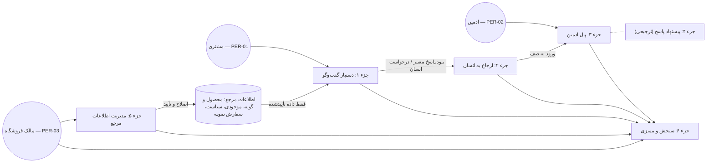

# ‏PRD-02 — راه حل

> ‏**نام کاری محصول:** دستیار هوشمند پشتیبانی مشتری برای فروشگاه‌های آنلاین `[SRC-01]` *(نام تجاری تعیین نشده — Q-08)*
>
> ‏**سطح این بخش:** «چه چیزی، در کل». مسئله و اهداف در PRD-01، نقش‌ها و پنل‌ها و رفتار در PRD-03، قابلیت‌ها و معیار پذیرش در PRD-04، بستر دقیق در PRD-07 و نسخه‌بندی در PRD-11 و PRD-12 می‌آید.
>
> ‏**راهنمای برچسب‌ها:** `[SRC-xx §n]` = برگرفته از منبع (بخش n) · **(پیشنهاد)** = پیشنهاد تیم PRD، تأییدشده در چت PRD-02 · **(فرض A-xx)** = فرض تأییدنشده؛ در Master Index پیگیری می‌شود.
>
> ‏**نسخه 1.1 (CH-32):** شرح «جزء ۳» در §2.3 با رفتار تأییدشده هم‌راستا شد: ادمین مکالمه بسته را بازگشایی نمی‌کند (DEC-240).

### ‏راهنمای شناسه‌ها

| ‏کد | ‏معنی | ‏کجا تعریف شده |
|---|---|---|
| ‏BO | ‏هدف کسب‌وکار (مثلاً BO-03 = کاهش اطلاعات نادرست درباره موجودی) | ‏PRD-01 §1.5 |
| ‏LG | ‏هدف یادگیری نسخه جاری | ‏PRD-01 §1.5.2 |
| ‏PER | ‏پرسونا (PER-01 مشتری، PER-02 ادمین، PER-03 مالک فروشگاه) | ‏PRD-01 §1.3 |
| ‏PS | ‏حوزه مسئله در اسکوپ | ‏PRD-01 §1.6 |
| ‏BR | ‏نیاز کسب‌وکار | ‏BRD §4 |
| ‏FR | ‏رفتار مشخصی که سیستم باید داشته باشد (مثلاً FR-04 = کنترل اعتبار موجودی) | ‏BRD §5، §6 |
| ‏RULE | ‏قاعده داده و موجودی (مثلاً RULE-05 = «ناموجود» با «نامشخص» فرق دارد) | ‏BRD §7 |
| ‏NFR | ‏نیازمندی کیفی، مانند امنیت و پایداری | ‏BRD §10 |
| ‏EP | ‏اپیک پیشنهادی BRD | ‏BRD §13 |
| ‏SP | ‏اصل راه‌حل (این سند) | ‏PRD-02 §2.2 |
| ‏§n | ‏بخش n از یک منبع | — |

---

## ‏۲.۱ بیان راه‌حل

‏**در یک جمله:** یک دستیار گفت‌وگومحور فارسی که پرسش‌های مشتری را فقط از اطلاعات تأییدشده فروشگاه پاسخ می‌دهد و اگر پاسخ معتبر نداشته باشد، درخواست را بدون گم‌شدن به یک صف روشن انسانی می‌سپارد `[SRC-01 §4؛ SRC-02 مقدمه]`.

- ‏**برای مشتری:** گفت‌وگوی متنی فارسی که به پرسش‌های پیش و پس از خرید (مشخصات، سایز و گونه، موجودی، ارسال، سفارش نمونه و مرجوعی) پاسخ می‌دهد و در انتخاب ساده از کاتالوگ راهنمایی می‌کند `[SRC-02 §3]`.
- ‏**ارجاع به انسان:** مشتری در هر مرحله می‌تواند انسان را درخواست کند. اگر دستیار پاسخ معتبر نداشته باشد، درخواست همراه با سابقه و خلاصه در صف ثبت می‌شود `[BR-04]`.
- ‏**برای ادمین:** پنلی که به‌جای همه پیام‌ها فقط صف کارهای نیازمند اقدام را نشان می‌دهد. ادمین در آن مکالمه را تحویل می‌گیرد، پاسخ می‌دهد و نتیجه را ثبت می‌کند `[BR-03، BR-07]`.
- ‏**برای مالک فروشگاه:** بخشی برای اصلاح و تأیید کنترل‌شده محصول، گونه، موجودی (همراه با زمان تأیید) و سیاست‌ها `[BR-05]`. *(جای آن در پنل‌ها ← PRD-03، Q-12)*
- ‏**سنجش:** رویدادهای کلیدی ثبت می‌شوند تا کیفیت پاسخ و نتیجه رسیدگی قابل بررسی باشد `[BR-06]`.
- ‏**بستر نسخه جاری:** صفحه گفت‌وگو روی وب نمایشی و پنل ادمین تحت وب، با داده ساختگی یا ناشناس‌شده `[SRC-02 §3؛ فرض A-03]`. *(جزئیات در PRD-07)*
- ‏**قاعده کلی:** دستیار **اطلاع می‌دهد، می‌پرسد و ثبت می‌کند**؛ **اقدام نمی‌کند** (رزرو، تغییر سفارش، وعده تحویل، استثنا یا تراکنش مالی ندارد) `[SRC-02 §3]`.

---

## ‏۲.۲ اصول راه‌حل

> ‏این اصول بر همه اجزای راه‌حل حاکم‌اند. بخش‌های بعدی (به‌ویژه معیارهای پذیرش PRD-04) می‌توانند به آن‌ها ارجاع دهند؛ مثلاً «طبق SP-04».

| ‏شناسه | ‏اصل | ‏در عمل یعنی | ‏مرجع | ‏هدف کسب‌وکار (BO) |
|---|---|---|---|---|
| ‏SP-01 | ‏پاسخ فقط از منبع تأییدشده | ‏حافظه مدل و پیام قبلی مشتری منبع اطلاعات نیستند؛ منبع و نسخه پاسخ برای ادمین قابل بازبینی است | ‏FR-02، RULE-02 | ‏BO-01، BO-03 |
| ‏SP-02 | ‏«نمی‌دانم» صریح به‌جای پاسخ ساختگی | ‏اگر پاسخ معتبر نباشد، دستیار صریح اعلام می‌کند و درخواست را خودکار به انسان ارجاع می‌دهد (DEC-260) | ‏FR-02؛ SRC-01 §4؛ BRD §8 | ‏BO-01 |
| ‏SP-03 | ‏اول رفع ابهام، بعد پاسخ | ‏اگر سایز، رنگ یا مدل معلوم نباشد، دستیار سؤال تکمیلی می‌پرسد و حدس نمی‌زند | ‏FR-03 | ‏BO-01، BO-03 |
| ‏SP-04 | ‏موجودی در سطح گونه و با اعتبار زمانی | ‏داده منقضی، متعارض یا بدون منبع «نامشخص» است، نه «موجود» و نه «ناموجود» | ‏FR-04؛ RULE-01، 03، 05 | ‏BO-03 |
| ‏SP-05 | ‏اطلاع‌رسانی، نه اقدام | ‏اعلام موجودی به معنای رزرو نیست؛ قیمت، ارسال و مرجوعی فقط از منبع اعلام می‌شوند؛ پیام مشتری نمی‌تواند این مرز را تغییر دهد | ‏SRC-02 §3؛ RULE-07، 08؛ NFR-07 | ‏BO-03 |
| ‏SP-06 | ‏هیچ ارجاعی گم نمی‌شود | ‏پیام موفقیت فقط پس از ثبت پایدار نمایش داده می‌شود؛ اگر ثبت شکست بخورد، مسیر تماس جایگزین ارائه می‌شود | ‏FR-06، FR-12، NFR-05 | ‏BO-05 |
| ‏SP-07 | ‏در هر لحظه فقط یک مالک | ‏پس از تحویل به ادمین، بات ساکت می‌شود و فقط با واگذاری صریح دوباره فعال می‌شود | ‏FR-08؛ BR-07 | ‏BO-03، BO-05 |
| ‏SP-08 | ‏«پاسخ‌داده‌شده» با «حل‌شده» فرق دارد | ‏حل فقط با تأیید مشتری یا ثبت مستند ادمین احراز می‌شود؛ سکوت مشتری کافی نیست | ‏FR-09؛ واژه‌نامه BRD | ‏BO-01، BO-05 |
| ‏SP-09 | ‏هوش مصنوعی برای فهم، قواعد قطعی برای کنترل | ‏AI درخواست را می‌فهمد، زمینه را حفظ می‌کند و خلاصه می‌سازد؛ موجودی، سیاست و اختیارات با قواعد ثابتی کنترل می‌شوند که به مدل وابسته نیستند | ‏SRC-02 §13 (واگذاری انتخاب فنی)؛ زمینه: SRC-05 §5 *(تأییدنشده — DEC-02)* | ‏BO-03 |
| ‏SP-10 | ‏همه چیز قابل سنجش و ممیزی | ‏پاسخ، منبع، ارجاع، تحویل، نتیجه و تغییر داده با عامل و زمان ثبت می‌شوند | ‏BR-06؛ FR-11؛ NFR-08 | ‏BO-01، BO-04 |

---

## ‏۲.۳ اجزای راه‌حل

| ‏جزء | ‏چه می‌کند | ‏پرسونا | ‏نیاز کسب‌وکار (BR) | ‏حوزه مسئله (PS) | ‏اپیک BRD | ‏اولویت |
|---|---|---|---|---|---|---|
| ‏**جزء ۱ — دستیار گفت‌وگو** | ‏پیام فارسی را می‌فهمد، زمینه گفت‌وگو را حفظ می‌کند، ابهام را با سؤال تکمیلی رفع می‌کند، از منبع تأییدشده پاسخ می‌دهد، در انتخاب ساده از کاتالوگ راهنمایی می‌کند و سفارش نمونه و سیاست مرجوعی را توضیح می‌دهد | ‏PER-01 | ‏BR-01، BR-02 | ‏PS-01، PS-02، PS-03 | ‏EP-01، EP-02 | ‏الزامی |
| ‏**جزء ۲ — ارجاع به انسان** | ‏درخواست انسان را در هر مرحله می‌پذیرد؛ ارجاع را با علت، سابقه و خلاصه به‌صورت پایدار ثبت می‌کند؛ اگر ثبت شکست بخورد، مسیر تماس جایگزین می‌دهد | ‏PER-01، PER-02 | ‏BR-04 | ‏PS-04 | ‏EP-04 | ‏الزامی |
| ‏**جزء ۳ — پنل ادمین** | ‏صف اقدام با علت و زمان انتظار را نشان می‌دهد؛ ادمین مکالمه را تحویل می‌گیرد، پاسخ می‌دهد، نتیجه را ثبت می‌کند و بات را متوقف یا فعال می‌کند **(نسخه 1.1 — CH-32)** | ‏PER-02 | ‏BR-03، BR-07 | ‏PS-04 | ‏EP-03، EP-07 | ‏الزامی |
| ‏**جزء ۴ — پیشنهاد پاسخ به ادمین** | ‏پیش‌نویس پاسخ پیشنهاد می‌دهد و ادمین تصمیم نهایی را می‌گیرد | ‏PER-02 | ‏در ماتریس ردیابی BRD نیامده؛ مرتبط با BO-04 *(پیشنهاد — Q-17)* | ‏PS-04 | — | ‏**ترجیحی**؛ فقط پس از تکمیل الزامات `[SRC-02 §3]` |
| ‏**جزء ۵ — مدیریت اطلاعات مرجع** | ‏محصول و گونه، موجودی (با منبع، زمان تأیید و نسخه)، و دانش و سیاست را به‌صورت کنترل‌شده اصلاح و تأیید می‌کند؛ پیش‌نویس تأییدنشده وارد پاسخ نمی‌شود | ‏PER-03 | ‏BR-05، BR-02 | ‏PS-03 | ‏EP-05، EP-02 | ‏الزامی؛ *جای آن در پنل‌ها در PRD-03 تعیین می‌شود (Q-12)* |
| ‏**جزء ۶ — سنجش و ممیزی** | ‏پیام، پاسخ، منبع، ارجاع، تحویل، نتیجه، بازگشایی، خطا و هزینه آزمون را با شناسه مکالمه ثبت می‌کند | ‏PER-03 (و تیم محصول) | ‏BR-06 | ‏PS-05 | ‏EP-06 | ‏الزامی |

> ‏همه هفت اپیک BRD (EP-01 تا EP-07) دست‌کم به یک جزء رسیده‌اند و هیچ جزء الزامی‌ای بدون BR نیست. داده سفارش ساختگی جزو «اطلاعات مرجع» است و مالک آن تیم محصول است `[SRC-02 §7]`.

### ‏نمای کلی راه‌حل

> ‏هدف این دیاگرام: نشان‌دادن رابطه پرسوناها، اجزا و داده مرجع در سطح کلی؛ پیش‌نویس Boundaryهای Use Case در PRD-03. جای جزء ۵ در پنل‌ها هنوز تعیین نشده است (Q-12).

---

## ‏۲.۴ راه‌حل برای هر پرسونا

‏راه‌حل برای بخش‌های مختلف بازار فرقی ندارد، چون بازار هدف یکی است (SMB — فرض A-01). محصول به حوزه کالایی وابسته نیست و پوشاک فقط مثال سناریوست (D-01). **تفاوت راه‌حل فقط در نقش‌هاست:**

| ‏پرسونا | ‏آنچه تجربه می‌کند | ‏اجزا | ‏قول اصلی |
|---|---|---|---|
| ‏PER-01 مشتری | ‏در همان گفت‌وگو پاسخ معتبر می‌گیرد، یا می‌شنود «نمی‌دانم» و مسیر رسیدن به انسان را می‌بیند | ‏۱، ۲ | ‏«یا پاسخ درست، یا ارجاع مطمئن؛ هرگز پاسخ ساختگی» |
| ‏PER-02 ادمین | ‏به‌جای همه پیام‌ها فقط صف کارهای باز را می‌بیند؛ مکالمه را با سابقه و خلاصه تحویل می‌گیرد | ‏۲، ۳، (۴) | ‏«فقط کارهایی را ببین که به تو نیاز دارند» |
| ‏PER-03 مالک فروشگاه | ‏اطلاعات مرجع را کنترل می‌کند و کیفیت پاسخ‌ها را می‌بیند؛ بات بیرون از اختیارات تعریف‌شده اقدامی نمی‌کند | ‏۵، ۶ | ‏«دستیار فقط چیزی را می‌گوید که تو تأیید کرده‌ای» |

---

## ‏۲.۵ ردیابی: درد ← راه‌حل

| ‏درد (PRD-01 §1.4) | ‏پرسونا | ‏چه چیزی آن را حل می‌کند |
|---|---|---|
| ‏انتظار برای پاسخ دستی | ‏PER-01 | ‏جزء ۱؛ زمان پاسخ در PRD-06 تعیین می‌شود *(تعهد ۲۴ ساعته در اسکوپ نیست)* |
| ‏جست‌وجو در صفحات مختلف | ‏PER-01 | ‏جزء ۱ |
| ‏اطلاعات نادرست موجودی | ‏PER-01، PER-03 | ‏جزء ۱ + جزء ۵؛ اصل SP-04 |
| ‏سردرگمی در مواجهه با مشکل | ‏PER-01 | ‏جزء ۱ (اصل SP-03) + جزء ۲ |
| ‏گم‌شدن درخواست حل‌نشده | ‏PER-01 | ‏جزء ۲؛ اصل SP-06 |
| ‏مرور همه پیام‌ها | ‏PER-02 | ‏جزء ۳ (صف اقدام) |
| ‏پراکندگی منابع اطلاعات | ‏PER-02 | ‏جزء ۲ (بسته تحویل ارجاع) + جزء ۵ |
| ‏حجم کار تکراری | ‏PER-02 | ‏جزء ۱ + جزء ۴ (ترجیحی) |
| ‏تداخل پاسخ بات و انسان | ‏PER-02 | ‏جزء ۳؛ اصل SP-07 |
| ‏نبود دید از کیفیت پاسخ‌ها | ‏PER-03 | ‏جزء ۶؛ اصل SP-10 |
| ‏خطر اقدام بات خارج از اختیار | ‏PER-03 | ‏اصل SP-05 |

> ‏**پوشش حوزه‌های مسئله:** PS-01 ← جزء ۱ · PS-02 ← جزء ۱ · PS-03 ← اجزای ۱ و ۵ · PS-04 ← اجزای ۲ و ۳ · PS-05 ← جزء ۶. همه حوزه‌ها پوشش دارند و هیچ جزئی بدون درد نیست.

---

## ‏۲.۶ ارزش و هم‌راستایی با استراتژی

‏**ارزشی که خلق می‌شود** (از نگاه فروشگاه — DEC-12):

- ‏**اعتماد:** مشتری فقط پاسخ مستند می‌گیرد و ادعای بدون پشتوانه درباره موجودی و سیاست داده نمی‌شود (BO-01، BO-03).
- ‏**تمرکز ادمین:** کار باز در صف دیده می‌شود، نه لابه‌لای پیام‌ها (BO-02، BO-05).
- ‏**کنترل:** فروشگاه مالک اطلاعات و اختیارات است و رفتار بات قابل بررسی است (BO-03).
- ‏**آمادگی سنجش:** شواهد لازم برای تصمیم پایلوت فراهم می‌شود (LG-01). صرفه‌جویی و رشد فروش در این نسخه ادعا نمی‌شوند `[SRC-02 §4؛ DEC-16]`.

‏**هم‌راستایی با استراتژی:** سند استراتژی شرکت در منابع موجود نیست. به همین دلیل مسیر سه‌مرحله‌ای محصول `[SRC-01 §10]` مبنای «جهت استراتژیک» قرار گرفته است (DEC-21) و اهداف درآمدی شرکت در PRD-13 و PRD-14 می‌آیند (DEC-12).

- ‏این راه‌حل **مرحله ۱ (AI Customer Support)** است.
- ‏**(پیشنهاد — فرض A-12)** اجزای این نسخه زیربنای مراحل بعدند: داده مرجع معتبر (جزء ۵) پیش‌نیاز پیشنهاد جایگزین در مرحله ۲ است؛ الگوی «اطلاع بده، اقدام نکن» و تحویل به انسان (SP-05، SP-07) پایه «اقدام با اجازه مشتری» در مرحله ۳ است؛ و سنجش (جزء ۶) شواهد ورود به هر مرحله را فراهم می‌کند.

---

## ‏۲.۷ بستر ارائه (سطح کلی)

| ‏کاربر | ‏بستر در نسخه جاری | ‏منبع |
|---|---|---|
| ‏مشتری | ‏صفحه گفت‌وگوی متنی روی **وب نمایشی**؛ فارسی و راست‌به‌چپ | ‏SRC-02 §3، NFR-03 |
| ‏ادمین | ‏پنل تحت وب | ‏SRC-02 §3 |
| ‏مالک فروشگاه | ‏مدیریت اطلاعات مرجع؛ جای آن در PRD-03 تعیین می‌شود | ‏Q-12 |
| ‏داده | ‏ساختگی یا ناشناس‌شده؛ بدون اتصال به سفارش، پرداخت، انبار و CRM | ‏فرض A-03؛ SRC-01 §5 |

> ‏بازار هدف اینستاشاپ‌هاست، اما اتصال اینستاگرام یا هر کانال واقعی به پایلوت و تصمیم D-04 وابسته است. روش ورود ادمین و سایر جزئیات بستر در PRD-07 می‌آیند.

---

## ‏۲.۸ تکامل راه‌حل

| ‏مرحله | ‏تغییر در راه‌حل | ‏منبع |
|---|---|---|
| ‏نسخه جاری (Prototype) | ‏شش جزء بالا با داده نمونه و وب نمایشی | ‏SRC-02 §3 |
| ‏پایلوت | ‏منبع و کانال واقعی، همگام‌سازی موجودی، نقش‌ها و شیفت، پایش تأخیر و مسیر تماس جایگزین واقعی | ‏SRC-02 §3، §12 |
| ‏مرحله ۲ — Shopping Assistant | ‏پیشنهاد جایگزین، رفع موانع خرید (از جمله Purchase Rescue) و شخصی‌سازی | ‏SRC-01 §6، §10 |
| ‏مرحله ۳ — Agentic Commerce | ‏اجرای فرایندهای چندمرحله‌ای با اجازه مشتری | ‏SRC-01 §6.5 |

> ‏جزئیات هر انتشار در PRD-11 و PRD-12 می‌آید.

---

## ‏۲.۹ فرضیات و سؤالات باز مرتبط با این بخش

| ‏شناسه | ‏موضوع | ‏اثر بر این بخش | ‏محل تعیین تکلیف |
|---|---|---|---|
| ‏A-01 | ‏بازار اولیه: SMB با تمرکز بر اینستاشاپ‌ها | ‏راه‌حل یکسان برای بازار (۲.۴) | ‏PRD-13 / D-01 |
| ‏A-03 | ‏داده ساختگی یا ناشناس و وب نمایشی | ‏بستر (۲.۷) | ‏PRD-07 |
| ‏A-10 | ‏مسئول موجودی، مالک داده و مالک فروشگاه یک نقش‌اند | ‏پرسونای جزء ۵ | ‏PRD-03 |
| ‏A-12 | ‏اجزای نسخه جاری زیربنای مراحل ۲ و ۳اند | ‏هم‌راستایی استراتژی (۲.۶) | ‏PRD-12 |
| ‏Q-12 | ‏جای «مدیریت اطلاعات مرجع»: پنل مستقل یا بخشی از پنل ادمین | ‏جزء ۵، دیاگرام، بستر | ‏PRD-03 |
| ‏Q-17 | ‏ردیابی جزء ۴ (پیشنهاد پاسخ) به یک BR | ‏جدول اجزا (۲.۳) | ‏PRD-04 |
| ‏D-01 | ‏حوزه پایلوت: عمومی یا پوشاک | ‏مستقل‌بودن راه‌حل از حوزه کالایی | ‏PRD-03، PRD-04 |
| ‏D-04 | ‏کانال واقعی و امکان اتصال رسمی | ‏بستر و تکامل (۲.۷، ۲.۸) | ‏PRD-07، PRD-12 |

### ‏تاریخچه نسخه

| ‏نسخه | ‏تاریخ | ‏تغییر |
|---|---|---|
| ‏1.0 | ‏2026-11-10 | ‏نسخه نخست تأییدشده |
| ‏1.1 | ‏2026-11-11 | ‏**CH-32 (DEC-240؛ چت PRD-15):** عبارت «و مکالمه بسته‌شده را بازگشایی می‌کند» از شرح «جزء ۳» در §2.3 برداشته شد. هیچ اصل، جزء یا ردیابی دیگری تغییر نکرد |
| ‏1.2 | ‏2026-11-12 | ‏**CH-42 (DEC-260؛ چت Q-42):** در اصل SP-02 «مسیر ارجاع را پیشنهاد می‌دهد» به «درخواست را خودکار به انسان ارجاع می‌دهد» تغییر کرد. هیچ اصل یا جزء دیگری تغییر نکرد |
