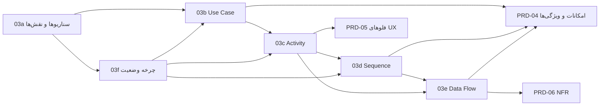

# ‏PRD-03 — دیاگرام‌های رفتاری

> ‏**نام کاری محصول:** دستیار هوشمند پشتیبانی مشتری برای فروشگاه‌های آنلاین `[SRC-01]` *(نام تجاری تعیین نشده — Q-08)*
>
> ‏**هدف این بخش (طبق تمپلیت):** بصری‌سازی و مستندسازی جنبه‌های پویای سیستم: تعامل سیستم با کاربر و سیستم‌های دیگر، جابه‌جایی داده، ارتباط اجزا با هم، و رویدادهایی که وضعیت را تغییر می‌دهند `[SRC-03 §3]`. طبق DEC-10، سناریوها و چرخه وضعیت هم در این بخش‌اند.
>
> ‏**ساختار (DEC-06، DEC-29):** این بخش در شش زیرسند نوشته شده است. این فایل فهرست، ترتیب مطالعه و نقشه ارتباط آن‌هاست.

---

## ‏۳.۱ زیرسندها

| ‏ترتیب مطالعه | ‏زیرسند | ‏محتوا | ‏شناسه‌های اصلی | ‏نسخه |
|---|---|---|---|---|
| ‏۱ | ‏`PRD-03a - Scenarios & Actors.md` | ‏سناریوهای روایی To-Be (یک اصلی و سه گونه)، نقش‌ها و اجزای منطقی، کارها، مقایسه As-Is و To-Be، شرح کامل UC-01 تا UC-08 | ‏ACT-01 تا ACT-04 | ‏1.0 ✅ |
| ‏۲ | ‏`PRD-03f - State.md` | ‏چرخه وضعیت مکالمه S1 تا S6، دوازده انتقال، انتقال‌های ممنوع، پرچم‌ها | ‏TR-00 تا TR-11 | ‏1.0 ✅ |
| ‏۳ | ‏`PRD-03b - Use Case.md` | ‏سه مرز سیستم و نوزده Use Case، ردیابی به FR و UC | ‏UCD-01 تا UCD-19 | ‏1.0 ✅ |
| ‏۴ | ‏`PRD-03c - Activity.md` | ‏هفت دیاگرام Activity با Swimlane، جدول تصمیم اعتبار موجودی، فهرست علت‌های ارجاع | ‏ACD-01 تا ACD-07 | ‏1.0 ✅ |
| ‏۵ | ‏`PRD-03d - Sequence.md` | ‏شش دیاگرام Sequence برای تعامل‌های حساس (ثبت ارجاع، کنترل موجودی، هم‌زمانی، اصلاح داده، خطا، بازگشایی) | ‏SQD-01 تا SQD-06 | ‏1.0 ✅ |
| ‏۶ | ‏`PRD-03e - Data Flow.md` | ‏DFD سطح صفر و یک، نُه محل ذخیره داده، مرز داده با سرویس مدل | ‏فرایند ۱ تا ۷؛ DS-01 تا DS-09 | ‏1.0 ✅ |

> ‏**چرا این ترتیب:** سناریو و نقش‌ها پایه همه‌اند؛ وضعیت‌ها پیش از دیاگرام‌ها تثبیت شدند چون Use Case، Activity و Sequence به آن‌ها ارجاع می‌دهند (DEC-29).

## ‏۳.۲ راهنمای شناسه‌های این بخش

| ‏کد | ‏معنی | ‏تعریف |
|---|---|---|
| ‏ACT | ‏نقش: ACT-01 مشتری · ACT-02 ادمین پشتیبانی · ACT-03 مالک فروشگاه / مالک داده · ACT-04 سرویس مدل (بیرونی) | ‏03a §3a.2 |
| ‏UC | ‏سناریوی کسب‌وکاری BRD (UC-01 تا UC-08) — بدون تغییر | ‏BRD §9؛ 03a §3a.5 |
| ‏S1 … S6 | ‏وضعیت اصلی مکالمه — بدون تغییر از BRD | ‏03f §3f.1 |
| ‏TR | ‏انتقال وضعیت | ‏03f §3f.3 |
| ‏UCD | ‏Use Case در دیاگرام | ‏03b |
| ‏ACD | ‏دیاگرام Activity | ‏03c |
| ‏SQD | ‏دیاگرام Sequence | ‏03d |
| ‏DS | ‏محل ذخیره داده | ‏03e §3e.4 |

## ‏۳.۳ نقشه ارتباط زیرسندها

## ‏۳.۴ ردیابی سراسری (خلاصه)

| ‏سناریو | ‏Use Case | ‏Activity | ‏Sequence | ‏انتقال‌های اصلی |
|---|---|---|---|---|
| ‏UC-01 پرسش متداول | ‏UCD-01، 05، 10 | ‏ACD-01 | — | ‏TR-01، 02، 07، 08 |
| ‏UC-02 انتخاب گونه | ‏UCD-02، 05 | ‏ACD-02 | ‏SQD-02 | ‏TR-01، 02، 03 |
| ‏UC-03 درخواست انسان | ‏UCD-04 | ‏ACD-03 | ‏SQD-01 | ‏TR-03، 05 |
| ‏UC-04 اصلاح موجودی | ‏UCD-15، 16، 17 | ‏ACD-04 | ‏SQD-04 | — |
| ‏UC-05 مرجوعی نمونه | ‏UCD-03، 05 | ‏ACD-01 | — | ‏TR-01، 03، 07 |
| ‏UC-06 رسیدگی ادمین | ‏UCD-06 تا 11، 14 | ‏ACD-05 | ‏SQD-03 | ‏TR-04، 06، 07، 08، 11 |
| ‏UC-07 بازگشایی | ‏UCD-01، 10 | ‏ACD-06 | ‏SQD-06 | ‏TR-09 |
| ‏UC-08 خطای سرویس | ‏UCD-04، 12 | ‏ACD-07 | ‏SQD-05 | ‏TR-10 |

## ‏۳.۵ رفتارهایی که این بخش به BRD افزود

> ‏همه این موارد در چت PRD-03 تأیید شده‌اند و در Master Index ثبت‌اند. جزئیات و پشتوانه در زیرسند مربوطه.

| ‏افزوده | ‏زیرسند | ‏تصمیم / تغییر |
|---|---|---|
| ‏«مورد مغایرت داده» و فهرست آن در پنل مدیریت فروشگاه (بدون اعلان) | ‏03a، 03c، 03e | ‏DEC-34، DEC-35 |
| ‏هر پاسخ اطلاعاتی با درخواست تأیید حل تمام می‌شود | ‏03f | ‏DEC-37 |
| ‏توقف بات به‌عنوان پرچم سطح فروشگاه؛ پیام تازه در توقف به صف می‌رود (TR-10) | ‏03f | ‏DEC-38، DEC-39 |
| ‏تحویل مستقیم مکالمه بات توسط ادمین (TR-11؛ از 03f 1.2 از راه ارجاع پایدار) | ‏03f | ‏DEC-42؛ CH-06؛ DEC-261 |
| ‏فهرست علت‌های ارجاع (شش علت؛ علت هفتم با DEC-261) | ‏03c | ‏DEC-47؛ DEC-261 |
| ‏بازگشایی با سابقه انسانی، ارجاع تازه با پیوند به قبلی | ‏03d | ‏DEC-49 |
| ‏گزینه همیشه در دسترس برای درخواست انسان، مستقل از سرویس مدل | ‏03d | ‏DEC-50 |
| ‏بررسی مالکیت پیش از انتشار پاسخ؛ بررسی متن مدل با نتیجه قواعد | ‏03d | ‏DEC-51، DEC-52 |
| ‏محل‌های ذخیره DS-07 تا DS-09 و دو فیلد تازه ارجاع | ‏03e | ‏DEC-54؛ CH-07 |
| ‏مرز داده با سرویس مدل | ‏03e | ‏DEC-56 |

## ‏۳.۶ نقاط باز منتقل‌شده به بخش‌های بعد

| ‏شناسه | ‏موضوع | ‏بخش مقصد |
|---|---|---|
| ‏A-09 | ‏حد «دو نوبت» رفع ابهام | ‏PRD-04 |
| ‏D-02 | ‏مرجع موجودی و آستانه زمانی اعتبار | ‏PRD-04 |
| ‏D-05 | ‏ساعات انسانی، زمان پاسخ و مسیر تماس جایگزین | ‏PRD-04 |
| ‏D-06 | ‏نگهداری داده، حذف، دسترسی سرویس‌دهنده مدل، مدت نگهداری رویدادها | ‏PRD-06 |
| ‏~~D-07~~ | ‏✅ بسته ← DEC-262 (بازه بازگشایی ۷ روز برای Prototype) | ‏PRD-04-EP06 |
| ‏Q-17 | ‏ردیابی UCD-14 (پیشنهاد پاسخ) به BR | ‏PRD-04 |
| ‏Q-26 | ‏حد زمانی «تأخیر بیش از حد» سرویس مدل | ‏PRD-06 |
| ‏Q-27 | ‏فیلدهای نهایی DS-07 تا DS-09، متن پاسخ‌های قالبی و برچسب علت‌های ارجاع | ‏PRD-04 |
| ‏— | ‏ساختار صفحات، جای فیزیکی پنل مدیریت فروشگاه، شکل گزینه درخواست انسان | ‏PRD-05، PRD-07 |

---

### ‏تاریخچه تغییرات این سند

| ‏نسخه | ‏تاریخ | ‏تغییر |
|---|---|---|
| ‏1.1 | ‏2026-11-12 | ‏§3.5: ردیف تحویل مستقیم و فهرست علت‌ها (DEC-261؛ CH-43)؛ نقاط باز: D-07 بسته (DEC-262؛ CH-44) |
