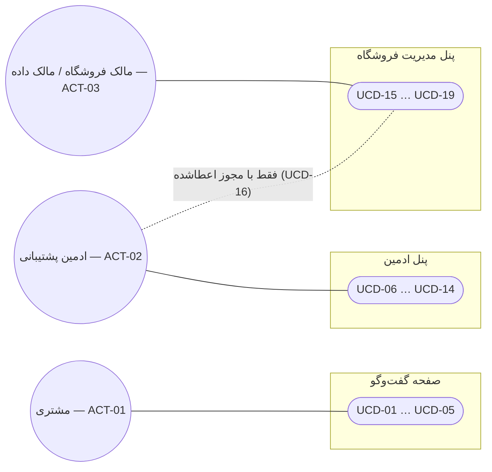
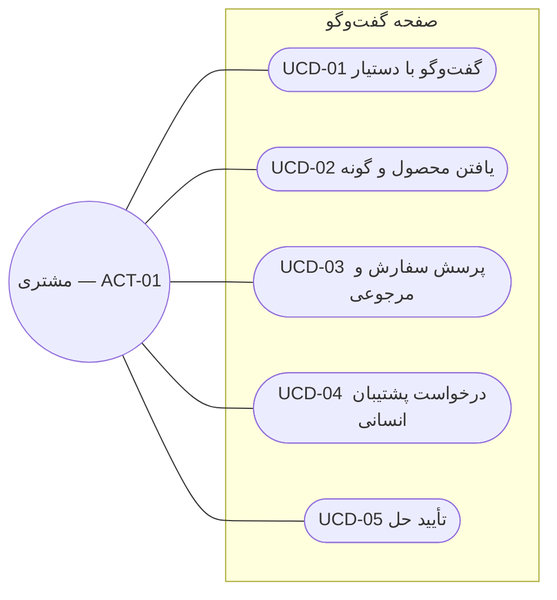
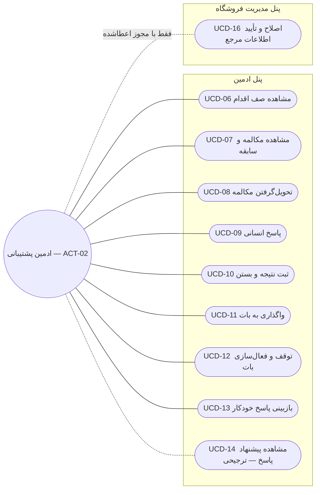
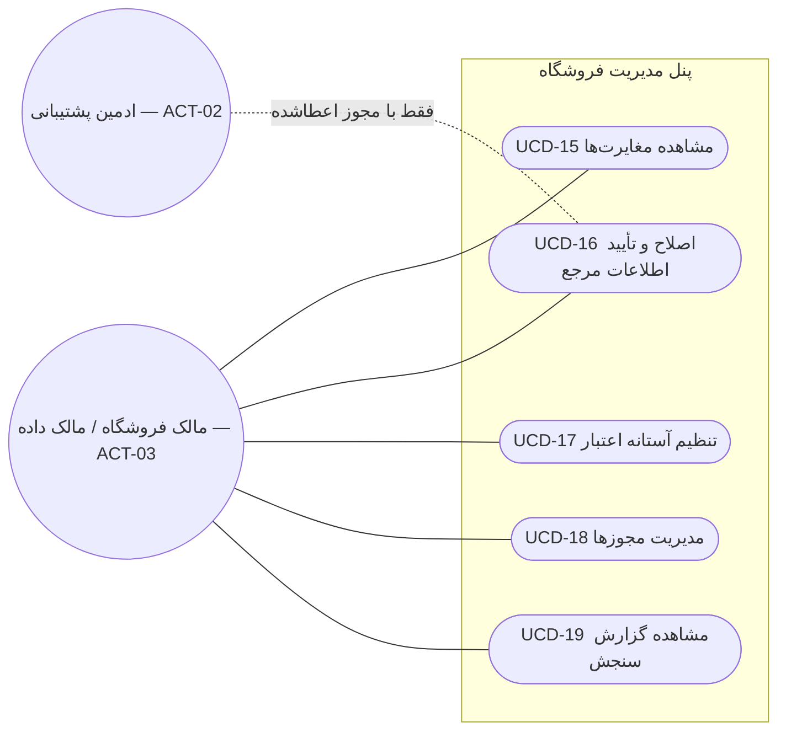

# ‏PRD-03b — دیاگرام Use Case

> ‏**سطح این زیرسند:** «هر نقش با سیستم چه می‌تواند بکند». یک مرز سیستم برای پنل هر نقش انسانی و Use Caseهای داخل آن، به سبک اسلاید ۲۴ SRC-06. منبع Use Caseها جدول کارهای PRD-03a §3a.3 است. جریان هر Use Case در 03c و 03d، و استوری و معیار پذیرش در PRD-04 می‌آیند.
>
> ‏**راهنمای برچسب‌ها:** `[SRC-xx §n]` = برگرفته از منبع · **(پیشنهاد)** = پیشنهاد تیم PRD، تأییدشده در چت PRD-03 · ⚠️ = نقطه باز.

### ‏راهنمای شناسه‌ها

| ‏کد | ‏معنی | ‏کجا تعریف شده |
|---|---|---|
| ‏UCD | ‏Use Case در دیاگرام (مثلاً UCD-08 = تحویل‌گرفتن مکالمه) | ‏همین سند |
| ‏ACT | ‏نقش (ACT-01 مشتری، ACT-02 ادمین، ACT-03 مالک فروشگاه / مالک داده) | ‏PRD-03a §3a.2 |
| ‏UC | ‏سناریوی کسب‌وکاری BRD (UC-01 تا UC-08) | ‏BRD §9؛ PRD-03a §3a.5 |
| ‏TR | ‏انتقال وضعیت مکالمه | ‏PRD-03f §3f.3 |
| ‏S1 … S6 | ‏وضعیت اصلی مکالمه | ‏PRD-03f §3f.1 |
| ‏FR / BR / NFR | ‏نیازمندی عملکردی / نیاز کسب‌وکار / نیازمندی کیفی | ‏BRD §4 تا §10 |
| ‏جزء ۱ … ۶ | ‏اجزای راه‌حل | ‏PRD-02 §2.3 |
| ‏DEC / Q | ‏تصمیم / سؤال باز | ‏Master Index |

---

## ‏۳b.۱ قواعد این دیاگرام‌ها

- ‏**یک مرز برای هر نقش انسانی:** صفحه گفت‌وگو، پنل ادمین، پنل مدیریت فروشگاه (DEC-31). مرزها منطقی‌اند؛ پیاده‌سازی فیزیکی در PRD-05 و PRD-07.
- ‏**بدون include و extend:** وابستگی Use Caseها در ستون «پیش‌نیاز» جدول‌ها آمده است **(پیشنهاد — DEC-43)**.
- ‏**ACT-04 سرویس مدل در این دیاگرام نیست:** فقط نقش‌های انسانی، مثل SRC-06؛ سرویس مدل در 03d و 03e ظاهر می‌شود (DEC-43).
- ‏**خط‌چین:** Use Case ترجیحی (جزء ۴) یا دسترسی مشروط به مجوز اعطاشده (DEC-30).
- ‏**نشانه‌گذاری Mermaid:** مثل بازترسیم SRC-06، flowchart با subgraph؛ دایره = نقش، کپسول = Use Case، کادر = مرز سیستم.

---

## ‏۳b.۲ نمای کلی

| ‏مرز | ‏نقش | ‏تعداد UCD | ‏اجزای راه‌حل | ‏اپیک BRD |
|---|---|---|---|---|
| ‏صفحه گفت‌وگو | ‏ACT-01 | ‏۵ | ‏جزء ۱، جزء ۲ | ‏EP-01، EP-02، EP-04 |
| ‏پنل ادمین | ‏ACT-02 | ‏۹ (یکی ترجیحی) | ‏جزء ۳، جزء ۴ | ‏EP-03، EP-07 |
| ‏پنل مدیریت فروشگاه | ‏ACT-03 | ‏۵ | ‏جزء ۵، جزء ۶ | ‏EP-05، EP-06، EP-02 |

---

## ‏۳b.۳ مرز «صفحه گفت‌وگو» — مشتری

| ‏UCD | ‏Use Case | ‏شرح کوتاه | ‏FR | ‏UC | ‏TR | ‏پیش‌نیاز |
|---|---|---|---|---|---|---|
| ‏UCD-01 | ‏گفت‌وگو با دستیار | ‏ارسال پیام فارسی، دریافت پاسخ از منبع تأییدشده یا «نمی‌دانم» صریح، پاسخ به سؤال تکمیلی؛ حفظ زمینه در همان مکالمه؛ پیام تازه در مکالمه بسته آن را بازگشایی می‌کند | ‏FR-01، FR-02 | ‏UC-01، UC-07 | ‏TR-00، TR-01، TR-02، TR-09 | — |
| ‏UCD-02 | ‏یافتن محصول و گونه | ‏پرسیدن موجودی یک گونه یا توصیف نیاز؛ رفع ابهام؛ پیشنهاد ساده فقط از کاتالوگ؛ اعلام «نامشخص» برای داده نامعتبر | ‏FR-03، FR-04 | ‏UC-02 | ‏TR-01، TR-02، TR-03 | ‏UCD-01 |
| ‏UCD-03 | ‏پرسش سفارش و مرجوعی | ‏وضعیت سفارش نمونه و سیاست مرجوعی؛ بدون اقدام مالی یا وعده تحویل | ‏FR-05 | ‏UC-05 | ‏TR-01، TR-03 | ‏UCD-01 |
| ‏UCD-04 | ‏درخواست پشتیبان انسانی | ‏در هر مرحله؛ تأیید فقط پس از ثبت پایدار؛ مسیر تماس جایگزین در شکست ثبت | ‏FR-06 | ‏UC-03، UC-08 | ‏TR-03 | ‏UCD-01 |
| ‏UCD-05 | ‏تأیید حل | ‏پاسخ مشتری به درخواست تأیید حل (S2) | ‏FR-09 | ‏UC-01، UC-02، UC-05 | ‏TR-07 | ‏UCD-01 |

> ‏مشتری فقط مکالمه خود را می‌بیند و به هیچ پنلی دسترسی ندارد `[SRC-02 §10؛ NFR-04]`.

---

## ‏۳b.۴ مرز «پنل ادمین» — ادمین پشتیبانی

| ‏UCD | ‏Use Case | ‏شرح کوتاه | ‏FR | ‏UC | ‏TR | ‏پیش‌نیاز |
|---|---|---|---|---|---|---|
| ‏UCD-06 | ‏مشاهده صف اقدام | ‏مکالمات S3 و S4 جدا از مکالمات بات؛ فیلتر وضعیت و مسئول؛ ترتیب قدیمی‌ترین ارجاع باز؛ علت، آخرین پیام، زمان انتظار، مسئول و نشان خوانده‌نشده | ‏FR-07 | ‏UC-06 | — | — |
| ‏UCD-07 | ‏مشاهده مکالمه و سابقه | ‏بسته تحویل ارجاع و تاریخچه کامل؛ بازکردن، وضعیت را تغییر نمی‌دهد | ‏FR-07، FR-02 | ‏UC-06 | — | — |
| ‏UCD-08 | ‏تحویل‌گرفتن مکالمه | ‏از صف (S3)، یا از مکالمه بات (S1، S2) با «تحویل مستقیم» که نخست ارجاع می‌سازد (DEC-261)؛ فقط یک مالک؛ توقف بات | ‏FR-08 | ‏UC-06 | ‏TR-04، TR-11 | ‏UCD-07 |
| ‏UCD-09 | ‏پاسخ انسانی | ‏ارسال پاسخ به مشتری | ‏FR-08 | ‏UC-06 | — | ‏UCD-08 |
| ‏UCD-10 | ‏ثبت نتیجه و بستن | ‏بستن مستند (S5) یا بدون تأیید (S6)؛ ثبت «موضوع جدید / ادامه» در بازگشایی | ‏FR-09 | ‏UC-06، UC-01، UC-07 | ‏TR-07، TR-08 | ‏UCD-08 |
| ‏UCD-11 | ‏واگذاری به بات | ‏فقط صریح؛ هنگام توقف کلی بات مجاز نیست | ‏BR-07 | ‏UC-06 | ‏TR-06 | ‏UCD-08 |
| ‏UCD-12 | ‏توقف و فعال‌سازی بات | ‏پرچم سطح فروشگاه؛ با ثبت عامل و زمان؛ **فقط ادمین** (DEC-44) | ‏FR-12؛ NFR-08 | ‏UC-08 | ‏TR-10 | — |
| ‏UCD-13 | ‏بازبینی پاسخ خودکار | ‏مرور نمونه‌ای پاسخ‌ها همراه با منبع و نسخه | ‏FR-02 | — | ‏(ممکن است به TR-11 برسد) | — |
| ‏UCD-14 | ‏مشاهده پیشنهاد پاسخ *(ترجیحی)* | ‏پیش‌نویس پیشنهادی؛ تصمیم نهایی با ادمین | ‏— (Q-17) | ‏UC-06 | — | ‏UCD-08 |
| ‏UCD-16 | ‏اصلاح و تأیید اطلاعات مرجع | ‏Use Case پنل مدیریت فروشگاه؛ ادمین فقط با مجوز اعطاشده (§3b.5) | ‏FR-10 | ‏UC-04 | — | ‏مجوز (UCD-18) |

> ‏ادمین فقط مکالمات مجاز فروشگاه را می‌بیند و فقط اختیارات مجاز دارد `[SRC-02 §10؛ NFR-04]`.

---

## ‏۳b.۵ مرز «پنل مدیریت فروشگاه» — مالک فروشگاه / مالک داده

| ‏UCD | ‏Use Case | ‏شرح کوتاه | ‏FR | ‏UC | ‏TR | ‏پیش‌نیاز |
|---|---|---|---|---|---|---|
| ‏UCD-15 | ‏مشاهده مغایرت‌ها | ‏فهرست موارد مغایرت داده (منقضی، متعارض، بدون منبع) برای هر گونه؛ بدون اعلان | ‏FR-04، FR-10 | ‏UC-04 | — | — |
| ‏UCD-16 | ‏اصلاح و تأیید اطلاعات مرجع | ‏اصلاح محصول و گونه، موجودی، دانش و سیاست، سفارش نمونه؛ پیش‌نویس تأییدنشده وارد پاسخ نمی‌شود؛ نسخه و عامل ثبت می‌شود؛ بستن مورد مغایرت | ‏FR-10 | ‏UC-04 | — | ‏(معمولاً UCD-15) |
| ‏UCD-17 | ‏تنظیم آستانه اعتبار | ‏آستانه زمانی اعتبار موجودی؛ مالک، یا ادمین دارای مجوز «تغییر آستانه اعتبار» (DEC-259)، با ثبت تغییر | ‏FR-04؛ ماتریس مجوز | ‏UC-04 | — | — |
| ‏UCD-18 | ‏مدیریت مجوزها | ‏اعطا یا لغو مجوز اصلاح منبع به ادمین | ‏NFR-04؛ ماتریس مجوز | — | — | — |
| ‏UCD-19 | ‏مشاهده گزارش سنجش | ‏کیفیت پاسخ، ارجاع، نتیجه، بازگشایی، خطا و هزینه آزمون | ‏FR-11؛ BR-06؛ NFR-09 | ‏همه | — | — |

> ‏**مالک داده و دیدن مکالمه:** طبق ماتریس مجوز، مالک داده مکالمه را «طبق نقش پشتیبانی اعطاشده» می‌بیند و تحویل و بستن را «فقط با نقش ادمین» انجام می‌دهد `[SRC-02 §10]`. پس اگر مالک فروشگاه بخواهد به مکالمه رسیدگی کند، با نقش ادمین و از پنل ادمین این کار را می‌کند؛ Use Case جداگانه‌ای برای آن تعریف نمی‌شود **(پیشنهاد)**.

---

## ‏۳b.۶ ردیابی

### ‏پوشش FR

| ‏FR | ‏UCD |
|---|---|
| ‏FR-01 گفت‌وگوی فارسی و حفظ زمینه | ‏UCD-01 |
| ‏FR-02 پاسخ مستند | ‏UCD-01، UCD-07، UCD-13 |
| ‏FR-03 رفع ابهام و یافتن محصول | ‏UCD-02 |
| ‏FR-04 کنترل اعتبار موجودی | ‏UCD-02، UCD-15، UCD-17 |
| ‏FR-05 سفارش و مرجوعی نمونه | ‏UCD-03 |
| ‏FR-06 درخواست و ثبت ارجاع | ‏UCD-04 |
| ‏FR-07 صف اقدام | ‏UCD-06، UCD-07 |
| ‏FR-08 تحویل و پاسخ انسانی | ‏UCD-08، UCD-09 |
| ‏FR-09 نتیجه و بازگشایی | ‏UCD-05، UCD-10 |
| ‏FR-10 به‌روزرسانی کنترل‌شده منابع | ‏UCD-15، UCD-16 |
| ‏FR-11 ثبت رویداد | ‏UCD-19 *(ثبت خودکار است؛ مشاهده در UCD-19)* |
| ‏FR-12 توقف و مدیریت خطا | ‏UCD-12 *(رفتار خطا در 03c و 03d)* |

> ‏همه FRها دست‌کم به یک UCD رسیده‌اند. تنها UCD بدون FR، UCD-14 (ترجیحی) است که به Q-17 وابسته است.

### ‏پوشش سناریوها

| ‏UC | ‏UCD |
|---|---|
| ‏UC-01 پرسش متداول | ‏UCD-01، UCD-05، UCD-10 |
| ‏UC-02 انتخاب گونه | ‏UCD-02، UCD-05 |
| ‏UC-03 درخواست انسان | ‏UCD-04 |
| ‏UC-04 اصلاح موجودی | ‏UCD-15، UCD-16، UCD-17 |
| ‏UC-05 مرجوعی نمونه | ‏UCD-03، UCD-05 |
| ‏UC-06 رسیدگی ادمین | ‏UCD-06 تا UCD-11، UCD-14 |
| ‏UC-07 بازگشایی | ‏UCD-01، UCD-10 |
| ‏UC-08 خطای سرویس | ‏UCD-04، UCD-12 |

---

## ‏۳b.۷ تصمیمات و نقاط باز

| ‏شناسه پیشنهادی | ‏تصمیم |
|---|---|
| ‏DEC-43 | ‏دیاگرام Use Case بدون include و extend و فقط با نقش‌های انسانی؛ ACT-04 در 03d و 03e؛ شماره‌گذاری UCD-01 تا UCD-19 برای سه مرز |
| ‏DEC-44 | ‏توقف و فعال‌سازی بات (UCD-12) فقط در اختیار ادمین است، تا زمانی که منبعی خلاف آن نگوید |

| ‏شناسه | ‏موضوع | ‏محل تعیین تکلیف |
|---|---|---|
| ‏Q-17 | ‏ردیابی UCD-14 (پیشنهاد پاسخ) به BR | ‏PRD-04 |
| ‏— | ‏ساختار صفحات هر مرز و جای فیزیکی پنل مدیریت فروشگاه | ‏PRD-05، PRD-07 (DEC-31) |
| ‏— | ‏روش ورود ادمین و مالک فروشگاه | ‏PRD-07 `[SRC-02 §13]` |

---

### ‏تاریخچه تغییرات این سند

| ‏نسخه | ‏تاریخ | ‏تغییر |
|---|---|---|
| ‏1.1 | ‏2026-11-12 | ‏UCD-17: ادمین دارای مجوز «تغییر آستانه اعتبار» هم می‌تواند (DEC-259؛ CH-41). UCD-08: تحویل مستقیم نخست ارجاع می‌سازد (DEC-261؛ CH-43). دیاگرام‌ها تغییر نکردند |
