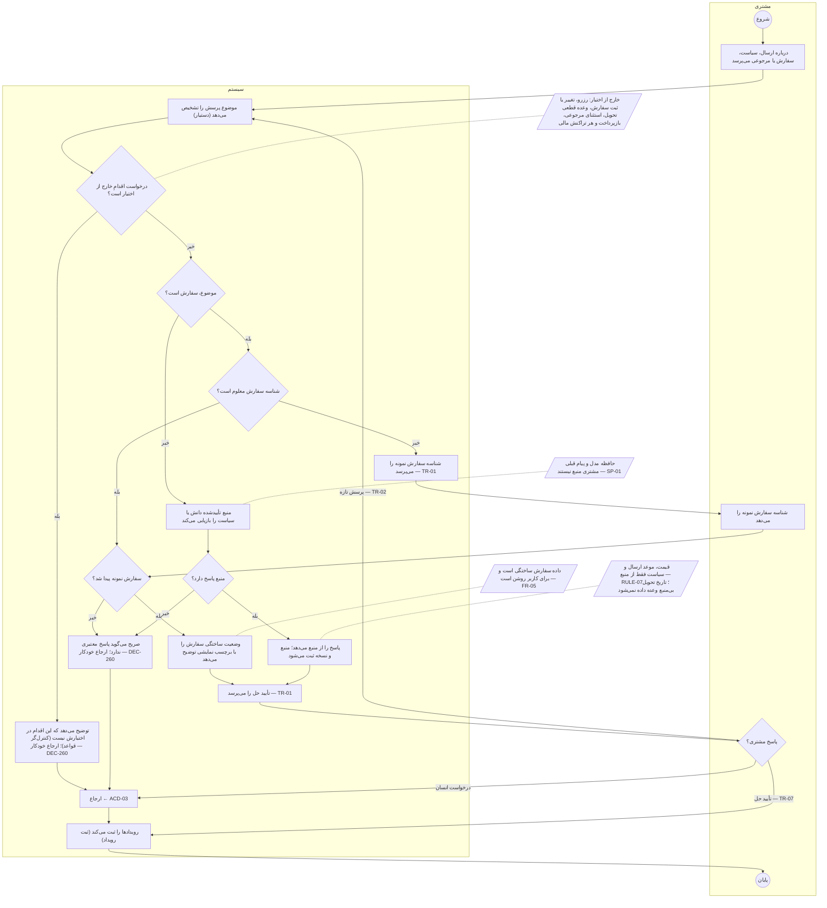
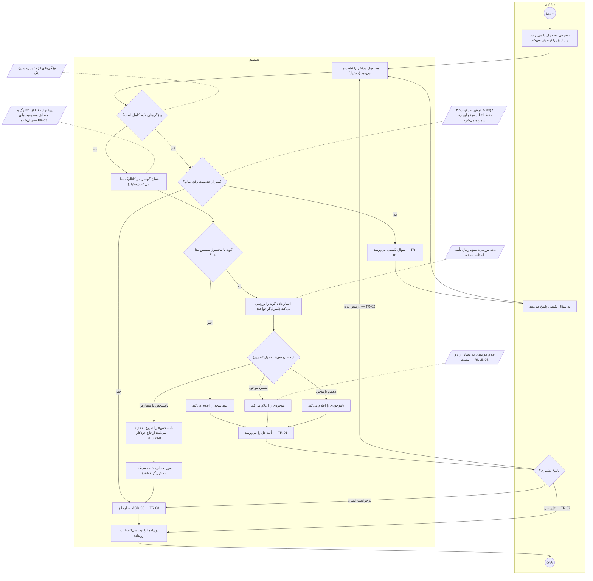
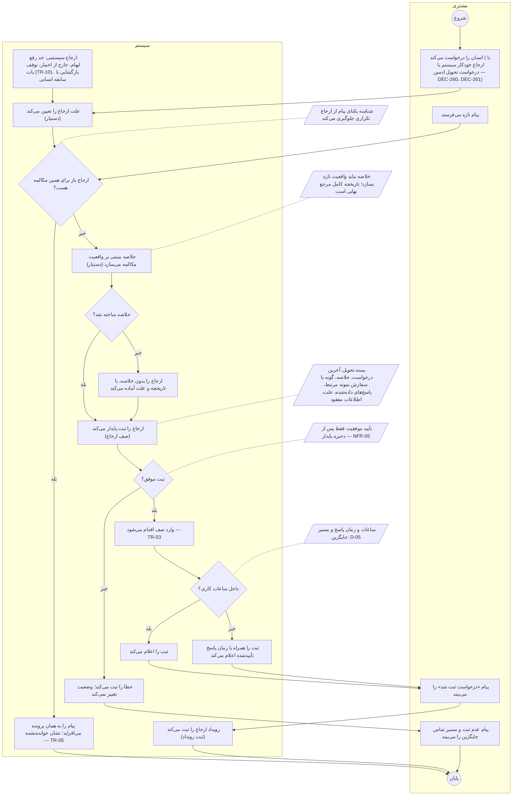
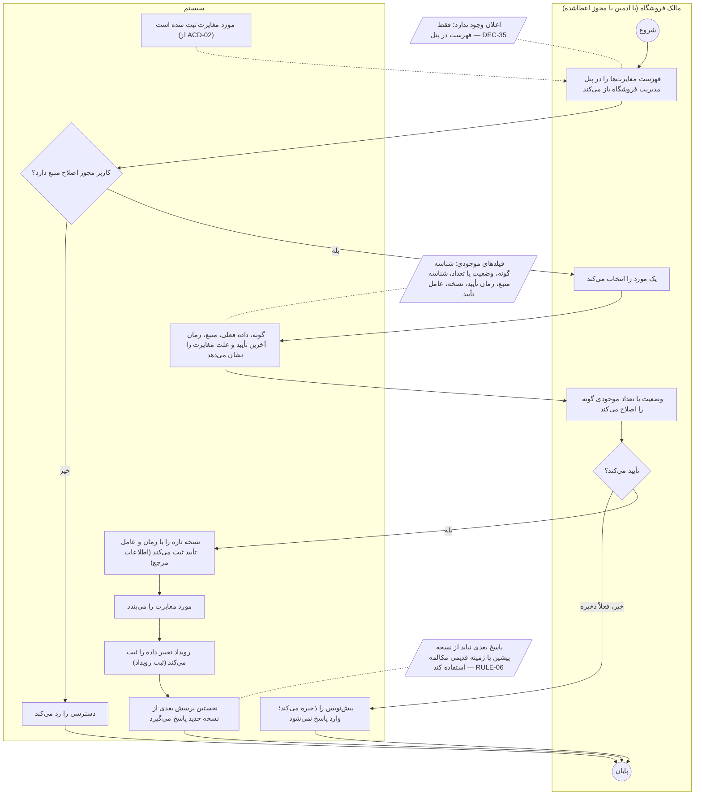
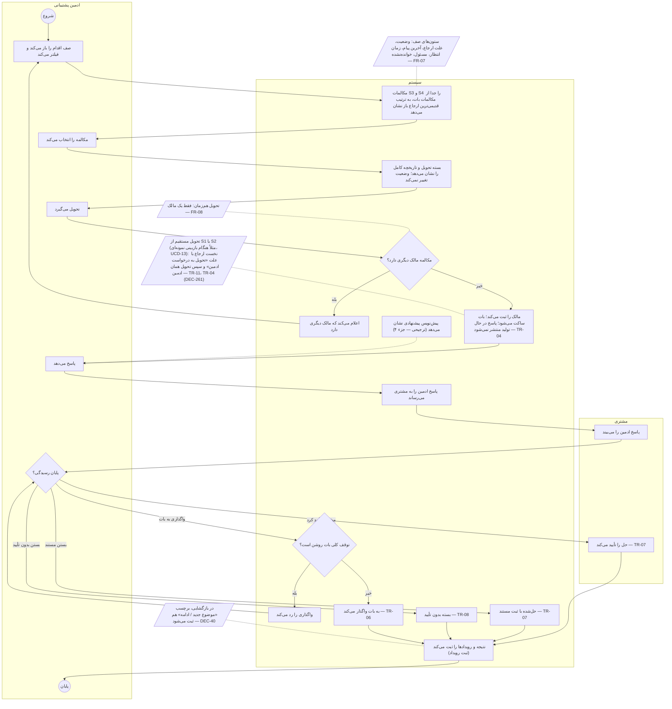
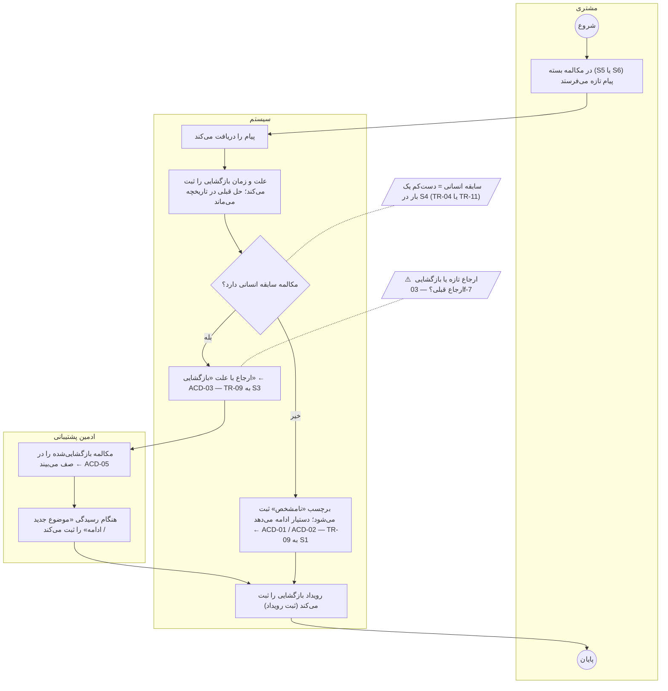
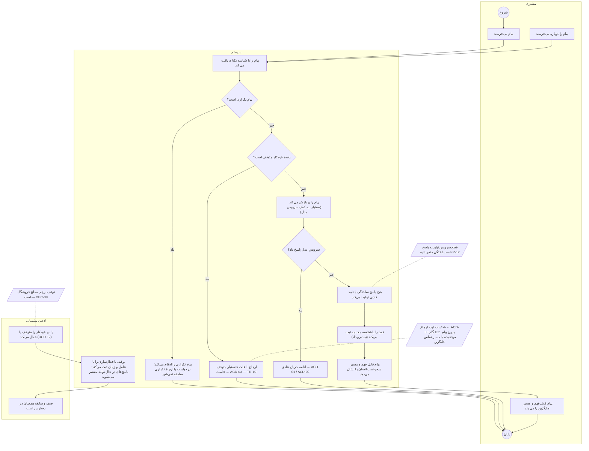

# ‏PRD-03c — دیاگرام‌های Activity

> ‏**سطح این زیرسند:** «گام‌به‌گام، چه کسی چه می‌کند و کجا تصمیم گرفته می‌شود». یک دیاگرام برای هر سناریوی کلیدی، با ستون (Swimlane) برای نقش‌ها و سیستم و یادداشت داده برای هر گام، به سبک اسلاید ۲۵ SRC-06. توالی پیام بین اجزا در 03d و جریان داده در 03e می‌آید. متن پیام‌های رابط در PRD-04 (DEC-33).
>
> ‏**راهنمای برچسب‌ها:** `[SRC-xx §n]` = برگرفته از منبع · **(پیشنهاد)** = پیشنهاد تیم PRD، تأییدشده در چت PRD-03 · **(فرض A-xx)** = فرض تأییدنشده · ⚠️ = نقطه باز.

### ‏راهنمای شناسه‌ها

| ‏کد | ‏معنی | ‏کجا تعریف شده |
|---|---|---|
| ‏ACD | ‏دیاگرام Activity (مثلاً ACD-03 = ثبت ارجاع) | ‏همین سند |
| ‏TR | ‏انتقال وضعیت مکالمه (مثلاً TR-03 = ورود به S3 پس از ثبت موفق ارجاع) | ‏PRD-03f §3f.3 |
| ‏S1 … S6 | ‏وضعیت اصلی مکالمه | ‏PRD-03f §3f.1 |
| ‏UC | ‏سناریوی کسب‌وکاری BRD | ‏PRD-03a §3a.5 |
| ‏UCD | ‏Use Case | ‏PRD-03b |
| ‏FR / RULE / NFR | ‏نیازمندی عملکردی / قاعده داده / نیازمندی کیفی | ‏BRD §5 تا §10 |
| ‏SP | ‏اصل راه‌حل | ‏PRD-02 §2.2 |
| ‏A / D / DEC | ‏فرض / تصمیم باز BRD / تصمیم | ‏Master Index |

---

## ‏۳c.۱ قواعد این دیاگرام‌ها

- ‏**ستون‌ها:** یک ستون برای هر نقش انسانی حاضر در سناریو و یک ستون «سیستم»؛ جزء منطقی انجام‌دهنده داخل گام نوشته می‌شود، مثلاً «(کنترل‌گر قواعد)» (DEC-32).
- ‏**یادداشت داده:** متوازی‌الاضلاع با خط‌چین، مثل SRC-06.
- ‏**لوزی تصمیم** برای انشعاب‌ها؛ **جدول تصمیم** هرجا منطق برای لوزی پیچیده است.
- ‏**برچسب TR** روی گام‌هایی که وضعیت مکالمه را تغییر می‌دهند.
- ‏**ارجاع بین دیاگرام‌ها** با «← ACD-xx».
- ‏**ثبت رویداد** (FR-11) در هر دیاگرام فقط یک بار، در گام پایانی، نشان داده شده است؛ فهرست کامل رویدادها در 03f §3f.3.

### ‏فهرست دیاگرام‌ها

| ‏ACD | ‏سناریو | ‏ستون‌ها | ‏UCD |
|---|---|---|---|
| ‏ACD-01 | ‏UC-01، UC-05 — پاسخ اطلاعاتی، سفارش و مرجوعی | ‏مشتری · سیستم | ‏UCD-01، 03، 05 |
| ‏ACD-02 | ‏UC-02 — انتخاب گونه و موجودی | ‏مشتری · سیستم | ‏UCD-02، 05 |
| ‏ACD-03 | ‏UC-03 — ثبت ارجاع | ‏مشتری · سیستم | ‏UCD-04 |
| ‏ACD-04 | ‏UC-04 — اصلاح موجودی | ‏مالک فروشگاه · سیستم | ‏UCD-15، 16، 17 |
| ‏ACD-05 | ‏UC-06 — رسیدگی ادمین | ‏ادمین · سیستم · مشتری | ‏UCD-06 تا 11، 14 |
| ‏ACD-06 | ‏UC-07 — بازگشایی | ‏مشتری · سیستم · ادمین | ‏UCD-01، 10 |
| ‏ACD-07 | ‏UC-08 — خطای سرویس و توقف بات | ‏مشتری · سیستم · ادمین | ‏UCD-04، 12 |

---

## ‏۳c.۲ ACD-01 — پاسخ اطلاعاتی، سفارش و مرجوعی (UC-01، UC-05)

| ‏گام / تصمیم | ‏پشتوانه |
|---|---|
| ‏D1، A2 | ‏مرز اختیارات `[SRC-02 §3]`؛ UC-05 (استثنا)؛ SP-05؛ NFR-07 |
| ‏D2 تا A4 | ‏FR-05؛ UC-05؛ فرهنگ داده «سفارش نمونه» |
| ‏A5 تا A7 | ‏FR-02؛ UC-01؛ SP-01، SP-02 |
| ‏A8، C3 | ‏UC-01؛ FR-09؛ DEC-37 (هر پاسخ اطلاعاتی با درخواست تأیید تمام می‌شود) |
| ‏C3 بدون پاسخ | ‏مکالمه در S2 می‌ماند؛ بستن فقط دستی (TR-08 در ACD-05) |

---

## ‏۳c.۳ ACD-02 — انتخاب گونه و موجودی (UC-02)

### ‏جدول تصمیم: اعتبار داده موجودی (لوزی D4)

> ‏شرط‌ها به همین ترتیب بررسی می‌شوند؛ **نخستین شرطِ برقرار** نتیجه را تعیین می‌کند. پیش‌نویس تأییدنشده اصلاً وارد بررسی نمی‌شود (FR-10).

| ‏# | ‏شرط | ‏نتیجه | ‏مورد مغایرت | ‏منبع |
|---|---|---|---|---|
| ‏۱ | ‏آستانه اعتبار تنظیم نشده است | ‏نامشخص | ‏بله | ‏RULE-04 |
| ‏۲ | ‏منبع تأییدشده برای گونه وجود ندارد | ‏نامشخص | ‏بله | ‏RULE-02، RULE-03 |
| ‏۳ | ‏زمان تأیید مفقود یا به‌طور غیرموجه در آینده است | ‏نامشخص | ‏بله | ‏RULE-04 |
| ‏۴ | ‏منابع یا نسخه‌ها با هم تعارض دارند | ‏متعارض | ‏بله | ‏RULE-03 |
| ‏۵ | ‏از آخرین تأیید بیش از آستانه گذشته است | ‏نامشخص (منقضی) | ‏بله | ‏RULE-03 |
| ‏۶ | ‏داده معتبر و وضعیت «موجود» | ‏موجود | ‏خیر | ‏RULE-03 |
| ‏۷ | ‏داده معتبر و وضعیت «ناموجود» | ‏ناموجود | ‏خیر | ‏RULE-05 |

> ‏**تعارض و نبود پاسخ معتبر (DEC-260):** با «متعارض» مثل «نامشخص» رفتار می‌شود: دستیار عدم قطعیت را صریح اعلام می‌کند، مورد مغایرت ثبت می‌شود و **ارجاع خودکار** ثبت می‌شود (TR-03)، بی‌آنکه منتظر پذیرش مشتری بماند. همین قاعده برای نبود منبع معتبر و درخواست خارج از اختیار برقرار است `[SRC-02 §8؛ UC-01، UC-04، UC-05]`. این همان معنای «تعارض حل‌نشده» در UC-04 در این PRD است. *(جایگزین DEC-46 — CH-42)*

| ‏گام / تصمیم | ‏پشتوانه |
|---|---|
| ‏D1 تا A3 | ‏FR-03؛ SP-03؛ UC-02 (استثنا)؛ فرض A-09 |
| ‏A4، D3، A5 | ‏FR-03؛ RULE-01 |
| ‏A6 تا A10 | ‏FR-04؛ RULE-01 تا 05، 08؛ SP-04؛ DEC-34؛ DEC-260 |
| ‏A11، C3 | ‏UC-01؛ FR-09؛ DEC-37 |

---

## ‏۳c.۴ ACD-03 — ثبت ارجاع (UC-03)

### ‏فهرست علت‌های ارجاع (برای ستون «علت» در صف — FR-07)

| ‏علت | ‏منشأ | ‏منبع |
|---|---|---|
| ‏درخواست مشتری | ‏UCD-04 | ‏FR-06؛ UC-03 |
| ‏نبود پاسخ معتبر (ارجاع خودکار پس از اعلام صریح) | ‏ACD-01، ACD-02 | ‏FR-02؛ UC-01؛ UC-04؛ DEC-260 |
| ‏درخواست خارج از اختیار (مثلاً استثنای مرجوعی؛ ارجاع خودکار) | ‏ACD-01 | ‏UC-05؛ DEC-260 |
| ‏رسیدن به حد رفع ابهام | ‏ACD-02 | ‏UC-02؛ فرض A-09 |
| ‏توقف پاسخ خودکار | ‏ACD-07 | ‏TR-10؛ DEC-38 |
| ‏بازگشایی با سابقه انسانی | ‏ACD-06 | ‏TR-09 |
| ‏تحویل به درخواست ادمین (تحویل مستقیم) | ‏ACD-05 | ‏TR-11؛ DEC-261 |

> ‏این فهرست **(پیشنهاد — DEC-47)** است و علت هفتم را DEC-261 افزود **(CH-43)**؛ برچسب نمایشی هر علت در PRD-04 می‌آید.

| ‏گام / تصمیم | ‏پشتوانه |
|---|---|
| ‏D0، A9 | ‏شناسه یکتای پیام `[SRC-02 §9]`؛ TR-05؛ UC-08 (استثنا) |
| ‏A2 تا A3 | ‏بسته تحویل ارجاع `[SRC-02 §9]` |
| ‏A4 تا A6 | ‏FR-06؛ SP-06؛ NFR-05؛ TR-03 |
| ‏D3 تا A8 | ‏UC-03 (استثنا)؛ DEC-41؛ D-05 |

---

## ‏۳c.۵ ACD-04 — اصلاح موجودی (UC-04)

> ‏**تنظیم آستانه اعتبار (UCD-17)** دیاگرام جدا ندارد: فقط مالک فروشگاه، با ثبت تغییر و عامل، و اثر آن از بررسی بعدی در جدول تصمیم ACD-02 `[SRC-02 §10]`. اصلاح سایر اطلاعات مرجع (محصول، سیاست، سفارش نمونه) از همین الگو پیروی می‌کند، با این تفاوت که از فهرست مغایرت شروع نمی‌شود.

| ‏گام / تصمیم | ‏پشتوانه |
|---|---|
| ‏D1، A1 | ‏ماتریس مجوز `[SRC-02 §10]`؛ NFR-04؛ DEC-30 |
| ‏O4، A3 | ‏FR-10 (پیش‌نویس تأییدنشده وارد پاسخ نمی‌شود) |
| ‏A4 تا A7 | ‏FR-10؛ RULE-06؛ NFR-08؛ UC-04 |

---

## ‏۳c.۶ ACD-05 — رسیدگی ادمین (UC-06)

| ‏گام / تصمیم | ‏پشتوانه |
|---|---|
| ‏A1، A2 | ‏FR-07؛ BR-03؛ بسته تحویل `[SRC-02 §9]` |
| ‏D1 تا A4 | ‏FR-08؛ SP-07؛ TR-04، TR-11 (DEC-42؛ DEC-261) |
| ‏A6 | ‏جزء ۴ (ترجیحی)؛ UCD-14؛ Q-17 |
| ‏H5 تا A10 | ‏FR-09؛ SP-08؛ TR-06 تا TR-08؛ DEC-39 |

---

## ‏۳c.۷ ACD-06 — بازگشایی (UC-07)

| ‏گام / تصمیم | ‏پشتوانه |
|---|---|
| ‏A2 | ‏FR-09 (ثبت علت و زمان بازگشایی)؛ UC-07 |
| ‏D1 تا A4 | ‏TR-09؛ جدول انتقال BRD §8؛ PRD-03f (تعریف سابقه انسانی) |
| ‏A4، H2 | ‏DEC-40 |

---

## ‏۳c.۸ ACD-07 — خطای سرویس و توقف بات (UC-08)

| ‏گام / تصمیم | ‏پشتوانه |
|---|---|
| ‏D0، A0 | ‏UC-08 (استثنا)؛ شناسه یکتای پیام `[SRC-02 §9]`؛ FR-11 (پیام تکراری دو درخواست شمرده نمی‌شود) |
| ‏D1، A2 | ‏FR-12؛ TR-10؛ DEC-38؛ برچسب علت: VL-03 **(CH-31)** |
| ‏A5 تا A7 | ‏FR-12؛ UC-08؛ NFR-01 |
| ‏H1، A8، H2 | ‏FR-12؛ NFR-08؛ UCD-12 |

---

## ‏۳c.۹ تصمیمات و نقاط باز

| ‏شناسه پیشنهادی | ‏تصمیم |
|---|---|
| ‏DEC-45 | ‏سبک Activity: ستون برای هر نقش و یک ستون سیستم با نام جزء داخل گام؛ یادداشت داده؛ لوزی و جدول تصمیم؛ برچسب TR؛ هفت دیاگرام ACD-01 تا ACD-07 (ادغام UC-01 و UC-05) |
| ‏~~DEC-46~~ | ‏تعارض داده مثل «نامشخص»: اعلام عدم قطعیت، پیشنهاد مسیر انسان و ثبت مورد مغایرت؛ ارجاع فقط با درخواست مشتری — **جایگزین‌شده با DEC-260** (ارجاع خودکار) |
| ‏DEC-47 | ‏فهرست شش علت ارجاع (§3c.4) مبنای ستون «علت» در صف است — **با DEC-261 هفت علت** («تحویل به درخواست ادمین») |

| ‏شناسه | ‏موضوع | ‏محل تعیین تکلیف |
|---|---|---|
| ‏A-09 | ‏حد «دو نوبت» رفع ابهام (لوزی D2 در ACD-02) | ‏PRD-04 |
| ‏D-02 | ‏آستانه اعتبار (شرط‌های ۱ و ۵ جدول تصمیم) | ‏PRD-04 |
| ‏D-05 | ‏ساعات انسانی، زمان پاسخ و مسیر تماس جایگزین (ACD-03) | ‏PRD-04 |
| ‏03f-7 | ‏ارجاع تازه یا بازگشایی ارجاع قبلی (ACD-06) | ‏PRD-03d |
| ‏— | ‏اینکه مشتری در «مسیر جایگزین» هنگام خطای مدل (ACD-07، A7) می‌تواند ارجاع ثبت کند یا فقط تماس جایگزین می‌بیند، به سالم‌بودن ثبت ارجاع وابسته است | ‏PRD-03d |

### ‏تاریخچه تغییرات این زیرسند

| ‏نسخه | ‏تاریخ | ‏تغییر | ‏مرجع |
|---|---|---|---|
| ‏1.0 | ‏2026-11-11 | ‏تأیید نخستین (چت PRD-03) | ‏— |
| ‏1.1 | ‏2026-11-11 | ‏ACD-07 گام A2: علت «توقف بات» ← «دستیار متوقف است» (همان برچسب VL-03). «توقف بات» در عنوان‌ها و متن روایی (مثل ACD-03 گام A0) دست نخورد | ‏CH-31؛ DEC-239 |
| ‏1.2 | ‏2026-11-12 | ‏ACD-01 (A2، A7) و ACD-02 (A9): ارجاع خودکار پس از اعلام صریح؛ یادداشت تعارض جایگزین DEC-46 (DEC-260؛ CH-42). §3c.4: علت هفتم «تحویل به درخواست ادمین»؛ ACD-05 گام A4 و یادداشت N2 (DEC-261؛ CH-43) | ‏CH-42، CH-43؛ DEC-260، DEC-261 |
