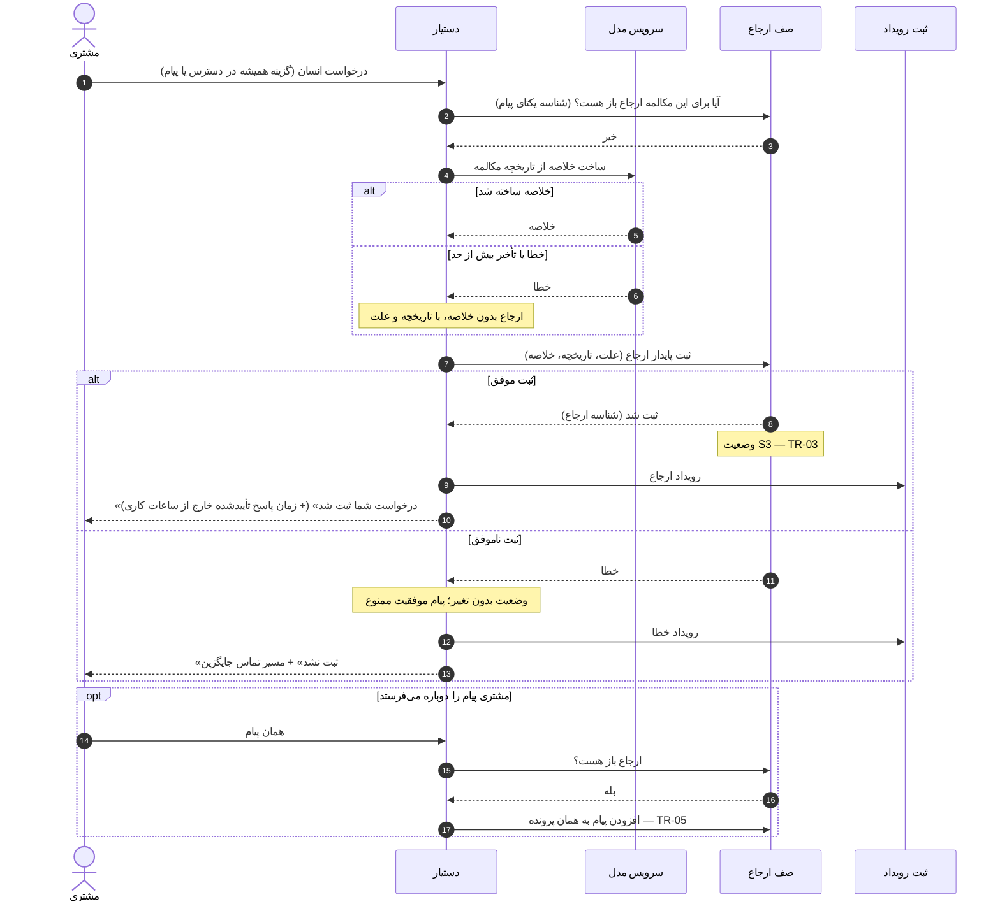
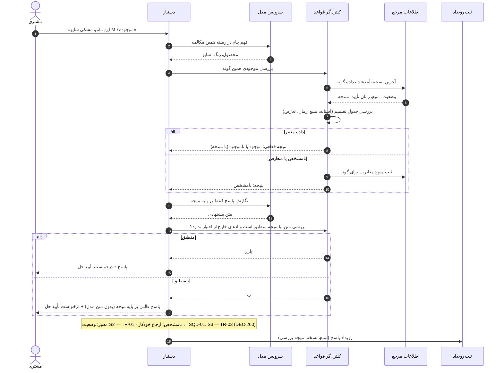
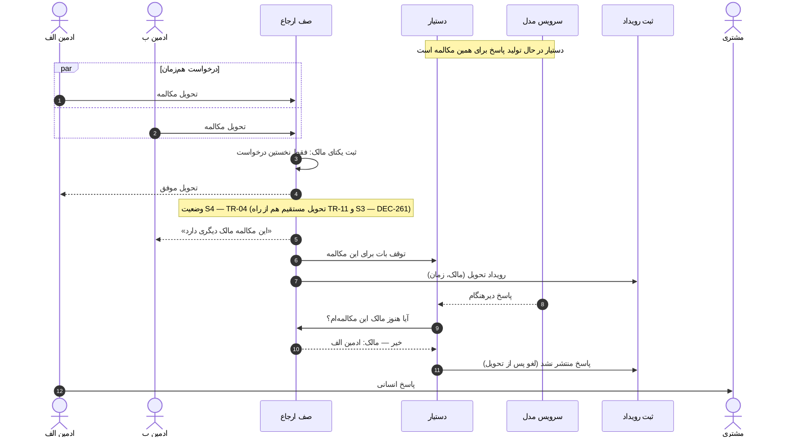
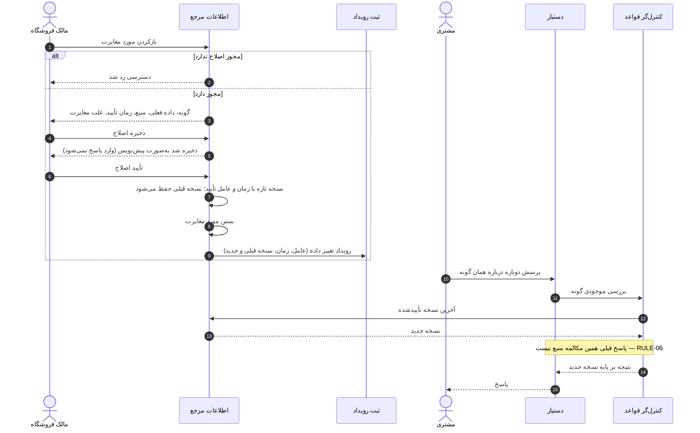
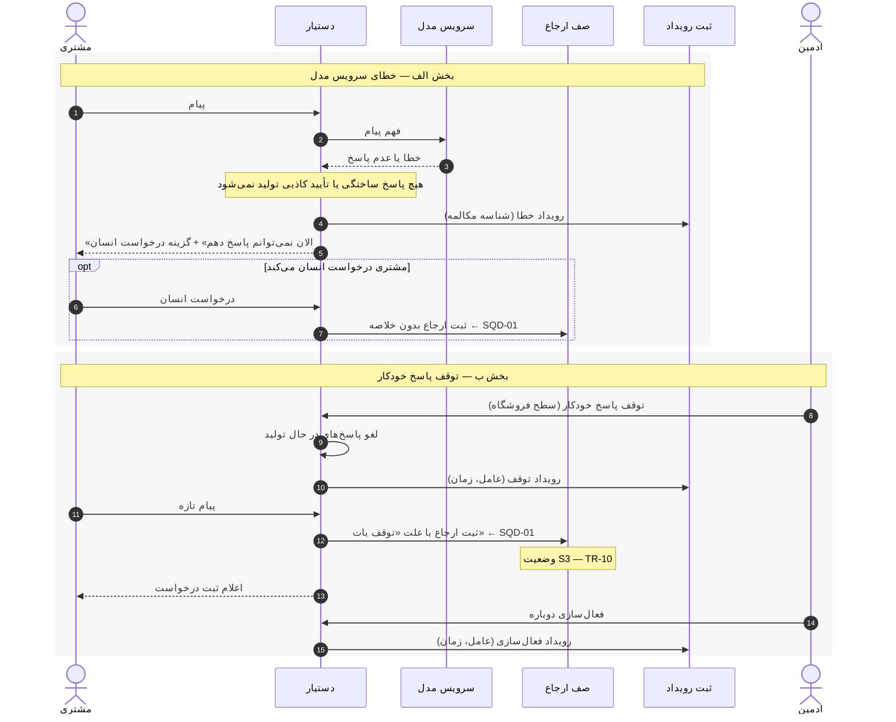
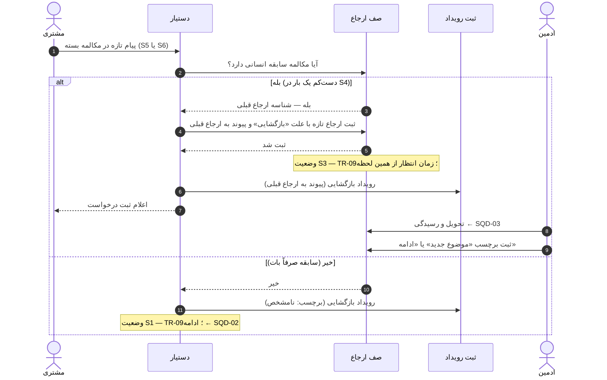

# ‏PRD-03d — دیاگرام‌های Sequence

> ‏**سطح این زیرسند:** «چه کسی به چه کسی، به چه ترتیبی پیام می‌دهد، و در خطا و هم‌زمانی چه می‌شود». فقط تعامل‌هایی که ترتیب و زمان‌بندی در آن‌ها حیاتی است کشیده شده‌اند؛ جریان کامل هر سناریو در 03c است. شرکت‌کنندگان **منطقی‌اند، نه فنی** (DEC-22، DEC-32)؛ انتخاب مدل، ذخیره‌سازی و معماری به طراحی فنی واگذار است `[SRC-02 §13]`.
>
> ‏**راهنمای برچسب‌ها:** `[SRC-xx §n]` = برگرفته از منبع · **(پیشنهاد)** = پیشنهاد تیم PRD، تأییدشده در چت PRD-03 · ⚠️ = نقطه باز.

### ‏راهنمای شناسه‌ها

| ‏کد | ‏معنی | ‏کجا تعریف شده |
|---|---|---|
| ‏SQD | ‏دیاگرام Sequence (مثلاً SQD-03 = تحویل هم‌زمان) | ‏همین سند |
| ‏ACD | ‏دیاگرام Activity | ‏PRD-03c |
| ‏TR / S1 … S6 | ‏انتقال وضعیت / وضعیت اصلی مکالمه | ‏PRD-03f |
| ‏ACT | ‏نقش (ACT-04 = سرویس مدل) | ‏PRD-03a §3a.2 |
| ‏AT | ‏آزمون پذیرش BRD (مثلاً AT-08 = هم‌زمانی تحویل) | ‏BRD §11، §13 |
| ‏FR / RULE / NFR | ‏نیازمندی عملکردی / قاعده داده / نیازمندی کیفی | ‏BRD §5 تا §10 |
| ‏SP | ‏اصل راه‌حل | ‏PRD-02 §2.2 |
| ‏DEC / D | ‏تصمیم / تصمیم باز BRD | ‏Master Index؛ BRD §14 |

---

## ‏۳d.۱ قواعد این دیاگرام‌ها

- ‏**شرکت‌کنندگان:** نقش‌های انسانی (آدمک)، اجزای منطقی سیستم (دستیار، کنترل‌گر قواعد، اطلاعات مرجع، صف ارجاع، ثبت رویداد) و ACT-04 سرویس مدل. «صف ارجاع» مالکیت مکالمه را هم نگه می‌دارد **(پیشنهاد)**.
- ‏**پیام‌ها** فارسی و رفتاری‌اند، نه نام تابع؛ شماره خودکار، مثل SRC-06. پاسخ‌ها خط‌چین.
- ‏**بلوک‌ها:** `alt` مسیر عادی و خطا · `opt` گام اختیاری · `par` هم‌زمانی.
- ‏**یادداشت** برای تغییر وضعیت (TR) و قواعد حساس.
- ‏هر دیاگرام یک جدول پشتوانه دارد (شماره پیام ← منبع).

| ‏SQD | ‏تعامل | ‏سناریو / ACD | ‏آزمون BRD |
|---|---|---|---|
| ‏SQD-01 | ‏ثبت پایدار ارجاع، شکست ثبت، پیام تکراری | ‏UC-03 / ACD-03 | ‏AT-06 |
| ‏SQD-02 | ‏پاسخ با کنترل اعتبار موجودی | ‏UC-02 / ACD-02 | ‏AT-03، AT-04 |
| ‏SQD-03 | ‏تحویل هم‌زمان و پاسخ دیرهنگام بات | ‏UC-06 / ACD-05 | ‏AT-08 |
| ‏SQD-04 | ‏اصلاح موجودی و اثر در پرسش بعدی | ‏UC-04 / ACD-04 | ‏AT-10 |
| ‏SQD-05 | ‏خطای سرویس مدل و توقف بات | ‏UC-08 / ACD-07 | ‏AT-12 |
| ‏SQD-06 | ‏بازگشایی با سابقه انسانی | ‏UC-07 / ACD-06 | ‏AT-09 |

---

## ‏۳d.۲ SQD-01 — ثبت ارجاع

| ‏پیام | ‏پشتوانه |
|---|---|
| ‏۱ | ‏FR-06 «در هر مرحله»؛ NFR-03 «مسیر درخواست انسان قابل مشاهده»؛ DEC-50 |
| ‏۲، ۳، ۱۴ تا ۱۷ | ‏شناسه یکتای پیام `[SRC-02 §9]`؛ TR-05 |
| ‏۴ تا ۶ | ‏بسته تحویل: شکست خلاصه مانع ثبت نیست `[SRC-02 §9]` |
| ‏۷ تا ۱۰ | ‏FR-06؛ NFR-05؛ SP-06؛ TR-03؛ DEC-41 |
| ‏۱۱ تا ۱۳ | ‏FR-06 (معیار پذیرش)؛ FR-12؛ D-05 |

---

## ‏۳d.۳ SQD-02 — پاسخ با کنترل اعتبار موجودی

> ‏این دیاگرام تقسیم کار SP-09 را نشان می‌دهد: **سرویس مدل** پیام را می‌فهمد و متن را می‌نویسد؛ **نتیجه موجودی** را فقط کنترل‌گر قواعد تعیین می‌کند. فرض: ویژگی‌های گونه کامل است؛ مسیر رفع ابهام در ACD-02.

| ‏پیام | ‏پشتوانه |
|---|---|
| ‏۱ تا ۳ | ‏FR-01 (حفظ زمینه؛ داده مکالمه دیگر وارد نمی‌شود)؛ DEC-22 |
| ‏۴ تا ۷ | ‏FR-04؛ RULE-01 تا RULE-05؛ جدول تصمیم ACD-02؛ SP-09 |
| ‏۸ تا ۱۰ | ‏DEC-34؛ DEC-260 (جایگزین DEC-46) |
| ‏۱۱ تا ۱۷ | ‏SP-01، SP-05، SP-09؛ NFR-01، NFR-07 — **بررسی متن پیش از ارسال (پیشنهاد — DEC-52)** |
| ‏۱۸ | ‏FR-02 (منبع و نسخه برای ادمین)؛ FR-11 |

---

## ‏۳d.۴ SQD-03 — تحویل هم‌زمان و پاسخ دیرهنگام بات

| ‏پیام | ‏پشتوانه |
|---|---|
| ‏۱ تا ۵ | ‏FR-08 (آزمون هم‌زمانی: فقط یک مالک فعال)؛ UC-06 (استثنا)؛ SP-07؛ PRD-03a (اطلاع به ادمین ناموفق) |
| ‏۶، ۷ | ‏FR-08؛ BR-07؛ NFR-08 |
| ‏۸ تا ۱۱ | ‏FR-08 «پاسخ دیرهنگام بات پس از تحویل منتشر نشود» — **بررسی مالکیت پیش از هر انتشار (پیشنهاد — DEC-51)** |
| ‏۱۲ | ‏FR-08؛ UCD-09 |

---

## ‏۳d.۵ SQD-04 — اصلاح موجودی و اثر در پرسش بعدی

| ‏پیام | ‏پشتوانه |
|---|---|
| ‏۱، ۲ | ‏ماتریس مجوز `[SRC-02 §10]`؛ NFR-04؛ DEC-30 |
| ‏۳ تا ۶ | ‏FR-10 (پیش‌نویس تأییدنشده وارد پاسخ نمی‌شود) |
| ‏۷ تا ۹ | ‏FR-10 (نسخه قبلی و عامل قابل ردیابی)؛ RULE-06؛ NFR-08؛ DEC-34 |
| ‏۱۰ تا ۱۵ | ‏FR-10 «اصلاح تأییدشده در نخستین پرس‌وجوی بعدی اثر کند»؛ RULE-06 |

---

## ‏۳d.۶ SQD-05 — خطای سرویس مدل و توقف بات

| ‏پیام | ‏پشتوانه |
|---|---|
| ‏۱ تا ۵ | ‏FR-12؛ UC-08؛ NFR-01 |
| ‏۶، ۷ | ‏ثبت ارجاع به سرویس مدل وابسته نیست؛ فقط خلاصه وابسته است `[SRC-02 §9]` — **DEC-50** |
| ‏۸ تا ۱۳ | ‏FR-12؛ NFR-08؛ TR-10؛ DEC-38 |
| ‏۱۴، ۱۵ | ‏FR-12؛ NFR-08 |

> ‏اگر خود صف ارجاع هم در دسترس نباشد، مسیر ثبت ناموفق SQD-01 (پیام‌های ۱۱ تا ۱۳) اجرا می‌شود: فقط مسیر تماس جایگزین.

---

## ‏۳d.۷ SQD-06 — بازگشایی با سابقه انسانی

| ‏پیام | ‏پشتوانه |
|---|---|
| ‏۱، ۲ | ‏UC-07؛ تعریف سابقه انسانی (PRD-03f) |
| ‏۳ تا ۷ | ‏TR-09؛ FR-09 (ثبت علت و زمان بازگشایی؛ حل قبلی از تاریخچه حذف نمی‌شود) — **ارجاع تازه با پیوند (DEC-49)** |
| ‏۸، ۹ | ‏ACD-05؛ DEC-40 |
| ‏۱۰ تا ۱۱ | ‏TR-09؛ DEC-40 |

> ‏**دلیل DEC-49:** زمان انتظار از لحظه پیام تازه شمرده می‌شود و مکالمه به‌خاطر زمان ارجاع قدیمی، به‌اشتباه بالای صف نمی‌رود؛ نتیجه قبلی دست‌نخورده می‌ماند؛ پیوند دو ارجاع شمارش «حل بدون بازگشایی» را ممکن می‌کند (D-07).

---

## ‏۳d.۸ تصمیمات و نقاط باز

| ‏شناسه پیشنهادی | ‏تصمیم |
|---|---|
| ‏DEC-48 | ‏سبک Sequence: شرکت‌کنندگان منطقی و سرویس مدل؛ پیام‌های فارسی رفتاری با شماره خودکار؛ بلوک‌های alt / opt / par؛ شش دیاگرام SQD-01 تا SQD-06 فقط برای تعامل‌های حساس |
| ‏DEC-49 | ‏03f-7 بسته شد: بازگشایی با سابقه انسانی **ارجاع تازه** می‌سازد که به ارجاع قبلی پیوند دارد |
| ‏DEC-50 | ‏ثبت ارجاع به سرویس مدل وابسته نیست؛ درخواست انسان در صفحه گفت‌وگو با **گزینه همیشه در دسترس** و بدون نیاز به AI قابل انجام است (شکل آن ← PRD-05) |
| ‏DEC-51 | ‏دستیار پیش از انتشار هر پاسخ، مالکیت مکالمه را بررسی می‌کند؛ این سازوکار رفتاری منع «پاسخ دیرهنگام بات» است |
| ‏DEC-52 | ‏متن تولیدشده مدل پیش از ارسال با نتیجه قواعد سنجیده می‌شود؛ در ناهمخوانی، پاسخ قالبی بر پایه نتیجه ارسال می‌شود |

| ‏شناسه | ‏موضوع | ‏محل تعیین تکلیف |
|---|---|---|
| ‏— | ‏حد زمانی «تأخیر بیش از حد» سرویس مدل (SQD-01، SQD-05) | ‏PRD-06 (NFR-02) |
| ‏— | ‏متن پاسخ‌های قالبی و پیام‌های خطا (SQD-02، SQD-05) | ‏PRD-04 (DEC-33) |
| ‏D-05 | ‏مسیر تماس جایگزین (SQD-01) | ‏PRD-04 |

---

### ‏تاریخچه تغییرات این سند

| ‏نسخه | ‏تاریخ | ‏تغییر |
|---|---|---|
| ‏1.1 | ‏2026-11-12 | ‏SQD-02: یادداشت وضعیت پس از پاسخ (نامشخص ← ارجاع خودکار) و پشتوانه پیام‌های ۸ تا ۱۰ (DEC-260؛ CH-42). SQD-03: تحویل مستقیم از راه TR-11 و S3 (DEC-261؛ CH-43) |
