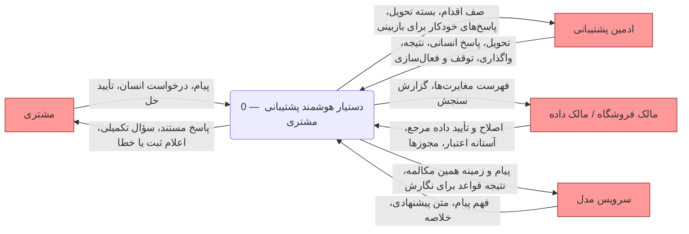
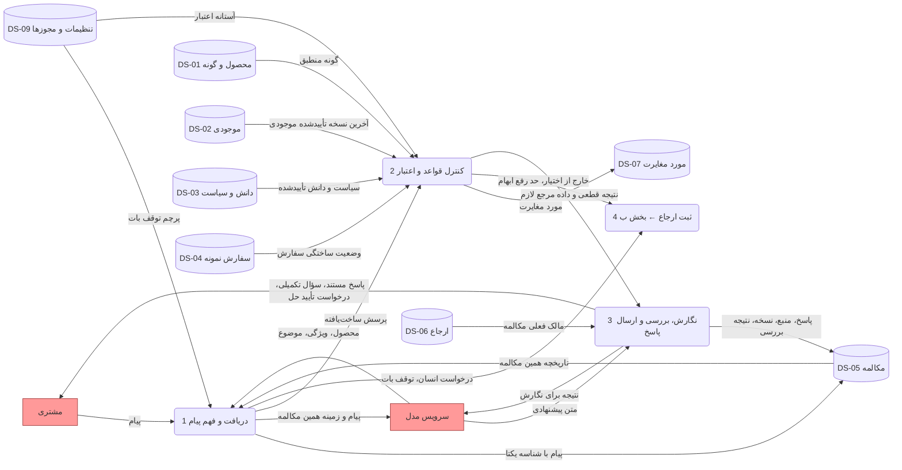
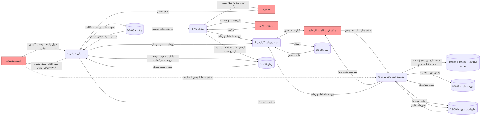

# ‏PRD-03e — دیاگرام جریان داده (DFD)

> ‏**سطح این زیرسند:** «داده از کجا می‌آید، کدام فرایند آن را تغییر می‌دهد، کجا ذخیره می‌شود و به چه کسی می‌رسد». پایه آن حداقل فرهنگ داده BRD است `[SRC-02 §7]`. فیلدهای دقیق، قرارداد زمان و وضعیت‌ها در PRD-04 و طراحی فنی می‌آیند `[SRC-02 §7]`؛ محل‌های ذخیره **منطقی‌اند**، نه طراحی پایگاه داده (DEC-22).
>
> ‏**راهنمای برچسب‌ها:** `[SRC-xx §n]` = برگرفته از منبع · **(پیشنهاد)** = پیشنهاد تیم PRD، تأییدشده در چت PRD-03 · **(تغییر — CH-xx)** = افزوده نسبت به BRD · ⚠️ = نقطه باز.

### ‏راهنمای شناسه‌ها

| ‏کد | ‏معنی | ‏کجا تعریف شده |
|---|---|---|
| ‏DS | ‏محل ذخیره داده (مثلاً DS-02 = موجودی) — به‌جای «D» به‌دلیل تداخل با تصمیم‌های باز BRD | ‏همین سند §3e.4 |
| ‏۱ … ۷ | ‏فرایندهای سطح یک DFD | ‏همین سند §3e.3 |
| ‏ACT | ‏نقش (ACT-03 = مالک فروشگاه / مالک داده؛ ACT-04 = سرویس مدل) | ‏PRD-03a §3a.2 |
| ‏SQD / ACD / UCD | ‏دیاگرام Sequence / Activity / Use Case | ‏PRD-03d / 03c / 03b |
| ‏FR / RULE / NFR | ‏نیازمندی عملکردی / قاعده داده / نیازمندی کیفی | ‏BRD §5 تا §10 |
| ‏D | ‏تصمیم باز BRD (مثلاً D-06 = نگهداری داده و احراز سفارش) | ‏BRD §14 |
| ‏DEC / CH | ‏تصمیم / تغییر | ‏Master Index |

---

## ‏۳e.۱ قواعد این دیاگرام‌ها

- ‏**نشانه‌ها (سبک SRC-06):** مستطیل قرمز = موجودیت بیرونی · مستطیل گوشه‌گرد شماره‌دار = فرایند · استوانه = محل ذخیره داده · هر جریان برچسب داده دارد.
- ‏**دو سطح:** سطح صفر (کل سیستم یک فرایند) و سطح یک (هفت فرایند). سطح یک برای خوانایی در دو بخش آمده است: **الف** پاسخ‌گویی و **ب** ارجاع، رسیدگی، مدیریت داده و سنجش.
- ‏**جریان رویداد:** همه فرایندها رویداد به فرایند ۷ می‌فرستند؛ برای خوانایی، این جریان‌ها در دیاگرام بخش ب یک‌جا نشان داده شده‌اند.

---

## ‏۳e.۲ سطح صفر (Context)

| ‏جریان | ‏پشتوانه |
|---|---|
| ‏مشتری ⇄ سیستم | ‏FR-01، FR-06، FR-09؛ UCD-01 تا UCD-05 |
| ‏ادمین ⇄ سیستم | ‏FR-07، FR-08، FR-09، FR-12؛ UCD-06 تا UCD-14 |
| ‏مالک ⇄ سیستم | ‏FR-04، FR-10، FR-11؛ ماتریس مجوز؛ UCD-15 تا UCD-19 |
| ‏سیستم ⇄ سرویس مدل | ‏SQD-01، SQD-02؛ مرز داده در §3e.5 |

---

## ‏۳e.۳ سطح یک

### ‏فرایندها

| ‏# | ‏فرایند | ‏اجزای منطقی | ‏FR | ‏دیاگرام مرتبط |
|---|---|---|---|---|
| ‏۱ | ‏دریافت و فهم پیام (شامل تشخیص پیام تکراری و پرچم توقف) | ‏دستیار | ‏FR-01، FR-11، FR-12 | ‏SQD-02، SQD-05؛ ACD-07 |
| ‏۲ | ‏کنترل قواعد و اعتبار (جدول تصمیم، مرز اختیارات، ثبت مغایرت) | ‏کنترل‌گر قواعد | ‏FR-03، FR-04، FR-05 | ‏SQD-02؛ ACD-01، ACD-02 |
| ‏۳ | ‏نگارش، بررسی و ارسال پاسخ (بررسی متن و مالکیت) | ‏دستیار، کنترل‌گر قواعد | ‏FR-02، FR-08 | ‏SQD-02، SQD-03 |
| ‏۴ | ‏ثبت ارجاع | ‏صف ارجاع | ‏FR-06، FR-12 | ‏SQD-01، SQD-06؛ ACD-03 |
| ‏۵ | ‏رسیدگی انسانی (صف، تحویل، پاسخ، نتیجه، واگذاری، توقف) | ‏صف ارجاع | ‏FR-07، FR-08، FR-09، FR-12 | ‏SQD-03؛ ACD-05 |
| ‏۶ | ‏مدیریت اطلاعات مرجع (اصلاح، تأیید، نسخه، آستانه، مجوز) | ‏اطلاعات مرجع | ‏FR-10 | ‏SQD-04؛ ACD-04 |
| ‏۷ | ‏ثبت رویداد و گزارش سنجش | ‏ثبت رویداد | ‏FR-11 | ‏همه |

### ‏بخش الف — پاسخ‌گویی (فرایندهای ۱ تا ۳)

| ‏جریان کلیدی | ‏پشتوانه |
|---|---|
| ‏پیام با شناسه یکتا ← DS-05 | ‏شناسه یکتای پیام `[SRC-02 §9]`؛ FR-11 |
| ‏فقط «تاریخچه همین مکالمه» | ‏FR-01 (محتوای مکالمه دیگر وارد پاسخ نشود)؛ NFR-04 |
| ‏DS-01 تا DS-04 ← فرایند ۲ | ‏SP-01؛ RULE-02؛ فقط داده تأییدشده (FR-10) |
| ‏فرایند ۲ ← DS-07 | ‏DEC-34؛ DEC-260 (جایگزین DEC-46) |
| ‏DS-06 ← فرایند ۳ (مالک فعلی) | ‏DEC-51 |
| ‏متن پیشنهادی ← فرایند ۳ | ‏DEC-52 |

### ‏بخش ب — ارجاع، رسیدگی، مدیریت داده و سنجش (فرایندهای ۴ تا ۷)

> ‏فرایندهای ۱ تا ۳ هم رویدادهای دریافت پیام، پاسخ، منبع، خطا و پاسخ لغوشده را به فرایند ۷ می‌فرستند (FR-11)؛ برای خوانایی در بخش الف کشیده نشده‌اند.

| ‏جریان کلیدی | ‏پشتوانه |
|---|---|
| ‏فرایند ۴ ← DS-06 (فقط پس از ذخیره پایدار) | ‏FR-06؛ NFR-05؛ پیوند به ارجاع قبلی: DEC-49 |
| ‏شکست خلاصه مانع ثبت نیست | ‏بسته تحویل `[SRC-02 §9]`؛ DEC-50 |
| ‏فرایند ۵ ← DS-09 (پرچم توقف) | ‏FR-12؛ DEC-38، DEC-44 |
| ‏فرایند ۶: نسخه تازه، نسخه قبلی حفظ | ‏FR-10؛ RULE-06؛ NFR-08 |
| ‏ادمین ← فرایند ۶ با مجوز | ‏ماتریس مجوز؛ DEC-30 |
| ‏فرایند ۷ ← DS-08 | ‏FR-11؛ NFR-08، NFR-09؛ BR-06 |

---

## ‏۳e.۴ محل‌های ذخیره داده

> ‏DS-01 تا DS-06 همان «حداقل فرهنگ داده» BRD‌اند و فیلدهایشان بدون تغییر آمده است. DS-07 تا DS-09 **(تغییر — CH-07)** افزوده‌اند، چون رفتارهای تأییدشده به آن‌ها نیاز دارند؛ فیلدهایشان **پیشنهادی** است و در PRD-04 نهایی می‌شود. طبق DEC-30، «مسئول کاتالوگ» و «مسئول موجودی» هر دو همان **ACT-03** هستند؛ نام BRD حفظ شده است (DEC-55).

| ‏شناسه | ‏محل ذخیره | ‏فیلدهای لازم | ‏مالک | ‏نویسنده (فرایند) | ‏خواننده (فرایند) | ‏منبع |
|---|---|---|---|---|---|---|
| ‏DS-01 | ‏محصول و گونه | ‏شناسه محصول و گونه، نام، ویژگی‌ها، سایز و رنگ، وضعیت فعال | ‏مسئول کاتالوگ (ACT-03) | ‏۶ | ‏۲ | ‏BRD §7 |
| ‏DS-02 | ‏موجودی | ‏شناسه گونه، وضعیت یا تعداد، شناسه منبع، زمان تأیید، نسخه، عامل تأیید | ‏مسئول موجودی (ACT-03) | ‏۶ | ‏۲ | ‏BRD §7 |
| ‏DS-03 | ‏دانش و سیاست | ‏شناسه منبع، موضوع، متن، نسخه، وضعیت تأیید، تاریخ اعتبار | ‏مالک فروشگاه (ACT-03) | ‏۶ | ‏۲ | ‏BRD §7 |
| ‏DS-04 | ‏سفارش نمونه | ‏شناسه ساختگی، وضعیت ساختگی، سناریوی مجاز | ‏تیم محصول | ‏۶ | ‏۲ | ‏BRD §7 |
| ‏DS-05 | ‏مکالمه | ‏شناسه، کانال، پیام‌ها، وضعیت، مسئول، زمان‌ها، پرچم آزمایشی | ‏تیم پشتیبانی | ‏۱، ۳، ۵ | ‏۱، ۴، ۵ | ‏BRD §7 |
| ‏DS-06 | ‏ارجاع | ‏شناسه مکالمه، علت، خلاصه، زمان ایجاد، وضعیت ثبت، مسئول | ‏تیم پشتیبانی | ‏۴، ۵ | ‏۳، ۵ | ‏BRD §7 |
| ‏DS-06 *(افزوده)* | ‏ارجاع — فیلدهای تازه | ‏پیوند به ارجاع قبلی؛ برچسب بازگشایی (موضوع جدید / ادامه / نامشخص) | ‏تیم پشتیبانی | ‏۴، ۵ | ‏۵، ۷ | ‏DEC-40، DEC-49 |
| ‏DS-07 | ‏مورد مغایرت | ‏شناسه، شناسه گونه، نوع (نامشخص / متعارض / منقضی / بدون منبع)، زمان ایجاد، مکالمه منشأ، وضعیت (باز / بسته)، عامل و زمان بستن | ‏مالک فروشگاه (ACT-03) | ‏۲، ۶ | ‏۶ | ‏DEC-34، DEC-35 |
| ‏DS-08 | ‏رویداد | ‏نوع رویداد، شناسه مکالمه، زمان، عامل، نسخه منبع، مصرف و هزینه سرویس | ‏تیم محصول | ‏۱ تا ۶ (از راه ۷) | ‏۷ | ‏FR-11؛ NFR-08، NFR-09 |
| ‏DS-09 | ‏تنظیمات و مجوزها | ‏آستانه اعتبار موجودی، مجوزهای اعطاشده، پرچم توقف بات — هرکدام با عامل و زمان تغییر | ‏مالک فروشگاه (ACT-03) | ‏۵ (توقف)، ۶ | ‏۱، ۲، ۶ | ‏ماتریس مجوز؛ FR-04، FR-12؛ DEC-38 |

> ‏**نمایش زمان** باید با منطقه زمانی فروشگاه سازگار باشد و در Prototype فقط داده ساختگی یا ناشناس‌شده استفاده می‌شود `[SRC-02 §7؛ NFR-06]`.

---

## ‏۳e.۵ مرز داده با سرویس مدل

> ‏طبق BRD، دسترسی سرویس‌دهنده مدل و محل پردازش پیش از پایلوت باید تصویب شود `[SRC-02 §10؛ D-06]`. این بخش مشخص می‌کند در رفتار محصول چه داده‌ای از این مرز می‌گذرد **(پیشنهاد — DEC-56)**؛ الزام حریم خصوصی متناظر در PRD-06 نوشته می‌شود.

| ‏به سرویس مدل **می‌رود** | ‏فرایند | ‏به سرویس مدل **نمی‌رود** |
|---|---|---|
| ‏پیام و تاریخچه **همین** مکالمه | ‏۱، ۴ | ‏داده مکالمات دیگر (FR-01، NFR-04) |
| ‏نتیجه قطعی قواعد | ‏۳ | ‏مجوزها، تنظیمات و پرچم‌ها (DS-09) |
| ‏داده مرجعِ لازم برای همان پاسخ | ‏۳ | ‏کل کاتالوگ، موجودی یا سیاست‌ها |
| — | — | ‏داده رویداد و گزارش (DS-08) |
| — | — | ‏رمز، اطلاعات کارت و داده غیرضروری — اصلاً جمع‌آوری نمی‌شوند (NFR-06) |

> ‏آنچه از سرویس مدل برمی‌گردد (فهم پیام، متن پیشنهادی، خلاصه) **منبع اطلاعات نیست**: نتیجه موجودی و سیاست را فقط فرایند ۲ تعیین می‌کند (SP-01، SP-09) و متن پیش از ارسال سنجیده می‌شود (DEC-52). محتوای پیام مشتری یا منبع نمی‌تواند قواعد دسترسی، اختیار مالی یا منبع معتبر را تغییر دهد (NFR-07).

---

## ‏۳e.۶ تصمیمات و نقاط باز

| ‏شناسه پیشنهادی | ‏تصمیم |
|---|---|
| ‏DEC-53 | ‏سبک DFD: سطح صفر و سطح یک (در دو بخش)؛ نشانه‌های SRC-06؛ پیشوند `DS` برای محل ذخیره داده |
| ‏DEC-54 | ‏افزودن DS-07 مورد مغایرت، DS-08 رویداد و DS-09 تنظیمات و مجوزها، و دو فیلد تازه در DS-06؛ فیلدها در PRD-04 نهایی می‌شوند (CH-07) |
| ‏DEC-55 | ‏نام مالک‌ها مطابق BRD حفظ می‌شود؛ «مسئول کاتالوگ» و «مسئول موجودی» همان ACT-03‌اند |
| ‏DEC-56 | ‏مرز داده با سرویس مدل طبق §3e.5؛ مبنای الزام حریم خصوصی در PRD-06 |

| ‏شناسه | ‏موضوع | ‏محل تعیین تکلیف |
|---|---|---|
| ‏D-06 | ‏نگهداری داده، روش حذف، دسترسی سرویس‌دهنده مدل و محل پردازش | ‏PRD-06 |
| ‏— | ‏فیلدهای نهایی DS-07 تا DS-09 و قرارداد زمان و وضعیت‌ها | ‏PRD-04 |
| ‏— | ‏مدت نگهداری رویدادها (DS-08) | ‏PRD-06 |

---

### ‏تاریخچه تغییرات این سند

| ‏نسخه | ‏تاریخ | ‏تغییر |
|---|---|---|
| ‏1.1 | ‏2026-11-12 | ‏ارجاع پشتوانه «فرایند ۲ ← DS-07» از DEC-46 به DEC-260 (CH-42). جریان داده تغییر نکرد |
