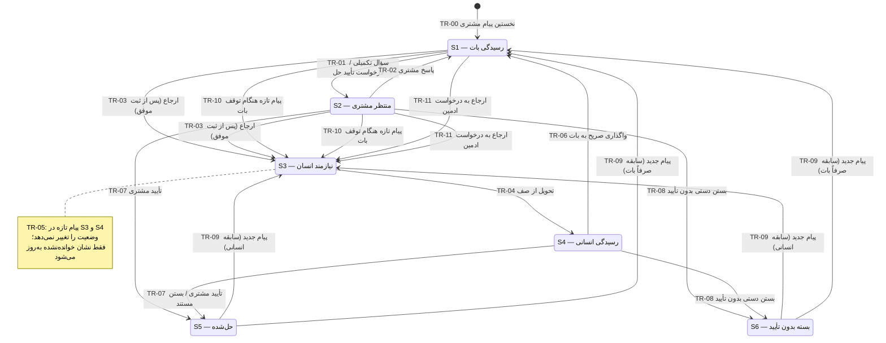

# ‏PRD-03f — چرخه وضعیت مکالمه

> ‏**سطح این زیرسند:** «مکالمه در هر لحظه کجاست و چه چیزی آن را جابه‌جا می‌کند». منبع اصلی، ماشین وضعیت BRD §8 است؛ هرجا این سند چیزی به آن افزوده، با برچسب **(پیشنهاد — DEC-xx)** یا **(تغییر — CH-xx)** مشخص شده است. متن پیام‌های رابط و معیار پذیرش در PRD-04 می‌آیند (DEC-33).
>
> ‏**راهنمای برچسب‌ها:** `[SRC-xx §n]` = برگرفته از منبع · **(پیشنهاد)** = پیشنهاد تیم PRD، تأییدشده در چت PRD-03 · **(فرض A-xx)** = فرض تأییدنشده · ⚠️ = نقطه باز.
>
> ‏**روش (DEC-29):** SRC-06 برای State نمونه ندارد؛ از `stateDiagram-v2` و جدول انتقال به سبک BRD استفاده شده است.

### ‏راهنمای شناسه‌ها

| ‏کد | ‏معنی | ‏کجا تعریف شده |
|---|---|---|
| ‏S1 … S6 | ‏وضعیت اصلی مکالمه — بدون تغییر از BRD | ‏BRD §8؛ همین سند §3f.1 |
| ‏TR | ‏انتقال وضعیت (مثلاً TR-04 = تحویل توسط ادمین) | ‏همین سند §3f.3 |
| ‏ACT | ‏نقش (ACT-01 مشتری، ACT-02 ادمین، ACT-03 مالک فروشگاه، ACT-04 سرویس مدل) | ‏PRD-03a §3a.2 |
| ‏UC | ‏سناریوی کسب‌وکاری BRD | ‏BRD §9؛ PRD-03a §3a.5 |
| ‏FR / BR / NFR / RULE | ‏نیازمندی عملکردی / نیاز کسب‌وکار / نیازمندی کیفی / قاعده داده | ‏BRD §4 تا §10 |
| ‏SP | ‏اصل راه‌حل (مثلاً SP-07 = در هر لحظه فقط یک مالک) | ‏PRD-02 §2.2 |
| ‏A / D / Q / DEC / CH | ‏فرض / تصمیم باز BRD / سؤال باز / تصمیم / تغییر | ‏Master Index |

---

## ‏۳f.۱ وضعیت‌ها

> ‏**قاعده پایه** `[SRC-02 §8]`: هر مکالمه در هر لحظه **دقیقاً یک** وضعیت اصلی دارد. در رسیدگی انسانی مسئول یک فرد مشخص است؛ در صف ارجاع مسئول گروه پشتیبانی است.

| ‏وضعیت | ‏تعریف | ‏مسئول اقدام بعدی | ‏در صف اقدام ادمین؟ | ‏منبع |
|---|---|---|---|---|
| ‏S1 — رسیدگی بات | ‏بات در حال پاسخ یا بررسی منابع است | ‏سامانه | ‏خیر | ‏BRD §8 |
| ‏S2 — منتظر مشتری | ‏سؤال تکمیلی یا درخواست تأیید حل مطرح شده است؛ **نوع انتظار** ثبت می‌شود: «رفع ابهام» یا «تأیید حل» | ‏مشتری | ‏خیر | ‏BRD §8 |
| ‏S3 — نیازمند انسان | ‏ارجاع پایدار ثبت شده و هنوز تحویل گرفته نشده است | ‏گروه پشتیبانی | ‏**بله** (بدون مسئول فردی) | ‏BRD §8؛ FR-07 |
| ‏S4 — رسیدگی انسانی | ‏ادمین مشخصی مکالمه را تحویل گرفته است | ‏همان ادمین | ‏**بله** (با مسئول) | ‏BRD §8؛ FR-07 |
| ‏S5 — حل‌شده | ‏مشتری حل را تأیید کرده، یا ادمین نتیجه را ثبت و مستند بسته است | ‏— | ‏خیر | ‏BRD §8؛ SP-08 |
| ‏S6 — بسته بدون تأیید | ‏تعامل پایان یافته، اما حل مسئله احراز نشده است؛ در نرخ حل شمرده نمی‌شود | ‏— | ‏خیر | ‏BRD §8؛ FR-09 |

> ‏**دسته‌بندی برای سنجش و نمایش:** وضعیت‌های **باز** = S1، S2، S3، S4 · وضعیت‌های **بسته** = S5، S6. مکالمه بسته با پیام تازه بازگشایی می‌شود (TR-09).

---

## ‏۳f.۲ دیاگرام وضعیت

> ‏**خوانش سریع:** مسیر بات S1 ⇄ S2 است و از S2 به S5 یا S6 بسته می‌شود. مسیر انسانی همیشه از S3 به S4 می‌رسد (تحویل مستقیم TR-11 هم نخست ارجاع می‌سازد — DEC-261) و از S4 بسته یا به بات واگذار می‌شود. هیچ مسیری از S1 مستقیم به وضعیت بسته نمی‌رود.

---

## ‏۳f.۳ جدول انتقال‌ها

| ‏شناسه | ‏از | ‏رویداد یا شرط | ‏به | ‏کنترل ضروری | ‏عامل | ‏رویداد ثبت‌شده (FR-11) | ‏سناریو | ‏منبع |
|---|---|---|---|---|---|---|---|---|
| ‏TR-00 | ‏— | ‏نخستین پیام مشتری در مکالمه تازه | ‏S1 | ‏ایجاد شناسه مکالمه؛ پرچم «داده آزمایشی» | ‏ACT-01 | ‏دریافت پیام | ‏همه | ‏FR-01؛ فرهنگ داده «مکالمه» |
| ‏TR-01 | ‏S1 | ‏دستیار سؤال تکمیلی می‌پرسد **یا** پس از هر پاسخ اطلاعاتی تأیید حل می‌خواهد | ‏S2 | ‏ثبت سؤال و نوع انتظار | ‏سامانه | ‏پاسخ، منبع و نسخه | ‏UC-01، 02، 05 | ‏BRD §8؛ **(پیشنهاد — DEC-37)** |
| ‏TR-02 | ‏S2 | ‏مشتری پاسخ می‌دهد (پاسخ سؤال تکمیلی، یا پرسش تازه به‌جای تأیید) | ‏S1 | ‏حفظ زمینه؛ اگر پاسخ، درخواست انسان باشد ← TR-03؛ اگر تأیید حل باشد ← TR-07 | ‏ACT-01 | ‏دریافت پیام | ‏UC-01، 02 | ‏BRD §8 |
| ‏TR-03 | ‏S1 / S2 | ‏درخواست انسان؛ نبود پاسخ معتبر (نبود منبع، موجودی «نامشخص» یا «متعارض») پس از اعلام صریح، به‌صورت خودکار **(DEC-260)**؛ درخواست خارج از اختیار، خودکار **(DEC-260)**؛ رسیدن به حد رفع ابهام | ‏S3 | ‏**فقط پس از ثبت موفق ارجاع**؛ در شکست ثبت، وضعیت بدون تغییر و مسیر تماس جایگزین؛ در S2 اولویت با ارجاع است | ‏ACT-01 / سامانه | ‏ارجاع (یا خطا) | ‏UC-01، 02، 03، 04، 05، 08 | ‏BRD §8؛ FR-06؛ فرض A-09؛ DEC-260 |
| ‏TR-04 | ‏S3 | ‏ادمین مکالمه را از صف تحویل می‌گیرد | ‏S4 | ‏فقط یک مالک فعال (تحویل هم‌زمان: یکی موفق، دیگری مطلع)؛ بات متوقف؛ پاسخ در حال تولید منتشر نمی‌شود | ‏ACT-02 | ‏تحویل (مالک و زمان) | ‏UC-06 | ‏BRD §8؛ FR-08؛ SP-07 |
| ‏TR-05 | ‏S3 / S4 | ‏پیام تازه مشتری | ‏بدون تغییر | ‏به‌روزرسانی نشان خوانده‌نشده؛ حفظ زمان اولین ارجاع باز؛ پیام به همان پرونده افزوده می‌شود | ‏ACT-01 | ‏دریافت پیام | ‏UC-03، 06 | ‏BRD §8، §9 |
| ‏TR-06 | ‏S4 | ‏ادمین صریحاً مکالمه را به بات واگذار می‌کند | ‏S1 | ‏ثبت عامل و زمان؛ بازگشت خودکار وجود ندارد؛ **هنگام توقف کلی بات مجاز نیست** | ‏ACT-02 | ‏تغییر مالکیت | ‏UC-06 | ‏BRD §8؛ BR-07؛ **(پیشنهاد — DEC-39)** |
| ‏TR-07 | ‏S2 / S4 | ‏مشتری حل را تأیید می‌کند، یا ادمین نتیجه را مستند ثبت و می‌بندد | ‏S5 | ‏ثبت مبنای حل (تأیید مشتری / ثبت ادمین) و عامل | ‏ACT-01 / ACT-02 | ‏نتیجه | ‏UC-01، 02، 05، 06 | ‏BRD §8؛ FR-09؛ SP-08 |
| ‏TR-08 | ‏S2 / S4 | ‏ادمین مکالمه را بدون تأیید می‌بندد (مثلاً سکوت مشتری) | ‏S6 | ‏فقط دستی؛ زمان‌سنج بستن خودکار وجود ندارد؛ در نرخ حل شمرده نمی‌شود | ‏ACT-02 | ‏نتیجه (بدون تأیید) | ‏UC-01، 06 | ‏BRD §8 |
| ‏TR-09 | ‏S5 / S6 | ‏پیام جدید مشتری | ‏S3 یا S1 | ‏سابقه انسانی ← S3 (با ثبت ارجاع)؛ سابقه صرفاً بات ← S1؛ ثبت علت و زمان بازگشایی و برچسب «موضوع جدید / ادامه / نامشخص»؛ حل قبلی در تاریخچه می‌ماند | ‏ACT-01 | ‏بازگشایی | ‏UC-07 | ‏BRD §8؛ FR-09؛ **(پیشنهاد — DEC-40)** |
| ‏TR-10 | ‏S1 / S2 | ‏پیام تازه مشتری در زمانی که پاسخ خودکار متوقف است | ‏S3 | ‏ثبت ارجاع با علت «دستیار متوقف است» (VL-03)؛ قواعد TR-03 درباره ثبت موفق برقرار است **(CH-31)** | ‏سامانه | ‏ارجاع | ‏UC-08 | ‏FR-12؛ شرایط ورود به پایلوت `[SRC-02 §12]`؛ **(پیشنهاد — DEC-38)** |
| ‏TR-11 | ‏S1 / S2 | ‏ادمین برای مکالمه‌ای که دست بات است «تحویل مستقیم» می‌خواهد (مثلاً هنگام بازبینی نمونه‌ای) | ‏S3، سپس بی‌درنگ S4 با TR-04 | ‏نخست ارجاع پایدار با علت «تحویل به درخواست ادمین» (VL-03)؛ در شکست ثبت، وضعیت بدون تغییر؛ سپس همان کنترل‌های TR-04 برای همان ادمین؛ از این پس مکالمه «سابقه انسانی» دارد | ‏ACT-02 | ‏ارجاع، سپس تحویل | ‏UC-06 | ‏BR-07؛ **(تغییر — CH-06، DEC-42؛ CH-43، DEC-261)** |

> ‏**سابقه انسانی** یعنی مکالمه دست‌کم یک بار در S4 بوده است (از راه TR-04 یا TR-11). این تعریف، مسیر بازگشایی در TR-09 را تعیین می‌کند **(پیشنهاد)**.

---

## ‏۳f.۴ انتقال‌های ممنوع

| ‏انتقال ممنوع | ‏دلیل | ‏منبع |
|---|---|---|
| ‏S1 → S5 یا S6 | ‏ارسال پاسخ حل نیست؛ هر پاسخ اطلاعاتی به S2 می‌رود (TR-01) | ‏SP-08؛ DEC-37 |
| ‏S3 → S5 یا S6 | ‏بستن بدون تحویل مجاز نیست؛ هر نتیجه یک مالک و ثبت مستند دارد | ‏SP-07؛ **(پیشنهاد — DEC-36)** |
| ‏هر وضعیت → S3 بدون ثبت موفق ارجاع | ‏پیام موفقیت و S3 فقط پس از ذخیره پایدار | ‏FR-06؛ NFR-05؛ SP-06 |
| ‏S3 → S1 | ‏بازگشت از صف به بات بدون تحویل و واگذاری صریح ممکن نیست | ‏BRD §8 (بدون بازگشت خودکار) |
| ‏S4 → S1 هنگام توقف کلی بات | ‏بات متوقف نمی‌تواند مالک شود | ‏**(پیشنهاد — DEC-39)** |
| ‏بستن خودکار با زمان‌سنج | ‏در محدوده Prototype نیست | ‏BRD §8 |

---

## ‏۳f.۵ پرچم‌ها (وضعیت اصلی نیستند)

| ‏پرچم | ‏سطح | ‏اثر | ‏منبع |
|---|---|---|---|
| ‏خوانده‌نشده | ‏مکالمه | ‏در صف نمایش داده می‌شود؛ خواندن پیام وضعیت را تغییر نمی‌دهد و مکالمه را حل‌شده نمی‌کند | ‏BRD §8؛ FR-07 |
| ‏در حال تولید پاسخ | ‏مکالمه | ‏اگر در این حالت TR-04 یا TR-11 رخ دهد، پاسخ منتشر نمی‌شود | ‏BRD §8؛ FR-08 |
| ‏پاسخ خودکار متوقف | ‏**فروشگاه (کلی)** | ‏پیام تازه در S1 و S2 با TR-10 به صف می‌رود؛ پاسخ در حال تولید منتشر نمی‌شود؛ TR-06 مجاز نیست؛ توقف و فعال‌سازی با عامل و زمان ثبت می‌شود | ‏FR-12؛ NFR-08؛ DEC-38، DEC-39 |
| ‏داده آزمایشی | ‏مکالمه | ‏همه مکالمات Prototype آزمایشی‌اند | ‏فرهنگ داده «مکالمه» `[SRC-02 §7]` |
| ‏نوع انتظار | ‏مکالمه (فقط در S2) | ‏«رفع ابهام» یا «تأیید حل»؛ تعداد نوبت رفع ابهام برای حد A-09 شمرده می‌شود | ‏BRD §8؛ فرض A-09 |
| ‏برچسب بازگشایی | ‏مکالمه | ‏«موضوع جدید / ادامه / نامشخص» | ‏UC-07؛ DEC-40 |

> ‏**مورد مغایرت داده** (DEC-34) پرچم مکالمه نیست؛ موجودیتی جدا در پنل مدیریت فروشگاه است و وضعیت مکالمه را تغییر نمی‌دهد. چرخه آن (باز ← بسته با اصلاح و تأیید) در PRD-03e و PRD-04 می‌آید.

---

## ‏۳f.۶ تصمیم‌های این زیرسند (حل شکاف‌های 03a)

| ‏شکاف | ‏تصمیم | ‏شناسه پیشنهادی |
|---|---|---|
| ‏03f-1 مکالمه S1 بی‌صاحب | ‏هر پاسخ اطلاعاتی با درخواست تأیید حل تمام می‌شود و مکالمه به S2 می‌رود؛ بستن فقط دستی (TR-08) | ‏DEC-37 |
| ‏03f-2 بستن از S3 | ‏در Prototype مجاز نیست؛ ابتدا تحویل | ‏DEC-36 |
| ‏03f-3 توقف کلی بات | ‏توقف پرچم سطح فروشگاه است؛ پیام تازه با TR-10 به صف می‌رود | ‏DEC-38 |
| ‏— (پیامد 03f-3) | ‏واگذاری به بات (TR-06) هنگام توقف کلی مجاز نیست | ‏DEC-39 |
| ‏03f-4 موضوع جدید / ادامه | ‏مسیر انسانی: ادمین ثبت می‌کند؛ مسیر بات: «نامشخص»؛ تشخیص خودکار در اسکوپ نیست | ‏DEC-40 |
| ‏03f-5 خارج از ساعات کاری | ‏وضعیت همان S3؛ فقط پیام به مشتری متفاوت است (متن ← PRD-04؛ D-05) | ‏DEC-41 |
| ‏03f-6 تحویل مستقیم | ‏مجاز است (TR-11)؛ تغییر نسبت به جدول BRD §8؛ **از 1.2:** نخست ارجاع پایدار (S3) و سپس تحویل (S4) | ‏DEC-42؛ CH-06؛ DEC-261 |

---

## ‏۳f.۷ نقاط باز

| ‏شناسه | ‏موضوع | ‏اثر بر این زیرسند | ‏محل تعیین تکلیف |
|---|---|---|---|
| ‏A-09 | ‏حد «دو نوبت» رفع ابهام | ‏شرط TR-03 | ‏PRD-04 |
| ‏D-05 | ‏ساعات انسانی و مسیر تماس جایگزین | ‏TR-03 (شکست ثبت)، DEC-41 | ‏PRD-04 (FR-06) |
| ‏~~D-07~~ | ‏✅ بسته ← DEC-262: بازه بازگشایی ۷ روز (A-16) برای Prototype تثبیت شد | ‏شمارش TR-09 در سنجش | ‏PRD-04-EP06 |
| ‏⚠️ 03f-7 | ‏آیا TR-09 در مسیر انسانی، ارجاع تازه می‌سازد یا ارجاع قبلی را بازگشایی می‌کند؟ | ‏ثبت ارجاع و زمان انتظار | ‏PRD-03d (Sequence) / PRD-04 |

---

### ‏تاریخچه تغییرات این زیرسند

| ‏نسخه | ‏تاریخ | ‏تغییر | ‏مرجع |
|---|---|---|---|
| ‏1.0 | ‏2026-11-11 | ‏تأیید نخستین (چت PRD-03) | ‏— |
| ‏1.1 | ‏2026-11-11 | ‏TR-10: علت ارجاع «توقف بات» ← «دستیار متوقف است» (VL-03). نام وضعیت‌ها و متن روایی تغییر نکرد | ‏CH-31؛ DEC-239 |
| ‏1.2 | ‏2026-11-12 | ‏TR-03: نبود پاسخ معتبر و خارج از اختیار، ارجاع خودکار (DEC-260؛ CH-42). TR-11: نخست ارجاع پایدار با علت «تحویل به درخواست ادمین» (S3) و سپس TR-04 (S4)؛ دیاگرام، جدول، خوانش سریع و §3f.6 (DEC-261؛ CH-43). §3f.7: D-07 بسته (DEC-262؛ CH-44) | ‏CH-42، CH-43، CH-44؛ DEC-260 تا DEC-262 |
