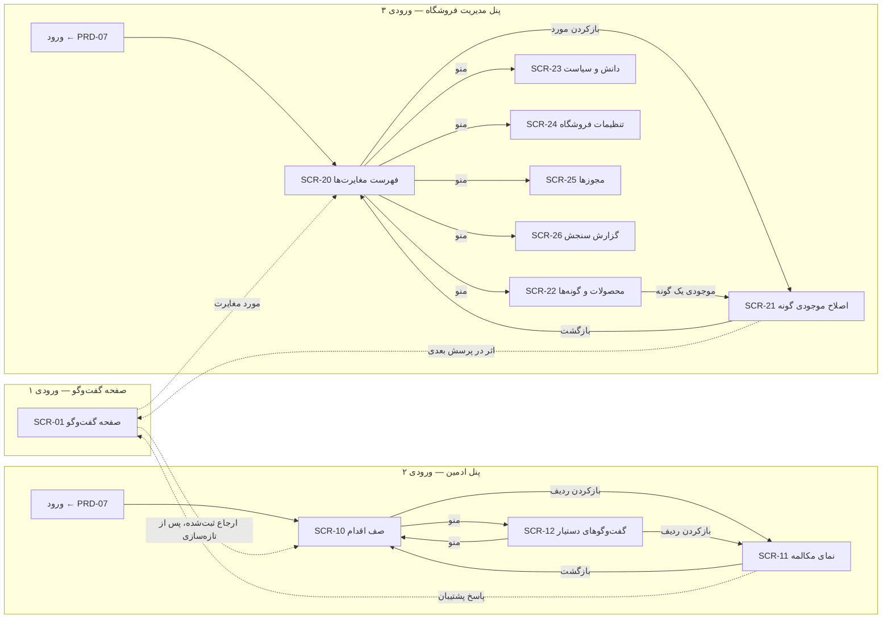

# ‏PRD-05 — فلوهای تجربه کاربر

> ‏**نام کاری محصول:** دستیار هوشمند پشتیبانی مشتری برای فروشگاه‌های آنلاین `[SRC-01]` *(نام تجاری تعیین نشده — Q-08)*
>
> ‏**هدف این بخش (طبق تمپلیت):** طراحی‌های تجربه کاربر که امکانات و سناریوها را درست نشان می‌دهند؛ فلوی کلی و Low-Fi کافی است و موکاپ گرافیکی لازم نیست `[SRC-03 §5]`.
>
> ‏**مرز با PRD-04 (DEC-33؛ PRD-04 §4.6):** PRD-04 می‌گوید «چه چیزی دیده می‌شود و چه رفتاری دارد». این بخش می‌گوید «کجا دیده می‌شود، به چه ترتیبی، و کاربر چطور بین صفحه‌ها جابه‌جا می‌شود». هیچ قاعده، معیار پذیرش یا متن رابطی اینجا تکرار نمی‌شود؛ فقط به استوری ارجاع داده می‌شود.
>
> ‏**ساختار (پیشنهاد — DEC-122):** این فایل فهرست، به‌علاوه سه زیرسند، یکی برای هر مرز منطقی (DEC-31).
>
> ‏**راهنمای برچسب‌ها:** `[SRC-xx §n]` = برگرفته از منبع · **(پیشنهاد)** = پیشنهاد تیم PRD · **(فرض A-xx)** = فرض تأییدنشده · **(تغییر — CH-xx)** = افزوده نسبت به اسناد تأییدشده · ⚠️ = نقطه باز.

### ‏راهنمای شناسه‌ها

| ‏کد | ‏معنی | ‏کجا تعریف شده |
|---|---|---|
| ‏SCR-NN | ‏صفحه (مثلاً SCR-10 = صف اقدام). ۰۱ تا ۰۹ صفحه گفت‌وگو، ۱۰ تا ۱۹ پنل ادمین، ۲۰ تا ۲۹ پنل مدیریت فروشگاه **(پیشنهاد — DEC-124)** | ‏همین سند §5.3 |
| ‏UXF-NN | ‏فلوی کار روی صفحه‌ها (مثلاً UXF-03 = درخواست انسان تا رسیدن به صف) **(پیشنهاد — DEC-124)** | ‏همین سند §5.6 |
| ‏R0 … Rn | ‏ناحیه‌ای از یک صفحه، از بالا به پایین؛ فقط درون همان صفحه معنا دارد | ‏همین سند §5.2 |
| ‏US / AC | ‏استوری / معیار پذیرش | ‏PRD-04 |
| ‏UCD / ACD | ‏Use Case / دیاگرام Activity | ‏PRD-03b / 03c |
| ‏S1 … S6 / TR | ‏وضعیت مکالمه / انتقال وضعیت | ‏PRD-03f |
| ‏VL | ‏فهرست مقادیر مجاز (برچسب‌های نمایشی) | ‏PRD-04-DD §DD.2 |
| ‏ND / CR | ‏نباید کلی محصول / قاعده رفتاری مشترک | ‏PRD-04-00 |
| ‏A / D / Q / DEC / CH | ‏فرض / تصمیم باز BRD / سؤال باز / تصمیم / تغییر | ‏Master Index |

---

## ‏۵.۱ زیرسندها

| ‏ترتیب | ‏فایل | ‏مرز | ‏صفحه‌ها | ‏وضعیت |
|---|---|---|---|---|
| ‏۱ | ‏`PRD-05 - UX Flows.md` | ‏همه | ‏همین فایل: قراردادها، نقشه صفحات، ورودی‌ها، ناوبری کلی، فلوهای کار، ردیابی | ‏1.1 ✅ |
| ‏۲ | ‏`PRD-05a - Chat Page.md` | ‏صفحه گفت‌وگو | ‏SCR-01 و دوازده حالت آن | ‏1.0 ✅ |
| ‏۳ | ‏`PRD-05b - Admin Panel.md` | ‏پنل ادمین | ‏پوسته، SCR-10 تا SCR-12، پنجره‌ها | ‏1.1 ✅ |
| ‏۴ | ‏`PRD-05c - Store Management Panel.md` | ‏پنل مدیریت فروشگاه | ‏پوسته، SCR-20 تا SCR-26 | ‏1.0 ✅ |

> ‏**دلیل تقسیم:** نقش، ابعاد صفحه و ورودی سه مرز با هم فرق دارد (DEC-125، DEC-126) و هر مرز یک نوبت کار مستقل است. ترتیب، مثل PRD-04، از مسیر مشتری شروع می‌شود.

---

## ‏۵.۲ قراردادهای مشترک

### ‏قالب هر صفحه در زیرسندها (نمونه تأییدشده: SCR-10)

| ‏# | ‏بخش | ‏محتوا |
|---|---|---|
| ‏۱ | ‏سرصفحه | ‏مرز، نقش، استوری‌ها، ردیابی (UCD، ACD، FR، BO)، دستگاه، «ورود از»، «خروج به» |
| ‏۲ | ‏ناوبری | ‏دیاگرام کوچک Mermaid از صفحه و همسایه‌هایش |
| ‏۳ | ‏ناحیه‌ها | ‏جدول «ناحیه / محتوا / کنش / استوری و مرجع / متن» از بالا به پایین |
| ‏۴ | ‏جزئیات ناحیه | ‏در صورت نیاز: ستون‌های جدول، فیلدهای فرم، اجزای درون پیام |
| ‏۵ | ‏حالت‌ها | ‏جدول «حالت / ناحیه‌های متأثر / رفتار / مرجع» |
| ‏۶ | ‏پوشش معیارهای پذیرش | ‏کدام AC در کدام ناحیه یا حالت دیده می‌شود |
| ‏۷ | ‏پیشنهادها و نقاط باز | ‏هر چیز تازه‌ای که PRD-04 ندارد، با برچسب پیشنهاد |

### ‏قواعد نگارش Wireframe (پیشنهاد — DEC-123)

| ‏# | ‏قاعده | ‏مرجع |
|---|---|---|
| ‏۱ | ‏Wireframe به شکل **جدول ناحیه‌به‌ناحیه** است؛ Wireframe تصویری یا ASCII نداریم | ‏تصمیم چت PRD-05 |
| ‏۲ | ‏ناحیه‌ها از بالا به پایین شماره می‌خورند (R0 همیشه پوسته یا سرصفحه است)؛ در هر ردیف، ترتیب اجزا از **راست به چپ** است | ‏NFR-03 |
| ‏۳ | ‏متن رابط فقط با **برچسب کوتاه + ارجاع** می‌آید، مثل «"نشان پایدار" ← US-04-01». متن کامل در PRD-04 است | ‏DEC-61؛ PRD-04 §4.2 «یک رفتار، یک جا» |
| ‏۴ | ‏متنی که PRD-04 ندارد، کامل و با برچسب **(پیشنهاد)** نوشته می‌شود و در جمع‌بندی زیرسند فهرست می‌شود | ‏DEC-61 |
| ‏۵ | ‏برچسب‌های وضعیت، علت و نوع همیشه از فهرست‌های VL می‌آیند | ‏PRD-04-DD §DD.2 |
| ‏۶ | ‏Wireframe چیدمان منطقی است، نه طراحی بصری: رنگ، قلم، فاصله و آیکون با تیم طراحی است | ‏SRC-03 §5 |
| ‏۷ | ‏فلش‌های ناوبری همیشه برچسب کنش دارند | ‏SRC-06 اسلاید ۲۸ |

### ‏حالت‌های استاندارد هر صفحه

> ‏این حالت‌ها برای همه فهرست‌ها و فرم‌ها یکسان‌اند و در زیرسندها فقط تفاوت‌ها نوشته می‌شود.

| ‏حالت | ‏رفتار | ‏مرجع |
|---|---|---|
| ‏بارگذاری | ‏نشانه بارگذاری به‌جای محتوا؛ هرگز پیام «خالی» | ‏SP-06 |
| ‏خالی | ‏پیام حالت خالی همان استوری | ‏هر استوری |
| ‏خطای بارگذاری | ‏پیام خطا + «تلاش دوباره»؛ **هرگز** فهرست خالی یا داده ناقص به‌جای خطا | ‏US-03-01؛ US-06-03 |
| ‏ذخیره در جریان | ‏کنش غیرفعال تا پاسخ برسد؛ از ثبت دوباره جلوگیری می‌شود | ‏CR-03 |
| ‏ذخیره ناموفق | ‏پیام خطا کنار همان فرم؛ مقدار قبلی معتبر است؛ پیام موفقیت نمی‌آید | ‏ND-14 |
| ‏دسترسی رد شد | ‏صفحه باز نمی‌شود؛ متن و رفتار ← PRD-07 | ‏NFR-04 |

### ‏قرارداد زمان و متن

‏طبق PRD-04-00 §0.4 (زمان به وقت فروشگاه، شمسی، ارقام فارسی، مدت نسبی در فهرست و زمان دقیق در جزئیات) و §0.5 (ده قاعده متن رابط). در این بخش تکرار نمی‌شوند.

### ‏فرض دستگاه

‏**(فرض A-17):** صفحه گفت‌وگو در اولویت برای **موبایل** طراحی می‌شود (خریداران اینستاشاپ — فرض A-01). پنل ادمین و پنل مدیریت فروشگاه برای **دسکتاپ** طراحی می‌شوند. تأیید یا اصلاح در PRD-07.

---

## ‏۵.۳ نقشه صفحات

| ‏صفحه | ‏عنوان | ‏مرز | ‏نقش | ‏استوری‌ها | ‏زیرسند |
|---|---|---|---|---|---|
| ‏SCR-01 | ‏صفحه گفت‌وگو | ‏صفحه گفت‌وگو | ‏مشتری | ‏EP-01 همه · US-02-01 · US-03-04، 05، 06 · US-04-01 تا 06 · US-07-01، 03، 04، 05 | ‏05a |
| ‏— | ‏پوسته پنل ادمین | ‏پنل ادمین | ‏ادمین | ‏US-07-05 | ‏05b |
| ‏SCR-10 | ‏صف اقدام | ‏پنل ادمین | ‏ادمین | ‏US-03-01، US-03-02 | ‏05b |
| ‏SCR-11 | ‏نمای مکالمه | ‏پنل ادمین | ‏ادمین | ‏US-03-03، 04، 05 · US-07-01 تا 04، 06 · US-06-02 (نشانه‌ها) | ‏05b |
| ‏SCR-12 | ‏گفت‌وگوهای دستیار **(CH-31)** | ‏پنل ادمین | ‏ادمین | ‏US-06-02 · ورودی US-07-02 و بستن S2 | ‏05b |
| ‏— | ‏پوسته پنل مدیریت فروشگاه | ‏پنل مدیریت فروشگاه | ‏مدیر؛ کارمند | ‏هشدارهای US-02-03 و US-04-06 | ‏05c |
| ‏SCR-20 | ‏فهرست مغایرت‌ها (رابط: «بررسی موجودی») | ‏پنل مدیریت فروشگاه | ‏مدیر؛ کارمند | ‏US-05-01 | ‏05c |
| ‏SCR-21 | ‏اصلاح موجودی گونه | ‏پنل مدیریت فروشگاه | ‏مدیر؛ کارمند | ‏US-05-02 | ‏05c |
| ‏SCR-22 | ‏محصولات و گونه‌ها | ‏پنل مدیریت فروشگاه | ‏مدیر؛ کارمند | ‏US-05-03 | ‏05c |
| ‏SCR-23 | ‏دانش و سیاست (رابط: «دانشنامه فروشگاه») | ‏پنل مدیریت فروشگاه | ‏مدیر؛ کارمند | ‏US-05-03 | ‏05c |
| ‏SCR-24 | ‏تنظیمات فروشگاه | ‏پنل مدیریت فروشگاه | ‏مدیر؛ کارمند (بدون «اشتراک») | ‏US-02-03 · US-04-06 · DEC-120 | ‏05c |
| ‏SCR-25 | ‏کاربران و مجوزها | ‏پنل مدیریت فروشگاه | ‏فقط مدیر | ‏US-05-04 · US-05-05 | ‏05c |
| ‏SCR-27 | ‏افزودن و ویرایش کارمند **(CH-54)** | ‏پنل مدیریت فروشگاه | ‏فقط مدیر | ‏US-05-05 | ‏05c |
| ‏SCR-26 | ‏گزارش سنجش | ‏پنل مدیریت فروشگاه | ‏فقط مدیر | ‏US-06-03 | ‏05c |

### ‏حالت‌های صفحه گفت‌وگو (نام‌های ثابت برای ارجاع؛ جزئیات در 05a)

| ‏حالت | ‏نام | ‏وضعیت مکالمه |
|---|---|---|
| ‏SCR-01 · ح۱ | ‏خوش‌آمد (پیش از نخستین پیام) | ‏— |
| ‏SCR-01 · ح۲ | ‏در حال پاسخ | ‏S1 |
| ‏SCR-01 · ح۳ | ‏درخواست تأیید حل | ‏S2 (تأیید حل) |
| ‏SCR-01 · ح۴ | ‏رفع ابهام با گزینه‌های کاتالوگ | ‏S2 (رفع ابهام) |
| ‏SCR-01 · ح۵ | ‏در حال ثبت درخواست | ‏S1 یا S2، در انتظار ثبت |
| ‏SCR-01 · ح۶ | ‏درخواست ثبت شده (نشان پایدار) | ‏S3 |
| ‏SCR-01 · ح۷ | ‏پشتیبان در گفت‌وگوست | ‏S4 |
| ‏SCR-01 · ح۸ | ‏بسته | ‏S5 یا S6 |
| ‏SCR-01 · ح۹ | ‏خطای سرویس مدل | ‏S1 یا S2 |
| ‏SCR-01 · ح۱۰ | ‏شکست ثبت درخواست | ‏S1 یا S2 |
| ‏SCR-01 · ح۱۱ | ‏پیام «ارسال نشد» | ‏هر وضعیت |
| ‏SCR-01 · ح۱۲ | ‏پیام بلندتر از حد | ‏هر وضعیت |

### ‏نماهای نمای مکالمه (جزئیات در 05b)

> ‏نام نماها («نمای بات»، «نمای مالک» و …) نام داخلی‌اند و در رابط دیده نمی‌شوند (DEC-137؛ DEC-239).

| ‏نما | ‏شرط | ‏کنش‌های اصلی |
|---|---|---|
| ‏SCR-11 · نمای صف | ‏S3 | ‏«تحویل می‌گیرم» |
| ‏SCR-11 · نمای بات | ‏S1 یا S2، از SCR-12 | ‏«تحویل از دستیار» · «بستن بدون تأیید» (فقط S2) · نشانه بازبینی **(CH-31)** |
| ‏SCR-11 · نمای مالک | ‏S4 و کاربر مالک است | ‏پاسخ · پیشنهاد پاسخ (ترجیحی) · درخواست تأیید · بستن (دو نوع) · واگذاری به دستیار |
| ‏SCR-11 · نمای ناظر | ‏S4 و مالک دیگری دارد | ‏فقط‌خواندنی |
| ‏SCR-11 · نمای بسته | ‏S5 یا S6 (از فیلتر «بسته» در SCR-10 یا از SCR-12) | ‏فقط‌خواندنی؛ نشانه بازبینی فقط برای بسته‌های صرفاً بات |

---

## ‏۵.۴ ورودی‌ها و دسترسی نقش‌ها

> ‏**(پیشنهاد — DEC-126):** سه مرز، سه ورودی جدا دارند. پنل ادمین و پنل مدیریت فروشگاه پوسته و منوی مشترک ندارند. شکل فیزیکی ورودی‌ها (آدرس، اپ، روش ورود) در PRD-07 تعیین می‌شود.

| ‏ورودی | ‏چه کسی | ‏ورود | ‏صفحه پیش‌فرض | ‏منو |
|---|---|---|---|---|
| ‏۱ — صفحه گفت‌وگو | ‏مشتری | ‏بدون ورود (شناسایی مکالمه ← PRD-07) | ‏SCR-01 | ‏ندارد |
| ‏۲ — پنل ادمین | ‏ادمین؛ مالکی که نقش ادمین دارد | ‏ورود ← PRD-07 | ‏SCR-10 | ‏«صف اقدام» · «گفت‌وگوهای دستیار» **(CH-31)** |
| ‏۳ — پنل مدیریت فروشگاه | ‏مدیر فروشگاه؛ کارمند فروشگاه | ‏ورود ← PRD-07 | ‏SCR-20 | ‏مدیر: «بررسی موجودی» · «محصولات و گونه‌ها» · «دانشنامه فروشگاه» · «تنظیمات» · «کاربران و مجوزها» · «گزارش» · کارمند: چهار آیتم نخست (DEC-316) |

### ‏ماتریس دید صفحه‌ها

| ‏صفحه | ‏مشتری | ‏ادمین پشتیبانی | ‏کارمند فروشگاه | ‏مدیر فروشگاه | ‏مرجع |
|---|---|---|---|---|---|
| ‏SCR-01 | ‏فقط مکالمه خود | — | — | — | ‏ND-23، ND-24 |
| ‏SCR-10، 11، 12 | — | ‏بله | ‏فقط با نقش ادمین | ‏فقط با نقش ادمین | ‏04-00 §0.2 |
| ‏SCR-20 تا 23 | — | — | ‏دیدن؛ ویرایش با مجوز همان دسته | ‏بله | ‏DEC-316 |
| ‏SCR-24 | — | — | ‏دیدن بدون «اشتراک»؛ ویرایش با مجوز «تنظیمات» | ‏بله | ‏DEC-316؛ DEC-309 |
| ‏SCR-25، 26، 27 | — | — | — | ‏بله | ‏DEC-316؛ DEC-317 |

> ‏آیتمی که نقش کاربر نمی‌بیند، در منو **نمایش داده نمی‌شود** (نه غیرفعال). باز کردن مستقیم آدرس آن به حالت «دسترسی رد شد» می‌رسد **(پیشنهاد)**. کنش ویرایشی که کارمند مجوزش را ندارد، روی صفحه غیرفعال است.
>
> ‏**بازخورد کنش‌ها در هر سه ورودی (DEC-311، CH-54):** نتیجه هر کنشی که چیزی را ذخیره یا وضعیتی را تغییر می‌دهد با یک پیام کوتاه و دقیق اعلام می‌شود (در صفحه مقصد، اگر کنش جابه‌جا می‌کند)؛ خطای اعتبارسنجی کنار فیلد می‌آید؛ پنجره فقط برای تأیید پیش از کنش است. متن هر پیام در زیرسند همان صفحه است.

---

## ‏۵.۵ ناوبری کلی

> ‏**خط پیوسته** = ناوبری کاربر · **خط‌چین** = اثر داده بین مرزها (کاربر جابه‌جا نمی‌شود). بین مرزها هیچ پیوند ناوبری وجود ندارد، چون ورودی‌ها جدا هستند (DEC-126) و اعلان در اسکوپ نیست (ND-37).
>
> ‏**ورود به SCR-21 از SCR-22 (پیشنهاد — G4):** موجودی یک گونه از فهرست محصولات و گونه‌ها هم قابل اصلاح است، نه فقط از فهرست مغایرت‌ها؛ تا مالک بتواند پیش از بروز مغایرت هم داده را تازه کند.

---

## ‏۵.۶ فلوهای کار روی صفحه‌ها

> ‏هر فلو یک دیاگرام Activity را روی صفحه‌ها می‌برد. جریان و تصمیم‌ها در ACD است و اینجا تکرار نمی‌شود؛ فقط «کدام صفحه، کدام حالت، کدام کنش».

| ‏فلو | ‏عنوان | ‏ACD | ‏نقش‌ها | ‏صفحه‌ها |
|---|---|---|---|---|
| ‏UXF-01 | ‏پاسخ اطلاعاتی، سفارش و مرجوعی | ‏ACD-01 | ‏مشتری | ‏SCR-01 |
| ‏UXF-02 | ‏انتخاب گونه و موجودی | ‏ACD-02 | ‏مشتری | ‏SCR-01 (← SCR-20) |
| ‏UXF-03 | ‏درخواست انسان تا صف | ‏ACD-03 | ‏مشتری، ادمین | ‏SCR-01 ← SCR-10 |
| ‏UXF-04 | ‏اصلاح موجودی از فهرست مغایرت | ‏ACD-04 | ‏مالک | ‏SCR-20 ← SCR-21 (← SCR-01) |
| ‏UXF-05 | ‏رسیدگی ادمین | ‏ACD-05 | ‏ادمین، مشتری | ‏SCR-10 ← SCR-11 ↔ SCR-01 |
| ‏UXF-06 | ‏بازگشایی | ‏ACD-06 | ‏مشتری، ادمین | ‏SCR-01 ← SCR-10 ← SCR-11 |
| ‏UXF-07 | ‏خطای سرویس و توقف بات | ‏ACD-07 | ‏مشتری، ادمین | ‏SCR-01؛ پوسته پنل ادمین |
| ‏UXF-08 | ‏بازبینی و تحویل مستقیم | ‏ACD-05 (یادداشت N2) | ‏ادمین، مشتری | ‏SCR-12 ← SCR-11 ↔ SCR-01 |

### ‏UXF-01 · پاسخ اطلاعاتی، سفارش و مرجوعی (ACD-01)

| ‏# | ‏نقش | ‏صفحه و حالت | ‏کنش یا دیدنی | ‏ACD |
|---|---|---|---|---|
| ‏۱ | ‏مشتری | ‏SCR-01 · ح۱ | ‏پیام خوش‌آمد را می‌بیند و پرسش را می‌فرستد | ‏C1 |
| ‏۲ | ‏مشتری | ‏SCR-01 · ح۲ | ‏نشانه «در حال پاسخ» | ‏A1 تا A5 |
| ‏۳الف | ‏مشتری | ‏SCR-01 · ح۳ | ‏پاسخ + «جواب سؤالتان را گرفتید؟» با دو گزینه (US-01-02) | ‏A6، A8 |
| ‏۳ب | ‏مشتری | ‏SCR-01 · ح۲ | ‏پرسش شناسه سفارش؛ پاسخ با برچسب «نمایشی» (US-01-05) | ‏A3، A4 |
| ‏۳ج | ‏مشتری | ‏SCR-01 · ح۳ | ‏نبود پاسخ یا خارج از اختیار؛ ارجاع خودکار ← UXF-03 (US-01-02، US-01-06؛ DEC-260) | ‏A7، A2، A9 |
| ‏۴ | ‏مشتری | ‏SCR-01 · ح۸ | ‏«بله، ممنون» ← S5؛ کادر نوشتن باز می‌ماند (US-03-04) | ‏TR-07 |
| ‏۴′ | ‏مشتری | ‏SCR-01 · ح۲ | ‏«نه، هنوز نه» ← پرسش «چه چیزی مانده؟» + «ثبت برای پشتیبانی» | ‏TR-02 |
| ‏۴″ | ‏مشتری | ‏← UXF-03 | ‏«ثبت برای پشتیبانی» | ‏A9 |

### ‏UXF-02 · انتخاب گونه و موجودی (ACD-02)

| ‏# | ‏نقش | ‏صفحه و حالت | ‏کنش یا دیدنی | ‏ACD |
|---|---|---|---|---|
| ‏۱ | ‏مشتری | ‏SCR-01 · ح۲ | ‏موجودی یک محصول را می‌پرسد یا نیازش را توصیف می‌کند | ‏C1 |
| ‏۲الف | ‏مشتری | ‏SCR-01 · ح۴ | ‏سؤال تکمیلی با گزینه‌های کاتالوگ قابل انتخاب (US-01-03؛ G3) | ‏A2 |
| ‏۲ب | ‏مشتری | ‏SCR-01 · ح۳ | ‏حداکثر سه پیشنهاد کاتالوگ درون پیام (US-01-04) | ‏A4 |
| ‏۳ | ‏مشتری | ‏SCR-01 · ح۲ | ‏یک گزینه را انتخاب می‌کند یا می‌نویسد | ‏C2 |
| ‏۴ | ‏مشتری | ‏SCR-01 · ح۳ | ‏پیام موجود یا ناموجود (با زمان تأیید)، یا «نامشخص» و ارجاع خودکار ← UXF-03 (US-02-01؛ DEC-260) | ‏A7 تا A9 |
| ‏۴′ | ‏سیستم | ‏(بدون دیدنی برای مشتری) | ‏مورد مغایرت ثبت می‌شود و در SCR-20 دیده می‌شود (US-02-02) ← UXF-04 | ‏A10 |
| ‏۵ | ‏مشتری | ‏← UXF-01 گام ۴ یا UXF-03 | ‏تأیید حل یا درخواست انسان | ‏C3 |
| ‏۵′ | ‏مشتری | ‏← UXF-03 | ‏پس از دو نوبت ناموفق، ارجاع خودکار با پیام «رسیدن به حد» (US-01-03) | ‏A3 |

### ‏UXF-03 · درخواست انسان تا صف (ACD-03)

| ‏# | ‏نقش | ‏صفحه و حالت | ‏کنش یا دیدنی | ‏ACD |
|---|---|---|---|---|
| ‏۱ | ‏مشتری | ‏SCR-01 · هر حالتِ S1 یا S2 (و ح۸ — G2) | ‏«گفت‌وگو با پشتیبان» در سرصفحه، یا دکمه درون پیام، یا درخواست با متن (US-04-01) | ‏C1 |
| ‏۲ | ‏مشتری | ‏SCR-01 · ح۵ | ‏«در حال ثبت…»؛ گزینه سرصفحه غیرفعال (US-04-02) | ‏A1 تا A4 |
| ‏۳الف | ‏مشتری | ‏SCR-01 · ح۶ | ‏پیام ثبت موفق (یا متن خارج از ساعات — US-04-06) + نشان پایدار به‌جای گزینه سرصفحه | ‏A6 تا A8 |
| ‏۳ب | ‏مشتری | ‏SCR-01 · ح۱۰ | ‏پیام عدم ثبت + مسیر تماس جایگزین + «دوباره امتحان کنید» (US-04-04) | ‏A5، C3 |
| ‏۴ | ‏مشتری | ‏SCR-01 · ح۶ | ‏پیام تازه به همان پرونده افزوده می‌شود؛ پاسخ محتوایی نمی‌آید (US-04-03؛ DEC-91) | ‏A9 |
| ‏۵ | ‏ادمین | ‏SCR-10 | ‏پس از تازه‌سازی، ردیف تازه با علت و زمان انتظار ← UXF-05 | ‏— |

### ‏UXF-04 · اصلاح موجودی از فهرست مغایرت (ACD-04)

| ‏# | ‏نقش | ‏صفحه و حالت | ‏کنش یا دیدنی | ‏ACD |
|---|---|---|---|---|
| ‏۱ | ‏مالک | ‏ورودی ۳ ← SCR-20 | ‏فهرست موارد باز، به ترتیب تعداد رخداد (US-05-01) | ‏O1 |
| ‏۲ | ‏مالک | ‏SCR-21 | ‏گونه، داده فعلی، علت مغایرت، سابقه نسخه‌ها (US-05-02) | ‏O2، A2 |
| ‏۳الف | ‏مالک | ‏SCR-21 | ‏«تأیید» یا «هنوز درست است — تأیید دوباره» ← پیام تأیید؛ مورد بسته می‌شود | ‏A4، A5 |
| ‏۳ب | ‏مالک | ‏SCR-21 | ‏«ذخیره پیش‌نویس» ← پیام پیش‌نویس؛ مورد باز می‌ماند | ‏A3 |
| ‏۴ | ‏مالک | ‏SCR-20 | ‏بازگشت؛ مورد از فیلتر «باز» بیرون رفته است | ‏— |
| ‏۵ | ‏مشتری | ‏SCR-01 | ‏پرسش بعدی از نسخه تازه پاسخ می‌گیرد؛ پیامی به مشتری‌های قبلی نمی‌رود | ‏A7 |

### ‏UXF-05 · رسیدگی ادمین (ACD-05)

| ‏# | ‏نقش | ‏صفحه و حالت | ‏کنش یا دیدنی | ‏ACD |
|---|---|---|---|---|
| ‏۱ | ‏ادمین | ‏SCR-10 | ‏فیلتر و جست‌وجو؛ بازکردن قدیمی‌ترین ردیف (US-03-01، 02) | ‏H1، A1 |
| ‏۲ | ‏ادمین | ‏SCR-11 · نمای صف | ‏بسته تحویل و تاریخچه؛ خوانده‌نشده پاک می‌شود (US-03-03) | ‏A2 |
| ‏۳ | ‏ادمین | ‏SCR-11 · نمای مالک | ‏«تحویل می‌گیرم» ← «این گفت‌وگو حالا با شماست» (US-07-01) | ‏H3، A4 |
| ‏۳′ | ‏ادمین | ‏SCR-11 · نمای ناظر | ‏دیگری زودتر تحویل گرفته ← «… تحویل گرفته است» | ‏D1، A3 |
| ‏۴ | ‏مشتری | ‏SCR-01 · ح۷ | ‏«پشتیبان فروشگاه به گفت‌وگو پیوست» | ‏— |
| ‏۵ | ‏ادمین | ‏SCR-11 · نمای مالک | ‏پاسخ می‌نویسد؛ پیشنهاد پاسخ اختیاری (US-07-03، 06) | ‏H4، A6 |
| ‏۶ | ‏مشتری | ‏SCR-01 · ح۷ | ‏پاسخ با برچسب «پشتیبان فروشگاه» | ‏A5، C1 |
| ‏۷الف | ‏ادمین ← مشتری | ‏SCR-11 ← SCR-01 · ح۳ | ‏«درخواست تأیید از مشتری» ← مشتری «بله» ← ح۸ (US-03-04) | ‏C2 |
| ‏۷ب | ‏ادمین | ‏SCR-11 · پنجره بستن | ‏«بستن — حل شد» با یادداشت، یا «بستن بدون تأیید» با دلیل؛ در بازگشایی، برچسب الزامی (US-03-05) | ‏A9، A10 |
| ‏۷ج | ‏ادمین | ‏SCR-11 | ‏«واگذاری به دستیار» (در توقف بات غیرفعال) ← مشتری پیام سیستمی می‌بیند (US-07-04) | ‏D2، A8 |
| ‏۸ | ‏ادمین | ‏SCR-10 | ‏مکالمه از فیلترهای فعال بیرون رفته؛ در فیلتر «بسته» دیده می‌شود (CH-13) | ‏A11 |

### ‏UXF-06 · بازگشایی (ACD-06)

| ‏# | ‏نقش | ‏صفحه و حالت | ‏کنش یا دیدنی | ‏ACD |
|---|---|---|---|---|
| ‏۱ | ‏مشتری | ‏SCR-01 · ح۸ | ‏پیام تازه در مکالمه بسته می‌فرستد | ‏C1 |
| ‏۲الف | ‏مشتری | ‏SCR-01 · ح۶ | ‏با سابقه انسانی: «پیامتان برای پشتیبانی ثبت شد…» (US-03-06) | ‏A3 |
| ‏۲ب | ‏مشتری | ‏SCR-01 · ح۲ | ‏بدون سابقه انسانی: دستیار عادی پاسخ می‌دهد ← UXF-01 / UXF-02 | ‏A4 |
| ‏۳ | ‏ادمین | ‏SCR-10 | ‏ردیف با علت «بازگشایی» | ‏H1 |
| ‏۴ | ‏ادمین | ‏SCR-11 | ‏پیوند «این گفت‌وگو قبلاً یک بار بسته شده بود…»؛ برچسب «موضوع جدید / ادامه» هنگام بستن ← UXF-05 | ‏H2 |

### ‏UXF-07 · خطای سرویس و توقف بات (ACD-07)

| ‏# | ‏نقش | ‏صفحه و حالت | ‏کنش یا دیدنی | ‏ACD |
|---|---|---|---|---|
| ‏۱ | ‏مشتری | ‏SCR-01 · ح۹ | ‏پیام خطای سرویس + «گفت‌وگو با پشتیبان» برجسته (US-04-05) ← UXF-03 | ‏A5 تا A7 |
| ‏۱′ | ‏مشتری | ‏SCR-01 · ح۱۱ | ‏ارسال دوباره پیام «ارسال نشد»؛ تکراری ساخته نمی‌شود (CR-03) | ‏C3، D0 |
| ‏۲ | ‏ادمین | ‏هر صفحه پنل ادمین · پوسته | ‏«توقف پاسخ خودکار» ← پنجره تأیید ← بنر توقف روی همه صفحه‌ها (US-07-05) | ‏H1، A8 |
| ‏۳ | ‏مشتری | ‏SCR-01 · ح۵ ← ح۶ | ‏پیام تازه هنگام توقف به صف می‌رود و «ثبت شد» می‌بیند | ‏D1، A2 |
| ‏۴ | ‏ادمین | ‏SCR-10 | ‏ردیف‌ها با علت «دستیار متوقف است»؛ صف و سابقه کامل در دسترس **(CH-31)** | ‏H2 |
| ‏۵ | ‏ادمین | ‏پوسته | ‏«فعال‌سازی» داخل بنر ← پنجره تأیید ← بنر حذف می‌شود | ‏H1، A8 |

### ‏UXF-08 · بازبینی و تحویل مستقیم (ACD-05، یادداشت N2)

| ‏# | ‏نقش | ‏صفحه و حالت | ‏کنش یا دیدنی | ‏مرجع |
|---|---|---|---|---|
| ‏۱ | ‏ادمین | ‏SCR-12 | ‏فیلتر نوع پاسخ یا «منتظر مشتری»، یا «۱۰ گفت‌وگوی تصادفی» (US-06-02) | ‏DEC-103، DEC-117 |
| ‏۲ | ‏ادمین | ‏SCR-11 · نمای بات | ‏منبع و نسخه هر پاسخ؛ نشانه بازبینی برای هر پاسخ | ‏US-06-02 |
| ‏۳الف | ‏ادمین | ‏SCR-11 · پنجره تأیید ← نمای مالک | ‏«تحویل از دستیار» (US-07-02): ارجاع با علت «تحویل به درخواست ادمین»، سپس تحویل ← ادامه از UXF-05 گام ۴ **(CH-31)** | ‏TR-11، TR-04؛ DEC-261 |
| ‏۳ب | ‏ادمین | ‏SCR-11 · پنجره بستن | ‏فقط S2: «بستن بدون تأیید» با دلیل (US-03-05) | ‏TR-08 |

---

## ‏۵.۶b فلوهای تازه v2 (CH-61)

> ‏v2 — پیشنهاد ChatGPT P1، بخش پنجم. صفحه‌ها: SCR-01 (حالت‌های ح۱۶ تا ح۱۸)، SCR-22 (ویژگی‌ها و تصویرها)، SCR-24 (دو بخش تازه)، SCR-26 (دسته تازه) و **SCR-28 ویژگی‌های کاتالوگ** (صفحه تازه، پنل فروشگاه، زیر «محصولات و گونه‌ها»). جزئیات در 05a، 05b و 05c.

### ‏UXF-09 · پیشنهاد محصول، جایگزین و تردید خرید (EP-08)

| ‏گام | ‏صفحه | ‏چه می‌شود |
| --- | --- | --- |
| ‏۱ | ‏SCR-01 | ‏مشتری نیاز و ترجیحاتش را می‌نویسد («مانتو تابستونه برای محل کار، تا سه میلیون») |
| ‏۲ | ‏SCR-01 ح۱۶ | ‏تا سه کارت محصول با خط دلیل؛ بی‌نتیجه: اعلام و پیشنهاد تغییر یک ویژگی (US-08-01) |
| ‏۳ | ‏SCR-01 ح۳ / ح۱۷ | ‏مشتری گونه را می‌پرسد؛ اگر با داده معتبر ناموجود است، تا سه جایگزین موجود با «تفاوت با انتخاب شما» (US-08-02)؛ «نامشخص» همچنان ارجاع (UXF-03) |
| ‏۴ | ‏SCR-01 ح۱۸ | ‏مشتری مردد است («گرونه»، «الف بهتره یا پ؟»)؛ گزینه ارزان‌تر موجود یا مقایسه ویژگی‌ها، بی تخفیف و بی حکم «بهتر» (US-08-03) |
| ‏۵ | ‏SCR-01 | ‏«جواب سؤالتان را گرفتید؟» مثل هر پاسخ اطلاعاتی (CR-01) |

### ‏UXF-10 · ویژگی‌ها، تصویرها و قابلیت‌های دستیار (EP-08)

| ‏گام | ‏صفحه | ‏چه می‌شود |
| --- | --- | --- |
| ‏۱ | ‏SCR-28 | ‏مدیر یا کارمند با مجوز «محصولات و گونه‌ها» ویژگی‌های کاتالوگ را تعریف می‌کند (نوع، مقدارها و هم‌ارزها، سطح، قابل جست‌وجو) |
| ‏۲ | ‏SCR-22 ویرایش | ‏برای هر محصول مقدار ویژگی‌ها و تصویرها (اصلی، ترتیب، متن جایگزین، رنگ) را ثبت و تأیید می‌کند |
| ‏۳ | ‏SCR-24 | ‏مدیر یا کارمند با مجوز «تنظیمات» قابلیت‌های دستیار و لحن را تنظیم می‌کند |
| ‏۴ | ‏SCR-26 | ‏مدیر دسته «خرید و درخواست‌ها» و موضوع‌های پرتکرار را می‌بیند |

---
## ‏۵.۷ ردیابی استوری ← صفحه

| ‏استوری | ‏صفحه و ناحیه یا حالت |
|---|---|
| ‏US-01-01 | ‏SCR-01 · ح۱، ح۲، ح۱۱، ح۱۲ |
| ‏US-01-02 | ‏SCR-01 · ح۳ (پاسخ، پاسخ بخشی، نبود پاسخ با دکمه درون پیام) |
| ‏US-01-03 | ‏SCR-01 · ح۴ |
| ‏US-01-04 | ‏SCR-01 · پیشنهاد کاتالوگ درون پیام |
| ‏US-01-05 | ‏SCR-01 · پیام سفارش نمونه با برچسب «نمایشی» |
| ‏US-01-06 | ‏SCR-01 · پیام خارج از اختیار با دکمه درون پیام |
| ‏US-02-01 | ‏SCR-01 · پیام‌های موجود، ناموجود، نامشخص |
| ‏US-02-02 | ‏بدون رابط؛ نتیجه در SCR-20 |
| ‏US-02-03 | ‏SCR-24 · بخش آستانه · هشدار در پوسته پنل فروشگاه |
| ‏US-03-01 | ‏SCR-10 |
| ‏US-03-02 | ‏SCR-10 · R2 جست‌وجو |
| ‏US-03-03 | ‏SCR-11 · بسته تحویل و تاریخچه |
| ‏US-03-04 | ‏SCR-01 · ح۳ · SCR-11 · «درخواست تأیید از مشتری» |
| ‏US-03-05 | ‏SCR-11 · پنجره‌های بستن · SCR-12 (S2) · SCR-01 · ح۸ |
| ‏US-03-06 | ‏SCR-01 · ح۸ ← ح۶ یا ح۲ · SCR-10 (علت) · SCR-11 (پیوند) |
| ‏US-04-01 | ‏SCR-01 · سرصفحه، ح۶ |
| ‏US-04-02 | ‏SCR-01 · ح۵، ح۶ · SCR-11 · بسته تحویل |
| ‏US-04-03 | ‏SCR-01 · ح۶ |
| ‏US-04-04 | ‏SCR-01 · ح۱۰ |
| ‏US-04-05 | ‏SCR-01 · ح۹ |
| ‏US-04-06 | ‏SCR-24 · بخش‌های ساعات کاری، زمان پاسخ، مسیر جایگزین · SCR-01 · ح۶ (خارج از ساعات) · هشدار پوسته پنل فروشگاه |
| ‏US-05-01 | ‏SCR-20 |
| ‏US-05-02 | ‏SCR-21 |
| ‏US-05-03 | ‏SCR-22، SCR-23 |
| ‏US-05-04 | ‏SCR-25 |
| ‏US-06-01 | ‏بدون رابط؛ داده در SCR-26 |
| ‏US-06-02 | ‏SCR-12 · SCR-11 · نمای بات |
| ‏US-06-03 | ‏SCR-26 |
| ‏US-07-01 | ‏SCR-11 · نمای صف، نمای مالک، نمای ناظر · SCR-01 · ح۷ |
| ‏US-07-02 | ‏SCR-11 · نمای بات و پنجره تأیید · SCR-12 |
| ‏US-07-03 | ‏SCR-11 · نمای مالک · SCR-01 · ح۷ |
| ‏US-07-04 | ‏SCR-11 · نمای مالک · SCR-01 · پیام سیستمی |
| ‏US-07-05 | ‏پوسته پنل ادمین · SCR-01 · ح۵، ح۶ |
| ‏US-07-06 | ‏SCR-11 · نمای مالک (ترجیحی) |

> ‏**جمع:** هر ۳۴ استوری پوشش دارند. US-02-02 و US-06-01 کار سیستمی‌اند و صفحه جدا ندارند.

---

## ‏۵.۸ سؤال Q-32 — جمع‌بندی و جای نهایی‌شدن

| ‏موضوع | ‏جهت تأییدشده در چت (پیشنهاد) | ‏نهایی در |
|---|---|---|
| ‏گزینه همیشه در دسترس درخواست انسان | ‏دکمه ثابت «گفت‌وگو با پشتیبان» در سرصفحه SCR-01، به‌علاوه دکمه‌های درون پیام که PRD-04 تعریف کرده است؛ در S3 و S4 جای خود را به نشان پایدار می‌دهد | ‏05a |
| ‏نشان پایدار S3 | ‏نوار چسبیده زیر سرصفحه، در جای همان دکمه؛ برای S4 متن جدا **(پیشنهاد — G5)** | ‏05a |
| ‏بنر توقف بات | ‏کنترل ثابت در پوسته پنل ادمین؛ بنر بالای همه صفحه‌های پنل ادمین با دکمه فعال‌سازی؛ در پنل فروشگاه فقط بنر اطلاعی **(پیشنهاد)** | ‏05b، 05c |
| ‏صفحه تنظیمات فروشگاه | ‏یک صفحه (SCR-24) با پنج بخش که هرکدام جدا ذخیره می‌شود؛ مجوزها در SCR-25 | ‏05c |

---

## ‏۵.۹ مرز این بخش با PRD-07 (DEC-31)

| ‏موضوع | ‏PRD-05 (اینجا) | ‏PRD-07 |
|---|---|---|
| ‏جای صفحه‌ها | ‏هر صفحه در کدام مرز است و ناوبری درون هر مرز | ‏این مرزها در چه محصول فیزیکی، آدرس یا اپی هستند |
| ‏ورودی‌ها | ‏سه ورودی جدا و صفحه پیش‌فرض هرکدام (DEC-126) | ‏شکل فیزیکی ورودی‌ها |
| ‏صفحه گفت‌وگو | ‏چیدمان درون صفحه | ‏ابزارک روی سایت نمایشی یا صفحه مستقل؛ شناسایی مکالمه بدون ورود (US-01-01) |
| ‏ورود | ‏فقط گره «ورود ← PRD-07» در نقشه ناوبری | ‏روش ورود، ساخت و حذف حساب ادمین و مالک، رفتار «دسترسی رد شد» |
| ‏دستگاه | ‏فرض A-17 برای ابعاد Wireframe | ‏دستگاه‌ها، واکنش‌گرایی و مرورگرها |
| ‏حساب مالکی که نقش ادمین هم دارد | ‏با هر ورودی، منوی همان پنل را می‌بیند | ‏یک حساب با دو نقش یا دو حساب |

---

## ‏۵.۱۰ تصمیم‌ها، تغییرات و نقاط باز

### ‏تصمیم‌های تأییدشده این فایل (برای ثبت در Master Index)

| ‏شناسه پیشنهادی | ‏تصمیم |
|---|---|
| ‏DEC-122 | ‏ساختار PRD-05: فایل فهرست + PRD-05a (صفحه گفت‌وگو) + PRD-05b (پنل ادمین) + PRD-05c (پنل مدیریت فروشگاه)؛ ترتیب فهرست ← a ← b ← c |
| ‏DEC-123 | ‏قالب Wireframe: جدول ناحیه‌به‌ناحیه + دیاگرام ناوبری Mermaid + جدول حالت‌ها + پوشش AC؛ بدون Wireframe تصویری؛ متن‌ها با ارجاع به استوری و متن تازه با برچسب پیشنهاد (§5.2) |
| ‏DEC-124 | ‏پیشوندهای `SCR` (صفحه) و `UXF` (فلوی کار)؛ بازه شماره SCR برای هر مرز (§5.3) |
| ‏DEC-125 | ‏فرض A-17 به‌عنوان مبنای ابعاد Wireframe تا PRD-07 |
| ‏DEC-126 | ‏سه ورودی جدا؛ پنل ادمین و پنل مدیریت فروشگاه پوسته و منوی مشترک ندارند؛ ادمینِ دارای مجوز اصلاح منبع از ورودی پنل فروشگاه وارد می‌شود و فقط SCR-20 تا SCR-23 را می‌بیند؛ آیتم‌های بی‌مجوز در منو نمایش داده نمی‌شوند — **دسترسی پنل فروشگاه: DEC-316 (مدیر و کارمند)** |
| ‏DEC-127 | ‏مکالمه‌های بسته با سابقه انسانی با فیلتر «بسته» در صف اقدام دیده و جست‌وجو می‌شوند (CH-13) |
| ‏DEC-128 | ‏جهت Q-32 طبق §5.8؛ جزئیات در زیرسندها |
| ‏DEC-129 | ‏موجودی یک گونه از SCR-22 هم قابل اصلاح است (G4) |

### ‏فرض تازه

| ‏شناسه | ‏فرض | ‏تعیین تکلیف |
|---|---|---|
| ‏A-17 | ‏صفحه گفت‌وگو در اولویت برای موبایل؛ پنل‌ها برای دسکتاپ | ‏PRD-07 |

### ‏تغییر نسبت به اسناد تأییدشده

| ‏شناسه | ‏تغییر | ‏اسناد متأثر |
|---|---|---|
| ‏CH-13 | ‏فیلتر «بسته» در صف اقدام: فقط S5 و S6 با سابقه انسانی؛ پیش‌فرض نیست؛ ستون «زمان بستن» به‌جای «زمان انتظار»؛ ترتیب تازه‌ترین بستن؛ جست‌وجو روی نتیجه فیلتر فعال؛ نمای مکالمه فقط‌خواندنی | ‏PRD-04-EP03 (US-03-01، US-03-02، AC-03-02-2)؛ Master Index (DEC-66، DEC-100) |
| ‏CH-14 | ‏دکمه «گفت‌وگو با پشتیبان» در مکالمه بسته (S5، S6) هم دیده می‌شود؛ زدن آن بازگشایی و ارجاع با علت «درخواست مشتری» می‌سازد (PRD-05a §5a.8) | ‏PRD-04-EP04 (US-04-01)؛ PRD-04-EP03 (US-03-06) |

### ‏نقاط باز که در زیرسندها بسته می‌شوند

| ‏شناسه | ‏موضوع | ‏زیرسند |
|---|---|---|
| ‏G2 | ‏دکمه درخواست انسان در مکالمه بسته (S5، S6) | ‏05a |
| ‏G3 | ‏گزینه‌های قابل انتخاب رفع ابهام و شکل پیشنهاد کاتالوگ | ‏05a |
| ‏G5 | ‏متن نشان پایدار در S4 | ‏05a |
| ‏G6 | ‏برچسب «نسخه نمایشی» در سرصفحه صفحه گفت‌وگو | ‏05a |
| ‏G8 | ‏شکل نمایش گزارش سنجش (عدد و جدول؛ بدون نمودار در Prototype) | ‏05c |
| ‏— | ‏بنر اطلاعی توقف بات در پنل فروشگاه | ‏05c |

### ‏تاریخچه تغییرات این فایل

| ‏نسخه | ‏تاریخ | ‏تغییر | ‏مرجع |
|---|---|---|---|
| ‏1.0 | ‏2026-11-11 | ‏تأیید نخستین (چت PRD-05) | ‏— |
| ‏1.1 | ‏2026-11-11 | ‏یکسان‌سازی برچسب‌ها، بدون تغییر رفتار: عنوان SCR-12 در §5.3، منوی ورودی ۲ در §5.4 و گره S12 در §5.5 «گفت‌وگوهای بات» ← «گفت‌وگوهای دستیار»؛ کنش «تحویل از بات» ← «تحویل از دستیار» در جدول نماها و UXF-08؛ علت «بات متوقف است» ← «دستیار متوقف است» در UXF-07؛ یادداشت نام داخلی نماها در §5.3؛ نسخه 05b در §5.1. نام نماها، عنوان فلوها و متن روایی تغییر نکرد | ‏CH-31؛ DEC-239 |
| ‏1.2 | ‏2026-11-12 | ‏§5.4: ورودی پنل فروشگاه و ماتریس دید با ستون «ادمین با مجوز تغییر آستانه»؛ فهرست صفحه‌ها SCR-24 (DEC-259، DEC-266؛ CH-41). UXF-01 گام ۳ج و UXF-02 گام‌های ۴ و ۵: ارجاع خودکار (DEC-260؛ CH-42). UXF-08 گام ۳الف (DEC-261؛ CH-43) | ‏— |
| ‏1.3 | ‏2026-11-20 | ‏§5.3: SCR-20 تا SCR-26 با نقش‌های مدیر و کارمند؛ SCR-25 «کاربران و مجوزها»؛ SCR-27 تازه. §5.4: ورودی ۳ و ماتریس دید با ستون‌های «کارمند فروشگاه» و «مدیر فروشگاه»؛ قاعده بازخورد کنش‌ها (DEC-311، DEC-316، DEC-317) | ‏CH-54 |
| ‏1.4 | ‏2026-11-20 | ‏v2 — CH-61: §5.6b فلوهای UXF-09 و UXF-10 و صفحه تازه SCR-28 (DEC-337، DEC-339) | ‏CH-61 |
