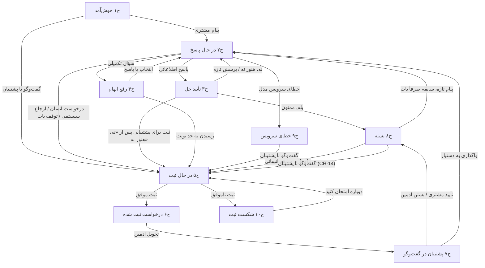

# ‏PRD-05a — صفحه گفت‌وگو

> ‏**مرز:** صفحه گفت‌وگو (ACT-01 مشتری) · **صفحه:** SCR-01 · **UCD:** UCD-01 تا UCD-05 · **فلوها:** UXF-01، 02، 03، 06، 07 (و دیدنی‌های UXF-05، 08) · **دستگاه:** موبایل در اولویت **(فرض A-17 ← PRD-07)**
>
> ‏**سطح این زیرسند:** چیدمان یک صفحه و ظاهر آن در دوازده حالت (PRD-05 §5.3). رفتار و متن کامل در استوری‌های PRD-04 است و اینجا فقط ارجاع داده می‌شود (DEC-123).
>
> ‏**راهنمای برچسب‌ها:** `[SRC-xx §n]` = برگرفته از منبع · **(پیشنهاد)** = پیشنهاد تیم PRD · **(فرض A-xx)** = فرض تأییدنشده · **(تغییر — CH-xx)** = افزوده نسبت به اسناد تأییدشده · ⚠️ = نقطه باز.

### ‏راهنمای شناسه‌ها

| ‏کد | ‏معنی | ‏کجا تعریف شده |
|---|---|---|
| ‏SCR-01 · ح۱ … ح۱۲ | ‏حالت‌های صفحه گفت‌وگو | ‏PRD-05 §5.3؛ همین سند §5a.4 |
| ‏R0 … R3 | ‏ناحیه‌های صفحه، از بالا به پایین | ‏همین سند §5a.2 |
| ‏C1 … C11 | ‏اجزای درون فهرست پیام‌ها (فقط درون همین سند) | ‏همین سند §5a.3 |
| ‏UXF | ‏فلوی کار روی صفحه‌ها | ‏PRD-05 §5.6 |
| ‏US / AC | ‏استوری / معیار پذیرش | ‏PRD-04 |
| ‏S1 … S6 / TR | ‏وضعیت مکالمه / انتقال وضعیت | ‏PRD-03f |
| ‏ND / CR | ‏نباید کلی محصول / قاعده رفتاری مشترک | ‏PRD-04-00 |
| ‏A / DEC / CH / G | ‏فرض / تصمیم / تغییر / شکاف شناسایی‌شده در تحلیل PRD-05 | ‏Master Index؛ PRD-05 §5.10 |

---

## ‏۵a.۱ سرصفحه

| ‏مورد | ‏مقدار |
|---|---|
| ‏مرز | ‏صفحه گفت‌وگو |
| ‏نقش | ‏مشتری؛ فقط مکالمه خود (ND-23، ND-24) |
| ‏استوری | ‏US-01-01 تا 06 · US-02-01 · US-03-04، 05، 06 · US-04-01 تا 06 · US-07-01، 03، 04، 05 |
| ‏ردیابی | ‏UCD-01 تا 05 · ACD-01، 02، 03، 06، 07 · FR-01 تا FR-06، FR-09، FR-12 · BO-01، BO-03، BO-05 |
| ‏دستگاه | ‏موبایل در اولویت؛ روی صفحه بزرگ‌تر همان چیدمان با عرض محدود **(فرض A-17)** |
| ‏ورود از | ‏ورودی ۱ (PRD-05 §5.4): از سایت نمایشی؛ شکل فیزیکی ← PRD-07. بدون ورود و ثبت‌نام (US-01-01) |
| ‏خروج به | ‏ندارد؛ صفحه گفت‌وگو پیوندی به صفحه دیگر محصول ندارد |

### ‏ناوبری

> ‏صفحه گفت‌وگو یک صفحه است؛ به‌جای ناوبری بین صفحه‌ها، **جابه‌جایی بین حالت‌ها** نشان داده می‌شود. هر فلش برچسب رویداد دارد.

> ‏ح۱۱ (ارسال نشد) و ح۱۲ (پیام بلند) روی هر حالتی می‌نشینند و وضعیت مکالمه را تغییر نمی‌دهند؛ برای خوانایی در دیاگرام نیامده‌اند. «تحویل مستقیم» (TR-11) از ح۲ و ح۳ و ح۴ هم از نگاه مشتری مستقیم به ح۷ می‌رسد: ارجاع پشت صحنه ثبت می‌شود و پیام «درخواست ثبت شد» نمایش داده نمی‌شود (US-07-02؛ DEC-261، DEC-267). «ارجاع سیستمی» در ح۲ شامل ارجاع خودکار نبود پاسخ معتبر، «نامشخص» و خارج از اختیار هم هست (DEC-260).

---

## ‏۵a.۲ ناحیه‌ها (از بالا به پایین؛ در هر ردیف از راست به چپ)

| ‏ناحیه | ‏محتوا | ‏کنش | ‏استوری / مرجع | ‏متن |
|---|---|---|---|---|
| ‏R0 سرصفحه | ‏نام فروشگاه · برچسب «دستیار پشتیبانی» · برچسب «نسخه نمایشی» · دکمه «گفت‌وگو با پشتیبان» | ‏زدن دکمه ← ح۵ | ‏US-04-01؛ CR-02؛ قاعده ۱۰ متن رابط؛ **G6 (پیشنهاد)** | ‏«گزینه» ← US-04-01 · «نسخه نمایشی» **(پیشنهاد)** |
| ‏R1 نوار وضعیت | ‏فقط در ح۶ و ح۷؛ چسبیده زیر سرصفحه؛ در این دو حالت جای دکمه R0 را می‌گیرد | — | ‏DEC-91؛ US-04-01؛ **G5** | ‏ح۶: «نشان پایدار» ← US-04-01 · ح۷: متن تازه **(پیشنهاد)** §5a.6 |
| ‏R2 فهرست پیام‌ها | ‏پیام‌ها به ترتیب زمان؛ تازه‌ترین در پایین؛ اجزای C1 تا C11 (§5a.3) | ‏کنش‌های درون پیام (C5 تا C8، C11) | ‏US-01-01؛ US-03-03 (ترتیب) | ‏§5a.5 |
| ‏R3 کادر نوشتن | ‏کادر متن چندخطی · شمارنده نویسه · دکمه ارسال؛ چسبیده پایین صفحه | ‏ارسال با دکمه؛ دکمه با متن غیرخالی فعال می‌شود. **دسکتاپ:** Enter = ارسال، Shift+Enter = خط تازه. **موبایل:** Enter = خط تازه، ارسال فقط با دکمه (DEC-295) | ‏US-01-01؛ فرض A-14 | ‏«پیام بلند» ← US-01-01 |

### ‏جزئیات R0 و R3

| ‏جزء | ‏رفتار | ‏مرجع |
|---|---|---|
| ‏دکمه «گفت‌وگو با پشتیبان» | ‏در ح۱، ح۲، ح۳، ح۴، ح۸، ح۹، ح۱۰ دیده و فعال است · در ح۵ دیده و غیرفعال · در ح۶ و ح۷ پنهان (جایش R1) · به سرویس مدل وابسته نیست | ‏CR-02؛ DEC-50؛ AC-04-01-4؛ **CH-14 (ح۸)** |
| ‏برچسب «نسخه نمایشی» | ‏همیشه دیده می‌شود؛ متن کوتاه و بدون کنش | ‏CR-08؛ **G6 (پیشنهاد)** |
| ‏کادر نوشتن | ‏در همه حالت‌ها فعال است، جز ح۵ (کادر فعال، ارسال غیرفعال تا پایان ثبت) | ‏DEC-71؛ **(پیشنهاد)** |
| ‏شمارنده نویسه | ‏از ۹۰۰ نویسه به بعد دیده می‌شود («۹۵۰ از ۱۰۰۰»)؛ پس از ۱۰۰۰، ح۱۲ | ‏فرض A-14؛ **(پیشنهاد)** |
| ‏پیام خالی | ‏دکمه ارسال غیرفعال است | ‏US-01-01 |
| ‏چیدمان موبایل | ‏R0 و R1 بالای صفحه ثابت‌اند و R3 پایین صفحه، بالای صفحه‌کلید؛ فقط R2 پیمایش می‌شود | ‏**(فرض A-17)** |

---

## ‏۵a.۳ اجزای فهرست پیام‌ها

| ‏جزء | ‏چیست | ‏کجا می‌آید | ‏رفتار | ‏استوری / مرجع |
|---|---|---|---|---|
| ‏C1 پیام مشتری | ‏متن مشتری | ‏**سمت راست** فهرست (DEC-302) | ‏همراه با وضعیت ارسال (C11) | ‏US-01-01 |
| ‏C2 پیام دستیار | ‏متن دستیار با برچسب فرستنده «دستیار» | ‏**سمت چپ** فهرست (DEC-302) | ‏منبع به مشتری نمایش داده نمی‌شود | ‏DEC-73؛ VL-08 |
| ‏C3 پیام پشتیبان | ‏متن ادمین؛ زیر پیام «[نام و نام خانوادگی] · پشتیبان فروشگاه»؛ ظاهری متمایز از C2 | ‏سمت چپ، مثل C2 | ‏نام و نام خانوادگی ادمینی که گفت‌وگو را تحویل گرفته نمایش داده می‌شود؛ جای دیگری نام ادمین به مشتری نشان داده نمی‌شود | ‏US-07-03؛ **DEC-303** (جایگزین DEC-94) |
| ‏C4 پیام سیستمی | ‏خط کوتاه و بدون برچسب فرستنده، وسط فهرست | ‏میان پیام‌ها | ‏فقط اطلاع؛ بدون کنش | ‏VL-08؛ §5a.5 |
| ‏C5 دکمه‌های تأیید حل | ‏«بله، ممنون» · «نه، هنوز نه» | ‏زیر پیام دستیار یا پیام سیستمی درخواست تأیید | ‏پس از انتخاب، گزینه انتخاب‌شده برجسته و هر دو غیرفعال می‌شوند | ‏US-01-02؛ US-03-04 |
| ‏C6 گزینه‌های رفع ابهام | ‏سایزها و رنگ‌های **کاتالوگ**؛ بدون اشاره به موجودی | ‏زیر سؤال تکمیلی | ‏زدن یک گزینه همان متن را به‌عنوان پیام مشتری (C1) می‌فرستد | ‏US-01-03؛ AC-01-03-6؛ **G3 (پیشنهاد)** |
| ‏C7 فهرست پیشنهاد کاتالوگ | ‏حداکثر ۳ مورد: نام محصول + ویژگی‌های منطبق | ‏درون پیام دستیار | ‏بدون تصویر، قیمت فقط اگر در منبع باشد، بدون موجودی؛ بدون کنش (مشتری با نوشتن ادامه می‌دهد) | ‏US-01-04؛ DEC-76؛ **G3 (پیشنهاد)** |
| ‏C8 دکمه درون پیام | ‏«ثبت برای پشتیبانی» یا «گفت‌وگو با پشتیبان» | ‏زیر پیام «نه، هنوز نه» و خطای سرویس؛ پس از نبود پاسخ، «نامشخص» و خارج از اختیار دکمه‌ای نیست، چون ارجاع خودکار است (DEC-260) | ‏← ح۵ | ‏US-03-04؛ US-04-05؛ DEC-260 |
| ‏C9 برچسب «نمایشی» | ‏برچسب درون پیام سفارش نمونه | ‏درون C2 | — | ‏US-01-05؛ قاعده ۸ متن رابط |
| ‏C10 نشانه در حال پاسخ | ‏نشانه انتظار با متن کوتاه | ‏پایین فهرست، جای پیام بعدی دستیار | ‏با پاسخ، پیام خطا یا لغو پاسخ ناپدید می‌شود | ‏ح۲؛ **(پیشنهاد)** |
| ‏C11 وضعیت ارسال | ‏نشان «ارسال نشد» + «ارسال دوباره» | ‏زیر C1 | ‏ارسال دوباره تکراری نمی‌شود | ‏US-01-01؛ CR-03 |
| ‏C12 پیشنهاد شروع | ‏چهار گزینه آماده برای نخستین پرسش (§5a.6) | ‏فقط ح۱؛ زیر پیام خوش‌آمد، در بخش کنش جدا | ‏زدن یک گزینه همان متن را به‌عنوان پیام مشتری (C1) می‌فرستد، مثل C6؛ پس از نخستین پیام مشتری دیگر نمایش داده نمی‌شود | ‏US-01-01؛ **DEC-271** |

> ‏**قاعده اجزای کنش‌دار (پیشنهاد):** فقط C5، C6، C8 و C12 **آخرین** پیام کنش‌پذیرند. در پیام‌های قدیمی‌تر غیرفعال می‌شوند و اگر انتخابی انجام شده، همان انتخاب نشان داده می‌شود. پس از ورود به ح۶، همه C8های قبلی غیرفعال‌اند. این کار از ثبت ناخواسته و پاسخ به سؤال کهنه جلوگیری می‌کند.

### ‏سلسله‌مراتب بصری (DEC-272)

| ‏جزء | ‏قاعده | ‏دلیل |
|---|---|---|
| ‏بخش کنش | ‏C5، C6، C8 و C12 در بخشی جدا و تمام‌عرض زیر آخرین پیام دستیار می‌آیند، با پس‌زمینه سبز روشن | ‏کار مشتری از متن پیام جدا دیده می‌شود |
| ‏C8 «گفت‌وگو با پشتیبان» | ‏دکمه سفید با قاب و متن رنگ اصلی؛ هم‌رنگ C1 نیست | ‏با پیام مشتری اشتباه گرفته نمی‌شود |
| ‏دکمه R0 | ‏وزن بصری کمتر (قاب روشن روی سرصفحه رنگی)؛ رفتار و دیده‌شدن طبق DEC-130 بی‌تغییر؛ در ح۵ قاب نقطه‌چین و متن کم‌رنگ‌تر | ‏راه انسانی همیشه در دسترس است ولی با پاسخ دستیار رقابت نمی‌کند |
| ‏نشان فرستنده | ‏C2 کنار آخرین پیام گروه، نشانه فروشگاه را دارد؛ C3 نشانه جدا (نشانه شخص) دارد؛ نشانه فروشگاه تا تعیین حوزه کالا یک تصویر پیش‌فرض عمومی (کیف خرید) است (DEC-305) | ‏دستیار «دستیار خود فروشگاه» دیده می‌شود؛ C3 از C2 متمایز است |
| ‏R1 در ح۷ | ‏پس‌زمینه سبز روشن (خبر خوب)، نه رنگ تیره | ‏سنگین‌ترین جزء صفحه نباشد |
| ‏ح۱۰ با مسیر جایگزین | ‏مسیر تماس در سطری جدا درون پیام، بدون پررنگ‌کردن وسط جمله | ‏خوانایی؛ متن طبق US-04-04 بی‌تغییر |
| ‏دسکتاپ | ‏ستون گفت‌وگو کارتی با عرض محدود وسط صفحه روی پس‌زمینه روشن | ‏فرض A-17 |

---

## ‏۵a.۴ حالت‌ها

| ‏حالت | ‏وضعیت | ‏R0 دکمه | ‏R1 | ‏R2 | ‏R3 | ‏استوری / مرجع |
|---|---|---|---|---|---|---|
| ‏بارگذاری صفحه | ‏— | ‏دیده، غیرفعال | — | ‏نشانه بارگذاری؛ هرگز ح۱ پیش از دانستن اینکه مکالمه قبلی هست یا نه | ‏غیرفعال | ‏PRD-05 §5.2 |
| ‏خطای بارگذاری | ‏— | ‏دیده، فعال | — | ‏پیام «گفت‌وگو بارگذاری نشد» + «تلاش دوباره» | ‏غیرفعال | ‏**(پیشنهاد)** §5a.6 |
| ‏ح۱ خوش‌آمد | ‏— (پیش از TR-00) | ‏فعال | — | ‏بلوک خوش‌آمد (نشانه و نام فروشگاه، زیرعنوان «دستیار پشتیبانی فروشگاه») + پیام خوش‌آمد (C2) + C12 **(DEC-270، DEC-271)** | ‏فعال | ‏US-01-01؛ AC-04-01-4 |
| ‏ح۲ در حال پاسخ | ‏S1 | ‏فعال | — | ‏آخرین C1 + C10 | ‏فعال؛ پیام تازه پاسخ در جریان را کنار می‌گذارد | ‏DEC-71 |
| ‏ح۳ تأیید حل | ‏S2 (تأیید حل) | ‏فعال | — | ‏پاسخ (C2، شاید با C7، C9 یا C8) + C5 | ‏فعال؛ متن روشن «حل شد» تأیید حساب می‌شود | ‏CR-01؛ US-01-02؛ US-02-01؛ DEC-102 |
| ‏ح۴ رفع ابهام | ‏S2 (رفع ابهام) | ‏فعال | — | ‏سؤال تکمیلی (C2) + C6 | ‏فعال | ‏US-01-03 |
| ‏ح۵ در حال ثبت | ‏S1 یا S2؛ ثبت در جریان | ‏دیده، غیرفعال | — | ‏C4 «در حال ثبت…» | ‏کادر فعال؛ ارسال غیرفعال | ‏US-04-02؛ DEC-86 |
| ‏ح۶ درخواست ثبت شده | ‏S3 | ‏پنهان | ‏نشان پایدار S3 | ‏پیام ثبت موفق (C2)؛ خارج از ساعات: متن جایگزین | ‏فعال؛ پیام‌ها به پرونده افزوده می‌شوند و پاسخ محتوایی نمی‌آید | ‏US-04-01، 02، 03، 06؛ DEC-91 |
| ‏ح۷ پشتیبان در گفت‌وگو | ‏S4 | ‏پنهان | ‏نشان S4 | ‏C4 «پشتیبان پیوست» + پیام‌های C3؛ شاید C5 (درخواست تأیید ادمین) | ‏فعال | ‏US-07-01، 03؛ US-03-04 |
| ‏ح۸ بسته | ‏S5 یا S6 | ‏فعال **(CH-14)** | — | ‏C4 «گفت‌وگو بسته شد» یا پیام پس از «بله» | ‏فعال؛ پیام تازه بازگشایی می‌کند | ‏US-03-04، 05، 06 |
| ‏ح۹ خطای سرویس | ‏S1 یا S2 | ‏فعال | — | ‏پیام خطای سرویس (C2) + C8 «گفت‌وگو با پشتیبان» | ‏فعال؛ پیام بعدی عادی پردازش می‌شود | ‏US-04-05 |
| ‏ح۱۰ شکست ثبت | ‏S1 یا S2 (بدون تغییر) | ‏فعال | — | ‏پیام عدم ثبت با یا بدون مسیر جایگزین + «دوباره امتحان کنید» | ‏فعال | ‏US-04-04؛ DEC-87 |
| ‏ح۱۱ ارسال نشد | ‏بدون تغییر | ‏بدون تغییر | ‏بدون تغییر | ‏C1 با C11 | ‏فعال | ‏US-01-01 |
| ‏ح۱۲ پیام بلند | ‏بدون تغییر | ‏بدون تغییر | ‏بدون تغییر | ‏بدون تغییر | ‏متن پاک نمی‌شود؛ ارسال غیرفعال؛ پیام راهنما زیر کادر | ‏US-01-01؛ AC-01-01-4 |

### ‏گونه‌های یک حالت (همان ناحیه‌ها، متن یا جزء متفاوت)

| ‏حالت | ‏گونه | ‏تفاوت | ‏مرجع |
|---|---|---|---|
| ‏ح۳ | ‏موجود / ناموجود / نامشخص | ‏متن پیام؛ زمان تأیید فقط در موجود و ناموجود؛ C8 فقط در نامشخص | ‏US-02-01؛ DEC-78 |
| ‏ح۳ | ‏نبود پاسخ / پاسخ بخشی / خارج از اختیار | ‏متن پیام؛ C8 در نبود پاسخ و خارج از اختیار | ‏US-01-02؛ US-01-06 |
| ‏ح۳ | ‏سفارش نمونه | ‏C9؛ «موعد ثبت‌نشده» در صورت نبود موعد | ‏US-01-05 |
| ‏ح۵ | ‏منشأ توقف بات | ‏مشتری تفاوتی نمی‌بیند؛ پس از ثبت ← ح۶ | ‏US-07-05؛ CR-06 |
| ‏ح۶ | ‏داخل یا خارج از ساعات کاری | ‏متن پیام ثبت موفق | ‏US-04-06؛ DEC-41 |
| ‏ح۶ | ‏بازگشایی با سابقه انسانی | ‏متن «پیامتان برای پشتیبانی ثبت شد» | ‏US-03-06 |
| ‏ح۶ | ‏درخواست انسانِ دوباره با متن | ‏پیام «قبلاً ثبت شده» | ‏US-04-03 |
| ‏ح۸ | ‏پس از «بله، ممنون» / پس از بستن ادمین | ‏متن پیام | ‏US-03-04؛ US-03-05 |
| ‏ح۱۰ | ‏با مسیر جایگزین / بدون آن | ‏متن پیام | ‏US-04-04؛ DEC-87 |
| ‏ح۲ | ‏پس از واگذاری به دستیار | ‏C4 «از این به بعد دستیار پاسخ می‌دهد»؛ دستیار تا پیام تازه ساکت است | ‏US-07-04؛ DEC-98 |

### ‏حالت‌های هم‌زمانی

| ‏موقعیت | ‏دیدنی برای مشتری | ‏مرجع |
|---|---|---|
| ‏ادمین در ح۲ تحویل می‌گیرد | ‏C10 ناپدید می‌شود، پاسخ دستیار نمی‌آید، C4 «پشتیبان پیوست» ← ح۷ | ‏ND-16؛ US-07-01، 02 |
| ‏توقف بات در ح۲ | ‏C10 ناپدید می‌شود؛ با پیام تازه ← ح۵ | ‏US-07-05 |
| ‏پاسخ دیرهنگام پس از ح۹ | ‏منتشر نمی‌شود | ‏DEC-93 |
| ‏دو تب باز | ‏پیام‌ها و حالت در هر دو تب یکسان، حداکثر پس از تازه‌سازی | ‏AC-01-01-6 |

---

## ‏۵a.۵ جای متن‌ها

> ‏متن کامل در استوری مرجع است (DEC-61). این جدول فقط می‌گوید کدام متن در کدام جزء و حالت می‌آید.

| ‏متن (برچسب در استوری) | ‏جزء | ‏حالت | ‏استوری |
|---|---|---|---|
| ‏پیام خوش‌آمد | ‏C2 | ‏ح۱ | ‏US-01-01 |
| ‏پیام بلند · ارسال نشد | ‏زیر R3 · C11 | ‏ح۱۲ · ح۱۱ | ‏US-01-01 |
| ‏پیام نامفهوم | ‏C2 | ‏ح۲ ← ح۳ یا پاسخ عادی | ‏US-01-01 |
| ‏نبود پاسخ · پاسخ بخشی · درخواست تأیید حل | ‏C2 + C8 · C2 · C5 | ‏ح۳ | ‏US-01-02 |
| ‏سؤال تکمیلی · مقدار بیرون از کاتالوگ · رسیدن به حد | ‏C2 + C6 · C2 + C6 · C2 | ‏ح۴ · ح۴ · ح۵ | ‏US-01-03 |
| ‏پیشنهاد · نبود نتیجه | ‏C2 + C7 · C2 | ‏ح۳ | ‏US-01-04 |
| ‏درخواست شناسه · وضعیت · موعد ثبت‌نشده · شناسه پیدا نشد | ‏C2 (+ C9) | ‏ح۲ / ح۳ | ‏US-01-05 |
| ‏عمومی · مرجوعی · رزرو (خارج از اختیار) | ‏C2 + C8 | ‏ح۳ | ‏US-01-06 |
| ‏موجود · ناموجود · نامشخص | ‏C2 (+ C8) | ‏ح۳ | ‏US-02-01 |
| ‏پس از «بله» · پس از «نه» · درخواست ادمین (S4) | ‏C2 · C2 + C8 · C4 + C5 | ‏ح۸ · ح۲ · ح۷ | ‏US-03-04 |
| ‏پیام به مشتری (حل‌شده / بدون تأیید) | ‏C4 | ‏ح۸ | ‏US-03-05 |
| ‏مسیر انسانی (بازگشایی) | ‏C2 | ‏ح۶ | ‏US-03-06 |
| ‏گزینه · پرسش در ابهام · نشان پایدار پس از ثبت | ‏R0 · C2 · R1 | ‏همه · ح۲ · ح۶ | ‏US-04-01 |
| ‏در حال ثبت · ثبت موفق (ساعات کاری) | ‏C4 · C2 | ‏ح۵ · ح۶ | ‏US-04-02 |
| ‏درخواست انسانِ دوباره در S3 | ‏C2 | ‏ح۶ | ‏US-04-03 |
| ‏ثبت نشد (با / بدون مسیر جایگزین) | ‏C2 + کنش | ‏ح۱۰ | ‏US-04-04 |
| ‏خطای سرویس | ‏C2 + C8 | ‏ح۹ | ‏US-04-05 |
| ‏ثبت موفق (خارج از ساعات) | ‏C2 | ‏ح۶ | ‏US-04-06 |
| ‏اطلاع مشتری از تحویل · برچسب پیام پشتیبان | ‏C4 · C3 | ‏ح۷ | ‏US-07-01؛ US-07-03 |
| ‏اطلاع مشتری از واگذاری | ‏C4 | ‏ح۲ | ‏US-07-04 |

---

## ‏۵a.۶ متن‌های تازه این زیرسند (همه پیشنهاد — DEC-61)

| ‏جا | ‏متن | ‏دلیل |
|---|---|---|
| ‏R0 برچسب نمایشی | ‏«نسخه نمایشی» | ‏G6؛ CR-08 |
| ‏R1 نشان S4 | ‏«[نام و نام خانوادگی] از پشتیبانی فروشگاه در گفت‌وگوست. پیام‌هایتان را همین‌جا بنویسید.» (DEC-303) | ‏G5؛ متن S3 در S4 نادرست است چون دیگر «ثبت» نیست، «در حال رسیدگی» است |
| ‏C10 | ‏«در حال نوشتن پاسخ…» | ‏ح۲ |
| ‏ح۱ بلوک خوش‌آمد | ‏نام فروشگاه + «دستیار پشتیبانی فروشگاه» | ‏DEC-270 |
| ‏C12 | ‏«موجودی محصول» · «هزینه و زمان ارسال» · «پیگیری سفارش» · «مرجوعی کالا» | ‏DEC-271؛ موضوع‌های پیام خوش‌آمد US-01-01 |
| ‏شمارنده | ‏«[۹۵۰] از ۱۰۰۰» | ‏فرض A-14 |
| ‏خطای بارگذاری صفحه | ‏«گفت‌وگو بارگذاری نشد. دوباره تلاش کنید.» + «تلاش دوباره» | ‏حالت استاندارد PRD-05 §5.2 |

---

## ‏۵a.۷ پوشش معیارهای پذیرش

| ‏معیار | ‏کجا در صفحه |
|---|---|
| ‏AC-01-01-1، 2، 7 | ‏ح۲، ح۳ (محتوای C2) |
| ‏AC-01-01-3 | ‏ح۱ ← ح۲ |
| ‏AC-01-01-4 | ‏ح۱۲ |
| ‏AC-01-01-5 | ‏ح۱۱ (C11) |
| ‏AC-01-01-6 | ‏حالت‌های هم‌زمانی |
| ‏AC-01-02-1 تا 8 | ‏ح۳ و گونه‌هایش؛ C8 ← ح۵ (AC-01-02-7) |
| ‏AC-01-03-1 تا 7 | ‏ح۴ (C6)؛ رسیدن به حد ← ح۵؛ AC-01-03-7 با R0 یا متن |
| ‏AC-01-04-1 تا 5 | ‏ح۳ (C7) |
| ‏AC-01-05-1 تا 5 | ‏ح۲ و ح۳ (C9) |
| ‏AC-01-06-1 تا 6 | ‏ح۳ (C8) |
| ‏AC-02-01-1 تا 12 | ‏ح۳ گونه‌های موجودی |
| ‏AC-03-04-1 تا 6 | ‏ح۳ (C5)، ح۷ (C5)، ح۸ |
| ‏AC-03-05-1، 2 | ‏ح۸ (C4) |
| ‏AC-03-06-1 تا 6 | ‏ح۸ ← ح۶ یا ح۲ |
| ‏AC-04-01-1 تا 6 | ‏R0 در همه حالت‌ها؛ ح۵؛ ح۶ |
| ‏AC-04-02-1 تا 5 | ‏ح۵ ← ح۶ |
| ‏AC-04-03-1 تا 3 | ‏ح۶ و گونه «درخواست دوباره»؛ C11 |
| ‏AC-04-04-1 تا 5 | ‏ح۱۰ |
| ‏AC-04-05-1، 4، 5 | ‏ح۹؛ هم‌زمانی (پاسخ دیرهنگام) |
| ‏AC-04-06-1 تا 3، 6 | ‏ح۶ گونه ساعات کاری |
| ‏AC-07-01-3، 4 | ‏هم‌زمانی؛ ح۷ |
| ‏AC-07-02-1 | ‏هم‌زمانی |
| ‏AC-07-03-1، 5 | ‏ح۷ (C3) |
| ‏AC-07-04-4 | ‏ح۲ پس از واگذاری |
| ‏AC-07-05-2، 3 | ‏ح۵ ← ح۶ |

> ‏AC‌هایی که فقط در پنل‌ها یا داده دیده می‌شوند (مثلاً ثبت رویداد) در 05b و 05c آمده‌اند.

---

## ‏۵a.۷b حالت‌های کمک به خرید (v2 — CH-61)

> ‏v2 — پیشنهاد ChatGPT P1. حالت‌ها در پروتوتایپ زنده (Chat-Live) با کاتالوگ نمونه v2 کار می‌کنند؛ بوم: ح۱۶ تا ح۱۸ (موبایل و دسکتاپ).

| ‏حالت | ‏محتوا | ‏استوری |
| --- | --- | --- |
| ‏ح۱۶ پیشنهاد محصول با دلیل | ‏حباب دستیار: «این‌ها با خواسته شما جور درمی‌آیند:» + تا سه **کارت محصول** + «برای موجودی هرکدام، رنگ و سایز را بگویید.» + «جواب سؤالتان را گرفتید؟» | ‏US-08-01 |
| ‏ح۱۶ب بی‌نتیجه | ‏«در کاتالوگ فروشگاه محصولی با همه این ویژگی‌ها پیدا نکردم…»؛ اگر جنس خواسته‌شده در کاتالوگ نیست، همین گفته می‌شود؛ بدون ارجاع | ‏US-08-01؛ US-08-04 |
| ‏ح۱۷ جایگزین | ‏پاسخ موجودی «… موجود نیست.» + «این‌ها نزدیک‌ترین گزینه‌های موجود در سایز L هستند:» + تا سه کارت با خط **«تفاوت با انتخاب شما»** + یادداشت رزرو | ‏US-08-02 |
| ‏ح۱۸ تردید در قیمت | ‏«اگر بودجه‌تان کمتر است، این مانتوهای مشابه موجودند:» + کارت‌ها با تفاوت و «… ارزان‌تر» | ‏US-08-03 |
| ‏ح۱۸ب مقایسه | ‏«تفاوت این دو در اطلاعات فروشگاه:» + جنس، فصل، کاربرد، قد، فرم و قیمت هر دو + «انتخاب با شماست…» | ‏US-08-03 |

### ‏کارت محصول (جزء تازه فهرست پیام‌ها — DEC-339)

| ‏بخش | ‏محتوا | ‏قاعده |
| --- | --- | --- |
| ‏تصویر | ‏تصویر اصلی محصول (یا تصویر همان رنگ برای جایگزین)، ۶۰×۷۶؛ بی‌تصویر: جای خالی با نماد لباس | ‏DEC-327 |
| ‏نام | ‏نام محصول؛ در جایگزین: « · رنگ · سایز» | — |
| ‏قیمت | ‏قیمت اعلام‌شده با جداکننده هزارگان و «تومان» | ‏RULE-07 |
| ‏خط دلیل یا تفاوت | ‏پیشنهاد: ویژگی‌های منطبق (خاکستری) · جایگزین و تردید: تفاوت‌ها و اختلاف قیمت (برچسب سبز روشن) | ‏DEC-331؛ DEC-332 |
| ‏کنش | ‏**ندارد**: پیوند خرید، سبد و «افزودن» نیست (DEC-322) | — |

---
## ‏۵a.۸ تصمیم‌ها، تغییرات و نقاط باز

### ‏تصمیم‌های تأییدشده (برای ثبت در Master Index)

| ‏شناسه پیشنهادی | ‏تصمیم |
|---|---|
| ‏DEC-130 | ‏دکمه «گفت‌وگو با پشتیبان» در سرصفحه، ثابت، مستقل از سرویس مدل؛ در ح۵ غیرفعال و در ح۶ و ح۷ جای آن نوار وضعیت R1 (Q-32 بخش اول و دوم بسته شد) |
| ‏DEC-131 | ‏نشان S4 متن جدا دارد (§5a.6) (G5) |
| ‏DEC-132 | ‏گزینه‌های رفع ابهام قابل انتخاب‌اند و همان متن را به‌عنوان پیام مشتری می‌فرستند؛ پیشنهاد کاتالوگ فهرست ساده درون پیام است، بدون تصویر و بدون کنش (G3) |
| ‏DEC-133 | ‏فقط اجزای کنش‌دار آخرین پیام کنش‌پذیرند؛ پس از ح۶ همه دکمه‌های قبلی ثبت غیرفعال‌اند (§5a.3) |
| ‏DEC-134 | ‏برچسب ثابت «نسخه نمایشی» در سرصفحه (G6) |
| ‏DEC-135 | ‏در ح۵ ارسال پیام تا پایان ثبت غیرفعال است؛ شمارنده نویسه از ۹۰۰ دیده می‌شود |
| ‏DEC-270 | ‏ح۱ بلوک خوش‌آمد دارد: نشانه و نام فروشگاه و زیرعنوان، بالای پیام خوش‌آمد |
| ‏DEC-271 | ‏C12 پیشنهاد شروع: چهار گزینه در ح۱؛ زدن = ارسال همان متن؛ پس از نخستین پیام پنهان |
| ‏DEC-272 | ‏سلسله‌مراتب بصری صفحه گفت‌وگو (جدول §5a.3) |
| ‏DEC-294 | ‏رفع ابهام با چند ویژگی (مثلاً سایز و رنگ): هر گروه گزینه تک‌انتخابی و قابل تغییر است؛ پیام فقط وقتی فرستاده می‌شود که همه گروه‌ها انتخاب شده باشند؛ متن راهنما زیر گزینه‌ها می‌گوید چه چیزی مانده. مشتری می‌تواند به‌جای انتخاب، پاسخ را بنویسد. *(تکمیل DEC-132)* |
| ‏DEC-295 | ‏کلید Enter در R3: دسکتاپ ارسال و Shift+Enter خط تازه؛ موبایل خط تازه و ارسال با دکمه |
| ‏DEC-296 | ‏پس از «بله، ممنون» یا «نه، هنوز نه» هر دو گزینه با انتخاب مشتری غیرفعال در تاریخچه می‌مانند. پس از «نه، هنوز نه» دستیار عذرخواهی کوتاه می‌کند و C8 «گفت‌وگو با پشتیبان» را پیشنهاد می‌دهد (DEC-268). با پیام تازه مشتری، گزینه‌های پاسخ‌نداده قبلی غیرفعال می‌شوند (DEC-133) |
| ‏DEC-297 | ‏**پیگیری سفارش و مرجوعی:** دستیار پیش از پاسخ شماره سفارش را می‌پرسد (شماره یافت‌نشده: یک بار درخواست دوباره، سپس ارجاع — DEC-268). در مرجوعی سفارش چندکالایی، کالا با گزینه پرسیده می‌شود؛ پاسخ = سیاست مرجوعی و مهلت آن سفارش؛ ثبت مرجوعی کار پشتیبان است و C8 کنار پرسش تأیید می‌آید (ND-01 تا ND-07) |
| ‏DEC-302 | ‏پیام مشتری (C1) سمت راست صفحه و پیام دستیار و پشتیبان (C2، C3) سمت چپ؛ نشانه فرستنده کنار لبه چپ |
| ‏DEC-303 | ‏پس از پیوستن پشتیبان، نام و نام خانوادگی او در خط سیستمی پیوستن (C4)، زیر پیام‌هایش (C3) و در نوار R1 ح۷ به مشتری نشان داده می‌شود. جایگزین بخش «نام ادمین نشان داده نمی‌شود» در DEC-94 |
| ‏DEC-305 | ‏تا تعیین حوزه کالا (D-01)، نشانه فروشگاه در سرصفحه و کنار پیام دستیار یک تصویر پیش‌فرض عمومی است (کیف خرید)؛ با لوگوی فروشگاه جایگزین می‌شود |
| ‏DEC-306 | ‏اسکرول‌بار کادر نوشتن فقط وقتی متن از بیشینه ارتفاع کادر (۴ خط) بیشتر شود دیده می‌شود |

### ‏تغییر نسبت به اسناد تأییدشده

| ‏شناسه | ‏تغییر | ‏اسناد متأثر |
|---|---|---|
| ‏CH-14 | ‏**(G2)** دکمه «گفت‌وگو با پشتیبان» در مکالمه بسته (S5، S6) هم دیده می‌شود. زدن آن مکالمه را بازگشایی می‌کند (TR-09) و بلافاصله ارجاع با علت «درخواست مشتری» می‌سازد (به ح۵ و سپس S3)، با پیوند به ارجاع قبلی اگر وجود داشته باشد. این دکمه در ح۸ جایگزین ارسال پیام نیست؛ پیام تازه همچنان طبق US-03-06 رفتار می‌کند | ‏PRD-04-EP04 (پیش‌شرط US-04-01: «S1 یا S2» ← «S1، S2، S5 یا S6»)؛ PRD-04-EP03 (US-03-06: محرک دوم بازگشایی) |

### ‏نقاط باز

| ‏شناسه | ‏موضوع | ‏محل |
|---|---|---|
| ‏— | ‏شکل فیزیکی صفحه (ابزارک روی سایت نمایشی یا صفحه مستقل) و شناسایی مکالمه بدون ورود | ‏PRD-07 |
| ‏— | ‏به‌روزرسانی خودکار پیام‌های پشتیبان در صفحه مشتری (بدون تازه‌سازی) | ‏PRD-06 (هم‌راستا با DEC-67) |
| ‏~~—~~ | ‏~~سوی پیام‌ها و ظاهر C2 در برابر C3~~ — بسته شد در طراحی P-02 (DEC-272) | ‏— |
| ‏Q-47 | ‏تکرار «جواب سؤالتان را گرفتید؟» پس از هر پاسخ اطلاعاتی (CR-01) — بی‌تغییر ماند تا تصمیم | ‏Master Index §8.1 |

---

### ‏تاریخچه تغییرات این سند

| ‏نسخه | ‏تاریخ | ‏تغییر |
|---|---|---|
| ‏1.1 | ‏2026-11-12 | ‏§5a دیاگرام حالت‌ها: برچسب «ثبت برای پشتیبانی» از ح۳؛ یادداشت ارجاع خودکار و تحویل مستقیم از نگاه مشتری (DEC-260، DEC-261، DEC-267). C8: دکمه فقط پس از «نه، هنوز نه» و خطای سرویس (DEC-260) |
| ‏1.2 | ‏2026-11-16 | ‏بازبینی طراحی P-02 (CH-48): بلوک خوش‌آمد ح۱ (DEC-270)؛ C12 پیشنهاد شروع (DEC-271)؛ جدول سلسله‌مراتب بصری (DEC-272)؛ نقطه باز «ظاهر C2 و C3» بسته شد؛ Q-47 افزوده شد |
| ‏1.3 | ‏2026-11-19 | ‏آزمون تیمی پروتوتایپ (CH-51): R3 رفتار Enter (DEC-295)؛ رفع ابهام دوگروهی (DEC-294)؛ گزینه‌های تأیید پس از «نه، هنوز نه» و پیشنهاد ارجاع (DEC-296)؛ مسیر پیگیری سفارش و مرجوعی (DEC-297). طراحی: ح۴ب، ح۳ب، ح۱۳، ح۱۴، ح۱۵ |
| ‏1.4 | ‏2026-11-20 | ‏آزمون تیمی دوم (CH-52): C1 راست و C2، C3 چپ (DEC-302)؛ نام پشتیبان پس از پیوستن (DEC-303)؛ نشانه پیش‌فرض فروشگاه (DEC-305)؛ اسکرول‌بار کادر نوشتن (DEC-306) |
| ‏1.5 | ‏2026-11-20 | ‏v2 — CH-61: §5a.7b حالت‌های کمک به خرید و جزء کارت محصول (DEC-339) |
