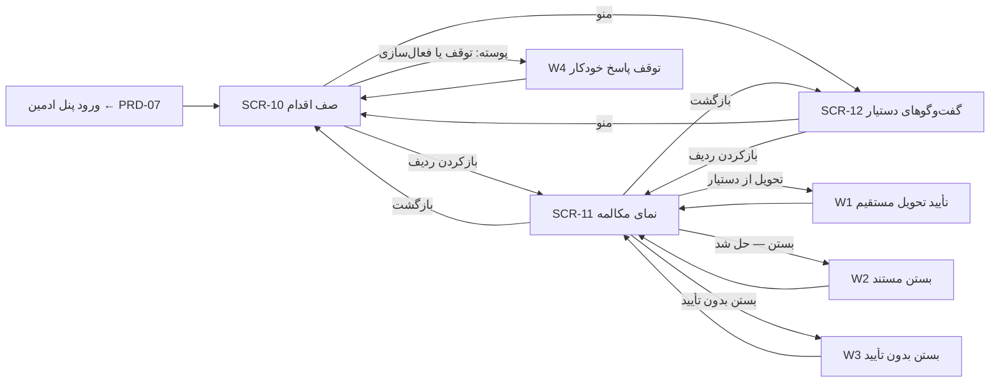

# ‏PRD-05b — پنل ادمین

> ‏**مرز:** پنل ادمین (ACT-02 ادمین پشتیبانی؛ مالک فروشگاه فقط با نقش ادمین) · **ورودی:** ورودی ۲ (PRD-05 §5.4) · **صفحه‌ها:** پوسته، SCR-10، SCR-11، SCR-12 و پنجره‌ها · **UCD:** UCD-06 تا UCD-14 · **فلوها:** UXF-03 (پایان)، 05، 06، 07، 08 · **دستگاه:** دسکتاپ **(فرض A-17 ← PRD-07)**
>
> ‏**سطح این زیرسند:** چیدمان صفحه‌ها و نماهای پنل ادمین. رفتار و متن کامل در استوری‌های PRD-04 است و اینجا فقط ارجاع داده می‌شود (DEC-123). نمونه تأییدشده SCR-10 بدون تغییر در §5b.3 آمده است.
>
> ‏**راهنمای برچسب‌ها:** `[SRC-xx §n]` = برگرفته از منبع · **(پیشنهاد)** = پیشنهاد تیم PRD · **(فرض A-xx)** = فرض تأییدنشده · **(تغییر — CH-xx)** = افزوده نسبت به اسناد تأییدشده · ⚠️ = نقطه باز.

### ‏راهنمای شناسه‌ها

| ‏کد | ‏معنی | ‏کجا تعریف شده |
|---|---|---|
| ‏SCR-10، 11، 12 | ‏صفحه‌های پنل ادمین | ‏PRD-05 §5.3 |
| ‏R0 … Rn | ‏ناحیه‌های هر صفحه؛ R0 همیشه پوسته است | ‏PRD-05 §5.2 |
| ‏W1 … W5 | ‏پنجره‌های تأیید و فرم (فقط درون همین سند) | ‏همین سند §5b.5 |
| ‏نمای صف / بات / مالک / ناظر / بسته | ‏نماهای SCR-11 (نام داخلی؛ در رابط دیده نمی‌شوند) | ‏PRD-05 §5.3 |
| ‏SCR-01 · ح‌n | ‏حالت‌های صفحه گفت‌وگو | ‏PRD-05a |
| ‏US / AC | ‏استوری / معیار پذیرش | ‏PRD-04 |
| ‏S1 … S6 / TR | ‏وضعیت مکالمه / انتقال وضعیت | ‏PRD-03f |
| ‏VL / EV | ‏فهرست مقادیر مجاز / نوع رویداد | ‏PRD-04-DD؛ PRD-04-EP06 |
| ‏A / DEC / CH | ‏فرض / تصمیم / تغییر | ‏Master Index |

### ‏نقشه پنل

> ‏«بازگشت» در SCR-11 به صفحه‌ای برمی‌گردد که مکالمه از آن باز شده است (SCR-10 یا SCR-12)، با همان فیلترها و جست‌وجو **(پیشنهاد)**. پنجره‌های W1 تا W5 از هر صفحه‌ای که کنش در آن است باز می‌شوند.

---

## ‏۵b.۱ پوسته پنل ادمین

| ‏مورد | ‏مقدار |
|---|---|
| ‏استوری | ‏US-07-05 · DEC-126 (منوی جدا از پنل فروشگاه) |
| ‏ردیابی | ‏UCD-12 · ACD-07 (گام‌های H1، A8) · FR-12 · CR-06 |
| ‏کجا | ‏بالای همه صفحه‌های پنل ادمین |

| ‏ناحیه | ‏محتوا | ‏کنش | ‏استوری / مرجع | ‏متن |
|---|---|---|---|---|
| ‏R0-a نوار بالا | ‏منو: «صف اقدام» · «گفت‌وگوهای دستیار» · نام کاربر و خروج (← PRD-07) | ‏رفتن به SCR-10 یا SCR-12 | ‏DEC-126؛ **CH-31** | — |
| ‏R0-a کنترل پاسخ خودکار | ‏وضعیت متنی «پاسخ خودکار: فعال» یا «متوقف» + کنش «توقف پاسخ خودکار» (فقط وقتی فعال است) | ‏زدن ← W4 | ‏US-07-05؛ DEC-44؛ NFR-03 | ‏کنش ← US-07-05 · وضعیت متنی **(پیشنهاد)** |
| ‏R0-b بنر توقف | ‏فقط وقتی توقف روشن است؛ زیر نوار بالا، روی همه صفحه‌ها؛ عامل و زمان توقف + کنش «فعال‌سازی پاسخ خودکار» | ‏زدن ← W4 (فعال‌سازی) | ‏US-07-05 | ‏«بنر پنل» ← US-07-05 |

| ‏حالت | ‏رفتار | ‏مرجع |
|---|---|---|
| ‏ذخیره پرچم ناموفق | ‏پیام خطا در W4؛ وضعیت متنی و بنر تغییر نمی‌کنند | ‏US-07-05 |
| ‏ادمین دیگری هم‌زمان توقف کرد | ‏با بارگذاری بعدی هر صفحه، بنر دیده می‌شود (به‌روزرسانی خودکار ← PRD-06) | ‏DEC-67 |
| ‏مالک بدون نقش ادمین | ‏به این پنل دسترسی ندارد (PRD-05 §5.4) | ‏DEC-44 |

---

## ‏۵b.۲ SCR-10 · صف اقدام

> ‏نمونه تأییدشده در چت PRD-05؛ بدون تغییر.

| ‏مورد | ‏مقدار |
|---|---|
| ‏مرز | ‏پنل ادمین |
| ‏نقش | ‏ادمین پشتیبانی؛ مالک فروشگاه فقط با نقش ادمین (04-00 §0.2) |
| ‏استوری | ‏US-03-01، US-03-02 · پوسته: US-07-05 |
| ‏ردیابی | ‏UCD-06 · ACD-05 (گام‌های H1 و A1) · FR-07 · BO-02 |
| ‏دستگاه | ‏دسکتاپ **(فرض A-17 ← PRD-07)** |
| ‏ورود از | ‏ورود پنل ادمین (← PRD-07) — صفحه پیش‌فرض پس از ورود · منوی پوسته · «بازگشت» از SCR-11 |
| ‏خروج به | ‏SCR-11 (بازکردن ردیف) · SCR-12 (منو) |

### ‏ناحیه‌ها

| ‏ناحیه | ‏محتوا | ‏کنش | ‏استوری / مرجع | ‏متن |
|---|---|---|---|---|
| ‏R0 پوسته | ‏§5b.1 | ‏§5b.1 | ‏US-07-05 | ‏§5b.1 |
| ‏R1 عنوان | ‏«صف اقدام» + شمار هر وضعیت در زبانه‌ها | — | ‏FR-07 · **(پیشنهاد)** | ‏«نیازمند انسان (۴)» · «در حال رسیدگی (۲)» **(پیشنهاد)** |
| ‏R2 فیلتر وضعیت | ‏زبانه‌ها: «همه» (پیش‌فرض: S3 + S4) · «نیازمند انسان» · «در حال رسیدگی» · **«بسته»** | ‏انتخاب یک زبانه | ‏US-03-01 · **CH-13** | ‏برچسب‌ها ← VL-01 |
| ‏R2 فیلتر مسئول | ‏فهرست کشویی: همه · بدون مسئول · من · ادمین مشخص | ‏انتخاب | ‏US-03-01 | — |
| ‏R2 جست‌وجو | ‏کادر، حداقل ۲ نویسه؛ روی نتیجه فیلترهای فعال | ‏تایپ · پاک‌کردن | ‏US-03-02 · DEC-100 | ‏«کادر جست‌وجو» ← US-03-02 |
| ‏R2 تازه‌سازی | ‏دکمه + زمان آخرین بارگذاری (نسبی) | ‏بارگذاری دوباره | ‏DEC-67 | ‏«آخرین به‌روزرسانی: ۳ دقیقه پیش» **(پیشنهاد)** |
| ‏R3 جدول صف | ‏یک ردیف برای هر مکالمه؛ ستون‌ها در جدول بعد | ‏کلیک روی ردیف ← SCR-11 | ‏US-03-01 | — |
| ‏R4 پیام حالت | ‏جای R3 در حالت‌های خالی و خطا | ‏پاک‌کردن فیلتر · تلاش دوباره | ‏US-03-01، US-03-02 | ‏جدول حالت‌ها |

### ‏ستون‌های R3 (به ترتیب از راست)

| ‏ستون | ‏فیلترهای فعال (همه، نیازمند انسان، در حال رسیدگی) | ‏فیلتر «بسته» (CH-13) | ‏مرجع |
|---|---|---|---|
| ‏وضعیت | ‏برچسب متنی S3 یا S4 | ‏«حل‌شده» یا «بسته بدون تأیید» | ‏VL-01؛ NFR-03 |
| ‏علت | ‏یکی از هفت علت VL-03 (تحویل مستقیم: «تحویل به درخواست ادمین»)؛ **متن کم‌رنگ زیر برچسب وضعیت، نه ستون جدا (DEC-298)** | ‏علت آخرین ارجاع | ‏DEC-47؛ DEC-261 |
| ‏آخرین پیام | ‏آخرین پیام مشتری، کوتاه‌شده در یک خط | ‏همان | ‏FR-07 |
| ‏زمان | ‏عنوان ستون «انتظار مشتری»: از ارجاع باز فعلی، نسبی؛ از ۱۵ دقیقه نشان کهربایی و از ۳۰ دقیقه نشان قرمز با آیکون ساعت **(DEC-301)**؛ راهنمای رنگ بالای جدول (DEC-298) | ‏«زمان بستن»، نسبی **(پیشنهاد)** | ‏TR-05؛ 04-00 §0.4 |
| ‏مسئول | ‏بدون مسئول: «—» (برای صفحه‌خوان «بدون مسئول»)؛ مسئول‌دار: نشان حرف اول + نام ادمین (DEC-298) | ‏آخرین مسئول | ‏BRD §8 |
| ‏خوانده‌نشده | ‏نقطه + متن «پیام تازه» در خانه «آخرین پیام»، کنار شناسه (ستون جدا ندارد — DEC-273)؛ ردیف خوانده‌نشده پس‌زمینه روشن و نوار رنگی در لبه آغاز ردیف دارد (DEC-298)؛ برای هر ادمین جدا | — | ‏DEC-101؛ قاعده ۲ متن رابط |
| ‏شناسه | ‏شناسه کوتاه مکالمه، کم‌رنگ، زیر آخرین پیام | ‏همان | ‏DEC-100 **(پیشنهاد)** |

> ‏**ترتیب:** فیلترهای فعال ← قدیمی‌ترین ارجاع باز در بالا (FR-07)؛ «بسته» ← تازه‌ترین بستن در بالا **(پیشنهاد)**. مرتب‌سازی با کلیک روی ستون، اقدام گروهی و کنش بستن در این صفحه وجود ندارند (نبایدهای US-03-01).

### ‏حالت‌ها

| ‏حالت | ‏R2 | ‏R3 / R4 | ‏مرجع |
|---|---|---|---|
| ‏بارگذاری | ‏فعال | ‏جای ردیف‌ها خالی با نشانه بارگذاری؛ هرگز «صف خالی» | ‏SP-06 |
| ‏عادی | ‏فعال | ‏جدول | — |
| ‏صف خالی | ‏فعال | ‏R4: «صف خالی» | ‏← US-03-01 |
| ‏فیلتر بدون نتیجه | ‏فعال | ‏R4: «نتیجه‌ای با این فیلتر نیست» + «پاک‌کردن فیلتر» | ‏← US-03-01 |
| ‏جست‌وجو بدون نتیجه | ‏فعال | ‏R4: «بدون نتیجه» + «پاک‌کردن جست‌وجو» | ‏← US-03-02 |
| ‏خطای بارگذاری | ‏فعال | ‏R4: «خطای بارگذاری» + «تلاش دوباره»؛ هرگز «صف خالی» | ‏← US-03-01 |
| ‏خطای جست‌وجو | ‏فعال | ‏پیام خطای کوتاه بالای جدول؛ جدول بدون جست‌وجو می‌ماند | ‏← US-03-02 |
| ‏توقف بات روشن | ‏— | ‏R0-b دیده می‌شود؛ ردیف‌ها با علت «دستیار متوقف است» **(CH-31)** | ‏US-07-05؛ TR-10 |
| ‏سرویس مدل قطع | ‏— | ‏بدون تغییر؛ صف کامل در دسترس | ‏FR-12؛ AC-03-01-9 |
| ‏کاربر بدون نقش ادمین | ‏— | ‏صفحه باز نمی‌شود (← PRD-07 پیام رد دسترسی) | ‏NFR-04 |

### ‏پوشش معیارهای پذیرش

| ‏معیار | ‏کجا در صفحه |
|---|---|
| ‏AC-03-01-1، 2، 6 | ‏R2 فیلتر وضعیت؛ ترتیب R3 |
| ‏AC-03-01-3، 7، 8 | ‏R3 ستون خوانده‌نشده، زمان، علت |
| ‏AC-03-01-4، 5 | ‏R3 ← SCR-11؛ ستون مسئول و فیلتر «بدون مسئول» |
| ‏AC-03-01-9، 10، 11 | ‏جدول حالت‌ها |
| ‏AC-03-02-1 تا 5 | ‏R2 جست‌وجو (AC-03-02-2 با CH-13 بازنویسی می‌شود) |

---

## ‏۵b.۳ SCR-11 · نمای مکالمه

| ‏مورد | ‏مقدار |
|---|---|
| ‏مرز | ‏پنل ادمین |
| ‏نقش | ‏ادمین؛ مالک با نقش ادمین |
| ‏استوری | ‏US-03-03، 04، 05 · US-07-01 تا 04، US-07-06 (ترجیحی) · US-06-02 (نشانه بازبینی) |
| ‏ردیابی | ‏UCD-07 تا 11، 13، 14 · ACD-05 (گام‌های A2 تا A11)، ACD-06 (H2) · FR-02، FR-07 تا FR-09 · BO-02، BO-03، BO-05 |
| ‏دستگاه | ‏دسکتاپ **(فرض A-17)** |
| ‏ورود از | ‏ردیف SCR-10 یا SCR-12 |
| ‏خروج به | ‏«بازگشت» به صفحه منشأ · پنجره‌های W1، W2، W3، W5 |

### ‏ناحیه‌ها

> ‏چیدمان دوستونه **(پیشنهاد)**: ستون اصلی تاریخچه و کادر پاسخ، ستون کناری بسته تحویل. ادمین تا تحویل‌گرفتن بیشتر به بسته تحویل نگاه می‌کند و پس از آن به تاریخچه.

| ‏ناحیه | ‏محتوا | ‏کنش | ‏استوری / مرجع | ‏متن |
|---|---|---|---|---|
| ‏R0 پوسته | ‏§5b.1 | ‏§5b.1 | ‏US-07-05 | ‏§5b.1 |
| ‏R1 سرصفحه مکالمه | ‏«بازگشت» · شناسه کوتاه · وضعیت (VL-01) · مسئول · علت (VL-03) · نوع انتظار در S2 (VL-02) | ‏بازگشت | ‏US-03-03؛ DEC-261 | ‏برچسب‌ها ← VL |
| ‏R2 نوار کنش | ‏کنش‌های همان نما (جدول نماها) | ‏← جدول نماها | ‏EP-03؛ EP-07 | ‏کنش‌ها ← استوری هر کنش |
| ‏R3 ستون کناری: بسته تحویل | ‏عنوان «خلاصه درخواست» · آخرین درخواست · خلاصه با برچسب، یا «خلاصه ساخته نشد» · گونه یا سفارش نمونه مرتبط · پاسخ‌های داده‌شده · علت · اطلاعات ناقص · پیوند به ارجاع قبلی (در بازگشایی) | ‏بازکردن ارجاع قبلی در همان صفحه (فقط‌خواندنی) | ‏US-03-03؛ US-04-02؛ DEC-49؛ DEC-92 | ‏«عنوان بسته»، «اطلاعات مفقود»، «ارجاع قبلی» ← US-03-03 · «برچسب خلاصه» ← US-04-02 |
| ‏R4 ستون اصلی: تاریخچه | ‏همه پیام‌ها به ترتیب زمان با برچسب فرستنده (VL-08) · خطوط سیستمی تحویل، واگذاری، توقف، بستن و بازگشایی · برای هر پاسخ دستیار: منبع، نسخه، «پاسخ قالبی» · در نمای بات: نشانه بازبینی برای هر پاسخ دستیار | ‏گذاشتن نشانه بازبینی (فقط نمای بات و نمای بسته صرفاً بات) | ‏US-03-03؛ FR-02؛ US-06-02؛ DEC-117 | ‏«برچسب منبع» ← US-03-03 · نشانه‌ها ← US-06-02 |
| ‏R5 پیشنهاد پاسخ (ترجیحی) | ‏فقط نمای مالک؛ بالای کادر پاسخ؛ متن پیشنهادی + منبع و نسخه + «استفاده» · «رد» | ‏«استفاده» متن را به کادر پاسخ می‌برد؛ «رد» آن را پنهان می‌کند | ‏US-07-06 | ‏«برچسب»، «نبود پیشنهاد» ← US-07-06 |
| ‏R6 کادر پاسخ | ‏فقط نمای مالک؛ پایین ستون اصلی ثابت می‌ماند و فقط تاریخچه پیمایش می‌شود (DEC-273)؛ کادر چندخطی · شمارنده از ۱۸۰۰ نویسه · «ارسال» | ‏ارسال | ‏US-07-03؛ فرض A-15 | ‏«ارسال نشد»، «مالکیت از دست رفته» ← US-07-03 |

### ‏نماها و کنش‌های R2

| ‏نما | ‏شرط | ‏کنش‌های R2 | ‏R5 / R6 | ‏نشانه بازبینی | ‏مرجع |
|---|---|---|---|---|---|
| ‏صف | ‏S3 | ‏«تحویل می‌گیرم» | ‏پنهان | ‏خیر | ‏US-07-01؛ DEC-36 (بستن نیست) |
| ‏بات | ‏S1 یا S2 | ‏«تحویل از دستیار» ← W1 · در S2: «بستن بدون تأیید» ← W3 | ‏پنهان | ‏بله | ‏US-07-02؛ US-03-05؛ DEC-103؛ **CH-31** |
| ‏مالک | ‏S4 و کاربر مالک است | ‏«درخواست تأیید از مشتری» · «بستن — حل شد» ← W2 · منوی «بیشتر» ← «بستن بدون تأیید» ← W3 (DEC-273) · «واگذاری به دستیار» | ‏دیده | ‏خیر | ‏US-03-04، 05؛ US-07-03، 04، 06 |
| ‏ناظر | ‏S4 و مالک دیگری دارد | ‏ندارد؛ نوار متنی «این گفت‌وگو را [نام ادمین] تحویل گرفته است» | ‏پنهان | ‏خیر | ‏AC-07-01-5 |
| ‏بسته | ‏S5 یا S6 | ‏ندارد؛ نتیجه، مبنا، دلیل و برچسب بازگشایی در R1 | ‏پنهان | ‏فقط اگر سابقه صرفاً بات باشد | ‏CH-13؛ US-06-02 |

> ‏**ترتیب کنش‌ها در نمای مالک (پیشنهاد):** «درخواست تأیید از مشتری» اول و برجسته می‌آید، بعد دو کنش بستن، بعد «واگذاری به دستیار». این همان ترجیح SP-08 است: تأیید مشتری بهتر از بستن یک‌طرفه است.

### ‏حالت‌ها

| ‏حالت | ‏ناحیه‌های متأثر | ‏رفتار | ‏مرجع |
|---|---|---|---|
| ‏بارگذاری | ‏همه | ‏حالت استاندارد | ‏PRD-05 §5.2 |
| ‏خطای بارگذاری تاریخچه | ‏R3، R4 | ‏پیام خطا + «تلاش دوباره»؛ بخشی از تاریخچه به‌جای کل آن نمایش داده نمی‌شود | ‏US-03-03 |
| ‏خلاصه ساخته نشده | ‏R3 | ‏«خلاصه ساخته نشد»؛ بقیه بسته تحویل دیده می‌شود | ‏US-04-02 |
| ‏تحویل در جریان | ‏R2 | ‏کنش غیرفعال تا پاسخ برسد | ‏PRD-05 §5.2 |
| ‏تحویل موفق | ‏R1، R2، R5، R6 | ‏پیام «این گفت‌وگو حالا با شماست» ← نمای مالک | ‏US-07-01 |
| ‏دیگری زودتر تحویل گرفت | ‏R2 | ‏پیام هم‌زمانی ← نمای ناظر | ‏US-07-01؛ AC-07-01-2 |
| ‏تحویل ناموفق | ‏R2 | ‏«تحویل انجام نشد»؛ نما تغییر نمی‌کند | ‏US-07-01 |
| ‏وضعیت در این فاصله تغییر کرد (بسته شد، به S3 رفت، بازگشایی شد) | ‏همه | ‏وضعیت تازه بارگذاری و نمای متناظر نشان داده می‌شود؛ کنش انجام نمی‌شود | ‏US-07-01؛ US-07-02 |
| ‏ارسال پاسخ ناموفق | ‏R4، R6 | ‏پیام در تاریخچه با «ارسال نشد» + ارسال دوباره | ‏US-07-03 |
| ‏مالکیت از دست رفت (مثلاً واگذاری از تب دیگر) | ‏R6 | ‏پیام «مالکیت از دست رفته»؛ متن کادر پاک نمی‌شود؛ ← نمای متناظر | ‏US-07-03؛ AC-07-03-4 |
| ‏توقف بات روشن | ‏R2 | ‏«واگذاری به دستیار» غیرفعال با متن دلیل | ‏US-07-04؛ DEC-39 |
| ‏سرویس مدل قطع | ‏R5 | ‏پیشنهاد پنهان، بدون پیام خطای مزاحم؛ بقیه صفحه کامل | ‏US-07-06؛ FR-12 |
| ‏پیام تازه مشتری | ‏R4 | ‏با بارگذاری بعدی دیده می‌شود (به‌روزرسانی خودکار ← PRD-06) | ‏DEC-67 |

### ‏پوشش معیارهای پذیرش

| ‏معیار | ‏کجا در صفحه |
|---|---|
| ‏AC-03-03-1 تا 6 | ‏R3، R4؛ حالت «خلاصه ساخته نشده» |
| ‏AC-03-04-4 | ‏نمای مالک: «درخواست تأیید از مشتری» |
| ‏AC-03-05-1 تا 6 | ‏نمای مالک و نمای بات؛ W2، W3؛ نبود کنش بستن در نمای صف |
| ‏AC-07-01-1، 2، 5، 6 | ‏نمای صف ← نمای مالک یا ناظر؛ حالت‌های تحویل |
| ‏AC-07-02-1، 2 | ‏نمای بات ← W1 ← نمای مالک |
| ‏AC-07-03-1 تا 4 | ‏R6 و حالت‌های ارسال و مالکیت |
| ‏AC-07-04-1، 2 | ‏نمای مالک؛ حالت «توقف بات روشن» |
| ‏AC-07-06-1 تا 4 | ‏R5 |
| ‏AC-06-02-2، 4، 5 | ‏R4 منبع و نشانه؛ نمای بات |

---

## ‏۵b.۴ SCR-12 · گفت‌وگوهای دستیار

| ‏مورد | ‏مقدار |
|---|---|
| ‏مرز | ‏پنل ادمین |
| ‏نقش | ‏ادمین؛ مالک با نقش ادمین |
| ‏استوری | ‏US-06-02 · ورودی US-07-02 و بستن S2 (US-03-05؛ DEC-103) |
| ‏ردیابی | ‏UCD-13 · ACD-05 (یادداشت N2) · FR-02 · BO-01 |
| ‏دستگاه | ‏دسکتاپ **(فرض A-17)** |
| ‏ورود از | ‏منوی پوسته · «بازگشت» از SCR-11 |
| ‏خروج به | ‏SCR-11 (نمای بات یا نمای بسته) · SCR-10 (منو) |

### ‏ناحیه‌ها

| ‏ناحیه | ‏محتوا | ‏کنش | ‏استوری / مرجع | ‏متن |
|---|---|---|---|---|
| ‏R0 پوسته | ‏§5b.1 | ‏§5b.1 | ‏US-07-05 | ‏§5b.1 |
| ‏R1 عنوان | ‏«گفت‌وگوهای دستیار» + کنش «۱۰ گفت‌وگوی تصادفی» | ‏ساخت نمونه تصادفی از دامنه فیلتر فعلی | ‏US-06-02؛ DEC-117؛ **CH-31** | ‏«عنوان»، «نمونه تصادفی» ← US-06-02 |
| ‏R2 فیلتر وضعیت | ‏زبانه‌ها: «همه» (پیش‌فرض) · «پاسخ‌گویی دستیار» (S1) · «منتظر مشتری» (S2) · «بسته» (S5، S6 بدون سابقه انسانی) | ‏انتخاب | ‏US-06-02؛ DEC-103؛ VL-01؛ **CH-31** | ‏برچسب‌ها ← VL-01 |
| ‏R2 فیلتر نوع پاسخ | ‏چندگزینه‌ای: نبود پاسخ · پاسخ قالبی · موجودی نامشخص · خارج از اختیار | ‏انتخاب | ‏US-06-02 | ‏**(پیشنهاد)** برای برچسب‌ها، هم‌نام با VL-10 و VL-11 |
| ‏R2 بازه | ‏امروز · ۷ روز · ۳۰ روز · دلخواه | ‏انتخاب | ‏US-06-02 | — |
| ‏R2 تازه‌سازی | ‏مثل SCR-10 | ‏بارگذاری دوباره | ‏DEC-67 | ‏مثل SCR-10 |
| ‏R3 نوار نمونه | ‏فقط پس از «۱۰ گفت‌وگوی تصادفی»: «نمونه تصادفی از [فیلتر فعلی]» + «نمونه تازه» · «بازگشت به فهرست» | ‏ساخت دوباره · بازگشت | ‏DEC-117؛ **(پیشنهاد)** | ‏**(پیشنهاد)** |
| ‏R4 جدول | ‏ستون‌ها: وضعیت · آخرین پیام · «از آخرین پیام» (مدت نسبی) · **«بازبینی»: «[بازبینی‌شده] از [پاسخ‌های دستیار]»** · **«نوع پاسخ»**: نشان نوع پاسخ‌های حساس (نبود پاسخ، قالبی، نامشخص، خارج از اختیار) (DEC-299) | ‏کلیک ← SCR-11 | ‏US-06-02؛ DEC-103 | — |
| ‏R5 پیام حالت | ‏جای R4 در حالت‌های خالی و خطا | ‏مثل SCR-10 | ‏US-06-02 | ‏«گفت‌وگویی با این فیلتر نیست» ← US-06-02 |

> ‏**ترتیب پیش‌فرض (پیشنهاد):** تازه‌ترین پیام در بالا. در «منتظر مشتری»، طولانی‌ترین مدت از آخرین پیام در بالا، تا ادمین برای «بستن بدون تأیید» تصمیم بگیرد (DEC-103).
>
> ‏**ستون‌های شمار بازبینی‌شده و نشان نوع پاسخ (پیشنهاد):** به ادمین کمک می‌کنند مکالمه‌های حساس یا بازبینی‌نشده را زودتر ببیند. داده آن‌ها از EV-04، EV-05 و EV-26 می‌آید و رفتار تازه‌ای نمی‌سازد.

### ‏حالت‌ها

‏مثل حالت‌های استاندارد PRD-05 §5.2 و SCR-10. تفاوت‌ها:

| ‏حالت | ‏رفتار | ‏مرجع |
|---|---|---|
| ‏دامنه نمونه کمتر از ۱۰ مکالمه | ‏همه مکالمه‌های دامنه نشان داده می‌شوند | ‏AC-06-02-6 |
| ‏مکالمه‌ای در این فاصله به S3 یا S4 رفت | ‏با بارگذاری بعدی از فهرست بیرون می‌رود؛ اگر باز شده باشد، SCR-11 نمای متناظر را نشان می‌دهد | ‏US-07-02 |

### ‏پوشش معیارهای پذیرش

| ‏معیار | ‏کجا در صفحه |
|---|---|
| ‏AC-06-02-1 | ‏دامنه R2 |
| ‏AC-06-02-3 | ‏زبانه «منتظر مشتری» + ستون «از آخرین پیام» ← نمای بات با «بستن بدون تأیید» |
| ‏AC-06-02-6 | ‏R1 و R3 |

---

## ‏۵b.۵ پنجره‌ها

| ‏پنجره | ‏از کجا | ‏محتوا | ‏کنش‌ها | ‏استوری / مرجع | ‏متن |
|---|---|---|---|---|---|
| ‏W1 تأیید تحویل مستقیم | ‏SCR-11 نمای بات | ‏متن تأیید؛ با تأیید، ارجاع با علت «تحویل به درخواست ادمین» و سپس تحویل (DEC-261) | ‏«تحویل از دستیار» · «انصراف» | ‏US-07-02؛ **CH-31** | ‏«تأیید» ← US-07-02 |
| ‏W2 بستن مستند | ‏SCR-11 نمای مالک | ‏کادر «چه کاری انجام شد؟» (الزامی) · در مکالمه بازگشایی‌شده با سابقه انسانی: انتخاب «موضوع جدید» / «ادامه» (الزامی) | ‏«بستن — حل شد» (تا پر شدن فیلدهای الزامی غیرفعال) · «انصراف» | ‏US-03-05؛ DEC-104؛ DEC-40 | ‏«راهنمای یادداشت» ← US-03-05 · برچسب‌ها ← VL-07 |
| ‏W3 بستن بدون تأیید | ‏SCR-11 نمای مالک یا نمای بات (S2) | ‏دلیل از VL-06 (الزامی) · یادداشت (الزامی فقط برای «دیگر») · برچسب بازگشایی مثل W2 | ‏«بستن بدون تأیید» · «انصراف» | ‏US-03-05؛ DEC-104 | ‏برچسب‌ها ← VL-06، VL-07 |
| ‏W4 توقف یا فعال‌سازی پاسخ خودکار | ‏پوسته (R0-a یا R0-b) | ‏متن تأیید توقف یا فعال‌سازی | ‏«توقف پاسخ خودکار» یا «فعال‌سازی» · «انصراف» | ‏US-07-05 | ‏«تأیید توقف»، «تأیید فعال‌سازی» ← US-07-05 |
| ‏W5 پیام تأیید واگذاری | ‏SCR-11 نمای مالک | ‏یک خط: «گفت‌وگو به دستیار سپرده می‌شود و از صف بیرون می‌رود.» | ‏«واگذاری به دستیار» · «انصراف» | ‏US-07-04؛ **(پیشنهاد)** | ‏**(پیشنهاد)** |

| ‏حالت مشترک پنجره‌ها | ‏رفتار | ‏مرجع |
|---|---|---|
| ‏ذخیره در جریان | ‏دکمه اصلی غیرفعال؛ پنجره باز می‌ماند | ‏PRD-05 §5.2 |
| ‏ذخیره ناموفق | ‏پیام خطا داخل پنجره؛ مقادیر واردشده حفظ می‌شوند؛ پیام موفقیت نمی‌آید | ‏ND-14 |
| ‏وضعیت مکالمه در این فاصله تغییر کرد | ‏پنجره بسته و وضعیت تازه نمایش داده می‌شود | ‏US-03-05 (هم‌زمانی) |

> ‏**W5 (پیشنهاد):** US-07-04 برای واگذاری تأیید نخواسته است. پیشنهادم یک تأیید ساده است، چون واگذاری مکالمه را از صف بیرون می‌برد و برگشت آن فقط با پیام مشتری ممکن است (DEC-95). اگر لازم نمی‌دانید، حذفش می‌کنیم.

---

## ‏۵b.۶ متن‌های تازه این زیرسند (همه پیشنهاد — DEC-61)

| ‏جا | ‏متن | ‏دلیل |
|---|---|---|
| ‏R0-a وضعیت پاسخ خودکار | ‏«پاسخ خودکار: فعال» · «پاسخ خودکار: متوقف» | ‏NFR-03 (وضعیت با برچسب متنی) |
| ‏SCR-10 R1 | ‏«نیازمند انسان ([۴])» · «در حال رسیدگی ([۲])» | ‏نمونه تأییدشده |
| ‏SCR-10 و SCR-12 R2 | ‏«آخرین به‌روزرسانی: [۳ دقیقه] پیش» | ‏DEC-67 |
| ‏SCR-10 ستون زمان در «بسته» | ‏«زمان بستن» | ‏CH-13 |
| ‏SCR-12 R3 | ‏«نمونه تصادفی از [فیلتر فعلی]» · «نمونه تازه» · «بازگشت به فهرست» | ‏DEC-117 |
| ‏SCR-12 فیلتر نوع | ‏«نبود پاسخ» · «پاسخ قالبی» · «موجودی نامشخص» · «خارج از اختیار» | ‏US-06-02 |
| ‏W5 | ‏«گفت‌وگو به دستیار سپرده می‌شود و از صف بیرون می‌رود.» | ‏US-07-04 |

---

## ‏۵b.۷ تصمیم‌ها و نقاط باز

### ‏تصمیم‌های تأییدشده (برای ثبت در Master Index)

| ‏شناسه پیشنهادی | ‏تصمیم |
|---|---|
| ‏DEC-136 | ‏کنترل پاسخ خودکار در پوسته پنل ادمین با وضعیت متنی؛ بنر توقف روی همه صفحه‌های پنل ادمین با کنش فعال‌سازی (Q-32 بخش سوم، سمت پنل ادمین، بسته شد) |
| ‏DEC-137 | ‏SCR-11 دوستونه: تاریخچه و کادر پاسخ در ستون اصلی، بسته تحویل در ستون کناری؛ پنج نما با کنش‌های جدول §5b.3 |
| ‏DEC-138 | ‏در نمای مالک، «درخواست تأیید از مشتری» اول و برجسته می‌آید (SP-08) |
| ‏DEC-139 | ‏«بازگشت» در SCR-11 به صفحه منشأ با همان فیلترها برمی‌گردد |
| ‏DEC-140 | ‏SCR-12: فیلترهای وضعیت، نوع پاسخ و بازه؛ ستون‌های شمار بازبینی‌شده و نشان نوع پاسخ؛ ترتیب تازه‌ترین پیام و در «منتظر مشتری» طولانی‌ترین انتظار |
| ‏DEC-141 | ‏پنجره تأیید ساده برای واگذاری به دستیار (W5) |
| ‏DEC-142 | ‏برچسب بازگشایی در W2 و W3 فقط برای مکالمه بازگشایی‌شده با سابقه انسانی الزامی است؛ در مسیر بات «نامشخص» خودکار می‌ماند (DEC-40) |
| ‏DEC-273 | ‏SCR-10: «پیام تازه» درون خانه آخرین پیام؛ رنگ زمان انتظار (آستانه‌ها پیشنهاد، Q-46). SCR-11: کادر پاسخ ثابت پایین ستون اصلی؛ در نمای مالک «بستن بدون تأیید» در منوی «بیشتر» (در نمای بات به‌خاطر DEC-103 دیده می‌ماند) |
| ‏DEC-298 | ‏SCR-10: علت زیر برچسب وضعیت (ستون علت حذف)؛ عنوان «انتظار مشتری» با راهنمای رنگ بالای جدول؛ «راهنمای وضعیت‌ها» کشویی؛ ردیف پیام تازه با پس‌زمینه و نوار رنگی؛ مسئول «—» یا نشان + نام؛ صف متوقف همان چیدمان صف (با جست‌وجو) به‌علاوه بنر |
| ‏DEC-299 | ‏SCR-12: ستون «بازبینی» به شکل «x از n» به‌جای دو ستون شمار؛ ستون نشان‌ها با عنوان «نوع پاسخ»؛ «راهنمای وضعیت‌ها و ستون‌ها» کشویی؛ R3 نوار نمونه بالای جدول با «نمونه تازه» و «بازگشت به فهرست» *(تکمیل DEC-140، DEC-117)* |
| ‏DEC-300 | ‏نام ادمین در پوسته متن ساده است و کنش ندارد (صفحه حساب خارج از محدوده — PRD-07) |
| ‏DEC-301 | ‏**Q-46 بسته شد:** آستانه رنگ «انتظار مشتری» ۱۵ دقیقه (کهربایی) و ۳۰ دقیقه (قرمز)؛ با تعیین هدف BO-02 بازبینی می‌شود |

### ‏نقاط باز

| ‏شناسه | ‏موضوع | ‏محل |
|---|---|---|
| ‏— | ‏به‌روزرسانی خودکار صف، نمای مکالمه و بنر توقف بدون تازه‌سازی | ‏PRD-06 (DEC-67) |
| ‏— | ‏ورود، خروج و پیام «دسترسی رد شد» | ‏PRD-07 |
| ‏~~Q-46~~ | ‏~~آستانه رنگی زمان انتظار~~ — بسته شد: ۱۵ و ۳۰ دقیقه (DEC-301) | ‏— |
| ‏Q-48 | ‏پوسته پنل ادمین (نوار بالا) و پنل فروشگاه (نوار کناری) یکسان شوند یا نه | ‏Master Index §8.1 |

### ‏تاریخچه تغییرات این زیرسند

| ‏نسخه | ‏تاریخ | ‏تغییر | ‏مرجع |
|---|---|---|---|
| ‏1.0 | ‏2026-11-11 | ‏تأیید نخستین (چت PRD-05) | ‏— |
| ‏1.1 | ‏2026-11-11 | ‏یکسان‌سازی برچسب‌ها، بدون تغییر رفتار: عنوان §5b.4، R1 و منوی پوسته و گره نقشه پنل «گفت‌وگوهای بات» ← «گفت‌وگوهای دستیار»؛ زبانه S1 در SCR-12 «پاسخ‌گویی بات» ← «پاسخ‌گویی دستیار» (VL-01)؛ کنش «تحویل از بات» ← «تحویل از دستیار» در نقشه پنل، جدول نماها و W1؛ علت «بات متوقف است» ← «دستیار متوقف است» در حالت‌های SCR-10. نام نماها و نام حالت «توقف بات روشن» تغییر نکرد | ‏CH-31؛ DEC-239 |
| ‏1.2 | ‏2026-11-12 | ‏SCR-10 ستون علت و SCR-11 R1: هفت علت VL-03 بدون برچسب جدای «تحویل مستقیم»؛ W1: ارجاع سپس تحویل (DEC-261؛ CH-43) | ‏CH-43؛ DEC-261 |
| ‏1.3 | ‏2026-11-16 | ‏بازبینی طراحی P-02: SCR-10 ستون خوانده‌نشده در «آخرین پیام» ادغام شد و زمان انتظار نشان رنگی گرفت؛ SCR-11 کادر پاسخ ثابت و منوی «بیشتر» در نمای مالک (DEC-273)؛ Q-46 و Q-48 | ‏CH-48 |
| ‏1.4 | ‏2026-11-19 | ‏آزمون تیمی پروتوتایپ: ستون‌ها و راهنمای SCR-10 (DEC-298)، ستون‌های SCR-12 و نوار نمونه (DEC-299)، نام ادمین (DEC-300)، آستانه ۱۵/۳۰ و بستن Q-46 (DEC-301) | ‏CH-51 |
