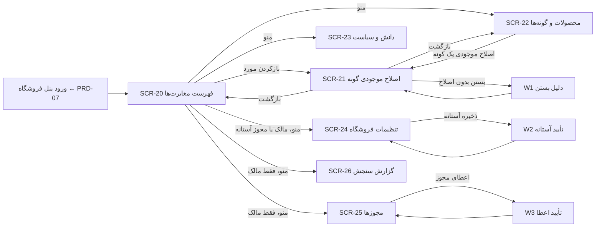

# ‏PRD-05c — پنل مدیریت فروشگاه

> ‏**مرز:** پنل مدیریت فروشگاه (مدیر فروشگاه = ACT-03 مالک فروشگاه / مالک داده؛ کارمند فروشگاه با دید و مجوزهای DEC-316) · **ورودی:** ورودی ۳ (PRD-05 §5.4) · **صفحه‌ها:** پوسته، SCR-20 تا SCR-27 و پنجره‌ها · **UCD:** UCD-15 تا UCD-19 · **فلوها:** UXF-04 · **دستگاه:** دسکتاپ **(فرض A-17 ← PRD-07)**
>
> ‏**سطح این زیرسند:** چیدمان صفحه‌ها و فرم‌های پنل مدیریت فروشگاه. قواعد مشترک ویرایش (پیش‌نویس و تأیید، نسخه، اثر فوری، ویرایش هم‌زمان) در PRD-04-EP05 «قواعد مشترک این اپیک» است و اینجا فقط جای آن‌ها در صفحه نشان داده می‌شود.
>
> ‏**راهنمای برچسب‌ها:** `[SRC-xx §n]` = برگرفته از منبع · **(پیشنهاد)** = پیشنهاد تیم PRD · **(فرض A-xx)** = فرض تأییدنشده · ⚠️ = نقطه باز.

### ‏راهنمای شناسه‌ها

| ‏کد | ‏معنی | ‏کجا تعریف شده |
|---|---|---|
| ‏SCR-20 … SCR-26 | ‏صفحه‌های پنل مدیریت فروشگاه | ‏PRD-05 §5.3 |
| ‏R0 … Rn | ‏ناحیه‌های هر صفحه؛ R0 همیشه پوسته است | ‏PRD-05 §5.2 |
| ‏W1 … W4 | ‏پنجره‌های این پنل (فقط درون همین سند؛ با W پنل ادمین فرق دارند) | ‏همین سند §5c.9 |
| ‏قاعده مشترک EP-05 شماره n | ‏قواعد مشترک ویرایش اطلاعات مرجع | ‏PRD-04-EP05 |
| ‏US / AC | ‏استوری / معیار پذیرش | ‏PRD-04 |
| ‏DS / VL / KM / EV | ‏محل ذخیره / فهرست مقادیر / قاعده شمارش / رویداد | ‏PRD-04-DD؛ PRD-04-EP06 |
| ‏A / DEC / G | ‏فرض / تصمیم / شکاف تحلیل PRD-05 | ‏Master Index؛ PRD-05 §5.10 |

### ‏نقشه پنل

> ‏منو برای همه صفحه‌ها یکی است و از هر صفحه به هر صفحه مجاز می‌رسد؛ در دیاگرام فقط از SCR-20 کشیده شده است. «بازگشت» در SCR-21 به صفحه منشأ (SCR-20 یا SCR-22) برمی‌گردد، مثل DEC-139.

---

## ‏۵c.۱ پوسته پنل مدیریت فروشگاه

| ‏ناحیه | ‏محتوا | ‏کنش | ‏استوری / مرجع | ‏متن |
|---|---|---|---|---|
| ‏R0-a منو | ‏مدیر: «بررسی موجودی ([۳])» (DEC-308) · «محصولات و گونه‌ها» · «دانشنامه فروشگاه» (DEC-315) · «تنظیمات» · «کاربران و مجوزها» · «گزارش» · کارمند: چهار آیتم نخست · پایین منو: نام و نام خانوادگی، نقش (مدیر / کارمند)، «تغییر رمز» (← W5) و «خروج» (← PRD-07) | ‏رفتن به صفحه | ‏DEC-126؛ US-05-01 (شمارنده) | ‏«شمارنده» ← US-05-01 |
| ‏R0-b بنرها | ‏به ترتیب: (۱) توقف پاسخ خودکار، فقط اطلاعی · (۲) آستانه اعتبار تنظیم نشده · (۳) مسیر تماس جایگزین تنظیم نشده | ‏بنر ۲ و ۳ برای مدیر و کارمند با مجوز «تنظیمات» کنش «رفتن به تنظیمات» دارند (DEC-316) | ‏US-02-03؛ US-04-06؛ **(پیشنهاد)** بنر ۱ | ‏بنر ۲ ← US-02-03 · بنر ۳ ← US-04-06 · بنر ۱ **(پیشنهاد)** §5c.10 |

| ‏بنر | ‏مدیر | ‏کارمند | ‏کی برداشته می‌شود |
|---|---|---|---|
| ‏۱ توقف پاسخ خودکار | ‏دیده، بدون کنش (تغییر فقط از پنل ادمین — DEC-44) | ‏دیده | ‏با فعال‌سازی |
| ‏۲ آستانه تنظیم نشده | ‏دیده + «رفتن به تنظیمات» | ‏دیده؛ با مجوز «تنظیمات» + «رفتن به تنظیمات» (DEC-316) | ‏با ذخیره آستانه |
| ‏۳ مسیر جایگزین تنظیم نشده | ‏دیده + «رفتن به تنظیمات» | ‏دیده نمی‌شود (به کار او مربوط نیست) | ‏با ذخیره مسیر، همان لحظه |

> ‏**بنر ۳ (DEC-274):** این هشدار در پوسته به‌صورت بنر تکرار نمی‌شود. برای مالک، بالای SCR-20 کارت «راه‌اندازی فروشگاه» می‌آید که موارد تنظیم‌شده و تنظیم‌نشده (آستانه اعتبار، ساعت‌های کاری، مسیر تماس جایگزین) را با «رفتن به تنظیمات» نشان می‌دهد؛ متن «هشدار پنل» (US-04-06) در همان کارت و درون بخش R4 SCR-24 می‌آید. **بنر ۲ در پوسته می‌ماند** (AC-02-03-1؛ اثر مستقیم بر پاسخ موجودی).

> ‏**بنر ۱ (پیشنهاد):** وقتی بات متوقف است، معمولاً داده‌ها در حال اصلاح‌اند؛ مالک باید بداند که پس از اصلاح، باید از ادمین بخواهد پاسخ خودکار را فعال کند (Q-32 بخش سوم، سمت پنل فروشگاه).

---

## ‏۵c.۲ SCR-20 · فهرست مغایرت‌ها

| ‏مورد | ‏مقدار |
|---|---|
| ‏نقش | ‏مدیر و همه کارمندان؛ کنش‌ها با مجوز «بررسی موجودی» (DEC-316) |
| ‏استوری | ‏US-05-01 · ایجاد موارد: US-02-02 |
| ‏ردیابی | ‏UCD-15 · ACD-04 (O1، A2) · FR-04، FR-10 · BO-03 |
| ‏ورود از | ‏ورود پنل فروشگاه (صفحه پیش‌فرض) · منو · «بازگشت» از SCR-21 |
| ‏خروج به | ‏SCR-21 |

| ‏ناحیه | ‏محتوا | ‏کنش | ‏استوری / مرجع | ‏متن |
|---|---|---|---|---|
| ‏R0 پوسته | ‏§5c.1 | ‏§5c.1 | — | ‏§5c.1 |
| ‏R1 عنوان | ‏عنوان + یک خط توضیح و ترتیب؛ شمار موارد باز در زبانه «باز» و شمارنده منو | — | ‏US-05-01؛ DEC-308 | ‏«عنوان»، «توضیح زیر عنوان» ← US-05-01 |
| ‏R2 فیلتر | ‏زبانه‌ها: «باز» (پیش‌فرض) · «بسته» · تازه‌سازی با زمان آخرین بارگذاری | ‏انتخاب · بارگذاری دوباره | ‏US-05-01 | ‏مثل SCR-10 |
| ‏R3 جدول | ‏ستون‌های جدول بعد؛ یک ردیف برای هر مورد | ‏کلیک ← SCR-21 همان گونه | ‏US-05-01؛ AC-05-01-5 | — |
| ‏R4 پیام حالت | ‏جای R3 | ‏تلاش دوباره | ‏US-05-01 | ‏«خالی» ← US-05-01 |

| ‏ستون (از راست) | ‏تعریف | ‏مرجع |
|---|---|---|
| ‏گونه | ‏نام محصول، رنگ، سایز | ‏RULE-01 |
| ‏نوع | ‏برچسب VL-09 و زیر آن راهنمای کار به خط کوچک | ‏DEC-82؛ DEC-308 |
| ‏تعداد رخداد | ‏سرستون «مشتری‌هایی که پرسیدند»؛ عدد | ‏DEC-65؛ DEC-308 |
| ‏آخرین رخداد | ‏سرستون «آخرین پرسش»؛ نسبی | ‏04-00 §0.4؛ DEC-308 |
| ‏داده فعلی | ‏وضعیت یا تعداد · «تأیید: [۳۰ ساعت] پیش» · نسخه؛ یا «موجودی ثبت نشده» | ‏DS-02 |
| ‏وضعیت | ‏«باز»؛ در زبانه «بسته»: شیوه بستن، عامل و زمان | ‏DS-07 |

> ‏**ترتیب:** بیشترین تعداد رخداد، سپس تازه‌ترین رخداد (DEC-110). در «بسته»: تازه‌ترین بستن **(پیشنهاد)**.

### ‏پوشش معیارهای پذیرش

| ‏معیار | ‏کجا |
|---|---|
| ‏AC-05-01-1، 2 | ‏R2 «باز»؛ ستون‌ها و ترتیب R3 |
| ‏AC-05-01-3، 4 | ‏ماتریس دید (PRD-05 §5.4) |
| ‏AC-05-01-5 | ‏R3 ← SCR-21 |
| ‏AC-02-02-4 | ‏هیچ اعلانی؛ فقط این فهرست و شمارنده منو |

---

## ‏۵c.۳ SCR-21 · اصلاح موجودی گونه

| ‏مورد | ‏مقدار |
|---|---|
| ‏نقش | ‏مدیر و همه کارمندان؛ کنش‌ها با مجوز «بررسی موجودی»؛ بی‌مجوز فقط‌خواندنی (DEC-316) |
| ‏استوری | ‏US-05-02 |
| ‏ردیابی | ‏UCD-16 · ACD-04 (O2 تا A6) · SQD-04 · FR-10 · RULE-06 · BO-03 |
| ‏ورود از | ‏SCR-20 (با مورد باز) · SCR-22 ردیف گونه (بدون مورد باز — DEC-129) |
| ‏خروج به | ‏«بازگشت» به صفحه منشأ · W1 |

| ‏ناحیه | ‏محتوا | ‏کنش | ‏استوری / مرجع | ‏متن |
|---|---|---|---|---|
| ‏R0 پوسته | ‏§5c.1 | ‏§5c.1 | — | — |
| ‏R1 سرصفحه | ‏«بازگشت» · نام کامل گونه · برچسب موارد باز همین گونه (VL-09)، یا هیچ | ‏بازگشت | ‏US-05-02 | ‏برچسب‌ها ← VL-09 |
| ‏R2 داده فعلی | ‏وضعیت یا تعداد · منبع · زمان آخرین تأیید (دقیق و نسبی) · نسخه · عامل تأیید | — | ‏ACD-04 (A2) | — |
| ‏R3 پیش‌نویس موجود | ‏فقط اگر پیش‌نویسی هست: مقدار پیش‌نویس، سازنده و زمان، با برچسب «منتظر تأیید — دستیار تا تأیید از آن استفاده نمی‌کند» (DEC-307) | ‏ادامه در R4 | ‏قاعده مشترک EP-05 شماره ۱ | ‏«پیش‌نویس» ← US-05-02 |
| ‏R4 فرم اصلاح | ‏نخست پرسش «این داده هنوز درست است؟» با دو گزینه: «بله، هنوز درست است» (= تأیید دوباره) و «نه، باید اصلاح شود»؛ با گزینه دوم: وضعیت (موجود / ناموجود) · تعداد (اختیاری، عدد ≥ ۰) · «تأیید» · «ذخیره پیش‌نویس»؛ جدا و پایین‌تر: «بستن بدون اصلاح» (DEC-274) | ‏هر کنش؛ آخری ← W1 | ‏US-05-02؛ DEC-111؛ DEC-85 | ‏کنش‌ها، «تأیید»، «ناسازگاری» ← US-05-02 |
| ‏R5 رکوردهای متعارض **(فقط پایلوت — DEC-314)** | ‏فقط برای مورد «اطلاعات متعارض» که از داده بارگذاری‌شده یا چند منبع می‌آید؛ در Prototype از پنل پیش نمی‌آید: هر رکورد فعال با مقدار، زمان و عامل تأیید + «این رکورد درست است» | ‏انتخاب یکی ← تأیید آن و غیرفعال‌شدن بقیه | ‏US-05-02؛ DEC-81؛ **CH-31** | ‏**(پیشنهاد)** §5c.10 |
| ‏R6 سابقه نسخه‌ها | ‏جدول: نسخه · مقدار · زمان تأیید · عامل · نوع تغییر (اصلاح / تأیید دوباره) | — | ‏FR-10؛ AC-05-02-3 | — |

> ‏**قاعده نمایش کنش‌ها (پیشنهاد):** پرسش دوگزینه‌ای «این داده هنوز درست است؟» (جای «هنوز درست است — تأیید دوباره») فقط وقتی دیده می‌شود که نسخه تأییدشده‌ای وجود دارد. «بستن بدون اصلاح» فقط وقتی دیده می‌شود که مورد باز هست. وقتی از SCR-22 و بدون مورد باز آمده‌اید، فقط «تأیید» و «ذخیره پیش‌نویس» دیده می‌شوند (و «تأیید دوباره» اگر نسخه‌ای هست).

| ‏حالت | ‏رفتار | ‏مرجع |
|---|---|---|
| ‏گونه موجودی ثبت‌شده ندارد | ‏R2: «موجودی ثبت نشده»؛ R6 خالی | ‏US-05-03؛ AC-05-03-4 |
| ‏مقدار نامعتبر یا ناسازگار | ‏پیام راهنما کنار فیلد؛ ذخیره نمی‌شود | ‏AC-05-02-8 |
| ‏ویرایش هم‌زمان | ‏پیام «ویرایش هم‌زمان»؛ R2 و R6 با نسخه تازه بارگذاری می‌شوند؛ مقدار واردشده در R4 حفظ می‌شود | ‏DEC-107؛ AC-05-02-7 |
| ‏مجوز در میانه ویرایش لغو شد | ‏کنش رد می‌شود؛ پیام «دسترسی رد شد» (← PRD-07) | ‏AC-05-04-2 |
| ‏ذخیره یا تأیید ناموفق | ‏حالت استاندارد؛ نسخه فعلی معتبر | ‏ND-14 |
| ‏تأیید موفق | ‏پیام «تأیید»؛ R1 برچسب‌های باز برداشته می‌شوند؛ R2 و R6 به‌روز | ‏AC-05-02-1، 5 |

### ‏پوشش معیارهای پذیرش

| ‏معیار | ‏کجا |
|---|---|
| ‏AC-05-02-1، 2، 5 | ‏R4 کنش‌ها؛ R3 پیش‌نویس |
| ‏AC-05-02-3 | ‏R6 |
| ‏AC-05-02-4 | ‏اثر در SCR-01 (UXF-04 گام ۵) |
| ‏AC-05-02-6 | ‏ماتریس دید |
| ‏AC-05-02-7، 8 | ‏جدول حالت‌ها |

---

## ‏۵c.۴ SCR-22 · محصولات و گونه‌ها

| ‏مورد | ‏مقدار |
|---|---|
| ‏نقش | ‏مدیر و همه کارمندان؛ ویرایش با مجوز «محصولات و گونه‌ها» (DEC-316) |
| ‏استوری | ‏US-05-03 (بخش محصول و گونه) |
| ‏ردیابی | ‏UCD-16 · ACD-04 (یادداشت پایانی) · FR-10 · DS-01 |
| ‏نماها | ‏**فهرست** و **ویرایش محصول** (یک صفحه با دو نما) |

### ‏نمای فهرست

| ‏ناحیه | ‏محتوا | ‏کنش | ‏مرجع |
|---|---|---|---|
| ‏R1 عنوان | ‏«محصولات و گونه‌ها» + «افزودن محصول» | ‏← نمای ویرایش خالی | ‏US-05-03 |
| ‏R2 ابزار | ‏جست‌وجوی نام · زبانه‌ها: «فعال» (پیش‌فرض) · «غیرفعال» · «همه» | ‏جست‌وجو · انتخاب | ‏**(پیشنهاد)** |
| ‏R3 جدول | ‏نام محصول · شمار گونه‌ها (برابر ردیف‌های نمای ویرایش) · وضعیت فعال · زمان آخرین تأیید · ستون «تغییرات» با برچسب «منتظر تأیید» و راهنمای «تا تأیید نشود، دستیار از آن استفاده نمی‌کند» (DEC-307) | ‏کلیک ← نمای ویرایش | ‏DS-01 |

### ‏نمای ویرایش محصول

| ‏ناحیه | ‏محتوا | ‏کنش | ‏استوری / مرجع | ‏متن |
|---|---|---|---|---|
| ‏R1 سرصفحه | ‏«بازگشت» · نام محصول · وضعیت فعال · نسخه | ‏بازگشت | ‏US-05-03 | — |
| ‏R2 فرم محصول | ‏نام (الزامی) · ویژگی‌ها (فهرست «ویژگی / مقدار»، مثلاً جنس، فصل) · قیمت و تخفیف (اختیاری) · فعال / غیرفعال | ‏«تأیید» · «ذخیره پیش‌نویس» | ‏DS-01؛ RULE-07؛ قاعده مشترک EP-05 شماره ۱ | ‏«غیرفعال‌سازی محصول» ← US-05-03 |
| ‏R3 گونه‌ها | ‏جدول: سایز · رنگ · فعال / غیرفعال · «موجودی: [نتیجه فعلی بررسی]» · کنش «اصلاح موجودی» | ‏«افزودن گونه» ← ردیف تازه بالای جدول با فیلدهای سایز و رنگ، وضعیت «غیرفعال» و کنش «ثبت موجودی»؛ کلید فعال‌سازی تا موجودی تأییدشده نباشد غیرفعال است (DEC-313) · ویرایش در همان ردیف · «اصلاح موجودی» ← SCR-21 | ‏DS-01؛ RULE-01؛ DEC-129؛ DEC-313 | ‏«اول موجودی این گونه را ثبت و تأیید کنید.» |
| ‏R4 سابقه نسخه‌ها | ‏جدول نسخه · زمان · عامل · خلاصه تغییر | — | ‏FR-10 | — |

> ‏**ستون «موجودی» در R3 (پیشنهاد):** نتیجه فعلی بررسی اعتبار (VL-10: موجود / ناموجود / نامشخص) را برای همان گونه نشان می‌دهد، تا مالک گونه‌های «نامشخص» را پیش از پرسش مشتری ببیند. داده تازه‌ای نمی‌سازد؛ همان جدول تصمیم EP-02 است.

| ‏حالت | ‏رفتار | ‏مرجع |
|---|---|---|
| ‏فیلد الزامی خالی | ‏ذخیره نمی‌شود؛ پیام کنار فیلد | ‏US-05-03 |
| ‏گونه تازه بدون موجودی | ‏ستون موجودی «نامشخص» + «اصلاح موجودی» | ‏AC-05-03-4 |
| ‏کاتالوگ خالی | ‏«هنوز محصولی ثبت نشده است.» + «افزودن محصول» | ‏**(پیشنهاد)** |
| ‏ویرایش هم‌زمان، ذخیره ناموفق | ‏مثل SCR-21 | ‏DEC-107؛ ND-14 |

---

## ‏۵c.۵ SCR-23 · دانش و سیاست (در رابط: «دانشنامه فروشگاه» — DEC-315)

| ‏مورد | ‏مقدار |
|---|---|
| ‏نقش | ‏مدیر و همه کارمندان؛ ویرایش با مجوز «دانشنامه فروشگاه» (DEC-316) |
| ‏استوری | ‏US-05-03 (بخش دانش و سیاست) |
| ‏ردیابی | ‏UCD-16 · FR-10 · DS-03 · DEC-74، DEC-112 |
| ‏نماها | ‏**فهرست** و **ویرایش منبع** |

### ‏نمای فهرست

| ‏ناحیه | ‏محتوا | ‏کنش | ‏مرجع |
|---|---|---|---|
| ‏R1 عنوان | ‏«دانشنامه فروشگاه» + «افزودن» | ‏← نمای ویرایش خالی | ‏US-05-03 |
| ‏R2 ابزار | ‏جست‌وجو در موضوع و متن · زبانه‌ها: «معتبر» (پیش‌فرض) · «منقضی» · «همه» | ‏جست‌وجو · انتخاب | ‏DEC-74؛ **(پیشنهاد)** |
| ‏R3 جدول | ‏موضوع · آغاز متن (یک خط) · نسخه · تاریخ اعتبار یا «بدون انقضا» · ستون «وضعیت»: خالی (معتبر)، «منقضی» یا «منتظر تأیید» (DEC-307) | ‏کلیک ← نمای ویرایش | ‏DS-03 |

### ‏نمای ویرایش منبع

| ‏ناحیه | ‏محتوا | ‏کنش | ‏استوری / مرجع | ‏متن |
|---|---|---|---|---|
| ‏R1 سرصفحه | ‏«بازگشت» · موضوع · نسخه · برچسب «منقضی» در صورت گذشت تاریخ | ‏بازگشت | ‏US-05-03 | ‏«سیاست منقضی» ← US-05-03 |
| ‏R2 فرم | ‏موضوع (الزامی؛ متن کوتاه با پیشنهاد موضوع‌های رایج: ارسال، مرجوعی، راهنمای سایز، پرداخت) · متن (الزامی؛ فقط متن ساده) · تاریخ اعتبار (اختیاری؛ تقویم شمسی) | ‏«تأیید» · «ذخیره پیش‌نویس» | ‏DS-03؛ DEC-112؛ DEC-69 | ‏پیشنهاد موضوع‌ها **(پیشنهاد)** |
| ‏R3 پیش‌نویس موجود | ‏مثل SCR-21 R3 | — | ‏قاعده مشترک EP-05 شماره ۱ | — |
| ‏R4 سابقه نسخه‌ها | ‏جدول نسخه · زمان · عامل · بازکردن متن نسخه قبلی (فقط‌خواندنی) | ‏بازکردن | ‏FR-10؛ DEC-108 | — |

| ‏حالت | ‏رفتار | ‏مرجع |
|---|---|---|
| ‏تأیید با تاریخ اعتبار گذشته | ‏هشدار پیش از تأیید؛ تأیید ممکن است | ‏US-05-03 |
| ‏فهرست خالی | ‏«هنوز اطلاعاتی برای پاسخ‌گویی ثبت نشده است. تا وقتی ثبت نکنید، دستیار به پرسش‌های ارسال و مرجوعی جواب نمی‌دهد.» + «افزودن» | ‏ND-08؛ **(پیشنهاد)** |
| ‏ویرایش هم‌زمان، ذخیره ناموفق | ‏مثل SCR-21 | ‏DEC-107؛ ND-14 |

### ‏پوشش معیارهای پذیرش (SCR-22 و SCR-23)

| ‏معیار | ‏کجا |
|---|---|
| ‏AC-05-03-1، 2 | ‏SCR-23 R2 کنش‌ها؛ R4 سابقه |
| ‏AC-05-03-3 | ‏SCR-22 R2 فعال / غیرفعال |
| ‏AC-05-03-4 | ‏SCR-22 R3 ستون موجودی |
| ‏AC-05-03-5 | ‏SCR-23 برچسب «منقضی» |
| ‏AC-05-03-6 | ‏رفتار پاسخ؛ رابط ندارد |

---

## ‏۵c.۶ SCR-24 · تنظیمات فروشگاه

| ‏مورد | ‏مقدار |
|---|---|
| ‏نقش | ‏مدیر فروشگاه؛ کارمند با مجوز «تنظیمات» همه بخش‌ها جز «اشتراک» را ویرایش می‌کند؛ کارمند بدون این مجوز بخش‌ها را فقط می‌بیند و «اشتراک» را نمی‌بیند (DEC-316) |
| ‏استوری | ‏US-02-03 · US-04-06 · DEC-120 · DEC-309 |
| ‏ردیابی | ‏UCD-17 · FR-04، FR-06 · DS-09 · CR-07 |
| ‏چیدمان | ‏«اشتراک» بالای صفحه و پنج بخش تنظیم در دو ستون؛ هر بخش ذخیره، خطا و پیام نتیجه خودش را دارد **(DEC-128؛ DEC-311)** |

| ‏ناحیه | ‏فیلدها | ‏کنش | ‏استوری / مرجع | ‏متن |
|---|---|---|---|---|
| ‏R0 اشتراک (فقط مدیر) | ‏نوع «ماهانه» · روزهای باقی‌مانده (برجسته) · تاریخ پایان | ‏«تمدید اشتراک»؛ در Prototype پرداخت نیست و پیام «تمدید در نسخه نمایشی فعال نیست؛ با تیم محصول تماس بگیرید.» می‌آید | ‏DEC-309؛ A-29 | ‏§5c.10 |
| ‏R1 آستانه اعتبار موجودی | ‏عدد **دقیقه** (۱۵ تا ۶۰)؛ بدون پیش‌فرض؛ واحد «دقیقه» کنار فیلد؛ بازه فقط در پیام خطا | ‏«ذخیره» ← W2 | ‏US-02-03؛ DEC-310 | ‏«برچسب تنظیم»، «مقدار نامعتبر» ← US-02-03 |
| ‏R2 ساعات کاری | ‏هفت ردیف از شنبه تا جمعه؛ کنار هر روز کلید «باز / تعطیل»؛ با «باز»، فیلدهای «از [ساعت] تا [ساعت]» به وقت فروشگاه دیده می‌شوند. **هر هفت روز، از جمله جمعه، یکسان‌اند** | ‏کلید هر روز · «ذخیره» | ‏US-04-06؛ DEC-89، DEC-90 | ‏راهنمای «اگر هیچ روزی تنظیم نشود، به مشتری زمان پاسخی گفته نمی‌شود» |
| ‏R3 زمان پاسخ خارج از ساعات | ‏یکی: «از آغاز ساعت کاری بعدی» · «متن کوتاه» (با کادر متن) · پیش‌نمایش پیام مشتری | ‏«ذخیره» | ‏US-04-06؛ DEC-89 | ‏پیش‌نمایش ← US-04-06 |
| ‏R4 مسیر تماس جایگزین | ‏متن کوتاه · هشدار نبود مسیر درون بخش · پیش‌نمایش پیام شکست ثبت | ‏«ذخیره»؛ با ذخیره موفق، هشدار همین بخش و مورد «مسیر تماس جایگزین» در کارت «راه‌اندازی فروشگاه» SCR-20 **همان لحظه** برداشته می‌شوند | ‏US-04-06؛ US-04-04 | ‏«هشدار پنل» ← US-04-06 |
| ‏R5 منطقه زمانی | ‏فهرست کشویی | ‏«ذخیره» | ‏DEC-120 | — |
| ‏زیر هر بخش | ‏«آخرین تغییر: [نام و نام خانوادگی]، [زمان]» | — | ‏CR-07 | — |

| ‏حالت | ‏رفتار | ‏مرجع |
|---|---|---|
| ‏ذخیره موفق هر بخش | ‏پیام کوتاه ««[نام بخش]» ذخیره شد.» و «آخرین تغییر» همان بخش به‌روز می‌شود | ‏DEC-311 |
| ‏مقدار نامعتبر (آستانه بیرون از ۱۵ تا ۶۰، بازه ساعت نامعتبر، مسیر خالی) | ‏ذخیره نمی‌شود؛ پیام کنار همان فیلد و پیام کوتاه خطا «ذخیره نشد؛ …» | ‏US-02-03؛ US-04-06؛ DEC-311 |
| ‏ذخیره یک بخش ناموفق | ‏فقط همان بخش خطا دارد؛ بخش‌های دیگر دست نمی‌خورند | ‏ND-14 |
| ‏تغییر ذخیره‌نشده و ترک صفحه | ‏W4 | ‏**(پیشنهاد)** |

### ‏پوشش معیارهای پذیرش

| ‏معیار | ‏کجا |
|---|---|
| ‏AC-02-03-1 | ‏بنر ۲ پوسته و هشدار R1 |
| ‏AC-02-03-2، 3، 5، 6 | ‏R1 + W2 |
| ‏AC-02-03-4، AC-02-03-7، AC-04-06-4 | ‏ماتریس دید |
| ‏AC-04-06-1، 2، 3، 6 | ‏R2، R3 (اثر در SCR-01 · ح۶) |
| ‏AC-04-06-5 | ‏R4 + «آخرین تغییر» |

---

## ‏۵c.۷ SCR-25 · کاربران و مجوزها

| ‏مورد | ‏مقدار |
|---|---|
| ‏نقش | ‏فقط مدیر فروشگاه؛ در منوی کارمند نیست |
| ‏استوری | ‏US-05-04 · US-05-05 |
| ‏ردیابی | ‏UCD-18 · NFR-04، NFR-08 · DEC-316، DEC-317 |

| ‏ناحیه | ‏محتوا | ‏کنش | ‏استوری / مرجع | ‏متن |
|---|---|---|---|---|
| ‏R1 عنوان | ‏«کاربران و مجوزها» + یک خط توضیح | ‏«افزودن کارمند» ← SCR-27 خالی | ‏US-05-05 | ‏§5c.10 |
| ‏R2 راهنمای دسته‌ها | ‏چهار دسته با یک جمله برای هرکدام؛ «بدون مجوز، کارمند همه بخش‌ها را فقط می‌بیند. «گزارش»، «اشتراک» و «کاربران و مجوزها» فقط برای مدیر است.» | — | ‏US-05-04 | — |
| ‏R3 جدول کاربران | ‏نام و نام خانوادگی و زیر آن نام کاربری · نقش (مدیر / کارمند) · چهار ستون دسته؛ در هر خانه کلید «ویرایش / فقط دیدن» و زیر آن **آخرین تغییر همان مجوز** (نام و نام خانوادگی · تاریخ) · حساب (فعال / غیرفعال) · «ویرایش» ← SCR-27. ردیف مدیر «همه دسترسی‌ها» و بدون کلید | ‏روشن‌کردن کلید ← W3 · خاموش‌کردن ← لغو فوری با پیام کوتاه | ‏US-05-04 | ‏«تأیید اعطا»، «پس از لغو» ← US-05-04 |
| ‏R4 پیام حالت | ‏جای R3 وقتی کارمندی نیست | ‏«افزودن کارمند» | ‏US-05-04 | ‏«کارمندی تعریف نشده» ← US-05-04 |

### ‏پوشش معیارهای پذیرش

| ‏معیار | ‏کجا |
|---|---|
| ‏AC-05-04-1 | ‏ماتریس دید (PRD-05 §5.4) و منوی کارمند |
| ‏AC-05-04-2، 5 | ‏SCR-21 حالت «مجوز لغو شد» |
| ‏AC-05-04-3، 4، 6 | ‏ماتریس دید؛ R3 |
| ‏AC-05-04-7 | ‏R3 آخرین تغییر هر مجوز |

---

## ‏۵c.۷b SCR-27 · افزودن و ویرایش کارمند **(تازه — CH-54)**

| ‏مورد | ‏مقدار |
|---|---|
| ‏نقش | ‏فقط مدیر فروشگاه |
| ‏استوری | ‏US-05-05 · US-05-04 |
| ‏ورود از | ‏SCR-25 «افزودن کارمند» (فرم خالی) · «ویرایش» در ردیف کارمند |
| ‏خروج به | ‏SCR-25 (ذخیره، انصراف، بازگشت) · W4 |

| ‏ناحیه | ‏محتوا | ‏کنش | ‏مرجع |
|---|---|---|---|
| ‏R1 سرصفحه | ‏«بازگشت» به «کاربران و مجوزها» · «افزودن کارمند» یا «ویرایش کارمند · [نام و نام خانوادگی]» | ‏بازگشت | ‏US-05-05 |
| ‏R2 اطلاعات حساب | ‏نام * · نام خانوادگی * · نام کاربری * (یکتا) · رمز موقت با «ساخت رمز تازه» و راهنمای «کارمند در نخستین ورود رمز را عوض می‌کند» · کلید «حساب فعال» با راهنمای غیرفعال‌سازی | ‏ساخت رمز تازه · کلید | ‏US-05-05؛ DEC-317 |
| ‏R3 دسترسی‌ها | ‏چهار ردیف دسته با یک جمله توضیح، انتخاب دوگزینه‌ای «فقط دیدن / ویرایش» و «آخرین تغییر: [نام و نام خانوادگی] · [تاریخ]» | ‏انتخاب | ‏US-05-04 |
| ‏R4 کنش‌ها | ‏«ذخیره» · «انصراف» | ‏ذخیره ← SCR-25 با پیام «اطلاعات کارمند ذخیره شد.» | ‏DEC-311 |

| ‏حالت | ‏رفتار | ‏مرجع |
|---|---|---|
| ‏نام کاربری تکراری یا فیلد الزامی خالی | ‏ذخیره نمی‌شود؛ پیام کنار فیلد | ‏AC-05-05-2 |
| ‏ذخیره ناموفق | ‏پیام کوتاه خطا؛ حساب تغییر نمی‌کند | ‏ND-14 |
| ‏کارمند نشانی را باز می‌کند | ‏«دسترسی رد شد» | ‏AC-05-05-5 |

---

## ‏۵c.۸ SCR-26 · گزارش سنجش

| ‏مورد | ‏مقدار |
|---|---|
| ‏نقش | ‏فقط مدیر فروشگاه؛ «گزارش» در منوی کارمند نمی‌آید (DEC-316) |
| ‏استوری | ‏US-06-03 · داده: US-06-01 |
| ‏ردیابی | ‏UCD-19 · FR-11 · NFR-09 · KM-01 تا KM-20 · BO-01، BO-04 |
| ‏شکل نمایش | ‏**عدد و جدول؛ بدون نمودار در Prototype (G8 بسته شد)** |

| ‏ناحیه | ‏محتوا | ‏کنش | ‏استوری / مرجع | ‏متن |
|---|---|---|---|---|
| ‏R1 عنوان و ابزار | ‏«گزارش سنجش» · بازه: امروز · ۷ روز · ۳۰ روز · دلخواه · «استخراج CSV» (همه داده‌های صفحه) | ‏انتخاب بازه · استخراج فایل | ‏US-06-03؛ DEC-118 | — |
| ‏R2 سلامت داده | ‏یک خط بالای گزارش: «رویدادهای ثبت‌نشده در این بازه: [n]»؛ فقط وقتی n > ۰ | — | ‏DEC-116 | ‏**(پیشنهاد)** |
| ‏R3 پنج دسته کارت | ‏جدول بعد؛ هر کارت: نام، عدد، در صورت لزوم یک خط جزء، یک خط تعریف. کد شاخص در رابط نیست | — | ‏US-06-03؛ DEC-319 | ‏«هزینه ناقص»، «نیازمند برچسب» ← US-06-03 |

| ‏دسته (به ترتیب) | ‏کارت‌ها | ‏قاعده شمارش |
|---|---|---|
| ‏۱ گفت‌وگو | ‏گفت‌وگوهای باز شده · میانگین پیام تا بسته شدن · گفت‌وگوهای بسته‌شده · پیام‌های پاسخ‌داده (دستیار / پشتیبان / جمع) | ‏KM-08، KM-13، KM-19 |
| ‏۲ ارجاع | ‏نرخ ارجاع (با «[n] از [m]») · ارجاع بی‌رسیدگی بیش از ۳۰ دقیقه · خطای ثبت ارجاع | ‏KM-14، KM-15، KM-03 |
| ‏۳ نتیجه | ‏نرخ حل با دو جزء «با «بله» مشتری» و «با ثبت پشتیبان» · بسته بدون تأیید · بازگشایی | ‏KM-06، KM-16 |
| ‏۴ پاسخ دستیار | ‏زمان پاسخ (میانه؛ و صدک ۹۵ با هدف) · بی‌پاسخ بیش از ۳۰ دقیقه · نبود پاسخ · ادعای حساس («نیازمند برچسب») | ‏KM-17، KM-18، KM-01، KM-05 |
| ‏۵ موجودی | ‏موجود · ناموجود · نامشخص؛ وضعیت همین لحظه، با باز شدن صفحه حساب می‌شود | ‏KM-20؛ DEC-312 |

> ‏**فقط در CSV:** حل بدون بازگشایی (KM-07، شاخص پایلوت)، پاسخ قالبی، KM-09 و KM-10 (زمان یافتن و انتظار پاسخ انسان) **(پیشنهاد)**، و از **CH-55 (DEC-320، پایه v2)** شاخص‌های دسته برداشته‌شده «کیفیت و هزینه»: موجودی نامعتبرِ اعلام‌شده قطعی (KM-04)، ارجاع ازدست‌رفته احتمالی (KM-02)، نشانه‌های بازبینی، بررسی موجودی باز و بسته و میانه زمان تا بررسی (KM-12)، و سرویس مدل: هزینه با برچسب «ناقص»، خطا و فراخوانی (KM-11).

| ‏حالت | ‏رفتار | ‏مرجع |
|---|---|---|
| ‏داده‌ای در بازه نیست | ‏پیام «در این بازه داده‌ای ثبت نشده است.» به‌جای کارت‌ها؛ دسته موجودی همچنان وضعیت لحظه را نشان می‌دهد | ‏US-06-03 |
| ‏خطای محاسبه | ‏پیام خطا + «تلاش دوباره»؛ هیچ عدد ناقصی نمایش داده نمی‌شود | ‏US-06-03 |
| ‏استخراج در جریان | ‏«استخراج CSV» غیرفعال با نشانه انتظار | ‏PRD-05 §5.2 |
| ‏استخراج موفق یا ناموفق | ‏پیام کوتاه نتیجه؛ فایل ناقص داده نمی‌شود | ‏ND-14؛ DEC-311 |

### ‏پوشش معیارهای پذیرش

| ‏معیار | ‏کجا |
|---|---|
| ‏AC-06-03-1، 8 | ‏دسته ۳ |
| ‏AC-06-03-2 | ‏فایل CSV، برچسب «ناقص» (DEC-320) |
| ‏AC-06-03-3 | ‏R1 «استخراج CSV» |
| ‏AC-06-03-4 | ‏فایل CSV (DEC-320) |
| ‏AC-06-03-5 | ‏ماتریس دید و منوی کارمند |
| ‏AC-06-03-6 | ‏فایل CSV |
| ‏AC-06-03-7 | ‏دسته ۱ |

---

## ‏۵c.۹ پنجره‌ها

| ‏پنجره | ‏از کجا | ‏محتوا | ‏کنش‌ها | ‏استوری / مرجع | ‏متن |
|---|---|---|---|---|---|
| ‏W1 بستن بدون اصلاح | ‏SCR-21 | ‏کادر دلیل (الزامی) | ‏«بستن مورد» (DEC-308) · «انصراف» | ‏US-05-02؛ DEC-85 | ‏راهنما **(پیشنهاد)**: «چرا این مورد بدون اصلاح بسته می‌شود؟ (مثلاً این گونه دیگر فروخته نمی‌شود)» |
| ‏W2 تأیید آستانه | ‏SCR-24 R1 | ‏مقدار قبلی و جدید | ‏«ذخیره» · «انصراف» | ‏US-02-03 | ‏«تأیید تغییر» ← US-02-03 |
| ‏W3 تأیید اعطای مجوز | ‏SCR-25 | ‏نام و نام خانوادگی کارمند، دسته و اثر مجوز | ‏«اعطای مجوز» · «انصراف» | ‏US-05-04 | ‏«تأیید اعطا» ← US-05-04 |
| ‏W4 ترک صفحه با تغییر ذخیره‌نشده | ‏SCR-21 تا SCR-24 و SCR-27 | ‏پرسش ترک | ‏«ترک صفحه» · «ماندن» | ‏**(پیشنهاد)** | ‏«تغییرات ذخیره نشده‌اند. صفحه را ترک می‌کنید؟» |
| ‏W5 تغییر رمز عبور **(CH-54)** | ‏«تغییر رمز» در پوسته هر دو پنل؛ پس از نخستین ورود با رمز موقت | ‏رمز فعلی · رمز تازه (دست‌کم ۸ نویسه) · تکرار رمز تازه | ‏«تغییر رمز» · «انصراف» | ‏DEC-318؛ ENV-34a | ‏خطاها کنار فیلد: «رمز فعلی درست نیست.» · «رمز تازه دست‌کم ۸ نویسه باشد.» · «تکرار رمز با رمز تازه یکی نیست.» · موفق: «رمز عبور تغییر کرد.» |

> ‏حالت‌های مشترک پنجره‌ها مثل PRD-05b §5b.5 است.
>
> ‏**بازخورد کنش‌ها (DEC-311):** پس از هر ذخیره، تأیید، اعطا یا لغو، و هر کنشی که وضعیت را تغییر می‌دهد، یک **پیام کوتاه** پایین صفحه با متن دقیق همان کنش می‌آید و خودش محو می‌شود؛ اگر کنش به صفحه دیگری می‌برد، پیام در صفحه مقصد نشان داده می‌شود. خطای اعتبارسنجی کنار همان فیلد می‌آید و پیام کوتاه خطا هم نمایش داده می‌شود. پنجره فقط برای تأیید **پیش از** کنش است (W1 تا W5)، نه برای اعلام نتیجه.

---

## ‏۵c.۱۰ متن‌های تازه این زیرسند (همه پیشنهاد — DEC-61)

| ‏جا | ‏متن | ‏دلیل |
|---|---|---|
| ‏بنر ۱ پوسته | ‏«پاسخ خودکار دستیار متوقف است؛ پیام‌های تازه مشتری‌ها مستقیم به صف پشتیبانی می‌روند. فعال‌سازی از پنل ادمین انجام می‌شود.» | ‏Q-32 بخش سوم |
| ‏کنش بنر ۲ و ۳ | ‏«رفتن به تنظیمات» | ‏§5c.1 |
| ‏SCR-21 R3 | ‏«منتظر تأیید — دستیار تا تأیید از آن استفاده نمی‌کند» | ‏قاعده مشترک EP-05 شماره ۱؛ DEC-307 |
| ‏SCR-22 و SCR-23 R3 | ‏برچسب «منتظر تأیید»؛ راهنما «تا تأیید نشود، دستیار از آن استفاده نمی‌کند» | ‏DEC-307 |
| ‏منو و SCR-20 | ‏منو «بررسی موجودی» · توضیح زیر عنوان، راهنمای کار هر نوع، سرستون‌ها و حالت خالی ← US-05-01 | ‏DEC-308 |
| ‏SCR-21 R5 | ‏«برای این گونه چند اطلاعات متفاوت ثبت شده است. کدام درست است؟» · کنش «این رکورد درست است» | ‏DEC-81 |
| ‏SCR-20 / SCR-21 | ‏«موجودی ثبت نشده» | ‏شرط ۲ جدول تصمیم |
| ‏SCR-22 خالی | ‏«هنوز محصولی ثبت نشده است.» | ‏حالت خالی |
| ‏SCR-23 خالی | ‏«هنوز اطلاعاتی برای پاسخ‌گویی ثبت نشده است. تا وقتی ثبت نکنید، دستیار به پرسش‌های ارسال و مرجوعی جواب نمی‌دهد.» | ‏ND-08 |
| ‏SCR-24 R2 | ‏«اگر ساعات کاری را تنظیم نکنید، به مشتری هیچ زمان پاسخی گفته نمی‌شود.» | ‏DEC-90 |
| ‏SCR-24 زیر هر بخش | ‏«آخرین تغییر: [نام]، [زمان]» | ‏CR-07 |
| ‏SCR-26 R2 | ‏«رویدادهای ثبت‌نشده در این بازه: [n]. عددهای این گزارش ممکن است کمتر از واقعیت باشند.» | ‏DEC-116 |
| ‏W1 | ‏متن راهنمای دلیل | ‏DEC-85 |
| ‏W4 | ‏«تغییرات ذخیره نشده‌اند. صفحه را ترک می‌کنید؟» | ‏— |
| ‏SCR-24 R0 | ‏«فقط مدیر فروشگاه این بخش را می‌بیند. پرداخت در نسخه نمایشی فعال نیست.» · پیام تمدید ← §5c.6 | ‏DEC-309 |
| ‏SCR-24 ذخیره | ‏««[نام بخش]» ذخیره شد.» · «ذخیره نشد؛ [آنچه باید اصلاح شود].» | ‏DEC-311 |
| ‏SCR-25 R1 | ‏«کارمندان فروشگاه را اضافه کنید و برای هر بخش اجازه ویرایش بدهید یا بگیرید.» | ‏DEC-316 |
| ‏SCR-27 | ‏متن‌ها ← US-05-05 | ‏DEC-317 |
| ‏W5 | ‏§5c.9 | ‏DEC-318 |

---

## ‏۵c.۱۱ تصمیم‌ها و نقاط باز

### ‏تصمیم‌های تأییدشده (برای ثبت در Master Index)

| ‏شناسه پیشنهادی | ‏تصمیم |
|---|---|
| ‏DEC-143 | ‏منوی پنل فروشگاه وابسته به نقش با شمارنده مغایرت‌های باز؛ سه بنر با ترتیب و دید §5c.1؛ بنر توقف در این پنل فقط اطلاعی است (Q-32 بخش سوم کامل بسته شد) |
| ‏DEC-144 | ‏SCR-21: کنش‌ها بسته به وجود نسخه و مورد باز نمایش داده می‌شوند؛ رکوردهای متعارض با کنش «این رکورد درست است»؛ پیش‌نویس موجود جدا نمایش داده می‌شود |
| ‏DEC-145 | ‏SCR-22 و SCR-23 هرکدام یک صفحه با دو نمای فهرست و ویرایش؛ ستون نتیجه فعلی موجودی در جدول گونه‌ها |
| ‏DEC-146 | ‏SCR-24: پنج بخش با ذخیره جدا، به ترتیب آستانه، ساعات کاری، زمان پاسخ، مسیر جایگزین، منطقه زمانی؛ پیش‌نمایش پیام مشتری در زمان پاسخ و مسیر جایگزین؛ «آخرین تغییر» زیر هر بخش (Q-32 بخش چهارم بسته شد) |
| ‏DEC-147 | ‏SCR-26: عدد و جدول بدون نمودار، در هفت گروه؛ KM-09 و KM-10 فقط از CSV؛ خط سلامت داده (G8 بسته شد) |
| ‏DEC-148 | ‏پرسش ترک صفحه با تغییر ذخیره‌نشده در صفحه‌های ویرایش و تنظیمات (W4) |
| ‏DEC-307 | ‏برچسب «منتظر تأیید» جای «پیش‌نویس دارد» در SCR-22 و SCR-23 (با راهنما) و در SCR-21 R3 (CH-53) |
| ‏DEC-308 | ‏متن رابط بررسی موجودی: منو «بررسی موجودی»، توضیح زیر عنوان SCR-20، راهنمای کار زیر برچسب هر نوع، سرستون‌های «مشتری‌هایی که پرسیدند» و «آخرین پرسش»، حالت خالی، «بستن بدون اصلاح» و «بستن مورد»؛ داده و رفتار تغییر نکرد (CH-53) |
| ‏DEC-320 | ‏CH-55 (پایه v2): دسته «کیفیت و هزینه» از SCR-26 برداشته شد؛ شاخص‌هایش فقط در CSV |
| ‏DEC-309 تا DEC-319 | ‏CH-54: اشتراک؛ آستانه به دقیقه؛ پیام کوتاه نتیجه کنش‌ها؛ گونه و رکورد یکتا؛ «دانشنامه فروشگاه»؛ مدیر و کارمند و چهار دسته؛ SCR-27؛ W5؛ گزارش شش دسته (جزئیات در Master Index) |
| ‏DEC-274 | ‏بنر ۳ ← کارت «راه‌اندازی فروشگاه» در SCR-20 و هشدار درون SCR-24 (بنر ۲ می‌ماند)؛ SCR-21 R4 پرسش دوگزینه‌ای پیش از فرم اصلاح؛ SCR-26 بدون کد شاخص در رابط و کارت مشترک «نیازمند برچسب» |

### ‏نقاط باز

| ‏شناسه | ‏موضوع | ‏محل |
|---|---|---|
| ‏— | ‏ساخت حساب ادمین، ورود و «دسترسی رد شد» | ‏PRD-07 |
| ‏— | ‏مقدار واقعی آستانه، ساعات کاری و مسیر جایگزین | ‏مقدارهای آزمون Prototype تعیین شد (DEC-262؛ PRD-11a §11a.7.1)؛ مقدار واقعی فروشگاه پایلوت: D-02، D-05 |
| ‏— | ‏مدت نگهداری داده‌ای که در CSV استخراج می‌شود | ‏D-06؛ PRD-06 |

### ‏تاریخچه تغییرات این زیرسند

| ‏نسخه | ‏تاریخ | ‏تغییر | ‏مرجع |
|---|---|---|---|
| ‏1.0 | ‏2026-11-11 | ‏تأیید نخستین (چت PRD-05) | ‏— |
| ‏1.1 | ‏2026-11-11 | ‏SCR-21 R5: «اطلاعات متناقض» ← «اطلاعات متعارض» (VL-09). چیدمان، رفتار و DEC-81 تغییر نکرد | ‏CH-31؛ DEC-239 |
| ‏1.2 | ‏2026-11-12 | ‏ناوبری و بنر ۲: ادمین با مجوز آستانه؛ SCR-24 نقش (فقط بخش R1 برای این ادمین)؛ SCR-25 R2 دو مجوز (DEC-259، DEC-266؛ CH-41). نقاط باز: مقدارهای آزمون (DEC-262؛ CH-44) | ‏— |
| ‏1.3 | ‏2026-11-16 | ‏بازبینی طراحی P-02: بنر ۳ به کارت راه‌اندازی SCR-20؛ SCR-21 انتخاب دومرحله‌ای؛ SCR-26 بدون کد شاخص و کارت مشترک «نیازمند برچسب» (DEC-274) | ‏CH-48 |
| ‏1.4 | ‏2026-11-20 | ‏متن رابط: منو «بررسی موجودی»؛ SCR-20 توضیح، راهنمای کار هر نوع، سرستون‌ها؛ SCR-21 R3 و SCR-22/23 برچسب «منتظر تأیید»؛ «بستن بدون اصلاح» و W1 «بستن مورد»؛ نام کارت گزارش گروه ۶. چیدمان، داده و رفتار تغییر نکرد | ‏CH-53؛ DEC-307، DEC-308 |
| ‏1.5 | ‏2026-11-20 | ‏پوسته و بنرها (مدیر و کارمند، تغییر رمز)؛ SCR-20 تا SCR-23 نقش‌ها؛ SCR-21 R5 فقط پایلوت؛ SCR-22 افزودن گونه و فعال‌سازی؛ SCR-23 «دانشنامه فروشگاه» و ستون وضعیت؛ SCR-24 بازنویسی (اشتراک، دقیقه، کلید روزها، پیام نتیجه)؛ SCR-25 «کاربران و مجوزها»؛ SCR-27 تازه؛ SCR-26 شش دسته؛ W3، W4، W5؛ بازخورد کنش‌ها؛ متن‌ها | ‏CH-54؛ DEC-309 تا DEC-319 |
| ‏1.6 | ‏2026-11-20 | ‏**پایه v2 — CH-55:** SCR-26: دسته ششم «کیفیت و هزینه» برداشته شد؛ یادداشت «فقط در CSV» و پوشش AC-06-03-2، ‎-4 (DEC-320) | ‏CH-55؛ DEC-320 |
