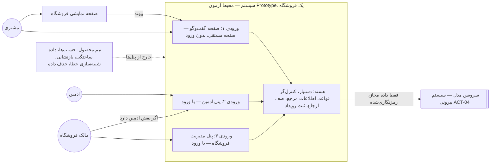

# ‏PRD-07 — نیازمندی‌های محیطی و سیستمی

> ‏**سطح این سند:** این سند می‌گوید محصول **روی چه بستری** ارائه می‌شود و آن بستر **چه قابلیت‌هایی** باید داشته باشد تا رفتار PRD-04 و حدهای کیفی PRD-06 برقرار شوند: نوع محصول، ورودی‌ها، دستگاه و مرورگر، هویت و دسترسی، محیط آزمون، سیستم‌های بیرونی و کفایت زیرساخت.
>
> ‏**آنچه اینجا نیست:** رفتار و متن رابط (PRD-04، PRD-05)، حدهای عددی کیفیت (PRD-06؛ فقط با شناسه ارجاع داده می‌شوند)، و **هر انتخاب فناوری**: زبان، فریم‌ورک، پایگاه داده، مدل، سرویس‌دهنده و روش پیاده‌سازی. این انتخاب‌ها با طراحی فنی است `[SRC-02 §13؛ C-08]`.
>
> ‏**راهنمای برچسب‌ها:** `[SRC-xx §n]` = برگرفته از منبع · **(پیشنهاد)** = پیشنهاد تیم PRD، تأییدشده در چت PRD-07 · **(فرض A-xx)** = مقدار تأییدنشده · **(تغییر — CH-xx)** = افزوده نسبت به BRD · **(تأییدنشده)** = برگرفته از تحقیقات بازار (DEC-02) · **TBD** = تعیین در پایلوت.

### ‏راهنمای شناسه‌ها

| ‏کد | ‏معنی | ‏کجا تعریف شده |
|---|---|---|
| ‏ENV-xx | ‏نیازمندی محیطی و سیستمی این سند (مثلاً ENV-21 = شناسایی مکالمه با شناسه بی‌نام مرورگر) **(DEC-166)** | ‏همین سند |
| ‏ورودی ۱ / ۲ / ۳ | ‏صفحه گفت‌وگو / پنل ادمین / پنل مدیریت فروشگاه | ‏PRD-05 §5.4 (DEC-126) |
| ‏SCR | ‏صفحه (SCR-01 گفت‌وگو؛ SCR-10 تا 12 پنل ادمین؛ SCR-20 تا 26 پنل فروشگاه) | ‏PRD-05 |
| ‏NFR-xx-n | ‏نیازمندی کیفی و زیرشناسه آن | ‏PRD-06 |
| ‏ACT | ‏نقش (ACT-01 مشتری، ACT-02 ادمین، ACT-03 مالک فروشگاه، ACT-04 سرویس مدل) | ‏PRD-03a |
| ‏DS / EV | ‏محل ذخیره داده / نوع رویداد | ‏PRD-04-DD؛ PRD-04-EP06 |
| ‏US / AC / ND / CR | ‏استوری / معیار پذیرش / نباید کلی / قاعده رفتاری مشترک | ‏PRD-04 |
| ‏S1 … S6 / TR | ‏وضعیت مکالمه / انتقال وضعیت | ‏PRD-03f |
| ‏A / D / Q / DEC / CH | ‏فرض / تصمیم باز BRD / سؤال باز / تصمیم / تغییر | ‏Master Index |

---

## ‏۷.۱ دامنه و قواعد این سند

> ‏**یادداشت درباره عنوان (Q-05، C-10 — DEC-156):** تمپلیت برای این بخش عنوان «نیازمندی‌های محیطی و سیستمی» و برچسب انگلیسی «Functional Requirements» آورده است. متن راهنمای تمپلیت فقط درباره بستر، دستگاه، نوع اپلیکیشن، وب‌سرویس و کفایت زیرساخت است `[SRC-03 §7]`. بنابراین **محتوای راهنما مبناست** و برچسب انگلیسی خطای تمپلیت حساب می‌شود. عنوان تمپلیت دست نخورده است (DEC-05). نیازمندی‌های عملکردی به معنای استاندارد در PRD-04 آمده‌اند (DEC-10).

| ‏# | ‏قاعده | ‏مرجع |
|---|---|---|
| ‏۱ | ‏هر ردیف ENV یک **قابلیت یا قید بستر** است، نه رفتار محصول. رفتار فقط با شناسه در ستون «مرجع» می‌آید. | ‏دستورالعمل پروژه §۸ |
| ‏۲ | ‏**حدهای عددی PRD-06 تکرار نمی‌شوند.** ردیف ENV می‌گوید بستر باید کدام NFR را ممکن کند. | ‏PRD-06 §6.10 |
| ‏۳ | ‏**هیچ فناوری، محصول یا سرویس‌دهنده مشخصی الزام نمی‌شود.** پیشنهادهای SRC-04 و SRC-05 فقط در پانویس و با برچسب «تأییدنشده» می‌آیند. | ‏C-08؛ DEC-02 |
| ‏۴ | ‏ستون‌ها: شناسه · الزام · Prototype · پایلوت · مرجع. ستون «پایلوت» فقط وقتی پر است که منبع یا این چت چیزی گفته باشد؛ وگرنه TBD. | ‏DEC-03؛ DEC-14 |
| ‏۵ | ‏متن‌های رابط تازه این سند همه **(پیشنهاد — DEC-61)** هستند و در §7.6.4 فهرست شده‌اند. | ‏DEC-61 |

> ‏**پانویس تأییدنشده (DEC-02):** SRC-04 برای MVP فریم‌ورک‌های مکالمه (Rasa، BotPress)، مدل‌های زبانی (GPT یا مدل بومی)، زیرساخت ابری و ابزارک گفت‌وگو روی سایت یا تلگرام/اینستاگرام را پیشنهاد کرده است `[SRC-04 §6]`. SRC-05 رابط وب با Next.js، ذخیره‌سازی PostgreSQL، بازیابی ترکیبی و قواعد قطعی را پیشنهاد کرده است `[SRC-05 §5]`. هیچ‌کدام الزام این PRD نیستند و برای طراحی فنی فقط زمینه‌اند. اصل «قواعد قطعی برای موجودی، قیمت و مجوز» در SRC-05 با SP-09 هم‌راستاست.

---

## ‏۷.۲ پاسخ به پرسش‌های تمپلیت

| ‏# | ‏پرسش تمپلیت `[SRC-03 §7]` | ‏پاسخ | ‏ردیف‌ها |
|---|---|---|---|
| ‏۱ | ‏بستری که محصول ارائه می‌شود چیست؟ | ‏**وب.** سه ورودی جدا با نشانی وب: صفحه گفت‌وگوی مشتری (صفحه مستقل)، پنل ادمین و پنل مدیریت فروشگاه. در Prototype یک فروشگاه با داده ساختگی و بدون اتصال به سیستم‌های فروشگاه | ‏ENV-01 تا ENV-07 |
| ‏۲ | ‏از نظر دستگاه، موبایل یا دسکتاپ؟ | ‏**صفحه گفت‌وگو موبایل‌محور** (با پشتیبانی دسکتاپ)؛ **پنل‌ها دسکتاپ** | ‏ENV-10 تا ENV-14 |
| ‏۳ | ‏اپلیکیشن لازم است یا وب‌اپلیکیشن کافی است؟ | ‏**وب‌اپلیکیشن کافی است.** اپلیکیشن بومی و نصب روی دستگاه لازم نیست | ‏ENV-01 |
| ‏۴ | ‏وب‌سرویس ارائه می‌شود یا بدون کدنویسی هم می‌شود استفاده کرد؟ | ‏**بدون کدنویسی.** فروشگاه همه کارها را از پنل‌ها انجام می‌دهد. در Prototype هیچ وب‌سرویس یا API برای استفاده بیرونی ارائه نمی‌شود | ‏ENV-05، ENV-67 |
| ‏۵ | ‏منابع زیرساختی کفایت می‌کند یا زیرساخت قوی‌تری لازم است؟ | ‏**زیرساختی وجود ندارد** (DEC-27) و باید فراهم شود. نیاز Prototype کوچک است و زیرساخت سبک کافی است. وابستگی تعیین‌کننده، سرویس مدل بیرونی است | ‏§7.9 |

---

## ‏۷.۳ نمای بستر

> ‏هدف دیاگرام: نشان‌دادن ورودی‌ها، هسته سیستم، تنها سیستم بیرونی (سرویس مدل) و کارهای تیم محصول روی محیط آزمون. اجزای هسته همان اجزای منطقی PRD-03a‌اند و جداسازی فیزیکی آن‌ها با طراحی فنی است.

> ‏**خط پیوسته** = استفاده یا جریان داده · **خط‌چین** = کار راه‌اندازی و آزمون که از رابط کاربران نمی‌گذرد. همه ارتباط‌ها رمزنگاری‌شده‌اند (ENV-41).

---

## ‏۷.۴ بستر و ورودی‌ها

| ‏شناسه | ‏الزام | ‏Prototype | ‏پایلوت | ‏مرجع |
|---|---|---|---|---|
| ‏ENV-01 | ‏محصول **وب‌اپلیکیشن** است و با مرورگر استفاده می‌شود؛ اپلیکیشن بومی و نصب روی دستگاه کاربر لازم نیست | ‏الزامی | ‏همان؛ اپلیکیشن بومی فقط با تصمیم جدا | ‏`[SRC-02 §3]`؛ PRD-02 §2.7 |
| ‏ENV-02 | ‏**سه ورودی جدا**، هرکدام با نشانی خود: ورودی ۱ صفحه گفت‌وگو، ورودی ۲ پنل ادمین، ورودی ۳ پنل مدیریت فروشگاه. صفحه پیش‌فرض: SCR-01 · SCR-10 · SCR-20 | ‏الزامی | ‏همان | ‏DEC-126؛ PRD-05 §5.4 |
| ‏ENV-03 | ‏صفحه گفت‌وگو یک **صفحه مستقل و تمام‌صفحه** با نشانی خودش است و به سایت میزبان وابسته نیست. با پیوند از صفحه نمایشی فروشگاه یا با بازکردن مستقیم نشانی باز می‌شود **(پیشنهاد — DEC-158)** | ‏الزامی | ‏ابزارک روی سایت فروشگاه یا پیوند در کانال واقعی، مشروط به D-04 (PRD-12) | ‏PRD-05 §5.9؛ PRD-05a §5a.1؛ Q-25 |
| ‏ENV-04 | ‏**صفحه نمایشی فروشگاه:** یک صفحه ساده با نام فروشگاه نمایشی و پیوند «گفت‌وگو با پشتیبان» که صفحه گفت‌وگو را باز می‌کند **(CH-31)**. فروشگاه اینترنتی کامل، کاتالوگ قابل خرید یا سبد خرید نیست **(پیشنهاد)** | ‏الزامی | ‏جایگزین با سایت یا کانال واقعی فروشگاه | ‏`[SRC-02 §3]` «رابط وب نمایشی کفایت می‌کند»؛ ND-02 |
| ‏ENV-05 | ‏هیچ **وب‌سرویس یا API** برای استفاده بیرونی (فروشگاه، شریک یا توسعه‌دهنده) ارائه نمی‌شود. فروشگاه همه کارها را بدون کدنویسی از پنل‌ها انجام می‌دهد | ‏الزامی | ‏TBD (همراه با اتصال کانال و منبع موجودی — ND-30، ND-31) | ‏SRC-03 §7؛ DEC-109 |
| ‏ENV-06 | ‏هر نصب **یک فروشگاه** دارد؛ داده و تنظیمات فروشگاه دیگری در آن نیست | ‏۱ فروشگاه | ‏۱ فروشگاه پایلوت (D-01) | ‏NFR-11-1؛ ND-36 |
| ‏ENV-07 | ‏**نمایش فارسی در بستر:** همه ورودی‌ها راست‌به‌چپ، با قلم فارسی خوانا، تقویم شمسی و ارقام فارسی. زمان‌ها به **منطقه زمانی فروشگاه** (تنظیم DS-09) نمایش داده می‌شوند، **مستقل از ساعت و منطقه زمانی دستگاه کاربر** | ‏الزامی | ‏همان | ‏NFR-03-1؛ DEC-69؛ DEC-120؛ 04-00 §0.4 |

> ‏**چرا صفحه مستقل (DEC-158):** چیدمان صفحه گفت‌وگو تمام‌صفحه و موبایل‌محور است؛ سرصفحه و کادر نوشتن ثابت‌اند و فقط فهرست پیام‌ها پیمایش می‌شود (PRD-05a §5a.2). خریدار اینستاشاپ هم معمولاً با یک پیوند (بیو یا دایرکت) به فروشگاه می‌رسد، پس صفحه مستقل به روند واقعی فروشگاه‌ها نزدیک‌تر است (Q-25). ابزارک روی سایت، یک سایت میزبان اضافه می‌خواهد و در Prototype ارزش آزمونی تازه‌ای ندارد.

---

## ‏۷.۵ دستگاه، مرورگر و شبکه مرجع

> ‏این بخش مقدار «دستگاه و شبکه» در شرایط مرجع آزمون PRD-06 §6.2 را مشخص می‌کند. فرض A-17 با DEC-157 تأیید شد.

| ‏شناسه | ‏الزام | ‏Prototype | ‏پایلوت | ‏مرجع |
|---|---|---|---|---|
| ‏ENV-10 | ‏**دستگاه هدف هر ورودی:** صفحه گفت‌وگو برای **موبایل** طراحی می‌شود و روی دسکتاپ همان چیدمان را با عرض محدود دارد. پنل ادمین و پنل مدیریت فروشگاه برای **دسکتاپ** طراحی می‌شوند؛ استفاده از پنل‌ها روی موبایل و تبلت در Prototype الزامی نیست و آزموده نمی‌شود | ‏الزامی | ‏استفاده از پنل‌ها روی موبایل TBD (همراه با شیفت و نقش‌ها) | ‏A-17 ← DEC-157؛ PRD-05a §5a.1 |
| ‏ENV-11 | ‏**دستگاه مرجع موبایل:** گوشی اندرویدی میان‌رده، در حالت عمودی، با عرض نمایش منطقی ۳۶۰ تا ۴۱۲ پیکسل، با آخرین نسخه پایدار مرورگر Chrome. NFR-03-3 (دکمه درخواست انسان بدون پیمایش) روی این دستگاه و هم روی کم‌عرض‌ترین مقدار این بازه سنجیده می‌شود | ‏**(فرض A-26)** | ‏با دستگاه‌های رایج مشتریان فروشگاه پایلوت بازبینی شود | ‏PRD-06 §6.2؛ NFR-03-3 |
| ‏ENV-12 | ‏**دستگاه مرجع دسکتاپ:** رایانه با نمایشگر دست‌کم ۱۳۶۶×۷۶۸ پیکسل و آخرین نسخه پایدار Chrome | ‏**(فرض A-26)** | ‏همان | ‏PRD-06 §6.2؛ NFR-02-6 |
| ‏ENV-13 | ‏**مرورگرهای پشتیبانی‌شده:** آخرین نسخه پایدار Chrome (اندروید و دسکتاپ)، Safari (iOS)، و Firefox و Edge (دسکتاپ). آزمون‌های پذیرش و کاربردپذیری روی دستگاه‌های مرجع انجام می‌شوند؛ بقیه مرورگرها یک بازبینی دستی سبک می‌گیرند: بارگذاری، ارسال پیام، درخواست انسان، ورود و یک کنش در هر پنل | ‏الزامی | ‏فهرست با آمار واقعی مشتریان بازبینی شود | ‏NFR-03 |
| ‏ENV-14 | ‏**شبکه مرجع:** اتصال پایدار اینترنت (ثابت یا وای‌فای) برای همه آزمون‌های PRD-06. برای صفحه گفت‌وگو یک اجرای کنترلی روی **اینترنت همراه** گزارش می‌شود که معیار قبولی نیست و فقط اثر شبکه را نشان می‌دهد **(پیشنهاد)** | ‏الزامی | ‏شبکه واقعی مشتریان؛ حد TBD | ‏NFR-02 «داده و شبکه تعریف‌شده»؛ PRD-06 §6.2 |

---

## ‏۷.۶ هویت و دسترسی

### ‏۷.۶.۱ مشتری — شناسایی مکالمه بدون ورود

> ‏**پشتوانه:** NFR-04-1 (جداسازی مکالمه)، US-01-01 (بدون ورود و ثبت‌نام؛ شناسایی ← PRD-07)، AC-01-01-6 (دو تب)، US-03-06 (بازگشایی در همان مکالمه). **روش (DEC-159):** شناسه بی‌نام که در همان مرورگر نگه داشته می‌شود.

| ‏شناسه | ‏الزام | ‏Prototype | ‏پایلوت | ‏مرجع |
|---|---|---|---|---|
| ‏ENV-20 | ‏مشتری **بدون ورود و ثبت‌نام** گفت‌وگو می‌کند و برای شناسایی هیچ داده شخصی (نام، تلفن، ایمیل) از او خواسته نمی‌شود | ‏الزامی | ‏احراز ارتباط مشتری با سفارش واقعی پیش‌شرط پایلوت است (PRD-06 §6.9) | ‏US-01-01؛ ND-25؛ NFR-06-1 |
| ‏ENV-21 | ‏مرورگر مشتری یک **شناسه بی‌نام، تصادفی و حدس‌ناپذیر** دارد که در همان مرورگر نگه داشته می‌شود. نخستین پیام، مکالمه تازه را به این شناسه متصل می‌کند (TR-00) | ‏الزامی | ‏همان | ‏NFR-04-1؛ TR-00 |
| ‏ENV-22 | ‏**همان مرورگر، همان مکالمه:** تازه‌سازی صفحه، بستن و بازکردن دوباره، و بازکردن در چند تب همان مکالمه را نشان می‌دهد و مکالمه دوم نمی‌سازد. مکالمه بسته (S5، S6) هم در همان مرورگر دیده می‌شود تا بازگشایی ممکن باشد | ‏الزامی | ‏همان | ‏AC-01-01-6؛ US-03-06؛ NFR-05-2 |
| ‏ENV-23 | ‏**مرورگر یا دستگاه دیگر، حالت ناشناس، یا پاک‌شدن داده مرورگر** یعنی مکالمه تازه. مکالمه قبلی بازیابی نمی‌شود و در رابط هیچ راهی برای پیداکردن آن نیست | ‏الزامی | ‏TBD (ادامه مکالمه بین دستگاه‌ها با احراز — PRD-12) | ‏US-01-01 (نبود حافظه بین مکالمه‌ها) |
| ‏ENV-24 | ‏**نشانی صفحه شناسه مکالمه ندارد.** دسترسی به پیام‌ها فقط با شناسه همان مرورگر ممکن است؛ تغییر نشانی یا دست‌کاری درخواست به داده مکالمه دیگری نمی‌رسد | ‏الزامی | ‏همان | ‏NFR-04-1؛ ND-23، ND-24 |
| ‏ENV-25 | ‏هر مرورگر در هر لحظه **یک مکالمه** دارد؛ کنش «شروع مکالمه تازه» در رابط نیست | ‏الزامی | ‏TBD | ‏PRD-05a (چنین کنشی ندارد) |
| ‏ENV-26 | ‏اگر داده مکالمه حذف شده باشد (پایان مهلت NFR-06-5)، مرورگری که شناسه قدیمی دارد بدون خطا با ح۱ (خوش‌آمد) و مکالمه تازه روبه‌رو می‌شود | ‏الزامی | ‏همان | ‏NFR-06-5؛ PRD-05a §5a.4 |

> ‏**پیامد برای آزمون:** چون هر مرورگر یک مکالمه دارد، آزمون ۵ مکالمه هم‌زمان (NFR-02-7) و دو نشست هم‌زمان (AC-01-01-2) با پنج نمایه یا مرورگر جدا اجرا می‌شود. آزمون‌کنندگان کاربردپذیری هم هرکدام باید نمایه مرورگر تازه داشته باشند (ENV-45، ستون آزمون).
>
> ‏**ریسک (← PRD-08):** روی دستگاه مشترک، نفر بعدی مکالمه نفر قبلی را در همان مرورگر می‌بیند. در Prototype داده ساختگی است و دستگاه‌های آزمون کنترل‌شده‌اند؛ برای پایلوت باید پاسخ داده شود.

### ‏۷.۶.۲ ادمین و مالک — حساب و ورود

> ‏**پشتوانه:** NFR-04-2 (ورود الزامی)، NFR-04-3 (اجرای مجوز در سمت سیستم)، NFR-08 (ممیزی با عامل)، DEC-101 (خوانده‌نشده برای هر ادمین)، 04-00 §0.2 («مالک با نقش ادمین»)، PRD-05 §5.9، و BRD §13 «روش ورود ادمین، رفتار تب‌های هم‌زمان». **روش (DEC-160، DEC-161):** حساب فردی با نام کاربری و رمز عبور؛ حساب‌ها را تیم محصول می‌سازد.

| ‏شناسه | ‏الزام | ‏Prototype | ‏پایلوت | ‏مرجع |
|---|---|---|---|---|
| ‏ENV-30 | ‏ورود به ورودی ۲ و ۳ با **نام کاربری و رمز عبور**. هر ورودی صفحه ورود خودش را دارد؛ این صفحه‌ها شناسه SCR نمی‌گیرند (DEC-162) | ‏الزامی | ‏روش ورود قوی‌تر (مثلاً عامل دوم) TBD | ‏NFR-04-2؛ `[SRC-02 §13]` |
| ‏ENV-31 | ‏**حساب فردی:** هر نفر حساب خودش را دارد؛ حساب مشترک بین چند نفر وجود ندارد | ‏الزامی | ‏همان | ‏NFR-08؛ DEC-101؛ BRD §8 (مسئول = فرد مشخص) |
| ‏ENV-32 | ‏هر حساب یک یا دو **نقش** دارد: «ادمین» و «مالک فروشگاه». مجوزهای «اصلاح منبع» و «تغییر آستانه اعتبار» برای ادمین جداگانه در SCR-25 اعطا می‌شوند (DEC-113؛ DEC-259). **مالکی که نقش ادمین هم دارد یک حساب دارد** و با همان نام کاربری از هر دو ورودی وارد می‌شود؛ هر ورودی منوی خودش را نشان می‌دهد | ‏الزامی | ‏همان | ‏DEC-161؛ PRD-05 §5.9؛ 04-00 §0.2 |
| ‏ENV-33 | ‏**ساخت، تعیین نقش و غیرفعال‌سازی حساب‌ها** در Prototype کار تیم محصول است و خارج از پنل‌ها انجام می‌شود؛ ثبت‌نام آزاد و صفحه مدیریت حساب وجود ندارد. هر ساخت و تغییر حساب با تاریخ در سابقه راه‌اندازی تیم محصول ثبت می‌شود | ‏الزامی | ‏ساخت و غیرفعال‌سازی حساب ادمین توسط مالک فروشگاه — PRD-12 | ‏DEC-160؛ هم‌راستا با DEC-109؛ US-05-04 (بیرون گذاشته) |
| ‏ENV-34 | ‏**فراموشی رمز:** بازیابی خودکار رمز نیست؛ تیم محصول رمز تازه می‌دهد. صفحه ورود این را در یک خط راهنما می‌گوید | ‏الزامی | ‏بازیابی خودکار TBD | ‏DEC-160 |
| ‏ENV-35 | ‏رمز عبور فقط به شکلی ذخیره می‌شود که قابل بازگرداندن به متن اصلی نباشد؛ هرگز نمایش داده نمی‌شود و در رویداد (DS-08) یا فایل CSV نمی‌آید | ‏الزامی | ‏همان | ‏NFR-06-4؛ NFR-06-1 |
| ‏ENV-36 | ‏**نشست:** پس از ورود، نشست تا «خروج» یا تا **۸ ساعت بی‌کاری** معتبر است. کنشی که پس از پایان نشست زده شود انجام نمی‌شود، پیام موفقیت نمی‌آید و کاربر به صفحه ورود می‌رود؛ پس از ورود دوباره به همان صفحه برمی‌گردد | ‏**(فرض A-27)** | ‏مدت و سیاست قفل‌شدن پس از تلاش ناموفق TBD | ‏ND-14؛ NFR-04-2 |
| ‏ENV-37 | ‏**خروج:** کنش «خروج» در نوار بالای پوسته هر دو پنل است (PRD-05b §5b.1 و 05c §5c.1). خروج نشست همان مرورگر را می‌بندد؛ بازکردن هر صفحه پنل پس از آن به صفحه ورود می‌رود | ‏الزامی | ‏همان | ‏PRD-05b R0-a؛ PRD-05c R0-a |
| ‏ENV-38 | ‏**چند تب و چند دستگاه** برای یک حساب مجاز است. هر کنش با وضعیت لحظه کنش سنجیده می‌شود و تب کهنه کنش ناسازگار اجرا نمی‌کند | ‏الزامی | ‏همان | ‏NFR-10-5؛ `[SRC-02 §13]` |
| ‏ENV-39 | ‏**ورود ناموفق** پیام کلی می‌دهد و نمی‌گوید نام کاربری نادرست است یا رمز. حساب غیرفعال‌شده هم وارد نمی‌شود و همین پیام را می‌گیرد | ‏الزامی | ‏همان | ‏NFR-04 |

### ‏۷.۶.۳ رفتار دسترسی و «دسترسی رد شد»

> ‏PRD-05 §5.2 حالت «دسترسی رد شد» را حالت استاندارد همه صفحه‌ها گذاشته و متن و رفتارش را به PRD-07 سپرده است. منو آیتم بی‌مجوز را نشان نمی‌دهد (DEC-126)، ولی سیستم هم هر درخواست را جدا می‌سنجد (NFR-04-3) **(DEC-162)**.

| ‏شناسه | ‏موقعیت | ‏رفتار | ‏مرجع |
|---|---|---|---|
| ‏ENV-40a | ‏کاربر وارد نشده و صفحه یا داده‌ای از ورودی ۲ یا ۳ را باز می‌کند (از جمله مشتری‌ای که نشانی پنل را باز کند) | ‏به صفحه ورود همان ورودی می‌رود؛ هیچ داده‌ای از پنل نشان داده نمی‌شود؛ پس از ورود موفق به همان صفحه برمی‌گردد | ‏NFR-04-2 |
| ‏ENV-40b | ‏کاربر وارد شده ولی **نقش آن ورودی را ندارد** (مثلاً مالک بدون نقش ادمین در ورودی ۲، یا ادمین بدون مجوز اصلاح منبع در ورودی ۳) | ‏صفحه «دسترسی رد شد» با متن «حساب شما به این پنل دسترسی ندارد» و کنش «خروج» | ‏DEC-126؛ 04-00 §0.2 |
| ‏ENV-40c | ‏کاربر به ورودی دسترسی دارد ولی **صفحه بی‌مجوز** را با نشانی مستقیم باز می‌کند (مثلاً ادمین با مجوز اصلاح منبع، SCR-24 را؛ ادمین با مجوز آستانه فقط بخش آستانه SCR-24 را می‌بیند — DEC-266) | ‏صفحه «دسترسی رد شد» با متن «شما به این صفحه دسترسی ندارید» و کنش «رفتن به صفحه اصلی» (صفحه پیش‌فرض همان ورودی) | ‏PRD-05 §5.4؛ DEC-259؛ DEC-70 |
| ‏ENV-40d | ‏کنش یا داده بی‌مجوز با **فراخوانی مستقیم** و بدون رابط | ‏رد در سمت سیستم؛ هیچ داده‌ای تغییر نمی‌کند و پاسخ موفق برنمی‌گردد | ‏NFR-04-3 |
| ‏ENV-40e | ‏مجوز کاربر در میانه کار لغو می‌شود (لغو مجوز اصلاح منبع) | ‏نخستین کنش بعدی رد می‌شود؛ پیام «دسترسی شما به این بخش تغییر کرده است» و رفتار ENV-40b یا ENV-40c | ‏NFR-04-4؛ AC-05-04-2 |
| ‏ENV-40f | ‏حساب در میانه نشست غیرفعال می‌شود | ‏نخستین کنش بعدی انجام نمی‌شود و کاربر به صفحه ورود می‌رود | ‏ENV-33؛ ND-14 |

### ‏۷.۶.۴ متن‌های تازه این بخش (همه پیشنهاد — DEC-61)

| ‏جا | ‏متن |
|---|---|
| ‏عنوان صفحه ورود | ‏«ورود به پنل ادمین» · «ورود به پنل مدیریت فروشگاه» |
| ‏فیلدها و دکمه | ‏«نام کاربری» · «رمز عبور» · «ورود» |
| ‏راهنمای صفحه ورود | ‏«برای دریافت حساب یا رمز تازه با تیم محصول تماس بگیرید.» |
| ‏ورود ناموفق | ‏«نام کاربری یا رمز عبور درست نیست.» |
| ‏پایان نشست | ‏«نشست شما به پایان رسید. دوباره وارد شوید.» |
| ‏دسترسی رد شد — ورودی | ‏«حساب شما به این پنل دسترسی ندارد.» + «خروج» |
| ‏دسترسی رد شد — صفحه | ‏«شما به این صفحه دسترسی ندارید.» + «رفتن به صفحه اصلی» |
| ‏لغو مجوز در میانه کار | ‏«دسترسی شما به این بخش تغییر کرده است.» |
| ‏کنش خروج | ‏«خروج» |

> ‏صفحه ورود حالت‌های استاندارد PRD-05 §5.2 را دارد («ذخیره در جریان» = دکمه ورود غیرفعال تا پاسخ برسد). متن‌ها طبق قواعد 04-00 §0.5 کوتاه‌اند و جزئیات فنی ندارند.

---

## ‏۷.۷ محیط‌ها و میزبانی

| ‏شناسه | ‏الزام | ‏Prototype | ‏پایلوت | ‏مرجع |
|---|---|---|---|---|
| ‏ENV-41 | ‏**ارتباط رمزنگاری‌شده:** هر سه ورودی و ارتباط با سرویس مدل فقط با ارتباط رمزنگاری‌شده در دسترس‌اند؛ نشانی بدون رمزنگاری به نسخه رمزنگاری‌شده هدایت می‌شود یا پاسخی نمی‌دهد | ‏الزامی | ‏همان؛ رمزنگاری داده ذخیره‌شده TBD (PRD-06 §6.9) | ‏NFR-06-3 |
| ‏ENV-42 | ‏**یک محیط آزمون** که آزمون‌کنندگان (مشتری، ادمین، مالک) از راه اینترنت و بدون نصب نرم‌افزار به آن دسترسی دارند. محیط آزمون به هیچ سیستم واقعی فروشگاه وصل نیست و فقط داده ساختگی دارد | ‏الزامی | ‏محیط عملیاتی جدا از محیط آزمون TBD | ‏`[SRC-02 §3]`؛ ND-26، ND-30، ND-31؛ NFR-06-1 |
| ‏ENV-43 | ‏**به‌روزرسانی زنده:** بستر رساندن تغییر از سرور به صفحه‌ای که باز است، بدون تازه‌سازی و بدون کنش کاربر، را پشتیبانی می‌کند. روش با طراحی فنی است | ‏الزامی برای صفحه گفت‌وگو و نمای مالک؛ ترجیحی برای صف | ‏همان | ‏NFR-10-1، 10-2، 10-3؛ DEC-152 |
| ‏ENV-44 | ‏**ماندگاری:** همه داده‌ها در ذخیره‌سازی پایدار نگه داشته می‌شوند. تیم محصول می‌تواند سیستم را **راه‌اندازی مجدد** کند و پس از آن ارجاع‌ها، مکالمه‌ها، مالکیت‌ها، تنظیمات و حساب‌ها باقی‌اند | ‏الزامی | ‏همان + پشتیبان‌گیری و بازیابی TBD | ‏NFR-05-1، 05-2 |
| ‏ENV-45 | ‏**قابلیت‌های آزمون** (فقط در محیط آزمون، فقط برای تیم محصول، خارج از پنل‌ها و نادیدنی برای کاربران): (۱) تأخیر قابل تنظیم در پاسخ سرویس مدل؛ (۲) قطع کامل سرویس مدل؛ (۳) شکست ذخیره برای هر کنش ذخیره‌دار (ارجاع، تحویل، پاسخ ادمین، تنظیمات، تأیید داده مرجع)؛ (۴) ازکارافتادن ثبت رویداد. هر روشن و خاموش‌شدن این قابلیت‌ها با زمان ثبت می‌شود تا نتایج آزمون از داده عادی جدا شوند **(تغییر — CH-18)** | ‏الزامی | ‏در محیط عملیاتی نیست | ‏NFR-02-2 تا 02-5؛ NFR-05-3 تا 05-5؛ `[SRC-02 §11]` (۸ سناریوی خطای سرویس) |
| ‏ENV-46 | ‏**بارگذاری و بازنشانی داده:** تیم محصول داده ساختگی اولیه (کاتالوگ، گونه، موجودی، سیاست، سفارش نمونه، حساب‌ها، تنظیمات و منطقه زمانی) را خارج از پنل‌ها بارگذاری می‌کند و می‌تواند محیط را **پیش از هر دور آزمون** به همان حالت آغازین برگرداند. بازنشانی در میانه یک اجرای پیوسته انجام نمی‌شود | ‏الزامی | ‏بارگذاری داده واقعی فقط پس از §6.9 | ‏DEC-109؛ NFR-11-2؛ Q-31 |
| ‏ENV-47 | ‏**ساعت دقیق:** ساعت سیستم با زمان مرجع همگام است و همه زمان‌های ثبت‌شده (رویدادها، زمان تأیید موجودی، زمان انتظار) از ساعت سیستم می‌آیند، نه از ساعت دستگاه کاربر؛ با دقت دست‌کم یک ثانیه | ‏الزامی | ‏همان | ‏PRD-06 §6.2 (ثبت زمان)؛ DEC-79؛ FR-11 |
| ‏ENV-48 | ‏**حذف کامل داده:** تیم محصول می‌تواند داده DS-05 تا DS-08 و فایل‌های CSV را کامل حذف کند؛ اگر نسخه پشتیبانی وجود دارد، در همان مهلت حذف می‌شود. تاریخ حذف ثبت می‌شود | ‏الزامی | ‏روش حذف طبق §6.9 | ‏NFR-06-5؛ DEC-153 |
| ‏ENV-49 | ‏**دسترسی فنی به محیط** (سرور، ذخیره‌سازی، تنظیمات محیط و قابلیت‌های ENV-45) فقط برای تیم محصول و فنی است. مالک و ادمین فقط از پنل‌ها کار می‌کنند | ‏الزامی | ‏همان؛ مسئول و فهرست دسترسی‌ها TBD (Q-34) | ‏NFR-04 |
| ‏ENV-50 | ‏**محل میزبانی:** در Prototype آزاد است، چون داده ساختگی است؛ به شرط دسترسی پایدار از محل آزمون‌کنندگان و دسترسی پایدار به سرویس مدل | ‏آزاد با دو شرط | ‏پیش‌شرط پایلوت (داخل یا خارج کشور — PRD-06 §6.9) | ‏`[SRC-02 §10]`؛ `[SRC-04 §7]` (تأییدنشده) |

---

## ‏۷.۸ سیستم‌های بیرونی و کانال

### ‏۷.۸.۱ سرویس مدل (ACT-04)

> ‏سرویس مدل تنها سیستم بیرونی رفتاری Prototype است (PRD-03a §3a.2). انتخاب سرویس‌دهنده و شرایط قرارداد ← PRD-09؛ ریسک تحریم، قطع و کندی ← PRD-08.

| ‏شناسه | ‏الزام | ‏Prototype | ‏پایلوت | ‏مرجع |
|---|---|---|---|---|
| ‏ENV-60 | ‏سرویس مدل از محیط میزبان، با ارتباط رمزنگاری‌شده، در دسترس است | ‏الزامی | ‏همان | ‏ENV-41؛ `[SRC-02 §3]` (دسترسی سرویس مدل پیش‌شرط زمان‌بندی) |
| ‏ENV-61 | ‏هر فراخوانی سرویس مدل **سقف زمانی** دارد تا حدهای NFR-02-3 و NFR-02-4 برقرار بمانند؛ پاسخی که پس از سقف برسد کنار گذاشته می‌شود | ‏الزامی | ‏همان | ‏NFR-02-3، 02-4؛ DEC-93 |
| ‏ENV-62 | ‏به سرویس مدل فقط داده ستون «می‌رود» مرز PRD-03e §3e.5 فرستاده می‌شود | ‏الزامی | ‏همان + شرایط قرارداد (نگه‌نداشتن داده، استفاده‌نکردن برای آموزش) — PRD-09 | ‏NFR-06-2؛ DEC-56 |
| ‏ENV-63 | ‏هر فراخوانی یک رویداد EV-12 با مصرف و هزینه گزارش‌شده دارد | ‏الزامی | ‏همان + سقف هزینه (D-03) | ‏NFR-09-1 |
| ‏ENV-64 | ‏**استقلال از سرویس‌دهنده:** عوض‌کردن سرویس‌دهنده مدل به تغییر قواعد، صف، داده یا رابط نیاز ندارد. پس از هر تعویض، مجموعه پذیرش دوباره اجرا می‌شود **(پیشنهاد — تغییر CH-18)** | ‏الزامی | ‏همان | ‏SP-09؛ DEC-22؛ ریسک تحریم `[SRC-04 §7]` (تأییدنشده) ← PRD-08 |

### ‏۷.۸.۲ اتصال‌ها و کانال

| ‏شناسه | ‏الزام | ‏Prototype | ‏پایلوت | ‏مرجع |
|---|---|---|---|---|
| ‏ENV-65 | ‏**بدون اتصال دیگر:** اینستاگرام یا هر کانال واقعی، انبار، سیستم سفارش، پرداخت، CRM، پیامک، ایمیل و اعلان در Prototype نیستند | ‏الزامی | ‏طبق D-04 و PRD-12 | ‏ND-30، ND-31، ND-32، ND-37 |
| ‏ENV-66 | ‏**اصل وابسته‌نبودن به یک کانال (Q-25):** (۱) هسته سیستم (دستیار، کنترل‌گر قواعد، اطلاعات مرجع، صف، ثبت رویداد) به کانال وابسته نیست و کانال فقط راه رسیدن و فرستادن پیام است؛ (۲) هر مکالمه کانال خود را دارد (فیلد «کانال» در DS-05) و در Prototype تنها مقدار آن «وب نمایشی» است؛ (۳) هیچ قاعده، وضعیت، متن رابط یا شاخصی به کانال وابسته نیست؛ (۴) افزودن کانال در پایلوت فقط راه ورود و خروج پیام را اضافه می‌کند و قواعد را تغییر نمی‌دهد **(پیشنهاد — DEC-165)** | ‏الزامی؛ سنجش با بازبینی طراحی فنی | ‏کانال‌های پایلوت و رفتار ویژه هرکدام ← PRD-12 | ‏Q-25؛ A-13؛ PRD-10 §10.5 |
| ‏ENV-67 | ‏**سازگاری با روند فروشگاه‌ها:** فروشگاه برای استفاده فقط به مرورگر نیاز دارد؛ نصب، کدنویسی یا اتصال سیستم لازم نیست؛ اطلاعات مرجع با ورود دستی در پنل کار می‌کنند، پس فروشگاهی که سیستم انبار یا سفارش ندارد هم می‌تواند از محصول استفاده کند | ‏الزامی | ‏اتصال اختیاری به منبع واقعی موجودی (ND-31) ← PRD-12 | ‏Q-25؛ A-13؛ US-05-02 |

> ‏**Q-25:** بخش PRD-07 این سؤال با ENV-66 و ENV-67 بسته شد (DEC-165). بخش پایلوت (کدام کانال‌ها، کدام روندهای فروشگاه) در PRD-12 تعریف می‌شود. اسکوپ Prototype بزرگ نشده است.

---

## ‏۷.۹ کفایت زیرساخت

| ‏موضوع | ‏Prototype | ‏پایلوت | ‏مرجع |
|---|---|---|---|
| ‏زیرساخت موجود | ‏**هیچ.** کد، سرویس و زیرساختی وجود ندارد و باید فراهم شود | ‏— | ‏DEC-27؛ PRD-10 §10.1 |
| ‏اندازه بار | ‏یک فروشگاه، ۵ مکالمه هم‌زمان، دست‌کم ۲ ادمین هم‌زمان، مجموعه ۶۰ سناریو و ۲۰ مکالمه مختلط | ‏به حد کاربران پایلوت وابسته (TBD) | ‏NFR-02-7، 02-8؛ NFR-11-2؛ `[SRC-02 §12]` |
| ‏نتیجه | ‏**زیرساخت سبک کافی است** و زیرساخت قوی‌تری لازم نیست. ظرفیت باید فقط حدهای PRD-06 را در شرایط مرجع برآورده کند | ‏بازبینی پس از تعیین D-01، D-04 و حد کاربران | ‏PRD-06 §6.4 |
| ‏وابستگی تعیین‌کننده | ‏سرویس مدل: دسترسی‌پذیری، سرعت و هزینه آن بیش از هر زیرساختی بر حدهای PRD-06 اثر دارد | ‏همان + محل پردازش | ‏NFR-02-1؛ NFR-09-1؛ D-03 |
| ‏کار انسانی روی محیط | ‏تیم محصول: ساخت حساب‌ها، بارگذاری و بازنشانی داده، قابلیت‌های آزمون، راه‌اندازی مجدد، حذف داده | ‏مسئول فنی و فروشگاه | ‏ENV-33، 44 تا 48 ← PRD-09 |

---

## ‏۷.۱۰ مرز با بخش‌های دیگر

| ‏بخش | ‏در این سند | ‏در آن بخش |
|---|---|---|
| ‏PRD-04 | ‏شناسایی مکالمه، حساب‌ها و ورود (که US-01-01 و US-05-04 به اینجا سپرده‌اند) | ‏رفتار و معیار پذیرش همه استوری‌ها |
| ‏PRD-05 | ‏شکل فیزیکی ورودی‌ها؛ صفحه ورود و «دسترسی رد شد» بدون شناسه SCR | ‏صفحه‌ها، حالت‌ها و ناوبری |
| ‏PRD-06 | ‏بستری که حدها را ممکن می‌کند؛ مقدار «دستگاه و شبکه» شرایط مرجع | ‏همه حدهای عددی و شرط آزمون |
| ‏PRD-08 | ‏فرض‌های A-26 و A-27 | ‏ثبت فرض‌ها؛ ریسک‌ها: در دسترس نبودن یا تحریم سرویس مدل، کندی شبکه همراه، دستگاه مشترک مشتری، نبود زیرساخت موجود |
| ‏PRD-09 | ‏— | ‏سرویس‌دهنده مدل و قرارداد؛ میزبان؛ مسئول فنی محیط و Q-34؛ کارهای تیم محصول (ENV-33، 44 تا 48) و Q-31 |
| ‏PRD-11 | ‏دستگاه‌ها و مرورگرهای مرجع؛ قابلیت‌های آزمون | ‏آماده‌سازی محیط پیش از روز ۸ و ۹؛ نمایه‌های جدای مرورگر برای آزمون‌ها |
| ‏PRD-12 | ‏— | ‏ابزارک یا کانال واقعی (D-04)؛ ساخت حساب توسط مالک؛ بازیابی رمز و قفل حساب؛ محل میزبانی و پردازش؛ پنل‌ها روی موبایل |
| ‏طراحی فنی | ‏قابلیت‌ها و قیدها | ‏فناوری، معماری، روش به‌روزرسانی زنده، روش شناسه بی‌نام، روش ذخیره رمز |

---

## ‏۷.۱۱ فرض‌ها، تصمیم‌ها، تغییرات و نقاط باز

### ‏فرض‌های تازه

| ‏شناسه | ‏فرض | ‏ردیف | ‏تعیین تکلیف |
|---|---|---|---|
| ‏A-26 | ‏دستگاه مرجع موبایل: گوشی اندرویدی میان‌رده، عمودی، عرض ۳۶۰ تا ۴۱۲ پیکسل، Chrome به‌روز؛ دسکتاپ مرجع: ≥ ۱۳۶۶×۷۶۸ و Chrome به‌روز | ‏ENV-11، ENV-12 | ‏PRD-08؛ بازبینی در پایلوت |
| ‏A-27 | ‏پایان نشست ادمین و مالک پس از ۸ ساعت بی‌کاری | ‏ENV-36 | ‏PRD-08 |

### ‏فرض بسته‌شده

| ‏شناسه | ‏وضعیت |
|---|---|
| ‏A-17 | ‏✅ بسته شد ← DEC-157 (صفحه گفت‌وگو موبایل‌محور، پنل‌ها دسکتاپ؛ دستگاه‌های مرجع در A-26) |

### ‏تصمیم‌های این سند (برای ثبت در Master Index)

| ‏شناسه | ‏تصمیم |
|---|---|
| ‏DEC-156 | ‏**Q-05 و C-10 بسته شد:** محتوای راهنمای بخش ۷ تمپلیت (بستر و زیرساخت) مبناست؛ عنوان دست نمی‌خورد و برچسب «Functional Requirements» در یادداشت سند خطای تمپلیت ثبت می‌شود |
| ‏DEC-157 | ‏**A-17 تأیید شد:** صفحه گفت‌وگو موبایل‌محور و پنل‌ها دسکتاپ؛ دستگاه و مرورگر مرجع طبق ENV-11 تا ENV-13 (A-26)؛ شبکه مرجع طبق ENV-14 |
| ‏DEC-158 | ‏**شکل فیزیکی صفحه گفت‌وگو:** صفحه مستقل تمام‌صفحه با نشانی خودش، با پیوند از یک صفحه نمایشی ساده فروشگاه؛ ابزارک یا کانال واقعی در پایلوت (D-04) |
| ‏DEC-159 | ‏**شناسایی مکالمه مشتری:** شناسه بی‌نام، تصادفی و حدس‌ناپذیر در همان مرورگر؛ همان مرورگر = همان مکالمه؛ مرورگر یا دستگاه دیگر = مکالمه تازه؛ نشانی صفحه شناسه ندارد (ENV-20 تا ENV-26) |
| ‏DEC-160 | ‏**حساب و ورود ادمین و مالک:** حساب فردی با نام کاربری و رمز عبور؛ ساخت، نقش و غیرفعال‌سازی حساب‌ها با تیم محصول و خارج از پنل‌ها؛ بدون ثبت‌نام آزاد و بازیابی خودکار رمز؛ چند تب و دستگاه مجاز (ENV-30 تا ENV-39) |
| ‏DEC-161 | ‏**مالکی که نقش ادمین دارد یک حساب با دو نقش دارد** و از هر دو ورودی با همان حساب وارد می‌شود |
| ‏DEC-162 | ‏**رفتار دسترسی:** جدول ENV-40a تا ENV-40f؛ صفحه ورود و «دسترسی رد شد» شناسه SCR نمی‌گیرند و فقط در PRD-07 توصیف می‌شوند |
| ‏DEC-163 | ‏**الزام‌های محیط آزمون** (شبیه‌سازی تأخیر و قطع سرویس مدل، شکست ذخیره، ازکارافتادن ثبت رویداد؛ بارگذاری و بازنشانی داده؛ ساعت دقیق؛ حذف کامل داده) در PRD-07 ثبت می‌شوند و PRD-06 تغییر نمی‌کند |
| ‏DEC-164 | ‏**استقلال از سرویس‌دهنده مدل (ENV-64):** تعویض سرویس‌دهنده بدون تغییر قواعد، صف، داده یا رابط؛ پس از تعویض، مجموعه پذیرش دوباره اجرا می‌شود |
| ‏DEC-165 | ‏**Q-25 — بخش PRD-07 بسته شد:** اصل وابسته‌نبودن به یک کانال (ENV-66) و سازگاری با روند فروشگاه‌ها بدون نصب و اتصال (ENV-67)؛ بخش پایلوت ← PRD-12 |
| ‏DEC-166 | ‏**ساختار PRD-07:** یک سند بدون زیرسند؛ جدول پاسخ به پرسش‌های تمپلیت + جدول‌های الزام با پیشوند `ENV` و ستون‌های «شناسه / الزام / Prototype / پایلوت / مرجع»؛ یک دیاگرام نمای بستر |

### ‏تغییر نسبت به BRD

| ‏شناسه | ‏تغییر | ‏اسناد متأثر |
|---|---|---|
| ‏CH-18 | ‏**افزوده به الزام‌های BRD:** (۱) قابلیت‌های آزمون در محیط Prototype (ENV-45)، چون آزمون‌های خطای سرویس و دسترسی `[SRC-02 §11]` و ردیف‌های PRD-06 بدون آن‌ها اجراشدنی نیستند؛ (۲) استقلال از سرویس‌دهنده مدل (ENV-64)، به‌خاطر ریسک دسترسی و تحریم سرویس مدل. **هیچ سند Approved قبلی اصلاح نمی‌شود:** پوسته‌های PRD-05b و 05c از پیش «نام کاربر و خروج (← PRD-07)» دارند و ارجاع‌های «← PRD-07» در PRD-04، PRD-05 و PRD-06 همچنان درست‌اند | ‏PRD-07؛ Master Index |

### ‏نقاط باز

| ‏شناسه | ‏موضوع | ‏محل |
|---|---|---|
| ‏D-04 | ‏کانال واقعی پایلوت و امکان اتصال رسمی؛ ابزارک یا پیوند در کانال | ‏PRD-12، PRD-09 |
| ‏Q-25 (بخش پایلوت) | ‏کانال‌ها و روندهای فروشگاه پایلوت | ‏PRD-12 |
| ‏— | ‏روش ورود قوی‌تر، بازیابی رمز، قفل حساب و مدیریت حساب توسط مالک | ‏PRD-12 |
| ‏— | ‏محل میزبانی و پردازش، رمزنگاری داده ذخیره‌شده، پشتیبان‌گیری | ‏PRD-06 §6.9؛ PRD-12 |
| ‏— | ‏ادامه مکالمه مشتری بین دستگاه‌ها و دستگاه مشترک | ‏PRD-08 (ریسک)؛ PRD-12 |
| ‏Q-34 | ‏مسئول امنیت و مسئول فنی محیط | ‏PRD-09، PRD-00 |

### ‏تاریخچه تغییرات این سند

| ‏نسخه | ‏تاریخ | ‏تغییر | ‏مرجع |
|---|---|---|---|
| ‏1.0 | ‏2026-11-11 | ‏تأیید نخستین (چت PRD-07) | ‏— |
| ‏1.1 | ‏2026-11-11 | ‏ENV-04: پیوند «گفت‌وگو با پشتیبانی» ← «گفت‌وگو با پشتیبان»، هم‌نام دکمه سرصفحه صفحه گفت‌وگو (US-04-01) | ‏CH-31؛ DEC-239 |
| ‏1.2 | ‏2026-11-12 | ‏ENV-32: دو مجوز قابل اعطا؛ ENV-40c: مثال و مرجع (DEC-259، DEC-266؛ CH-41) | ‏— |
