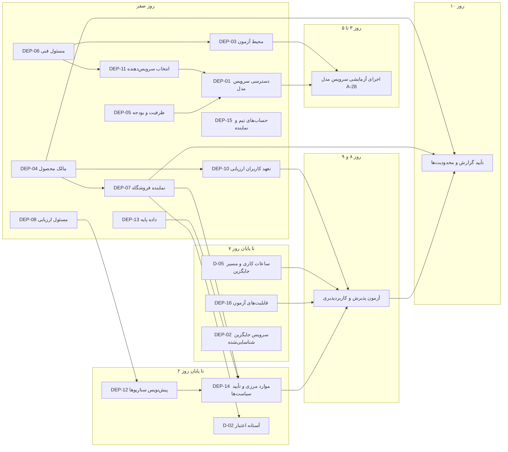

# ‏PRD-09 — وابستگی‌ها

> ‏**سطح این سند:** این سند فهرست چیزهایی است که محصول برای ساخت، آزمون و تأیید به آن‌ها وابسته است. برای هر وابستگی سه چیز ثبت می‌شود: **چه چیزی** لازم است، **چه کسی** آن را تأمین می‌کند، و **تا کِی** باید آماده باشد. تمپلیت وابستگی را این‌طور تعریف کرده است `[SRC-03 §9]`: مواردی که می‌شناسیم و محصول به آن‌ها وابسته است؛ مثلاً یک سرویس بیرونی، یا کاری که یکی از تیم‌های داخلی باید انجام دهد.
>
> ‏**آنچه اینجا نیست:** اینکه اگر وابستگی تأمین نشود چه می‌شود (ریسک‌ها در PRD-08؛ اینجا فقط با شناسه RSK)؛ زمان‌بندی روزبه‌روز کار ساخت، فهرست بررسی روز صفر و دروازه پذیرش (PRD-11)؛ دروازه ورود به پایلوت (PRD-12)؛ محتوای پیش‌شرط‌های حریم خصوصی پایلوت (PRD-06 §6.9)؛ نام افراد (PRD-00، Q-07)؛ و هر انتخاب فناوری یا سرویس‌دهنده (طراحی فنی؛ C-08).
>
> ‏**یافته اصلی:** امروز **هیچ وابستگی‌ای آماده نیست** و بیشتر آن‌ها هنوز تأمین‌کننده نام‌دار ندارند. همه کارهای داخلی تیم‌ها به یک وابستگی ریشه‌ای گره خورده‌اند: ظرفیت تیم و بودجه (DEP-05، D-03). *(DEC-263: ظرفیت ساخت با ابزارهای AI زیر نظر مسئول فنی تأمین است؛ بخش بودجه سرویس مدل و میزبانی همچنان باز است.)*
>
> ‏**راهنمای برچسب‌ها:** `[SRC-xx §n]` = برگرفته از منبع · **(پیشنهاد)** = پیشنهاد تیم PRD، تأییدشده در چت PRD-09 · **(فرض A-xx)** = باور یا مقدار تأییدنشده · **(تأییدنشده)** = برگرفته از تحقیقات بازار (DEC-02) · **TBD** = تعیین در پایلوت · ⓪ = پیش‌شرط روز صفر.
>
> ‏**نسخه 1.1 (CH-24):** چت PRD-11 سه کار داخلی تازه را پیدا کرد که آزمون‌های پذیرش بدون آن‌ها اجراشدنی یا مستقل نیستند: DEP-22، DEP-23 و DEP-24 (DEC-203). بقیه ردیف‌ها تغییر نکرده‌اند.

### ‏راهنمای شناسه‌ها

| ‏کد | ‏معنی | ‏کجا تعریف شده |
|---|---|---|
| ‏DEP-xx | ‏وابستگی این سند. DEP-01 تا DEP-29 = Prototype · DEP-30 به بعد = پایلوت **(DEC-179)**. با `D-xx` (تصمیم باز BRD) فرق دارد | ‏همین سند |
| ‏D-xx | ‏تصمیم باز BRD (مثلاً D-03 = بودجه و سقف هزینه) | ‏BRD §14 |
| ‏A-xx | ‏فرض تأییدنشده (مثلاً A-02 = پیش‌نیازهای روز صفر آماده‌اند) | ‏PRD-08 §8.2؛ Master Index §7 |
| ‏RSK-xx / CON-xx | ‏ریسک / محدودیت | ‏PRD-08 |
| ‏ENV-xx | ‏نیازمندی محیطی و سیستمی | ‏PRD-07 |
| ‏NFR-xx-n | ‏نیازمندی کیفی و زیرشناسه آن | ‏PRD-06 |
| ‏AT-xx | ‏آزمون پذیرش BRD (AT-01 تا AT-12) | ‏BRD §11، §13؛ کارت‌ها در PRD-11b |
| ‏US / AC / ND | ‏استوری / معیار پذیرش / نباید کلی | ‏PRD-04 |
| ‏ACT | ‏نقش (ACT-04 = سرویس مدل، سیستم بیرونی) | ‏PRD-03a |
| ‏BO | ‏هدف کسب‌وکار | ‏PRD-01 §1.5 |
| ‏Q / DEC / CH | ‏سؤال باز / تصمیم / تغییر | ‏Master Index |
| ‏روز ۰ … روز ۱۰ | ‏روزهای برنامه BRD §12؛ «روز صفر» = پیش از شروع روز ۱ | ‏`[SRC-02 §12]` |

---

## ‏۹.۱ دامنه، تعریف‌ها و قواعد

### ‏۹.۱.۱ آزمون تشخیص و مرزها **(DEC-180)**

| ‏موضوع | ‏قاعده |
|---|---|
| ‏**وابستگی چیست** | ‏چیزی که می‌شود برایش «تأمین‌کننده + تحویل‌دادنی + موعد» نوشت. اگر فقط بتوان گفت «شاید اتفاق بیفتد»، ریسک است و در PRD-08 می‌ماند |
| ‏**مرز با PRD-08** | ‏چه چیزی، چه کسی، تا کِی و وضعیت امروز ← اینجا. احتمال، اثر و پاسخ ← PRD-08، فقط با شناسه RSK. فرض‌های A-02، A-08 و A-28 در PRD-08 می‌مانند و اینجا ارجاع می‌گیرند (DEC-170) |
| ‏**مرز با تصمیم باز** | ‏تصمیم یعنی انتخاب میان گزینه‌ها و در D-xx یا Q-xx می‌ماند. **تحویل** نتیجه آن اگر شرط شروع یا شرط آزمون باشد، شناسه DEP می‌گیرد و به تصمیم ارجاع می‌دهد. نگاشت کامل در §9.6.3 |
| ‏**مرز با PRD-11** | ‏PRD-09 می‌گوید هر وابستگی تا کدام روز لازم است. PRD-11 از روی ستون «روز صفر؟» فهرست بررسی روز صفر و از روی ستون «موعد» پیش‌شرط هر آزمون را می‌سازد (PRD-11a §11a.2؛ PRD-11b §11b.8) |
| ‏**مرز با PRD-06 §6.9 و PRD-12** | ‏محتوای پیش‌شرط‌های پایلوت در PRD-06 §6.9 و دروازه ورود در PRD-12 است. اینجا فقط تأمین‌کننده و موعد آن‌ها می‌آید (DEC-171) |
| ‏**مرز با طراحی فنی** | ‏اینجا فقط **الزام وابستگی** نوشته می‌شود (چه ویژگی‌ای لازم است)، نه انتخاب سرویس‌دهنده یا فناوری (C-08؛ CON-08) |

### ‏۹.۱.۲ قواعد این سند

| ‏# | ‏قاعده | ‏مرجع |
|---|---|---|
| ‏۱ | ‏هر ردیف به منبع یا سند Approved ردیابی می‌شود. پیشنهادهای SRC-04 و SRC-05 فقط در پانویس و با برچسب «تأییدنشده» می‌آیند | ‏DEC-02؛ DEC-09 |
| ‏۲ | ‏**تأمین‌کننده نقش است، نه فرد**، چون نام افراد تعیین نشده است (Q-07). نقش‌ها در §9.2 تعریف شده‌اند | ‏DEC-177؛ DEC-185 |
| ‏۳ | ‏**تأمین‌کننده داخلی دو سطح دارد:** «تیم فنی» قابلیت را **می‌سازد**؛ «تیم محصول» آن را روی محیط **اجرا** می‌کند (ساخت حساب، بارگذاری، بازنشانی، شبیه‌سازی خطا، حذف). این فقط برچسب تأمین‌کننده را دقیق می‌کند و هیچ ردیف ENV را تغییر نمی‌دهد | ‏**(پیشنهاد — DEC-186)**؛ ENV-33، ENV-44 تا ENV-49 |
| ‏۴ | ‏**موعد** بر حسب روز برنامه BRD §12 یا یک آزمون (AT) یا «پیش از پایلوت» نوشته می‌شود. موعدهای کلی BRD §14 («پیش از اجرا»، «پیش از آزمون FR-04») به روز برنامه ترجمه شده‌اند | ‏`[SRC-02 §12، §14]` |
| ‏۵ | ‏**قاعده روز صفر:** اگر یکی از وابستگی‌های ⓪ آماده نباشد، روز صفر جابه‌جا می‌شود و برنامه فشرده نمی‌شود | ‏پاسخ RSK-13 (PRD-08) |
| ‏۶ | ‏ستون **«بدیل»** راه جایگزین در صورت تأخیر یا تأمین‌نشدن است و الزام تازه‌ای به محصول نمی‌افزاید؛ فقط آمادگی اجراست | ‏**(پیشنهاد — DEC-182)** |
| ‏۷ | ‏این سند هیچ نیازمندی یا رفتار تازه‌ای به محصول نمی‌افزاید. هر ردیف یا یک ENV، NFR یا آزمون موجود را تأمین می‌کند، یا یک تصمیم موجود را | ‏دستورالعمل پروژه §۸ |

### ‏۹.۱.۳ ستون‌ها و مقادیر وضعیت

‏**ستون‌ها:** شناسه · وابستگی و تحویل‌دادنی · نوع (بیرونی / داخلی) · تأمین‌کننده · مصرف‌کننده (ENV / US / NFR / AT / روز برنامه) · موعد · روز صفر؟ · وضعیت · بدیل · ریسک · مرجع **(DEC-178)**.

| ‏وضعیت | ‏معنی |
|---|---|
| ‏**تأمین‌کننده تعیین‌نشده** | ‏هیچ نقش یا فردی برای تأمین آن مشخص نشده است |
| ‏**تأمین‌کننده تعیین‌شده** | ‏نقش مسئول مشخص و متعهد است؛ کار هنوز شروع نشده |
| ‏**در حال آماده‌سازی** | ‏کار شروع شده است |
| ‏**آماده** | ‏تحویل‌دادنی تحویل و بررسی شده است |
| ‏**مسدود — [شناسه]** | ‏تأمین‌کننده نقش دارد، ولی خودش منتظر وابستگی یا تصمیم دیگری است (مثلاً «مسدود — DEP-05» یعنی تا ظرفیت تیم تأمین نشود، این کار شروع‌شدنی نیست) |

> ‏وضعیت همه ردیف‌ها در این نسخه، وضعیت روز تصویب این سند است. به‌روزرسانی وضعیت در اجرا با PRD-11 و Master Index است.

---

## ‏۹.۲ نقش‌های وابستگی

> ‏BRD شش نقش تأییدکننده یا تأمین‌کننده نام برده است `[SRC-02 §2، §12، §14]` و هیچ‌کدام فرد مشخص ندارند. این جدول مسئولیت هر نقش و زمانی را که لازم می‌شود تثبیت می‌کند. **نام افراد ← PRD-00 (Q-07)** **(DEC-185)**.

| ‏نقش | ‏مسئولیت در وابستگی‌ها | ‏تأییدکننده در BRD | ‏لازم از | ‏DEP | ‏مرجع |
|---|---|---|---|---|---|
| ‏**مالک محصول** | ‏محدوده و اولویت‌ها؛ جذب نماینده فروشگاه و کاربران ارزیابی؛ تصویب پارامترهای مالک محصول در دفتر PRD-08 §8.2.3؛ نگارش نهایی متن‌های رابط (DEC-61)؛ تأیید گزارش روز ۱۰ | ‏بله — محدوده و اولویت‌ها | ‏روز صفر | ‏DEP-04 | ‏`[SRC-02 §3، §11، §14]` |
| ‏**حامی کسب‌وکار** | ‏تصویب بودجه و بودجه سرویس مدل و میزبانی (D-03؛ ظرفیت ساخت با DEC-263)؛ در پایلوت، سقف هزینه سرویس | ‏— (مالک D-03) | ‏روز صفر | ‏DEP-05، DEP-36 | ‏`[SRC-02 §14]` D-03 |
| ‏**مسئول فنی** | ‏امکان‌پذیری؛ طراحی فنی و انتخاب سرویس‌دهنده مدل؛ میزبان و محیط آزمون؛ فهرست دسترسی‌های فنی محیط (ENV-49)؛ هم‌امضای D-03؛ در پایلوت، امکان‌سنجی کانال (D-04) | ‏بله — امکان‌پذیری | ‏روز صفر | ‏DEP-06، DEP-11 | ‏`[SRC-02 §12، §14]`؛ Q-34 |
| ‏**مسئول ارزیابی** | ‏مجموعه ۶۰ سناریو و ۲۰ مکالمه مختلط با برچسب‌های پیش از اجرا؛ مجموعه آزمایشی سرویس مدل؛ پروتکل آزمون‌های کاربردپذیری؛ دستگاه‌ها و نمایه‌های مرجع؛ اجرای آزمون‌ها و شواهد پذیرش | ‏بله — شواهد پذیرش | ‏روز صفر | ‏DEP-08، DEP-12، DEP-20، DEP-22، DEP-23، DEP-24 (اجرا) | ‏`[SRC-02 §11، §14]` |
| ‏**مسئول امنیت** | ‏تأیید مهلت نگهداری داده Prototype (A-24) همراه با نماینده فروشگاه؛ در پایلوت، مالک D-06 و پیش‌شرط‌های PRD-06 §6.9 | ‏— (مالک D-06) | ‏پیش از روز ۱۰ | ‏DEP-09 | ‏`[SRC-02 §14]`؛ Q-34؛ RSK-25 |
| ‏**نماینده فروشگاه نمایشی** | ‏در Prototype نقش «مالک فروشگاه» را بازی می‌کند: مقدار آستانه اعتبار (D-02) و ساعات کاری و مسیر جایگزین (D-05) را به‌عنوان **مقدار آزمون** می‌دهد، سیاست‌های داده ساختگی را تأیید می‌کند و گزارش روز ۱۰ را تأیید می‌کند. **فردی جدا از مالک محصول** است تا کنترل دونفره دروازه پذیرش حفظ شود | ‏بله — سیاست و صحت داده | ‏روز صفر | ‏DEP-07 | ‏`[SRC-02 §11، §14]`؛ Q-35 **(DEC-181)** |
| ‏**تیم فنی** | ‏ساخت محصول و قابلیت‌های محیط آزمون (ENV-44، ENV-45، ENV-47) و روش اجرای هم‌زمان | ‏— | ‏روز ۱ | ‏DEP-16 تا DEP-18، DEP-24 (ساخت) | ‏DEC-186 |
| ‏**تیم محصول** | ‏اجرای کارهای محیط: داده ساختگی، حساب‌ها، بارگذاری و بازنشانی، شبیه‌سازی خطا، صفحه نمایشی، حذف داده | ‏— | ‏روز صفر | ‏DEP-13 تا DEP-15، DEP-18، DEP-19، DEP-21 | ‏DEC-109؛ ENV-33، ENV-44 تا ENV-48 |

> ‏**نماینده فروشگاه نمایشی (DEC-181):** چون فروشگاه همکاری وجود ندارد (DEC-27، CON-07)، این نقش را یک فرد نام‌دار با سابقه کار فروشگاهی بر عهده می‌گیرد که مالک محصول نیست. مقادیری که او می‌دهد مقدار آزمون‌اند، نه مقدار یک فروشگاه واقعی. این محدودیت در تعمیم‌ناپذیری نتایج (RSK-20) پوشش دارد و باید در فهرست محدودیت‌های گزارش روز ۱۰ بیاید (CON-11).
>
> ‏**فرد واحد با چند نقش:** یک نفر می‌تواند چند نقش داشته باشد (مثلاً مسئول فنی و مسئول امنیت)، **به‌جز** مالک محصول و نماینده فروشگاه نمایشی، که دروازه پذیرش تأیید هر دو را جدا می‌خواهد `[SRC-02 §11]`.

---

## ‏۹.۳ وابستگی‌های Prototype

### ‏۹.۳.۱ الف — سرویس‌ها و زیرساخت بیرونی

| ‏شناسه | ‏وابستگی و تحویل‌دادنی | ‏نوع | ‏تأمین‌کننده | ‏مصرف‌کننده | ‏موعد | ‏روز صفر؟ | ‏وضعیت | ‏بدیل | ‏ریسک | ‏مرجع |
|---|---|---|---|---|---|---|---|---|---|---|
| ‏DEP-01 | ‏**سرویس مدل** (الزام وابستگی، نه انتخاب): (۱) دسترسی پایدار از محیط میزبان با ارتباط رمزنگاری‌شده؛ (۲) **حساب و روش پرداخت قابل‌استفاده**؛ (۳) امکان سقف زمانی برای هر فراخوانی؛ (۴) گزارش مصرف هر فراخوانی برای محاسبه هزینه؛ (۵) فهم فارسی کافی، شامل محاوره، فینگلیش و غلط املایی (فرض A-28)؛ (۶) تعویض‌پذیری بدون تغییر قواعد، صف، داده یا رابط | ‏بیرونی | ‏سرویس‌دهنده منتخب طراحی فنی (TBD)؛ تهیه حساب: مسئول فنی | ‏ENV-60 تا ENV-64؛ NFR-02؛ NFR-09-1؛ اجرای آزمایشی روز ۳ تا ۵ | ‏دسترسی آماده تا **روز صفر**؛ اجرای آزمایشی با مجموعه آزمایشی DEP-22 در **روز ۴** (PRD-11a §11a.6) | ‏⓪ | ‏مسدود — DEP-05، DEP-11 | ‏DEP-02 | ‏RSK-05، RSK-06، RSK-07، RSK-08، RSK-09 | ‏`[SRC-02 §3، §12]`؛ ACT-04؛ CON-08 |
| ‏DEP-02 | ‏**سرویس‌دهنده جایگزین مدل:** دست‌کم یک سرویس‌دهنده دیگر که الزام‌های DEP-01 را دارد **شناسایی** شود (نام، روش دسترسی و پرداخت). راه‌اندازی کامل لازم نیست؛ اگر تعویض لازم شد، مجموعه پذیرش دوباره اجرا می‌شود (ENV-64) | ‏بیرونی | ‏مسئول فنی | ‏ENV-64 | ‏**پیش از روز ۸** | ‏— | ‏تأمین‌کننده تعیین‌نشده | ‏— | ‏RSK-08 | ‏**(پیشنهاد — DEC-182)**؛ DEC-164 |
| ‏DEP-03 | ‏**میزبان و محیط آزمون:** یک محیط آزمون در دسترس از راه اینترنت و بدون نصب، با ارتباط رمزنگاری‌شده، ذخیره‌سازی پایدار و دسترسی پایدار به سرویس مدل؛ وصل‌نشده به هیچ سیستم واقعی فروشگاه. محل میزبانی در Prototype آزاد است | ‏بیرونی (میزبان) + داخلی (راه‌اندازی) | ‏مسئول فنی | ‏ENV-41، ENV-42، ENV-44، ENV-50 | ‏**روز صفر** | ‏⓪ | ‏مسدود — DEP-05، DEP-06 | ‏— | ‏RSK-16 | ‏`[SRC-02 §3]`؛ CON-07؛ PRD-07 §7.9 |

> ‏**پانویس تأییدنشده (DEC-02):** SRC-04 برای محدودیت تحریم استفاده از مدل‌های متن‌باز فارسی یا سرویس‌های داخلی را پیشنهاد کرده و در جدول «درخواست از اسپانسر» زیرساخت ابری، سرور توسعه و «VPN و دسترسی‌های لازم» را آورده است `[SRC-04 §6، §7]`. این‌ها برای انتخاب DEP-01 و DEP-02 در طراحی فنی فقط زمینه‌اند.

### ‏۹.۳.۲ ب — افراد و نقش‌ها

| ‏شناسه | ‏وابستگی و تحویل‌دادنی | ‏نوع | ‏تأمین‌کننده | ‏مصرف‌کننده | ‏موعد | ‏روز صفر؟ | ‏وضعیت | ‏بدیل | ‏ریسک | ‏مرجع |
|---|---|---|---|---|---|---|---|---|---|---|
| ‏DEP-04 | ‏**مالک محصول نام‌دار** با این تحویل‌دادنی‌ها: (۱) تعیین فرد برای DEP-07 و جذب DEP-10 تا روز صفر؛ (۲) تصویب پارامترهای مالک محصول در دفتر PRD-08 §8.2.3 تا موعد هرکدام؛ (۳) نگارش نهایی متن‌های رابط پیش از روز ۸ (DEC-61)؛ (۴) تأیید گزارش روز ۱۰ | ‏داخلی | ‏سازمان (نام ← Q-07) | ‏همه تأییدها؛ دروازه پذیرش | ‏**روز صفر**؛ تحویل‌دادنی‌ها طبق موعد هرکدام | ‏⓪ | ‏تأمین‌کننده تعیین‌نشده | ‏— (بدون مالک محصول روز صفر جابه‌جا می‌شود) | ‏RSK-13، RSK-14 | ‏`[SRC-02 §3، §11، §14]`؛ BRD مشخصات سند |
| ‏DEP-05 | ‏**ظرفیت تیم و بودجه:** بودجه Prototype، **شامل بودجه سرویس مدل و میزبانی**. ظرفیت ساخت با ابزارهای AI (Codex یا Claude) زیر نظر مسئول فنی تأمین است و تیم توسعه انسانی پیش‌شرط نیست (DEC-263) | ‏داخلی | ‏حامی کسب‌وکار و مسئول فنی | ‏کل برنامه؛ همه کارهای DEP-11 تا DEP-24 | ‏**روز صفر** | ‏⓪ | ‏تأمین‌کننده تعیین‌نشده (**D-03 بخش بودجه باز**) | ‏کاهش وسعت کاتالوگ و سناریو طبق قاعده حفاظت هسته (CON-05)؛ نه حذف هسته | ‏RSK-09، RSK-13 | ‏D-03؛ CON-06؛ فرض A-08 (تأییدنشده) |
| ‏DEP-06 | ‏**مسئول فنی نام‌دار**، همراه با فهرست دسترسی‌های فنی محیط: چه کسی به سرور، ذخیره‌سازی، تنظیمات محیط و قابلیت‌های ENV-45 دسترسی دارد | ‏داخلی | ‏سازمان (نام ← Q-07) | ‏ENV-49؛ DEP-01، DEP-03، DEP-11 | ‏**روز صفر** | ‏⓪ | ‏تأمین‌کننده تعیین‌نشده | ‏— | ‏RSK-16 | ‏Q-34؛ `[SRC-02 §14]` |
| ‏DEP-07 | ‏**نماینده فروشگاه نمایشی** با این تحویل‌دادنی‌ها: (۱) تأیید متن سیاست‌های داده ساختگی تا **پایان روز ۲**؛ (۲) مقدار آستانه اعتبار (D-02) تا **پایان روز ۲** — مقدار آزمون تعیین شد: ۲۴ ساعت (DEC-262)؛ (۳) ساعات کاری، زمان پاسخ و مسیر تماس جایگزین (D-05) پیش از AT-06، حداکثر **پایان روز ۷** — مقدارهای آزمون تعیین شد (DEC-262؛ PRD-11a §11a.7.1)؛ (۴) تأیید مهلت نگهداری A-24 همراه با DEP-09 پیش از روز ۱۰؛ (۵) حضور و تأیید گزارش و محدودیت‌ها در **روز ۱۰** | ‏داخلی (فرد بیرون از تیم سازنده) | ‏مالک محصول (تعیین فرد) | ‏RULE-03، RULE-04؛ US-02-03؛ US-04-06؛ SCR-24؛ دروازه پذیرش | ‏فرد تعیین‌شده تا **روز صفر**؛ تحویل‌دادنی‌ها طبق ستون وابستگی | ‏⓪ | ‏تأمین‌کننده تعیین‌نشده | ‏— (بدون نماینده، روز صفر جابه‌جا می‌شود) | ‏RSK-17، RSK-18، RSK-20 | ‏Q-35 **(DEC-181)**؛ `[SRC-02 §11، §12، §14]` |
| ‏DEP-08 | ‏**مسئول ارزیابی نام‌دار** | ‏داخلی | ‏سازمان (نام ← Q-07) | ‏DEP-12، DEP-20، DEP-22، DEP-23، DEP-24؛ آزمون‌ها | ‏**روز صفر** | ‏⓪ | ‏تأمین‌کننده تعیین‌نشده | ‏— | ‏RSK-15، RSK-20 | ‏`[SRC-02 §14]` |
| ‏DEP-09 | ‏**مسئول امنیت نام‌دار:** در Prototype، تأیید مهلت نگهداری و حذف داده (A-24) همراه با DEP-07؛ در پایلوت، ادامه در DEP-34 و DEP-35 | ‏داخلی | ‏سازمان (نام ← Q-07) | ‏NFR-06-5؛ ENV-48؛ D-06 | ‏**پیش از روز ۱۰** | ‏— | ‏تأمین‌کننده تعیین‌نشده | ‏— | ‏RSK-25 | ‏Q-34؛ `[SRC-02 §14]` |
| ‏DEP-10 | ‏**کاربران ارزیابی:** ۵ نفر در نقش ادمین (آزمون «تشخیص صف» در ۶۰ ثانیه) و ۵ نفر در نقش مشتری (آزمون کاربردپذیری)؛ هیچ‌کدام از سازندگان محصول نیستند | ‏بیرونی یا داخلی | ‏مالک محصول (جذب و زمان‌بندی) | ‏BO-01، BO-02؛ آزمون‌های کاربردپذیری روز ۸ و ۹ | ‏تعهد و زمان‌بندی تا **روز صفر**؛ حضور **روز ۸ و ۹** | ‏⓪ | ‏تأمین‌کننده تعیین‌نشده | ‏فهرست ذخیره برای هر گروه **(پیشنهاد)** | ‏RSK-17 | ‏`[SRC-02 §3، §11]` |

> ‏**چرا مسئول امنیت پیش‌شرط روز صفر نیست:** در Prototype داده ساختگی است (CON-03) و محل میزبانی آزاد است (ENV-50). نخستین تحویل‌دادنی مسئول امنیت تأیید A-24 پیش از روز ۱۰ است. نقش او در پایلوت تعیین‌کننده است (RSK-25).

### ‏۹.۳.۳ ج — کارهای داخلی تیم‌ها

| ‏شناسه | ‏وابستگی و تحویل‌دادنی | ‏نوع | ‏تأمین‌کننده | ‏مصرف‌کننده | ‏موعد | ‏روز صفر؟ | ‏وضعیت | ‏بدیل | ‏ریسک | ‏مرجع |
|---|---|---|---|---|---|---|---|---|---|---|
| ‏DEP-11 | ‏**انتخاب‌های طراحی فنی:** (۱) انتخاب سرویس‌دهنده مدل (DEP-01) تا روز صفر؛ (۲) بقیه انتخاب‌هایی که PRD به طراحی فنی سپرده است: روش به‌روزرسانی زنده (ENV-43)، روش شناسه بی‌نام مرورگر (ENV-21)، روش ذخیره رمز (ENV-35) و معماری ذخیره‌سازی، تا پایان روز ۲ | ‏داخلی | ‏مسئول فنی و تیم فنی | ‏DEP-01؛ ENV-21، ENV-35، ENV-43؛ کل ساخت | ‏(۱) **روز صفر** · (۲) **پایان روز ۲** | ‏⓪ (فقط بند ۱) | ‏مسدود — DEP-05، DEP-06 | ‏— | ‏RSK-13 | ‏**(پیشنهاد — DEC-184)**؛ C-08؛ `[SRC-02 §13]` |
| ‏DEP-12 | ‏**مجموعه آزمون پذیرش:** ۶۰ سناریو در شش گروه BRD و مجموعه ۲۰ مکالمه مختلط صف، با برچسب «پاسخ‌پذیر / نیازمند ارجاع / حساس» پیش از اجرا؛ مستقل از مثال‌های تنظیم محصول. **ترکیب، قواعد ساخت، برچسب‌ها و آزمون‌های منفی ← PRD-11b §11b.3 تا §11b.6** (برچسب‌ها به‌شکل «نتیجه مورد انتظار» + پرچم «حساس» — DEC-191) | ‏داخلی | ‏مسئول ارزیابی | ‏دروازه پذیرش؛ DEP-14 (داده از روی سناریوها ساخته می‌شود) | ‏پیش‌نویس تا **پایان روز ۲**؛ نسخه قطعی **پیش از روز ۸** | ‏— | ‏مسدود — DEP-08 | ‏کاهش تنوع سناریو طبق CON-05؛ گروه‌های بحرانی حذف نمی‌شوند | ‏RSK-15، RSK-20 | ‏**(پیشنهاد — DEC-184)**؛ `[SRC-02 §11، §12]` |
| ‏DEP-13 | ‏**داده ساختگی پایه:** کاتالوگ و گونه‌ها، موجودی اولیه، پیش‌نویس متن سیاست‌ها (ارسال، مرجوعی) و سفارش‌های نمونه، همه ساختگی یا ناشناس‌شده و آماده بارگذاری | ‏داخلی | ‏تیم محصول | ‏ENV-46؛ NFR-06-1؛ NFR-11-3؛ ساخت روز ۳ تا ۵ | ‏**روز صفر** | ‏⓪ | ‏مسدود — DEP-05 | ‏کاهش وسعت کاتالوگ طبق CON-05 | ‏RSK-15 | ‏DEC-109؛ Q-31 **(DEC-183)**؛ `[SRC-02 §3]` |
| ‏DEP-14 | ‏**داده ساختگی: موارد مرزی و تأیید:** افزودن موارد مرزی که از روی DEP-12 ساخته می‌شوند، دست‌کم یک نمونه از هر یک از **پنج نوع مغایرت** (آستانه تنظیم‌نشده، بدون منبع، زمان تأیید نامعتبر، متعارض، منقضی)، به‌علاوه سفارش بدون موعد و سیاست منقضی؛ سپس تأیید سیاست‌ها توسط DEP-07 | ‏داخلی | ‏تیم محصول؛ تأیید: DEP-07 | ‏AT-03، AT-04، AT-05، AT-10؛ US-02-02 | ‏**پایان روز ۲** | ‏— | ‏مسدود — DEP-05، DEP-07، DEP-12 | ‏— (موارد مرزی بخشی از هسته‌اند و کاهش نمی‌یابند) | ‏RSK-15 | ‏DEC-82؛ Q-31 **(DEC-183)**؛ `[SRC-02 §12]` |
| ‏DEP-15 | ‏**حساب‌های ادمین و مالک:** ساخت حساب فردی برای هر ادمین و مالک (از جمله حساب‌های کاربران ارزیابی در نقش ادمین و حساب نماینده فروشگاه در نقش مالک)، تعیین نقش، و ثبت در سابقه راه‌اندازی | ‏داخلی | ‏تیم محصول | ‏ENV-30 تا ENV-33 | ‏حساب‌های تیم و نماینده تا **روز صفر**؛ حساب‌های کاربران ارزیابی **پیش از روز ۸** | ‏⓪ (بخش اول) | ‏مسدود — DEP-05 | ‏— | ‏RSK-13 | ‏DEC-160؛ A-02 |
| ‏DEP-16 | ‏**قابلیت‌های آزمون:** تأخیر قابل تنظیم و قطع کامل سرویس مدل، شکست ذخیره برای هر کنش ذخیره‌دار، ازکارافتادن ثبت رویداد، با ثبت زمان روشن و خاموش‌شدن | ‏داخلی | ‏ساخت: تیم فنی · اجرا: تیم محصول | ‏ENV-45؛ ۸ سناریوی خطای سرویس و دسترسی؛ NFR-02-2 تا 02-5؛ NFR-05-3 تا 05-5 | ‏**ساخته و آزموده تا پایان روز ۷** | ‏— | ‏مسدود — DEP-05 | ‏— | ‏RSK-16 | ‏CH-18؛ `[SRC-02 §11]` |
| ‏DEP-17 | ‏**ماندگاری و راه‌اندازی مجدد** به‌دست تیم محصول، بدون ازدست‌رفتن ارجاع‌ها، مکالمه‌ها، مالکیت‌ها، تنظیمات و حساب‌ها | ‏داخلی | ‏ساخت: تیم فنی · اجرا: تیم محصول | ‏ENV-44؛ NFR-05-1، 05-2 | ‏**پیش از روز ۸** | ‏— | ‏مسدود — DEP-05 | ‏— | ‏RSK-16 | ‏PRD-07 §7.7 |
| ‏DEP-18 | ‏**بارگذاری، بازنشانی و ساعت:** بارگذاری DEP-13 و DEP-14 خارج از پنل‌ها؛ بازنشانی محیط به حالت آغازین پیش از هر دور آزمون؛ ساعت سیستم همگام با زمان مرجع | ‏داخلی | ‏ساخت: تیم فنی · اجرا: تیم محصول | ‏ENV-46، ENV-47 | ‏بارگذاری نخست **روز ۳**؛ بازنشانی و ساعت **پیش از روز ۸** | ‏— | ‏مسدود — DEP-05 | ‏— | ‏RSK-15، RSK-16 | ‏DEC-109 |
| ‏DEP-19 | ‏**صفحه نمایشی فروشگاه:** صفحه ساده با نام فروشگاه نمایشی و پیوند «گفت‌وگو با پشتیبانی» | ‏داخلی | ‏تیم محصول | ‏ENV-04؛ آزمون کاربردپذیری مشتری | ‏**پیش از روز ۸** | ‏— | ‏مسدود — DEP-05 | ‏بازکردن مستقیم نشانی صفحه گفت‌وگو (ENV-03) | ‏— | ‏DEC-158 |
| ‏DEP-20 | ‏**دستگاه‌ها و نمایه‌های مرجع:** دستگاه مرجع موبایل و دسکتاپ و مرورگرهای ENV-13؛ یک نمایه یا مرورگر جدا برای هر آزمون‌کننده و برای هر مکالمه هم‌زمان (۵ مکالمه، ۲ ادمین)؛ شبکه مرجع و یک اتصال اینترنت همراه برای اجرای کنترلی | ‏داخلی | ‏مسئول ارزیابی | ‏ENV-11 تا ENV-14؛ §7.6.1؛ NFR-02-7، 02-8؛ NFR-03-3 | ‏**پیش از روز ۸** | ‏— | ‏مسدود — DEP-08 | ‏— | ‏RSK-11، RSK-17 | ‏فرض A-26 |
| ‏DEP-21 | ‏**حذف کامل داده Prototype:** حذف DS-05 تا DS-08، فایل‌های CSV و نسخه‌های پشتیبان، و ثبت تاریخ حذف | ‏داخلی | ‏تیم محصول | ‏ENV-48؛ NFR-06-5 | ‏حداکثر **۳۰ روز پس از تحویل گزارش روز ۱۰** (فرض A-24) | ‏— | ‏مسدود — DEP-05 | ‏— | ‏— | ‏DEC-153 |
| ‏DEP-22 | ‏**مجموعه آزمایشی سرویس مدل:** حدود ۲۰ سناریو با همان قواعد ساخت مجموعه پذیرش (PRD-11b §11b.4) ولی **جدا از آن**؛ دست‌کم ۶ سناریو محاوره یا فینگلیش و ۳ سناریو با غلط املایی؛ از گروه‌های دانشی، موجودی و ابهام؛ با برچسب نتیجه مورد انتظار. هیچ سناریوی آن در مجموعه پذیرش (DEP-12) نمی‌آید **(تغییر — CH-24)** | ‏داخلی | ‏مسئول ارزیابی | ‏اجرای آزمایشی A-28 در روز ۴ (PRD-11a §11a.6)؛ بازسنجی روز ۷؛ اجرای کوتاه پس از تعویض سرویس‌دهنده | ‏**پایان روز ۳** | ‏— | ‏مسدود — DEP-08 | ‏— (بدون آن، اجرای آزمایشی یا انجام نمی‌شود یا استقلال مجموعه پذیرش از دست می‌رود) | ‏RSK-05، RSK-07 | ‏DEC-194؛ `[SRC-02 §11]` (استقلال مجموعه) |
| ‏DEP-23 | ‏**پروتکل و تسهیل‌گر آزمون‌های کاربردپذیری:** پروتکل نوشته‌شده برای آزمون «تشخیص صف» و «کاربردپذیری مشتری» (متن آغاز، تکلیف‌ها، قاعده مداخله، شروع و پایان زمان‌سنجی ۶۰ ثانیه، تعریف موفقیت، فرم ثبت مشاهده)؛ یک تسهیل‌گر و یک ثبت‌کننده برای جلسه‌های روز ۸ و ۹، هیچ‌کدام از سازندگان محصول **(تغییر — CH-24)** | ‏داخلی | ‏مسئول ارزیابی | ‏BO-01، BO-02؛ PRD-11b §11b.10 | ‏**پیش از روز ۸** | ‏— | ‏مسدود — DEP-08 | ‏مسئول ارزیابی خودش تسهیل‌گر باشد، با ثبت‌کننده جدا | ‏RSK-17، RSK-20 | ‏`[SRC-02 §11]` «بدون راهنمایی تسهیل‌گر»؛ DEC-203 |
| ‏DEP-24 | ‏**روش اجرای هم‌زمان و بار:** ابزار یا روش (اسکریپت یا اجرای دستی هماهنگ) برای ۵ مکالمه مشتری هم‌زمان و ۲ ادمین هم‌زمان، که دست‌کم ۱۰۰ پاسخ برای معیارهای صدکی، ۲۰ ارجاع و ۲۰ بارگذاری صف تولید کند و زمان‌ها را از رویدادها بخواند **(تغییر — CH-24)** | ‏داخلی | ‏ساخت: تیم فنی · اجرا: مسئول ارزیابی | ‏NFR-02-1، 02-5 تا 02-8؛ NFR-10-1، 10-2؛ NFR-11-5؛ دور ه (PRD-11b §11b.7)؛ اجرای کوتاه روز ۴ | ‏**پیش از روز ۸**؛ نسخه ساده برای اجرای آزمایشی روز ۴ | ‏— | ‏مسدود — DEP-05 | ‏اجرای دستی هماهنگ با پنج نمایه (DEP-20) و چند آزمون‌کننده | ‏RSK-07، RSK-16 | ‏فرض A-25؛ DEC-199؛ DEC-203 |

> ‏**تقسیم داده ساختگی (DEC-183؛ پاسخ Q-31):** BRD داده نمونه را پیش‌شرط شروع می‌داند `[SRC-02 §3]`، ولی تثبیت «داده تأییدشده» را کار روز ۱ و ۲ گذاشته است `[SRC-02 §12]`. این دو با تقسیم داده جمع می‌شوند: **داده پایه** تا روز صفر (DEP-13)، و **موارد مرزی + تأیید نماینده فروشگاه** تا پایان روز ۲ (DEP-14). مسئول هر دو تیم محصول است (DEC-109).
>
> ‏**چرا DEP-22 تا DEP-24 (DEC-203):** مجموعه پذیرش باید مستقل از تنظیم محصول باشد، پس اجرای آزمایشی روز ۴ مجموعه خودش را می‌خواهد (DEP-22). آزمون‌های کاربردپذیری «بدون راهنمایی تسهیل‌گر» بدون پروتکل و تسهیل‌گر مشخص قابل تکرار نیستند (DEP-23). اندازه نمونه A-25 با اجرای کارکردی ۶۰ سناریو برآورده نمی‌شود و اجرای هم‌زمان جدا لازم است (DEP-24).

---

## ‏۹.۴ وابستگی‌های پایلوت

> ‏این‌ها پیش از تعهد به پایلوت لازم‌اند و موعد روزانه ندارند. دروازه کامل ورود و ترتیب آن‌ها ← PRD-12؛ محتوای پیش‌شرط‌های حریم خصوصی، هزینه و دسترس‌پذیری ← PRD-06 §6.9. ستون‌های «روز صفر؟» و «بدیل» برای این گروه کاربرد ندارند و حذف شده‌اند.

| ‏شناسه | ‏وابستگی و تحویل‌دادنی | ‏نوع | ‏تأمین‌کننده | ‏مصرف‌کننده | ‏موعد | ‏وضعیت | ‏ریسک | ‏مرجع |
|---|---|---|---|---|---|---|---|---|
| ‏DEP-30 | ‏**فروشگاه همکار پایلوت**، همراه با: همکاری برای ثبت خط مبنا (D-08)، نمونه پیام‌های واقعی برای اعتبارسنجی H-01 (A-05)، و شرکت در تحقیق ورکفلو (A-13) | ‏بیرونی | ‏مالک محصول (جذب) | ‏D-01؛ D-08؛ A-05؛ A-13 | ‏پیش از تعهد پایلوت؛ تحقیق A-13 پیش از انتخاب | ‏تأمین‌کننده تعیین‌نشده | ‏RSK-21، RSK-22، RSK-23 | ‏`[SRC-02 §12، §14]`؛ CON-01 |
| ‏DEP-31 | ‏**امکان‌سنجی و اتصال کانال واقعی** (ابزارک روی سایت یا پیوند در کانال) | ‏بیرونی | ‏مسئول فنی | ‏ENV-03 (ستون پایلوت)؛ ENV-66 | ‏پیش از تعهد پایلوت | ‏تأمین‌کننده تعیین‌نشده | ‏RSK-24 | ‏D-04؛ `[SRC-02 §12]` |
| ‏DEP-32 | ‏**منبع واقعی موجودی** و روش همگام‌سازی آزموده‌شده، شامل رفتار قطع اتصال؛ یا ورود دستی برای فروشگاه بدون سیستم انبار | ‏بیرونی | ‏فروشگاه پایلوت و مسئول فنی | ‏ND-31؛ ENV-67؛ RULE-02 | ‏پیش از تعهد پایلوت | ‏مسدود — DEP-30 | ‏RSK-01، RSK-24 | ‏`[SRC-02 §3، §12]`؛ D-02 |
| ‏DEP-33 | ‏**مسئول داده و مسئول شیفت انسانی** در فروشگاه پایلوت | ‏بیرونی | ‏فروشگاه پایلوت | ‏صف عملیاتی؛ US-04-06 | ‏پیش از شروع پایلوت | ‏مسدود — DEP-30 | ‏RSK-04 | ‏`[SRC-02 §3، §12]` |
| ‏DEP-34 | ‏**شرایط قرارداد سرویس‌دهنده مدل:** نگه‌نداشتن داده پس از پردازش، استفاده‌نکردن برای آموزش، و ارسال فقط داده مرز §3e.5 | ‏بیرونی | ‏مسئول امنیت و مسئول فنی | ‏ENV-62 (ستون پایلوت)؛ NFR-06-2؛ §6.9 | ‏پیش از بارگذاری داده واقعی | ‏مسدود — DEP-09 | ‏RSK-10 | ‏D-06؛ DEC-56 |
| ‏DEP-35 | ‏**تصمیم محل میزبانی و پردازش** (داخل یا خارج کشور) و رمزنگاری داده ذخیره‌شده | ‏بیرونی یا داخلی | ‏مسئول امنیت و مسئول فنی | ‏ENV-50 (ستون پایلوت)؛ NFR-06-3؛ §6.9 | ‏پیش از بارگذاری داده واقعی | ‏مسدود — DEP-09 | ‏RSK-08، RSK-10 | ‏`[SRC-02 §10]`؛ `[SRC-04 §7]` (تأییدنشده) |
| ‏DEP-36 | ‏**سقف هزینه سرویس مدل** و رفتار هنگام رسیدن به سقف | ‏داخلی | ‏حامی کسب‌وکار و مسئول فنی | ‏NFR-09-1؛ ENV-63؛ §6.9 | ‏پیش از شروع پایلوت | ‏تأمین‌کننده تعیین‌نشده (**D-03 باز**) | ‏RSK-09 | ‏D-03 |
| ‏DEP-37 | ‏**آموزش ادمین‌های فروشگاه پایلوت**، شامل توقف بات و بازگشت به پاسخ‌گویی دستی | ‏داخلی | ‏تیم محصول | ‏US-07-05؛ NFR-12-2 | ‏پیش از شروع پایلوت | ‏مسدود — DEP-30 | ‏RSK-26 | ‏`[SRC-02 §12]` |

> ‏**پانویس تأییدنشده (DEC-02):** SRC-05 توصیه می‌کند یکپارچه‌سازی فقط پس از اعتبارسنجی ورکفلو و فقط برای بزرگ‌ترین اصطکاک اثبات‌شده اضافه شود `[SRC-05 §5، §6]`. این توصیه با ترتیب DEP-30 ← DEP-31، DEP-32 هم‌جهت است. «سوابق پرسش‌های مشتری» در جدول اسپانسر SRC-04 §6 برای DEP-30 (اعتبارسنجی H-01) کاربرد دارد. «API سفارش و Sandbox» همان جدول در Prototype بیرون از دامنه است (ENV-65).

---

## ‏۹.۵ زنجیره زمانی و پیش‌نیازهای روز صفر

### ‏۹.۵.۱ زنجیره وابستگی‌ها روی برنامه ۱۰ روزه

> ‏هدف دیاگرام: نشان‌دادن اینکه هر وابستگی تا کدام نقطه برنامه لازم است و کدام وابستگی‌ها پیش‌نیاز بقیه‌اند. فقط زنجیره‌های اصلی کشیده شده‌اند؛ جزئیات در جدول‌های §9.3.

> ‏وابستگی‌هایی که در دیاگرام نیامده‌اند، با موعد «پیش از روز ۸» ورودی همان گره «آزمون پذیرش و کاربردپذیری»اند: DEP-17، DEP-18، DEP-19، DEP-20، DEP-23، DEP-24 و حساب‌های کاربران ارزیابی (DEP-15). **DEP-22** (پایان روز ۳) و نسخه ساده DEP-24 ورودی گره «اجرای آزمایشی سرویس مدل»اند. DEP-09 ورودی «تأیید گزارش» است (A-24) و DEP-21 پس از روز ۱۰ انجام می‌شود.

### ‏۹.۵.۲ نگاشت با فرض A-02 (پیش‌نیازهای روز صفر)

> ‏A-02 در PRD-08 §8.2.2 می‌گوید پیش‌نیازهای روز صفر آماده‌اند. این جدول آن بندها را به وابستگی‌ها می‌شکند. **فهرست بررسی روز صفر در PRD-11a §11a.2 از روی همین جدول ساخته شده است.**

| ‏بند A-02 | ‏منبع | ‏وابستگی‌ها |
|---|---|---|
| ‏مسئول محصول | ‏`[SRC-02 §3]` | ‏DEP-04 |
| ‏ظرفیت تیم | ‏`[SRC-02 §3]` | ‏DEP-05 (و نقش‌های DEP-06، DEP-08) |
| ‏داده نمونه | ‏`[SRC-02 §3]` | ‏DEP-13 (پایه). موارد مرزی (DEP-14) تا پایان روز ۲ |
| ‏دسترسی سرویس مدل | ‏`[SRC-02 §3]` | ‏DEP-01 و بند ۱ DEP-11 |
| ‏کاربران ارزیابی | ‏`[SRC-02 §3]` | ‏DEP-10 (تعهد و زمان‌بندی)؛ DEP-07 |
| ‏محیط آزمون | ‏PRD-08 §8.2.2 (ENV-42) | ‏DEP-03 |
| ‏حساب‌های ادمین و مالک | ‏PRD-08 §8.2.2 (ENV-33) | ‏DEP-15 (حساب‌های تیم و نماینده) |

‏**جمع پیش‌شرط‌های روز صفر (⓪):** DEP-01، DEP-03، DEP-04، DEP-05، DEP-06، DEP-07، DEP-08، DEP-10، DEP-11 (بند ۱)، DEP-13، DEP-15 (بخش اول).

‏**پیش‌شرط‌های پس از روز صفر (ورودی پیش‌شرط آزمون‌ها در PRD-11):**

| ‏موعد | ‏وابستگی‌ها |
|---|---|
| ‏پایان روز ۲ | ‏DEP-07 (D-02، تأیید سیاست‌ها)، DEP-11 (بند ۲)، DEP-12 (پیش‌نویس)، DEP-14 |
| ‏روز ۳ | ‏DEP-18 (بارگذاری نخست)؛ **DEP-22** (پایان روز ۳) |
| ‏روز ۴ | ‏نسخه ساده DEP-24 برای اجرای آزمایشی |
| ‏پایان روز ۷ | ‏DEP-07 (D-05)، DEP-16 |
| ‏پیش از روز ۸ | ‏DEP-02، DEP-04 (متن‌های نهایی)، DEP-12 (قطعی)، DEP-15 (حساب‌های ارزیابی)، DEP-17، DEP-18 (بازنشانی و ساعت)، DEP-19، DEP-20، **DEP-23**، **DEP-24** |
| ‏روز ۸ و ۹ | ‏DEP-10 (حضور) |
| ‏پیش از روز ۱۰ / روز ۱۰ | ‏DEP-09 و DEP-07 (A-24)؛ DEP-04 و DEP-07 (تأیید گزارش) |
| ‏حداکثر ۳۰ روز پس از روز ۱۰ | ‏DEP-21 |

---

## ‏۹.۶ نگاشت با BRD و نقاط باز

### ‏۹.۶.۱ شرط واقع‌بینانه زمان‌بندی و پاراگراف وابستگی BRD

| ‏مورد BRD | ‏وابستگی‌ها |
|---|---|
| ‏§3: «مسئول محصول، ظرفیت تیم، داده نمونه، دسترسی سرویس مدل و کاربران ارزیابی» | ‏§9.5.2 |
| ‏§12: «ظرفیت تیم» | ‏DEP-05 (ظرفیت ساخت: DEC-263) |
| ‏§12: «کاتالوگ و سیاست آماده» | ‏DEP-13، DEP-14 |
| ‏§12: «بودجه سرویس مدل» | ‏DEP-05 (Prototype)؛ DEP-36 (پایلوت) |
| ‏§12: «حضور نماینده فروشگاه و کاربران آزمایشی» | ‏DEP-07، DEP-10 |
| ‏§12: «تعداد نیرو و بودجه هنوز تعیین نشده‌اند» | ‏وضعیت DEP-05: تأمین‌کننده تعیین‌نشده (D-03 باز) |
| ‏§12 روز ۱ و ۲: «تثبیت دامنه، داده تأییدشده، سناریوها، آستانه اعتبار و نقش‌ها» | ‏DEP-14، DEP-12، DEP-07 (D-02)، §9.2 |
| ‏§11: «برچسب پاسخ‌پذیری، لزوم ارجاع و حساس‌بودن پیش از اجرا» | ‏DEP-12 |
| ‏§11: «مجموعه مستقل از مثال‌های تنظیم محصول» | ‏DEP-12، DEP-22 |
| ‏§11: «کاربردپذیری بدون راهنمایی تسهیل‌گر» | ‏DEP-10، DEP-23 |
| ‏§11 دروازه پذیرش: «مالک محصول و نماینده فروشگاه گزارش را تأیید کنند» | ‏DEP-04، DEP-07 |

### ‏۹.۶.۲ شرایط ورود به پایلوت BRD §12

| ‏شرط BRD | ‏در این سند |
|---|---|
| ‏کانال و منبع واقعی موجودی قابل دسترسی باشند؛ روش همگام‌سازی و رفتار قطع اتصال آزموده شود | ‏DEP-31، DEP-32 |
| ‏مسئول داده و شیفت انسانی تعیین شود | ‏DEP-33 |
| ‏کنترل دسترسی، نگهداری داده و احراز سفارش تصویب شود | ‏DEP-34، DEP-35 (محتوا: PRD-06 §6.9) |
| ‏ادمین آموزش ببیند | ‏DEP-37 |
| ‏خط مبنا و محدودیت تعداد کاربران مشخص شود | ‏DEP-30 (همکاری فروشگاه)؛ تصمیم ← PRD-12 (D-08) |
| ‏توقف بات و بازگشت به پاسخ‌گویی دستی آزموده شود | ‏آزمون ← PRD-12؛ آموزش DEP-37 |

### ‏۹.۶.۳ تصمیم‌ها و سؤال‌های باز: وابستگی یا تصمیم

| ‏شناسه | ‏نوع | ‏در این سند | ‏وضعیت پس از این سند |
|---|---|---|---|
| ‏D-01 فروشگاه و حوزه پایلوت | ‏تصمیم + وابستگی بیرونی | ‏DEP-30 | ‏باز ← PRD-12 |
| ‏D-02 آستانه اعتبار | ‏تصمیم مالک فروشگاه | ‏تحویل‌دادنی DEP-07، پایان روز ۲ | ‏مقدار آزمون تعیین شد (۲۴ ساعت — DEC-262)؛ مقدار واقعی پایلوت باز (EC-05) |
| ‏D-03 بودجه، سقف هزینه (ظرفیت ساخت: DEC-263) | ‏تصمیم + تأمین منابع | ‏DEP-05؛ DEP-36 | ‏**بخش بودجه باز**؛ وضعیت DEP-05 به آن گره خورده است |
| ‏D-04 کانال واقعی | ‏تصمیم + امکان‌سنجی | ‏DEP-31 | ‏باز ← PRD-12 |
| ‏D-05 ساعات و مسیر جایگزین | ‏تصمیم مالک فروشگاه | ‏تحویل‌دادنی DEP-07، پیش از AT-06 | ‏مقدارهای آزمون تعیین شد (DEC-262)؛ مقدار واقعی پایلوت باز (EC-13) |
| ‏D-06 بخش پایلوت | ‏تصمیم | ‏DEP-09، DEP-34، DEP-35 | ‏باز ← PRD-06 §6.9، PRD-12 |
| ‏D-07 حدود عددی پذیرش | ‏تصمیم داخلی | ‏فقط ارجاع | ‏✅ بسته (DEC-262؛ PRD-11a §11a.7.1) |
| ‏D-08 خط مبنا | ‏فعالیت برنامه پایلوت | ‏همکاری فروشگاه در DEP-30 | ‏باز ← PRD-12 |
| ‏Q-31 داده ساختگی | ‏سؤال درباره یک وابستگی | ‏DEP-13، DEP-14 | ‏**بسته** ← DEC-183 |
| ‏Q-34 مسئول امنیت و مسئول فنی محیط | ‏نقش | ‏§9.2؛ DEP-06، DEP-09 | ‏**بسته** ← DEC-185؛ نام افراد ← Q-07 |
| ‏Q-35 نماینده فروشگاه در Prototype | ‏نقش | ‏§9.2؛ DEP-07 | ‏**بسته** ← DEC-181؛ نام فرد ← Q-07 |
| ‏A-02 پیش‌نیازهای روز صفر | ‏فرض (PRD-08) | ‏§9.5.2 | ‏فرض در PRD-08 می‌ماند؛ فهرست ← اینجا؛ فهرست بررسی ← PRD-11a §11a.2 |
| ‏A-08 بودجه ۱۰ تا ۲۰ میلیون | ‏فرض (PRD-08) | ‏ارجاع در DEP-05 | ‏بدون تغییر |
| ‏A-28 سرویس مدل مناسب | ‏فرض (PRD-08) | ‏DEP-01 (بند ۵)، DEP-11، DEP-22 | ‏فرض می‌ماند؛ «انتخاب سرویس ← PRD-09» با DEP-11 پاسخ گرفت؛ مجموعه اجرای آزمایشی DEP-22 |

---

## ‏۹.۷ مرز با بخش‌های دیگر

| ‏بخش | ‏در این سند | ‏در آن بخش |
|---|---|---|
| ‏PRD-06 | ‏تأمین‌کننده و موعد DEP-21، DEP-34 تا DEP-36 | ‏حدود کیفی؛ محتوای پیش‌شرط‌های پایلوت §6.9 |
| ‏PRD-07 | ‏چه کسی و تا کِی قابلیت‌های بستر را فراهم می‌کند (DEP-01 تا DEP-03، DEP-15 تا DEP-21) | ‏خود قابلیت‌ها و قیدهای بستر (ENV) |
| ‏PRD-08 | ‏وابستگی‌ها با ستون «ریسک» | ‏احتمال، اثر و پاسخ ریسک‌ها؛ فرض‌های A-02، A-08، A-28. ارجاع‌های «← PRD-09» شناسه DEP می‌گیرند (CH-21) |
| ‏PRD-11 | ‏موعد هر وابستگی؛ ستون «روز صفر؟»؛ تأمین‌کننده و موعد DEP-22 تا DEP-24 | ‏PRD-11a: فهرست بررسی روز صفر، زمان‌بندی روزبه‌روز، اجرای آزمایشی، تصویب D-07 و دفتر پارامترها · PRD-11b: ترکیب مجموعه آزمون (محتوای DEP-12)، پروتکل کاربردپذیری (حداقل‌های DEP-23)، دورهای آزمون (مصرف DEP-24) |
| ‏PRD-12 | ‏DEP-30 تا DEP-37 | ‏دروازه ورود به پایلوت؛ تصمیم D-01، D-04، D-08؛ آزمون توقف و بازگشت |
| ‏PRD-00 | ‏نقش‌های §9.2 | ‏نام افراد و تأییدکنندگان (Q-07) |
| ‏طراحی فنی | ‏الزام وابستگی DEP-01 و موعد DEP-11 | ‏انتخاب سرویس‌دهنده، فناوری و معماری |

---

## ‏۹.۸ فرض‌ها، تصمیم‌ها، تغییرات و نقاط باز

### ‏فرض‌ها

‏فرض تازه‌ای افزوده نمی‌شود. A-02، A-08 و A-28 در PRD-08 می‌مانند و اینجا فقط ارجاع می‌گیرند.

### ‏تصمیم‌های این سند (برای ثبت در Master Index)

| ‏شناسه | ‏تصمیم |
|---|---|
| ‏DEC-178 | ‏**ساختار PRD-09:** یک سند بدون زیرسند؛ §9.1 دامنه و قواعد، §9.2 نقش‌ها، §9.3 وابستگی‌های Prototype در سه گروه (سرویس‌ها و زیرساخت بیرونی · افراد و نقش‌ها · کارهای داخلی)، §9.4 وابستگی‌های پایلوت، §9.5 زنجیره زمانی و نگاشت روز صفر، §9.6 نگاشت BRD؛ ستون‌ها: شناسه · وابستگی و تحویل‌دادنی · نوع · تأمین‌کننده · مصرف‌کننده · موعد · روز صفر؟ · وضعیت · بدیل · ریسک · مرجع؛ پنج مقدار وضعیت §9.1.3؛ یک دیاگرام زنجیره زمانی |
| ‏DEC-179 | ‏**پیشوند `DEP`:** DEP-01 تا DEP-29 برای Prototype و DEP-30 به بعد برای پایلوت؛ در راهنمای شناسه‌ها از `D-xx` تفکیک می‌شود |
| ‏DEC-180 | ‏**آزمون تشخیص و مرزها** (§9.1.1): وابستگی = تأمین‌کننده + تحویل‌دادنی + موعد؛ تصمیم در D یا Q می‌ماند و تحویل نتیجه آن اگر شرط شروع یا آزمون باشد DEP می‌گیرد |
| ‏DEC-181 | ‏**Q-35 بسته شد:** در Prototype نقش «نماینده فروشگاه نمایشی» را یک فرد نام‌دار با سابقه کار فروشگاهی بر عهده دارد که **مالک محصول نیست**. D-02 و D-05 را به‌عنوان مقدار آزمون می‌دهد، سیاست‌ها و گزارش روز ۱۰ را تأیید می‌کند (DEP-07). نام فرد ← Q-07 |
| ‏DEC-182 | ‏**سرویس مدل:** PRD الزام وابستگی را می‌نویسد، نه انتخاب را (DEP-01). یک سرویس‌دهنده جایگزین پیش از روز ۸ شناسایی می‌شود، بدون راه‌اندازی کامل (DEP-02). ستون «بدیل» برای همه وابستگی‌های Prototype. شرایط قرارداد فقط در پایلوت (DEP-34) |
| ‏DEC-183 | ‏**Q-31 بسته شد:** داده ساختگی دو بخش دارد: داده پایه تا روز صفر (DEP-13) و موارد مرزی پنج نوع مغایرت + تأیید سیاست‌ها توسط نماینده فروشگاه تا پایان روز ۲ (DEP-14)؛ هر دو با تیم محصول |
| ‏DEC-184 | ‏**طراحی فنی و مجموعه آزمون وابستگی داخلی‌اند:** انتخاب سرویس‌دهنده تا روز صفر و بقیه انتخاب‌های واگذارشده تا پایان روز ۲ (DEP-11)؛ مجموعه ۶۰ سناریو با برچسب، پیش‌نویس تا پایان روز ۲ و قطعی پیش از روز ۸ (DEP-12)؛ محتوای مجموعه ← PRD-11 |
| ‏DEC-185 | ‏**Q-34 بسته شد — نقش‌های وابستگی** (§9.2): مالک محصول، حامی کسب‌وکار، مسئول فنی، مسئول ارزیابی، مسئول امنیت، نماینده فروشگاه نمایشی، تیم فنی و تیم محصول، با مسئولیت و زمان لازم‌شدن. مسئول فنی (همراه با فهرست دسترسی‌های ENV-49) از روز صفر و مسئول امنیت پیش از روز ۱۰ لازم‌اند. یک نفر می‌تواند چند نقش داشته باشد، جز مالک محصول و نماینده فروشگاه. نام افراد ← Q-07 |
| ‏DEC-186 | ‏**تأمین‌کننده داخلی دوسطحی:** تیم فنی می‌سازد، تیم محصول روی محیط اجرا می‌کند؛ هیچ ردیف ENV تغییر نمی‌کند |
| ‏DEC-187 | ‏**ارجاع‌های بی‌شناسه «← PRD-09» در PRD-08** با جایگزینی درون‌متنی به شناسه DEP تبدیل می‌شوند (PRD-08 نسخه 1.1؛ CH-21). ارجاع‌های «← PRD-09» در PRD-06 و PRD-07 به خود بخش‌اند و درست می‌مانند |

> ‏همه تصمیم‌های بالا در چت PRD-09 تأیید شدند (CH-22). وابستگی‌های DEP-22 تا DEP-24 از تصمیم **DEC-203** چت PRD-11 می‌آیند (CH-24).

### ‏تغییر نسبت به BRD

‏ندارد. این سند هیچ نیازمندی یا رفتار تازه‌ای به محصول نمی‌افزاید.

| ‏شناسه | ‏تغییر در اسناد Approved | ‏اسناد متأثر |
|---|---|---|
| ‏CH-21 | ‏**شناسه‌گذاری ارجاع‌های «← PRD-09» در PRD-08** (DEC-170، DEC-187): قاعده ۶ §8.1.2؛ A-03 در §8.2.5؛ ستون‌های پاسخ یا مرجع RSK-06، RSK-08، RSK-10، RSK-15، RSK-16، RSK-17، RSK-25؛ §8.6.2؛ ردیف PRD-09 در §8.7؛ فرض تازه و نقاط باز §8.8. هیچ احتمال، اثر یا سطح ریسکی تغییر نمی‌کند | ‏PRD-08 (1.1)؛ Master Index |
| ‏CH-24 | ‏**PRD-09 → نسخه 1.1 (چت PRD-11، DEC-203):** افزودن DEP-22، DEP-23 و DEP-24 به §9.3.3؛ مسئولیت‌های تازه مسئول ارزیابی و تیم فنی در §9.2؛ مصرف‌کننده DEP-05 و DEP-08؛ موعد DEP-01 (اجرای آزمایشی روز ۴ با DEP-22)؛ یادداشت DEP-12 (ارجاع به PRD-11b)؛ ورود در §9.5.1، §9.5.2، §9.6.1، §9.6.3 و §9.7 | ‏PRD-09 (1.1)؛ Master Index |

### ‏تاریخچه نسخه

| ‏نسخه | ‏تاریخ | ‏تغییر | ‏شناسه |
|---|---|---|---|
| ‏1.0 | ‏2026-11-11 | ‏نسخه نخست تأییدشده | ‏CH-22 |
| ‏1.1 | ‏2026-11-11 | ‏DEP-22 تا DEP-24 و ارجاع‌های مرتبط؛ هیچ ردیف موجود دیگری جز موارد فهرست CH-24 تغییر نکرد | ‏CH-24 (DEC-203) |
| ‏1.2 | ‏2026-11-12 | ‏**CH-45 (DEC-263):** یافته اصلی، راهنمای شناسه‌ها، نقش «حامی کسب‌وکار»، DEP-05 (فقط بودجه سرویس مدل و میزبانی)، نگاشت BRD §12، ردیف D-03 در §9.8 و نقاط باز. **CH-44 (DEC-262):** DEP-07 بندهای ۲ و ۳، ردیف‌های D-02، D-05، D-07 در §9.8 و نقاط باز. هیچ موعد، تأمین‌کننده یا وضعیت دیگری تغییر نکرد | ‏CH-44، CH-45 |

### ‏نقاط باز

| ‏شناسه | ‏موضوع | ‏محل |
|---|---|---|
| ‏D-03 | ‏بودجه و سقف هزینه سرویس مدل و میزبانی (ظرفیت ساخت: DEC-263)؛ **وابستگی ریشه‌ای** همه کارهای داخلی (DEP-05) | ‏حامی کسب‌وکار و مسئول فنی؛ پیش از روز صفر |
| ‏Q-07 | ‏نام افراد همه نقش‌های §9.2 | ‏PRD-00؛ پیش از روز صفر برای نقش‌های ⓪ |
| ‏D-02، D-05 | ‏مقادیر آزمون تعیین شد (DEC-262)؛ مقدار واقعی پایلوت باز | ‏PRD-11a §11a.7.1؛ PRD-12a (EC-05، EC-13) |
| ‏D-01، D-04، D-06، D-08 | ‏تصمیم‌های پایلوت | ‏PRD-12 |
| ‏— | ‏وضعیت هر وابستگی در اجرا | ‏PRD-11 و Master Index |
