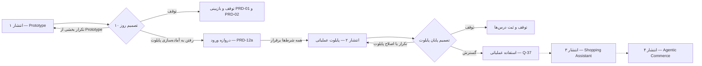

# ‏PRD-12 — برنامه انتشار آینده

> ‏**سطح این سند:** تمپلیت این بخش را این‌طور تعریف کرده است `[SRC-03 §«۱۰» تکراری]`: «اشاره کنیم که در آینده این محصول چه امکاناتی قرار است داشته باشد. در قالب سناریوهایی قابل فهم»، با جدول «انتشار | سناریوها». این فایل همین را می‌آورد. **دروازه ورود به پایلوت** که چند سند Approved به این بخش سپرده‌اند، در زیرسند PRD-12a است.
>
> ‏**آنچه اینجا نیست:** رفتار، استوری و معیار پذیرش قابلیت‌های آینده (این سند هیچ رفتار تازه‌ای تعریف نمی‌کند؛ پیش از ساخت هر انتشار، PRD با ثبت CH به‌روز می‌شود)؛ انتخاب فناوری و سرویس‌دهنده (طراحی فنی)؛ ریسک‌ها (PRD-08؛ اینجا فقط شناسه RSK)؛ تأمین‌کننده و موعد وابستگی‌ها (PRD-09)؛ بازار، رقبا و تمایز (PRD-13)؛ اهداف اقتصادی (PRD-14).
>
> ‏**راهنمای برچسب‌ها:** `[SRC-xx §n]` = برگرفته از منبع · **(پیشنهاد)** = پیشنهاد تیم PRD، تأییدشده در چت PRD-12 · **(برداشت)** = برداشت تیم PRD از منبع، نه گفته صریح آن · **(فرض A-xx)** = باور یا مقدار تأییدنشده · **(تأییدنشده)** = برگرفته از تحقیقات بازار (DEC-02) · **TBD** = تعیین پس از خط مبنا یا در آماده‌سازی پایلوت.

### ‏راهنمای شناسه‌ها

| ‏کد | ‏معنی | ‏کجا تعریف شده |
|---|---|---|
| ‏انتشار ۱ … ۴ | ‏انتشارهای محصول، بدون پیشوند (مثل «جزء ۱») **(DEC-206)** | ‏همین سند §12.2 |
| ‏FS-xx | ‏سناریوی انتشار آینده؛ شماره پشت‌سرهم در همه انتشارها (مثلاً FS-01 = پرسش موجودی از کانال واقعی) **(DEC-206)** | ‏همین سند |
| ‏EC-xx | ‏شرط ورود به پایلوت (Entry Condition) **(DEC-206)** | ‏PRD-12a |
| ‏LG-xx | ‏هدف یادگیری انتشار (LG-01 = Prototype؛ LG-02 = پایلوت) | ‏PRD-01 §1.5.2؛ همین سند §12.5.2 |
| ‏H / A | ‏فرضیه BRD / فرض تأییدنشده (مثلاً H-01 = بخش معناداری از پرسش‌ها قابل پاسخ است) | ‏PRD-08 §8.2 |
| ‏BO / KM | ‏هدف کسب‌وکار / قاعده شمارش شاخص | ‏PRD-01؛ PRD-04-EP06 |
| ‏ND / RULE | ‏نباید کلی محصول / قاعده داده | ‏PRD-04-00 |
| ‏ENV / NFR | ‏نیازمندی محیطی / کیفی | ‏PRD-07 / PRD-06 |
| ‏DEP | ‏وابستگی (DEP-30 به بعد = پایلوت) | ‏PRD-09 |
| ‏RSK / CON | ‏ریسک / محدودیت | ‏PRD-08 |
| ‏D / Q / DEC / CH | ‏تصمیم باز BRD / سؤال باز / تصمیم / تغییر | ‏BRD §14؛ Master Index |

---

## ‏۱۲.۱ زیرسندها

| ‏ترتیب مطالعه | ‏فایل | ‏محتوا | ‏مخاطب اصلی |
|---|---|---|---|
| ‏۱ | ‏`PRD-12 - Future Release Plan.md` | ‏همین فایل: قواعد، جدول تمپلیت، نقشه راه، انتشار ۲ تا ۴، موارد بدون برنامه | ‏همه؛ حامی کسب‌وکار |
| ‏۲ | ‏`PRD-12a - Pilot Entry Gate.md` | ‏دروازه ورود به پایلوت: ۲۲ شرط ورود، ترتیب آن‌ها، قاعده توقف در پایلوت، نگاشت BRD و PRD-06 §6.9 | ‏مالک محصول، مسئول فنی، مسئول امنیت، فروشگاه پایلوت |

> ‏**دلیل تقسیم (DEC-204):** ستون «وضعیت» شرط‌های دروازه در آماده‌سازی پایلوت مدام به‌روز می‌شود، ولی جدول تمپلیت و نقشه راه ثابت می‌مانند (همان دلیل DEC-188).

---

## ‏۱۲.۲ قواعد این سند

| ‏# | ‏قاعده | ‏مرجع |
|---|---|---|
| ‏۱ | ‏**سه سطح تعهد:** انتشار ۱ = **تعهدشده** (PRD-11) · انتشار ۲ = **مشروط**: فقط با تصمیم «رفتن به آماده‌سازی پایلوت» در روز ۱۰ و عبور از دروازه PRD-12a · انتشار ۳ و ۴ = **جهت، تعهدنشده**: هیچ منبعی زمان، اولویت یا شرط ورود آن‌ها را نگفته است | ‏DEC-202؛ DEC-21؛ **(DEC-205)** |
| ‏۲ | ‏**این سند رفتار تازه تعریف نمی‌کند.** هر سناریو فقط می‌گوید چه چیزی تازه است و به چه منبعی تکیه دارد. پیش از ساخت هر قابلیت، استوری و معیار پذیرش آن با ثبت CH به PRD افزوده می‌شود (EC-17) | ‏دستورالعمل پروژه §۸؛ RSK-14 |
| ‏۳ | ‏**قواعد هسته در هیچ انتشاری سست نمی‌شوند:** SP-01 تا SP-10، نبایدهای گروه الف تا د (ND-01 تا ND-29)، RULE-01 تا RULE-08. انتشار بعدی فقط وقتی یکی از آن‌ها را عوض می‌کند که تصمیم صریح و CH داشته باشد (مثلاً Agentic Commerce و مرز «اقدام نمی‌کند» — §12.7) | ‏PRD-02 §2.2؛ PRD-04-00 |
| ‏۴ | ‏هر سناریو و هر ردیف به منبع یا سند Approved ردیابی می‌شود. ایده‌های SRC-04 و SRC-05 فقط در پانویس و با برچسب «تأییدنشده» می‌آیند و قابلیت تازه به نقشه راه نمی‌افزایند | ‏DEC-02؛ **(DEC-213)** |
| ‏۵ | ‏مواردی که منبع برایشان انتشاری نگفته، به‌زور در انتشاری جا داده نمی‌شوند و در §12.8 «بدون برنامه» می‌مانند | ‏**(DEC-212)** |
| ‏۶ | ‏سناریوها به زبان کاربر نوشته می‌شوند و به کانال خاصی وابسته نیستند، چون کانال پایلوت هنوز تصمیم نگرفته است (D-04؛ ENV-66) | ‏`[SRC-03]` «سناریوهایی قابل فهم» |

---

## ‏۱۲.۳ انتشارها و سناریوها (جدول تمپلیت)

> ‏همان جدول دوستونه تمپلیت. شرح هر سناریو در §12.5 تا §12.7.

| ‏انتشار | ‏سناریوها |
|---|---|
| ‏انتشار ۱ — Prototype *(تعهدشده؛ PRD-11)* | ‏UC-01 تا UC-08 (PRD-11 §11.3) |
| ‏انتشار ۲ — پایلوت عملیاتی *(مشروط به تصمیم روز ۱۰ و دروازه PRD-12a)* | ‏FS-01 پرسش موجودی از کانال واقعی با داده همگام‌شده · FS-02 پاسخ از سیاست‌ها و دانش واقعی فروشگاه · FS-03 پرسش وضعیت سفارش واقعی پس از احراز · FS-04 رسیدگی شیفت پشتیبانی به صف واقعی · FS-05 مدیریت حساب‌های تیم توسط مالک فروشگاه · FS-06 گفت‌وگو روی دستگاه مشترک یا دستگاه دیگر · FS-07 توقف خودکارسازی و بازگشت به پاسخ‌گویی دستی · FS-08 سنجش نتیجه در برابر خط مبنا |
| ‏انتشار ۳ — AI Shopping Assistant *(جهت، تعهدنشده)* | ‏FS-09 پیشنهاد جایگزین برای گونه ناموجود · FS-10 جست‌وجوی محصول با تصویر · FS-11 پیشنهاد ست و محصول مکمل · FS-12 رفع تردید پیش از رهاشدن خرید · FS-13 پرو مجازی |
| ‏انتشار ۴ — Agentic Commerce *(جهت، تعهدنشده)* | ‏FS-14 پیداکردن و خرید محصول با اجازه مشتری · FS-15 پیگیری سفارش و ثبت درخواست تعویض با اجازه مشتری |

---

## ‏۱۲.۴ نقشه راه

> ‏هدف دیاگرام: نشان‌دادن ترتیب انتشارها، دو نقطه تصمیم (روز ۱۰ و پایان پایلوت) و جای دروازه. خط پیوسته = مسیر تعهدشده یا مشروط · خط‌چین = جهت تعهدنشده.

> ‏**«استفاده عملیاتی» انتشار جدا نیست (DEC-215).** منابع آن را از پایلوت جدا می‌دانند (هدف دسترس‌پذیری ۲۴ ساعته `[SRC-02 §10]`؛ ND-39؛ NFR-12-1)، ولی هیچ‌جا تعریفش نکرده‌اند. اینجا فقط به‌عنوان مقصد پایلوت موفق می‌آید و تعریف آن نقطه باز **Q-37** است.

---

## ‏۱۲.۵ انتشار ۲ — پایلوت عملیاتی

### ‏۱۲.۵.۱ این انتشار

| ‏مورد | ‏مقدار | ‏مرجع |
|---|---|---|
| ‏نام | ‏پایلوت عملیاتی: «استفاده محدود و کنترل‌شده با داده و فرایند واقعی» | ‏`[SRC-02 §14]` واژه‌نامه؛ DEC-03 |
| ‏شروع | ‏فقط پس از (۱) تصمیم «رفتن به آماده‌سازی پایلوت» در گزارش روز ۱۰ و (۲) برقراری همه شرط‌های PRD-12a. «رفتن به آماده‌سازی» شروع پایلوت نیست | ‏DEC-202؛ PRD-11b §11b.14.2 |
| ‏دامنه | ‏یک فروشگاه همکار (D-01)، کانال واقعی (D-04)، منبع واقعی موجودی، داده واقعی پس از کنترل دسترسی، تیم و شیفت واقعی | ‏`[SRC-02 §3، §12]`؛ CON-01؛ NFR-11-1 |
| ‏محصول | ‏**همان هسته Prototype** (۳۴ استوری) در شرایط واقعی، به‌علاوه قابلیت‌های نامزد §12.5.4. قواعد، وضعیت‌ها و نبایدها تغییر نمی‌کنند | ‏ENV-66؛ §12.2 قاعده ۳ |
| ‏بازه | ‏**TBD.** هیچ منبعی مدت پایلوت را نگفته است | ‏— |
| ‏آنچه می‌آزماید | ‏LG-02 (§12.5.2) | ‏**(DEC-210)** |
| ‏تأیید ورود | ‏طبق PRD-12a §12a.6 | ‏— |

### ‏۱۲.۵.۲ هدف یادگیری پایلوت (LG-02)

| ‏شناسه | ‏هدف | ‏خروجی | ‏مرجع |
|---|---|---|---|
| ‏LG-02 **(پیشنهاد — DEC-210)** | ‏آزمودن ارزش محصول در شرایط واقعی: (۱) اعتبارسنجی H-01 (A-05) با پیام‌های واقعی؛ (۲) آزمون کامل H-02 (A-06)؛ (۳) اعتبارسنجی الگوی مشترک ورکفلو (A-13)؛ (۴) سنجش BO-04 و شاخص‌های پایلوت BRD در برابر خط مبنا؛ (۵) آزمودن محدودیت‌هایی که Prototype نمی‌توانست بیازماید | ‏گزارش پایان پایلوت و تصمیم پایان پایلوت (§12.5.6) | ‏`[SRC-02 §1، §4، §11]`؛ PRD-08 §8.2.1؛ DEC-173 |

### ‏۱۲.۵.۳ سناریوهای انتشار ۲

> ‏**قالب کارت (DEC-207):** سناریو در یک جمله به زبان کاربر · چه چیزی تازه است · چه چیزی تغییر نمی‌کند · قابلیت‌ها و منبع · شرط و وابستگی · آنچه می‌آزماید · وضعیت. وضعیت همه کارت‌ها «نامزد؛ مشروط به تصمیم روز ۱۰ (DEC-202)» است، مگر قید دیگری آمده باشد.

#### ‏FS-01 · پرسش موجودی از کانال واقعی با داده همگام‌شده

| ‏مورد | ‏مقدار |
|---|---|
| ‏**سناریو** | ‏مشتری از کانال واقعی فروشگاه وارد گفت‌وگو می‌شود و موجودی یک گونه را می‌پرسد. پاسخ از داده‌ای می‌آید که از منبع واقعی موجودی فروشگاه همگام شده است. اگر همگام‌سازی قطع شده یا داده کهنه باشد، مشتری همان پاسخ «نامشخص» Prototype را می‌بیند و راه رسیدن به پشتیبان باز است |
| ‏**چه چیزی تازه است** | ‏ورود از کانال واقعی (پیوند یا ابزارک)، به‌جای صفحه نمایشی · منبع واقعی موجودی، به‌جای ثبت دستی در پنل · مشتری و داده واقعی · آستانه اعتبار که مقدار واقعی خود فروشگاه است، نه مقدار آزمون |
| ‏**چه چیزی تغییر نمی‌کند** | ‏RULE-01 تا RULE-05 · ND-10 · DEC-84 (خطا در دسترسی به داده = نامشخص) · قواعد مستقل از کانال‌اند (ENV-66) |
| ‏**قابلیت‌ها و منبع** | ‏ENV-03 (ستون پایلوت) · ND-30، ND-31 · `[SRC-02 §3]` موجودی پایلوت: «منبع واقعی و روش همگام‌سازی معتبر» · برای فروشگاهی که سیستم انبار ندارد: ورود دستی (ENV-67) |
| ‏**شرط و وابستگی** | ‏EC-03 (کانال؛ D-04، DEP-31) · EC-04 (منبع موجودی؛ DEP-32) · D-02 با مقدار واقعی فروشگاه (EC-05) |
| ‏**آنچه می‌آزماید** | ‏شاخص «خطای موجودی» پایلوت `[SRC-02 §11]` · محدودیت‌های ۳ و ۷ گزارش روز ۱۰ (PRD-11b §11b.14.1) |
| ‏**وضعیت** | ‏نامزد؛ مشروط به تصمیم روز ۱۰ و D-04 |

#### ‏FS-02 · پاسخ از سیاست‌ها و دانش واقعی فروشگاه

| ‏مورد | ‏مقدار |
|---|---|
| ‏**سناریو** | ‏مشتری درباره هزینه ارسال یا شرایط مرجوعی همین فروشگاه می‌پرسد و پاسخی می‌گیرد که از سیاست تأییدشده و فعلی فروشگاه آمده است. وقتی فروشگاه سیاستش را عوض می‌کند، مسئول داده نسخه تازه را تأیید می‌کند و پرسش بعدی از نسخه تازه پاسخ می‌گیرد |
| ‏**چه چیزی تازه است** | ‏منابع دانش و سیاست واقعی به‌جای پیش‌نویس ساختگی · فرایند نگهداری با مسئول مشخص در فروشگاه · گسترش پوشش راهنمایی محصول «متناسب با نتیجه پایلوت» |
| ‏**چه چیزی تغییر نمی‌کند** | ‏SP-01، SP-02 · ND-08، ND-09، ND-12 · DEC-74 (منبع منقضی = نبود منبع) · RULE-06 |
| ‏**قابلیت‌ها و منبع** | ‏`[SRC-02 §3]` گفت‌وگو و دانش پایلوت: «منابع واقعی و فرایند نگهداری مشخص»؛ راهنمایی محصول پایلوت: «گسترش پوشش متناسب با نتیجه پایلوت» |
| ‏**شرط و وابستگی** | ‏EC-05 (منابع دانش و مسئول داده؛ DEP-33) |
| ‏**آنچه می‌آزماید** | ‏H-01 (سهم پرسش‌های قابل پاسخ از اطلاعات فروشگاه) · شاخص «نرخ حل تأییدشده بدون بازگشایی» (KM-07) |

#### ‏FS-03 · پرسش وضعیت سفارش واقعی پس از احراز

| ‏مورد | ‏مقدار |
|---|---|
| ‏**سناریو** | ‏مشتری وضعیت سفارش واقعی خودش را می‌پرسد. دستیار فقط پس از احراز ارتباط مشتری با آن سفارش، اطلاعات سفارش را نشان می‌دهد؛ تغییر سفارش، بازپرداخت یا استثنای مرجوعی همچنان فقط ارجاع می‌شود |
| ‏**چه چیزی تازه است** | ‏داده واقعی سفارش به‌جای سفارش نمونه · احراز ارتباط مشتری با سفارش (روش TBD) |
| ‏**چه چیزی تغییر نمی‌کند** | ‏ND-01 تا ND-05 (هیچ اقدامی روی سفارش) · ND-27 (داشتن شماره سفارش به‌تنهایی مجوز نیست) · RULE-07 |
| ‏**قابلیت‌ها و منبع** | ‏`[SRC-02 §3]` سفارش و مرجوعی پایلوت: «داده واقعی تنها پس از کنترل دسترسی» · `[SRC-02 §10]` · ENV-20 (ستون پایلوت) |
| ‏**شرط و وابستگی** | ‏EC-10 (روش احراز؛ D-06) · EC-12 (کنترل دسترسی برای داده واقعی) · اتصال یا ورود داده سفارش واقعی (EC-05) |
| ‏**آنچه می‌آزماید** | ‏شاخص «ادعای حساس» در شرایط واقعی · افشای داده = محرک توقف (§12a.4) |

#### ‏FS-04 · رسیدگی شیفت پشتیبانی به صف واقعی

| ‏مورد | ‏مقدار |
|---|---|
| ‏**سناریو** | ‏ادمین‌های شیفت فروشگاه صف واقعی را رسیدگی می‌کنند؛ مسئول شیفت زمان انتظار را می‌پاید، و خارج از ساعات کاری مشتری مسیر تماس جایگزین واقعی فروشگاه را می‌بیند |
| ‏**چه چیزی تازه است** | ‏صف عملیاتی با نقش‌ها و مسئولیت شیفت · پایش تأخیر پاسخ انسانی · ساعات کاری و مسیر تماس جایگزین واقعی (D-05) · **نامزدها:** انتقال مکالمه به ادمین دیگر یا برگرداندن به صف (DEC-95) · استفاده از پنل‌ها روی موبایل (ENV-10) · پیشنهاد پاسخ به ادمین (US-07-06) و به‌روزرسانی خودکار صف (NFR-10-3)، اگر در Prototype ساخته نشده باشند |
| ‏**چه چیزی تغییر نمی‌کند** | ‏SP-07 (یک مالک) · ND-16 تا ND-22 · ترتیب صف بر اساس قدیمی‌ترین ارجاع |
| ‏**قابلیت‌ها و منبع** | ‏`[SRC-02 §3]` پنل ادمین پایلوت: «صف عملیاتی، نقش‌ها و مسئولیت شیفت»؛ ارجاع پایلوت: «پایش تأخیر و مسیر تماس جایگزین واقعی»؛ خلاصه و پیشنهاد پاسخ: «بر اساس نیاز و بازخورد توسعه می‌یابد» · PRD-11 §11.5 |
| ‏**شرط و وابستگی** | ‏EC-13 (مسئول شیفت و D-05 واقعی؛ DEP-33) · EC-14 (آموزش ادمین؛ DEP-37) |
| ‏**آنچه می‌آزماید** | ‏شاخص «زمان انتظار پاسخ انسان» (KM-10) · BO-04 «زمان انسانی به‌ازای درخواست» · RSK-04 (انباشت صف) |

#### ‏FS-05 · مدیریت حساب‌های تیم توسط مالک فروشگاه

| ‏مورد | ‏مقدار |
|---|---|
| ‏**سناریو** | ‏کاربری که رمزش را فراموش کرده، بدون تماس با تیم محصول آن را بازیابی می‌کند؛ تیم محصول حساب مدیر هر فروشگاه را از یک پنل سطح سامانه می‌سازد |
| ‏**چه چیزی تازه است** | ‏~~ساخت و غیرفعال‌سازی حساب توسط مالک~~ — مدیر از Prototype کارمند می‌سازد (DEC-317) · پنل سطح سامانه برای ساخت حساب مدیر · اعطای نقش ادمین توسط مدیر (Q-49) · بازیابی رمز · قفل حساب پس از تلاش ناموفق · روش ورود قوی‌تر · ~~نامزد بررسی: اعطای مجوز تغییر آستانه اعتبار به ادمین~~ — از Prototype قابل اعطاست (DEC-259؛ جایگزین DEC-68 و DEC-216) |
| ‏**چه چیزی تغییر نمی‌کند** | ‏حساب فردی (ENV-31) · اجرای مجوز در سمت سیستم (NFR-04-3) · ثبت عامل و زمان (NFR-08) |
| ‏**قابلیت‌ها و منبع** | ‏ENV-30، ENV-33، ENV-34، ENV-36 (ستون پایلوت) · DEC-259 |
| ‏**شرط و وابستگی** | ‏EC-12 (روش ورود و کنترل دسترسی پایلوت) |
| ‏**آنچه می‌آزماید** | ‏کارکرد حساب‌ها در شرایط واقعی؛ هیچ شاخص BO مستقیمی ندارد |

#### ‏FS-06 · گفت‌وگو روی دستگاه مشترک یا دستگاه دیگر

| ‏مورد | ‏مقدار |
|---|---|
| ‏**سناریو** | ‏دو نفر از یک گوشی یا مرورگر با فروشگاه گفت‌وگو می‌کنند و هیچ‌کدام مکالمه دیگری را نمی‌بیند؛ مشتری‌ای که گفت‌وگو را روی دستگاه دیگری ادامه می‌دهد، فقط پس از احراز به مکالمه قبلی‌اش می‌رسد |
| ‏**چه چیزی تازه است** | ‏پاسخ مصوب به دستگاه مشترک (RSK-12) · ادامه مکالمه بین دستگاه‌ها با احراز (ENV-23). **روش هر دو باز است** و این سند آن را طراحی نمی‌کند |
| ‏**چه چیزی تغییر نمی‌کند** | ‏NFR-04-1 (جداسازی مکالمه) · ND-23، ND-24 · نشانی صفحه شناسه مکالمه ندارد (ENV-24) |
| ‏**قابلیت‌ها و منبع** | ‏ENV-21 تا ENV-25 (ستون پایلوت) · PRD-07 §7.6.1 · RSK-12 |
| ‏**شرط و وابستگی** | ‏EC-11 (پاسخ مصوب دستگاه مشترک) |
| ‏**آنچه می‌آزماید** | ‏افشای داده = محرک توقف (§12a.4) |

#### ‏FS-07 · توقف خودکارسازی و بازگشت به پاسخ‌گویی دستی

| ‏مورد | ‏مقدار |
|---|---|
| ‏**سناریو** | ‏وقتی رخدادی بحرانی دیده می‌شود، ادمین پاسخ خودکار را برای کل فروشگاه متوقف می‌کند؛ پیام‌های تازه بی‌آنکه گم شوند به صف می‌روند و تیم تا رفع علت دستی پاسخ می‌دهد. بازگشت پاسخ خودکار فقط با تأیید مالک محصول و فروشگاه است |
| ‏**چه چیزی تازه است** | ‏اجرای واقعی قاعده توقف با ادمین‌های آموزش‌دیده · **چهار محرک** به‌جای سه (ادعای حساس تأییدشده — DEC-208؛ PRD-12a §12a.4) |
| ‏**چه چیزی تغییر نمی‌کند** | ‏قابلیت توقف همان US-07-05 است · DEC-88 (توقف خودکار سیستمی نیست) · NFR-12-2 (هیچ پیامی گم نمی‌شود) |
| ‏**قابلیت‌ها و منبع** | ‏`[SRC-02 §12]` · PRD-08 §8.5 · US-07-05 |
| ‏**شرط و وابستگی** | ‏EC-14 (آموزش؛ DEP-37) · EC-15 (آزمون توقف و بازگشت دستی) |
| ‏**آنچه می‌آزماید** | ‏RSK-26 · NFR-12-2 در بار واقعی |

#### ‏FS-08 · سنجش نتیجه در برابر خط مبنا

| ‏مورد | ‏مقدار |
|---|---|
| ‏**سناریو** | ‏مالک فروشگاه در پایان هر دوره گزارش سنجش را باز می‌کند و زمان انسانی هر درخواست، زمان انتظار، نرخ حل بدون بازگشایی، خطای موجودی، رضایت و هزینه هر درخواست حل‌شده را با وضعیت پیش از پایلوت مقایسه می‌کند |
| ‏**چه چیزی تازه است** | ‏مقایسه با خط مبنای ثبت‌شده پیش از پایلوت · سنجش رضایت مشتری (روش TBD) · اهداف عددی پایلوت |
| ‏**چه چیزی تغییر نمی‌کند** | ‏قواعد شمارش KM (PRD-04-EP06) · ND-29 (هزینه نامعلوم صفر نمی‌شود) · شاخص‌های محافظ PRD-01 §1.5.3 |
| ‏**قابلیت‌ها و منبع** | ‏`[SRC-02 §11]` شاخص‌های پایلوت · BO-04 «در Prototype فقط آمادگی سنجش» (PRD-01 §1.5.3) · US-06-03 |
| ‏**شرط و وابستگی** | ‏EC-18 (خط مبنا و اهداف مصوب؛ D-08) · EC-19 (اعتبارسنجی H-01) |
| ‏**آنچه می‌آزماید** | ‏LG-02 · RSK-23 |

### ‏۱۲.۵.۴ قابلیت‌های نامزد انتشار ۲

> ‏فهرست یک‌جای همه تغییرات محصول که منابع به پایلوت سپرده‌اند. **«نامزد»** یعنی منبع آن را برای پایلوت گفته، ولی رفتارش تعریف نشده و پیش از ساخت باید به PRD افزوده شود (EC-17). **«نامزد بررسی»** یعنی منبع فقط بررسی آن را گفته است.

| ‏# | ‏قابلیت | ‏سناریو | ‏وضعیت | ‏منبع |
|---|---|---|---|---|
| ‏۱ | ‏کانال واقعی: ابزارک روی سایت یا پیوند در کانال | ‏FS-01 | ‏نامزد؛ مشروط به D-04 | ‏ENV-03؛ ND-30؛ D-04 |
| ‏۲ | ‏منبع واقعی موجودی و همگام‌سازی، یا ورود دستی | ‏FS-01 | ‏نامزد | ‏`[SRC-02 §3]`؛ ND-31؛ ENV-67 |
| ‏۳ | ‏منابع دانش و سیاست واقعی با فرایند نگهداری | ‏FS-02 | ‏نامزد | ‏`[SRC-02 §3]` |
| ‏۴ | ‏گسترش پوشش راهنمایی محصول | ‏FS-02 | ‏نامزد؛ «متناسب با نتیجه پایلوت» | ‏`[SRC-02 §3]` |
| ‏۵ | ‏داده واقعی سفارش و مرجوعی با احراز | ‏FS-03 | ‏نامزد؛ مشروط به EC-10 | ‏`[SRC-02 §3، §10]`؛ ENV-20 |
| ‏۶ | ‏صف عملیاتی، نقش‌ها و مسئولیت شیفت | ‏FS-04 | ‏نامزد | ‏`[SRC-02 §3]` |
| ‏۷ | ‏پایش تأخیر و مسیر تماس جایگزین واقعی | ‏FS-04 | ‏نامزد | ‏`[SRC-02 §3]` |
| ‏۸ | ‏انتقال مکالمه به ادمین دیگر یا برگرداندن به صف | ‏FS-04 | ‏نامزد | ‏DEC-95 |
| ‏۹ | ‏استفاده از پنل‌ها روی موبایل | ‏FS-04 | ‏نامزد | ‏ENV-10 |
| ‏۱۰ | ‏پیشنهاد پاسخ به ادمین (US-07-06) | ‏FS-04 | ‏نامزد، اگر در Prototype ساخته نشده باشد | ‏PRD-11 §11.5؛ `[SRC-02 §3]` |
| ‏۱۱ | ‏به‌روزرسانی خودکار صف (NFR-10-3؛ فرض A-22) | ‏FS-04 | ‏نامزد، اگر در Prototype ساخته نشده باشد | ‏PRD-11 §11.5 |
| ‏~~۱۲~~ | ‏~~ساخت و غیرفعال‌سازی حساب ادمین توسط مالک~~ | ‏— | ‏**دیگر نامزد پایلوت نیست:** مدیر از Prototype کارمند می‌سازد (DEC-317) | ‏ENV-33؛ DEC-317 |
| ‏۱۳ | ‏بازیابی رمز، قفل حساب و ورود قوی‌تر | ‏FS-05 | ‏نامزد | ‏ENV-30، ENV-34، ENV-36 |
| ‏~~۱۴~~ | ‏~~اعطای مجوز تغییر آستانه به ادمین~~ | ‏— | ‏**دیگر نامزد پایلوت نیست:** در Prototype قابل اعطاست (DEC-259) | ‏DEC-259 (جایگزین DEC-68، DEC-216) |
| ‏۱۵ | ‏پاسخ دستگاه مشترک و ادامه مکالمه بین دستگاه‌ها | ‏FS-06 | ‏نامزد؛ روش باز | ‏RSK-12؛ ENV-23 |
| ‏۱۶ | ‏محیط عملیاتی جدا از محیط آزمون، پشتیبان‌گیری و بازیابی | ‏— (بستر) | ‏نامزد | ‏ENV-42، ENV-44 |
| ‏۱۷ | ‏سنجش رضایت مشتری و مقایسه با خط مبنا | ‏FS-08 | ‏نامزد | ‏`[SRC-02 §11]` |
| ‏۱۸ | ‏دریافت موجودی از منبع پیش از پاسخ، وقتی داده از آستانه قدیمی‌تر است؛ و به‌روزرسانی دسته «موجودی» گزارش با باز شدن صفحه از منبع. اگر دریافت شکست بخورد نتیجه «نامشخص» می‌ماند **(CH-54)** | ‏FS-01 | ‏نامزد؛ همراه ردیف ۲ | ‏DEC-312؛ ND-31 |
| ‏۱۹ | ‏حالت «اطلاعات متعارض» برای داده چند منبع و نمای انتخاب رکورد درست (SCR-21 R5) **(CH-54)** | ‏FS-01 | ‏نامزد؛ همراه ردیف ۲ | ‏DEC-314 |
| ‏۲۰ | ‏پرداخت و تمدید واقعی اشتراک در پنل فروشگاه **(CH-54)** | ‏— (تجاری) | ‏نامزد بررسی؛ وابسته به مدل قیمت (A-29، Q-40) | ‏DEC-309 |
| ‏۲۱ | ‏پنل سطح سامانه برای تیم محصول (ساخت حساب مدیر و فروشگاه) و اعطای نقش ادمین پشتیبانی توسط مدیر **(CH-54)** | ‏FS-05 | ‏نامزد؛ Q-49 | ‏DEC-317؛ ENV-33 |

> ‏**آنچه پایلوت باید بیازماید که Prototype نتوانست:** محدودیت‌های ۱ تا ۷ و ۹ و ۱۰ فهرست الزامی گزارش روز ۱۰ (PRD-11b §11b.14.1) — یک فروشگاه نمایشی و داده ساختگی، مقادیر آزمون D-02 و D-05، همگام‌سازی عملیاتی، کاهش هزینه یا زمان، نمونه کوچک، H-01 و H-02، کانال واقعی، سرویس‌دهنده مدل در بار واقعی و شبکه همراه. بند ۱۱ (ترجیحی‌های ساخته‌نشده) در ردیف ۱۰ و ۱۱ جدول بالا آمده است.

### ‏۱۲.۵.۵ سنجش پایلوت

> ‏اهداف عددی **TBD** می‌مانند تا خط مبنا ثبت شود (D-08؛ CON-09). مصوب‌شدن آن‌ها شرط ورود است (EC-18)، نه کار این سند **(DEC-209)**.

| ‏شاخص پایلوت `[SRC-02 §11]` | ‏BO | ‏قاعده شمارش | ‏هدف |
|---|---|---|---|
| ‏زمان انسانی به‌ازای هر درخواست | ‏BO-04 | ‏طبق PRD-04-EP06 | ‏TBD (پس از خط مبنا) |
| ‏زمان انتظار پاسخ انسان | ‏BO-02 | ‏KM-10 | ‏TBD |
| ‏نرخ حل تأییدشده بدون بازگشایی در بازه مصوب | ‏BO-01، BO-05 | ‏KM-07؛ بازه A-16 | ‏TBD |
| ‏خطای موجودی | ‏BO-03 | ‏طبق PRD-04-EP06 | ‏TBD |
| ‏رضایت مشتری | ‏BO-01 | ‏روش TBD | ‏TBD |
| ‏هزینه هر درخواست حل‌شده | ‏BO-04 | ‏KM-11 | ‏TBD |

> ‏**قواعد BRD که در پایلوت هم برقرارند** `[SRC-02 §11، §12]`: کاهش ارجاع به‌تنهایی موفقیت نیست · صرفه‌جویی زمانی ابتدا «ظرفیت آزادشده» است و کاهش هزینه نقدی جدا اثبات می‌شود · افزایش فروش و کاهش مرجوعی فرضیه‌اند و منفعت قطعی حساب نمی‌شوند (DEC-16). ستون «هدف پایلوت» PRD-06 هم همه TBD است و همراه با EC-18 مصوب می‌شود.

### ‏۱۲.۵.۶ تصمیم پایان پایلوت

> ‏**(پیشنهاد — DEC-214).** هیچ منبعی پایان پایلوت را تعریف نکرده است. این جدول فقط ساختار تصمیم را می‌گذارد، هم‌شکل تصمیم روز ۱۰ (DEC-202)، بدون عدد.

| ‏گزینه | ‏وقتی | ‏نتیجه |
|---|---|---|
| ‏**گسترش به استفاده عملیاتی** | ‏اهداف مصوب پایلوت (EC-18) برآورده شده و رخداد بحرانی باز نیست | ‏تعریف و برنامه «استفاده عملیاتی» (Q-37)؛ بازبینی انتشار ۳ |
| ‏**تکرار یا اصلاح پایلوت** | ‏اهداف برآورده نشده، ولی علت قابل رفع است | ‏تعیین اصلاح، آزمون مجدد و دوره تازه؛ ثبت CH |
| ‏**توقف** | ‏شواهد نشان می‌دهد ارزش (H-01، H-02) یا رفتار ایمن در شرایط واقعی به دست نمی‌آید | ‏ثبت دلیل و درس‌ها؛ بازبینی PRD-01 و PRD-02 |

> ‏انتخاب گزینه با مالک محصول و مالک فروشگاه پایلوت است **(پیشنهاد)**، هم‌راستا با تأییدکنندگان بازگشت پس از توقف در BRD §12.

---

## ‏۱۲.۶ انتشار ۳ — AI Shopping Assistant (جهت، تعهدنشده)

> ‏مرحله ۲ مسیر توسعه: «کمک به انتخاب محصول، پیشنهاد جایگزین، رفع موانع خرید و شخصی‌سازی تجربه خرید» `[SRC-01 §10]`. جای قابلیت‌ها در این مرحله در PRD-01 §1.7 و PRD-02 §2.8 تأیید شده است. سناریوها فقط جهت‌اند و رفتارشان تعریف نشده است.

| ‏شناسه | ‏سناریو | ‏منبع |
|---|---|---|
| ‏FS-09 | ‏گونه‌ای که مشتری می‌خواهد ناموجود است یا به کارش نمی‌آید؛ دستیار گزینه‌های جایگزین را بر اساس نیاز، بودجه و ترجیحات او پیشنهاد می‌کند | ‏`[SRC-01 §6.3]`؛ ND-33 |
| ‏FS-10 | ‏مشتری تصویر یک محصول را می‌فرستد و دستیار محصولات مشابه یا مرتبط را در همین فروشگاه پیدا می‌کند | ‏`[SRC-01 §6.1]`؛ ND-33 |
| ‏FS-11 | ‏مشتری محصولی را انتخاب کرده و دستیار محصولات مکمل یا ست مناسب را پیشنهاد می‌کند | ‏`[SRC-01 §6.2]`؛ ND-33 |
| ‏FS-12 | ‏مشتری درباره سایز، انتخاب میان دو محصول، قیمت یا شرایط ارسال مردد است؛ دستیار مانع را می‌شناسد و با اطلاعات یا پیشنهاد مناسب رفعش می‌کند (Purchase Rescue) | ‏`[SRC-01 §6.4]`؛ ND-35 |
| ‏FS-13 | ‏مشتری پیش از خرید، لباس را به‌صورت مجازی امتحان می‌کند | ‏`[SRC-02 §3]` (خارج از مرحله نخست)؛ PRD-01 §1.7 |

| ‏مورد | ‏مقدار |
|---|---|
| ‏**شواهد لازم پیش از ورود** | ‏(۱) تصمیم «گسترش» در پایان پایلوت (§12.5.6)؛ (۲) اعتبار H-01 و H-02 در پایلوت؛ (۳) داده مرجع معتبر و نگهداری‌شده، که پیش‌نیاز پیشنهاد جایگزین است (فرض A-12 — PRD-02 §2.6) · «قابلیت‌ها پس از اعتبارسنجی هسته اصلی محصول و بررسی نیاز بازار» `[SRC-01 §6]` |
| ‏**چه چیزی باید دوباره تصمیم گرفته شود** | ‏ND-33 و ND-34 (شخصی‌سازی بر پایه رفتار مشتری) · پیش‌شرط‌های حریم خصوصی برای داده رفتاری **(برداشت)** · ادعای افزایش فروش فقط با سنجش جدا (DEC-16؛ ND-40) |
| ‏**وابستگی به حوزه کالایی** | ‏FS-11 و FS-13 بیشتر به پوشاک می‌خورند؛ حوزه کالایی هنوز باز است (D-01) |

> ‏**پانویس تأییدنشده (DEC-02؛ DEC-213):** SRC-05 برای پیشنهاد جایگزین، حفظ «نیازهای غیرقابل‌مذاکره» (سایز، بودجه، موعد) را به‌جای پیشنهاد عمومی و سنجش با گروه کنترل را پیشنهاد کرده است، و هشدار داده که پیشنهاد ساده محصول جایگزین بومی پلتفرم‌ها را دارد `[SRC-05 §1، §3.3]`. فرصت «تحلیل بازخورد در سطح محصول» `[SRC-05 §3.9، §4]` در هیچ منبع اصلی نیست و وارد نقشه راه نمی‌شود.

---

## ‏۱۲.۷ انتشار ۴ — Agentic Commerce (جهت، تعهدنشده)

> ‏مرحله ۳ و چشم‌انداز بلندمدت: «ایجنت‌هایی که با اجازه مشتری می‌توانند فرایندهای چندمرحله‌ای خرید و خدمات پس از خرید را مدیریت و اجرا کنند» `[SRC-01 §10]`.

| ‏شناسه | ‏سناریو | ‏منبع |
|---|---|---|
| ‏FS-14 | ‏مشتری نیازش را می‌گوید؛ ایجنت جست‌وجو و مقایسه می‌کند، موجودی و شرایط ارسال را بررسی می‌کند، گزینه مناسب را پیدا می‌کند و **با تأیید مشتری** خرید را پیش می‌برد (از جمله ثبت سفارش — **برداشت**) | ‏`[SRC-01 §6.5]`؛ ND-35 |
| ‏FS-15 | ‏مشتری از ایجنت می‌خواهد سفارشش را پیگیری کند یا درخواست تعویض ثبت کند؛ ایجنت **با اجازه مشتری** این کارها را انجام می‌دهد | ‏`[SRC-01 §6.5]` |

| ‏مورد | ‏مقدار |
|---|---|
| ‏**شواهد و پیش‌نیاز** | ‏«دسترسی به ابزارها و داده‌های فروشگاه و تعریف دقیق سطح دسترسی و تأیید مشتری» `[SRC-01 §6.5]` · الگوی «اطلاع بده، اقدام نکن» و تحویل به انسان پایه «اقدام با اجازه مشتری» است (فرض A-12) |
| ‏**چه چیزی باید دوباره تصمیم گرفته شود** | ‏**مرز اختیارات.** این انتشار با قاعده کلی «دستیار اقدام نمی‌کند» (PRD-02 §2.1؛ SP-05؛ ND-01 تا ND-05) در تعارض است و فقط با تصمیم صریح، CH و تعریف تازه مرز اختیارات ممکن است (§12.2 قاعده ۳) |

> ‏**پانویس تأییدنشده (DEC-02):** SRC-05 پیچیدگی «اجرای خودکار و ایمن تراکنش مالی» را ۵ از ۵ ارزیابی کرده و توصیه کرده اقدام‌های پیامددار با تأیید انسان بمانند `[SRC-05 §2، §3.5]`.

---

## ‏۱۲.۸ بدون برنامه — در انتظار شواهد

> ‏**(DEC-212).** این موارد در اسناد Approved «خارج از محدوده» یا «نه در Prototype» شده‌اند، ولی هیچ منبعی انتشاری برایشان نگفته است. به‌زور در انتشاری جا داده نمی‌شوند. هر مورد با نیاز، نتیجه پایلوت یا تصمیم مالک محصول به یک انتشار منتقل می‌شود و این انتقال CH می‌گیرد.

| ‏مورد | ‏وضعیت امروز | ‏مرجع |
|---|---|---|
| ‏چندزبانه | ‏خارج از مرحله نخست | ‏ND-36؛ `[SRC-02 §3]` |
| ‏چندفروشگاهی | ‏خارج از مرحله نخست؛ احتمالاً همراه با «استفاده عملیاتی» (Q-37) | ‏ND-36؛ NFR-11-1 |
| ‏CRM کامل یا صندوق یکپارچه چندکاناله | ‏خارج از مرحله نخست | ‏ND-32 |
| ‏پرداخت و بازپرداخت خودکار | ‏هیچ منبعی آن را در انتشاری نگذاشته است؛ نزدیک‌ترین جا انتشار ۴ است، ولی SRC-01 §6.5 فقط «پیش‌بردن خرید با تأیید مشتری» را گفته | ‏ND-05؛ `[SRC-02 §3]` |
| ‏دسترس‌پذیری ۲۴ ساعته و توافق سطح خدمت | ‏«هدف نسخه عملیاتی» | ‏ND-39؛ NFR-12-1؛ Q-37 |
| ‏اعلان (پیامک، ایمیل، پوش) به مالک یا ادمین | ‏خارج از اسکوپ | ‏ND-37؛ DEC-35 |
| ‏پاسخ‌های آماده ادمین | ‏در Prototype نیست | ‏DEC-97 |
| ‏ورود گروهی داده و ویرایش سفارش نمونه در پنل | ‏در Prototype نیست | ‏DEC-109 |
| ‏توقف خودکار بات بر پایه خطاهای پیاپی | ‏خارج از اسکوپ؛ تصمیم با ادمین | ‏DEC-88 |
| ‏آستانه اعتبار جداگانه برای هر محصول | ‏در Prototype یک آستانه برای کل فروشگاه | ‏DEC-83 |
| ‏نمودار در گزارش سنجش | ‏در Prototype عدد و جدول | ‏DEC-147 |
| ‏بازگشایی مکالمه توسط ادمین | ‏خارج از اسکوپ | ‏Master Index §3 (PRD-05) |
| ‏کنش «شروع مکالمه تازه» برای مشتری | ‏خارج از اسکوپ | ‏ENV-25 |
| ‏تشخیص خودکار «موضوع جدید / ادامه» در بازگشایی | ‏خارج از اسکوپ | ‏ND-38؛ DEC-40 |
| ‏بستن خودکار مکالمه با زمان‌سنج | ‏خارج از اسکوپ | ‏ND-21 |
| ‏وب‌سرویس یا API برای استفاده بیرونی | ‏TBD همراه با اتصال کانال و منبع موجودی | ‏ENV-05 |

---

## ‏۱۲.۹ مرز با بخش‌های دیگر

| ‏بخش | ‏در PRD-12 | ‏در آن بخش |
|---|---|---|
| ‏PRD-11 | ‏انتشار ۱ فقط با ارجاع؛ ترجیحی‌های ساخته‌نشده به‌عنوان نامزد | ‏محتوا، برنامه اجرا، پذیرش و تصمیم روز ۱۰ |
| ‏PRD-08 | ‏ریسک‌ها با شناسه؛ قاعده توقف با ارجاع (و محرک چهارم — PRD-12a §12a.4) | ‏احتمال، اثر و پاسخ ریسک؛ گام‌های قاعده توقف |
| ‏PRD-09 | ‏ترتیب وابستگی‌های پایلوت در دروازه (PRD-12a §12a.3) | ‏تأمین‌کننده، موعد و وضعیت DEP-30 تا DEP-37 |
| ‏PRD-06 §6.9 | ‏شرط ورود با ارجاع به هر بند | ‏محتوای پیش‌شرط‌های حریم خصوصی، هزینه و دسترس‌پذیری |
| ‏PRD-07 | ‏قابلیت‌های نامزد از ستون پایلوت | ‏قیدهای بستر |
| ‏PRD-13 | ‏— | ‏جذب فروشگاه پایلوت به‌عنوان مشتری، بازار مرحله ۲، تمایز از رقبا (DEC-176) |
| ‏PRD-14 | ‏— | ‏اهداف اقتصادی پایلوت (D-08) و منفعت خالص `[SRC-02 §12]` |
| ‏PRD-00 | ‏— | ‏نام مالک فروشگاه پایلوت و نقش‌ها (Q-07) |

---

## ‏۱۲.۱۰ تصمیم‌ها، تغییرات و نقاط باز

### ‏تصمیم‌های این بخش (برای ثبت در Master Index)

| ‏شناسه | ‏تصمیم | ‏جزئیات در |
|---|---|---|
| ‏DEC-204 | ‏**ساختار PRD-12:** فایل فهرست (نقشه راه) + PRD-12a (دروازه ورود به پایلوت)؛ ترتیب مطالعه فهرست ← a | ‏§12.1 |
| ‏DEC-205 | ‏**انتشارها و سطح تعهد:** انتشار ۱ Prototype (تعهدشده) · ۲ پایلوت عملیاتی (مشروط به تصمیم روز ۱۰ و دروازه) · ۳ Shopping Assistant و ۴ Agentic Commerce (جهت، تعهدنشده) | ‏§12.2، §12.3 |
| ‏DEC-206 | ‏**شناسه‌ها:** انتشارها بدون پیشوند؛ `FS` سناریوی انتشار آینده با شماره پشت‌سرهم؛ `EC` شرط ورود به پایلوت | ‏راهنمای شناسه‌ها |
| ‏DEC-207 | ‏**قالب سناریو:** جدول تمپلیت + کارت هفت‌بخشی برای انتشار ۲؛ برای انتشار ۳ و ۴ سناریوی یک‌جمله‌ای و «شواهد لازم پیش از ورود»؛ بدون استوری | ‏§12.5.3، §12.6، §12.7 |
| ‏DEC-208 | ‏**Q-36 بسته شد:** «ادعای حساس بدون منبع» در پایلوت هم محرک توقف است، به شرط تأیید در بازبینی انسانی یا شکایت؛ تغییر نسبت به BRD §12 (CH-26) | ‏PRD-12a §12a.4 |
| ‏DEC-209 | ‏**تصمیم‌های باز پایلوت** (D-01، D-04، D-06 بخش پایلوت، D-08، Q-25 بخش پایلوت، و پاسخ دستگاه مشترک) در PRD تصمیم گرفته نمی‌شوند؛ هرکدام شرط ورود با مالک BRD و موعد «پیش از تعهد پایلوت» است | ‏PRD-12a §12a.2 |
| ‏DEC-210 | ‏**LG-02:** هدف یادگیری پایلوت (H-01، H-02، A-13، BO-04 و شاخص‌های پایلوت در برابر خط مبنا) | ‏§12.5.2 |
| ‏DEC-211 | ‏**قاعده توقف:** PRD-12 به PRD-08 §8.5 ارجاع می‌دهد و فقط شرط «آزمون توقف و بازگشت دستی در محیط پایلوت با ادمین‌های آموزش‌دیده» را به دروازه می‌افزاید (EC-15) | ‏PRD-12a §12a.4 |
| ‏DEC-212 | ‏**موارد بی‌جایگاه** در بخش «بدون برنامه» می‌مانند؛ ثبت سفارش و درخواست تعویض با برچسب «برداشت» در انتشار ۴؛ پرداخت و بازپرداخت خودکار بی‌جایگاه | ‏§12.7، §12.8 |
| ‏DEC-213 | ‏**ایده‌های SRC-04 و SRC-05** فقط پانویس تأییدنشده‌اند و قابلیت تازه به نقشه راه نمی‌افزایند | ‏§12.6 |
| ‏DEC-214 | ‏**تصمیم پایان پایلوت:** گسترش / تکرار یا اصلاح / توقف؛ فقط ساختار، بدون عدد | ‏§12.5.6 |
| ‏DEC-215 | ‏**«استفاده عملیاتی» انتشار جدا نیست**؛ مقصد پایلوت موفق است و تعریف آن Q-37 | ‏§12.4 |
| ‏~~DEC-216~~ | ‏**اعطای مجوز آستانه به ادمین «نامزد بررسی» است**، نه قابلیت تعهدشده پایلوت (رفع ناسازگاری Master Index §3 با DEC-68) — **جایگزین‌شده با DEC-259** | ‏§12.5.4 |

### ‏تغییرات

| ‏شناسه | ‏تغییر | ‏سند |
|---|---|---|
| ‏CH-26 | ‏**تغییر نسبت به BRD §12 (DEC-208):** «ادعای حساس بدون منبع» محرک چهارم توقف خودکارسازی در پایلوت می‌شود، به شرط تأیید در بازبینی انسانی یا شکایت. PRD-08 §8.5 (گام ۱ و یادداشت پایانی)، محرک RSK-26 و Q-36 در §8.8 اصلاح می‌شوند. **هیچ احتمال، اثر یا سطح ریسکی تغییر نمی‌کند** | ‏PRD-12a؛ PRD-08 → 1.3 |

### ‏نقاط باز

| ‏شناسه | ‏موضوع | ‏محل |
|---|---|---|
| ‏Q-37 *(تازه)* | ‏«استفاده عملیاتی» یا «نسخه عملیاتی» پس از پایلوت موفق چیست؟ (توافق سطح خدمت، چندفروشگاهی، محیط عملیاتی) | ‏مالک محصول؛ PRD-13، PRD-14 |
| ‏D-01، D-04، D-06، D-08، Q-25 | ‏تصمیم‌های پایلوت، به‌شکل شرط ورود | ‏PRD-12a |
| ‏— | ‏مدت پایلوت | ‏آماده‌سازی پایلوت |
| ‏D-03 (بخش بودجه — DEC-263)، Q-07 | ‏هنوز مانع اجرای انتشار ۱ و در نتیجه همه انتشارهای بعدی‌اند | ‏PRD-11 §11.2.1 |

---

### ‏تاریخچه تغییرات این سند

| ‏نسخه | ‏تاریخ | ‏تغییر |
|---|---|---|
| ‏1.1 | ‏2026-11-12 | ‏**CH-41 (DEC-259):** کارت FS-05 («چه چیزی تازه است»، «قابلیت‌ها و منبع»)، ردیف ۱۴ §12.5.4 خط خورد، یادداشت DEC-216. **CH-45 (DEC-263):** ردیف D-03 در نقاط باز. شمار ۱۷ قابلیت نامزد در فهرست اکنون ۱۶ قابلیت فعال است |
| ‏1.2 | ‏2026-11-20 | ‏**CH-54:** §12.5.4 ردیف ۱۲ خط خورد و ردیف‌های ۱۸ تا ۲۱ تازه (DEC-309، DEC-312، DEC-314، DEC-317؛ Q-49)؛ کارت FS-05 |
