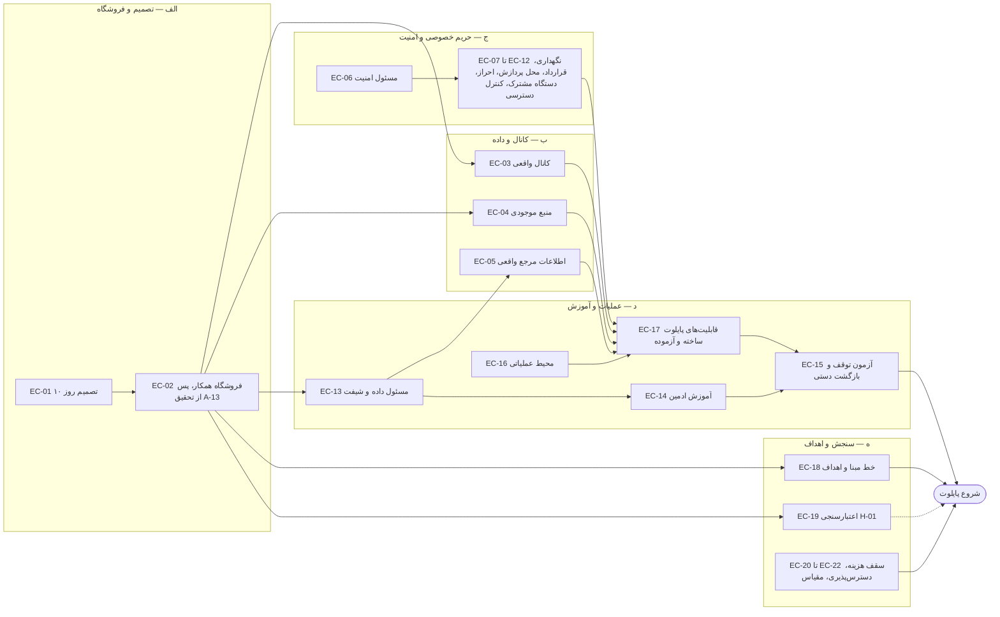

# ‏PRD-12a — دروازه ورود به پایلوت

> ‏**سطح این سند:** پیش از آنکه پایلوت شروع شود، چه چیزهایی باید برقرار باشد، به چه ترتیبی، و چه کسی برقراری آن‌ها را تأیید می‌کند. پایه آن شرایط ورود BRD است: «کانال و منبع واقعی موجودی باید قابل دسترسی باشند؛ روش همگام‌سازی و رفتار قطع اتصال آزموده شود؛ مسئول داده و شیفت انسانی تعیین شود؛ کنترل دسترسی، نگهداری داده و احراز سفارش تصویب شود؛ ادمین آموزش ببیند؛ خط مبنا و محدودیت تعداد کاربران مشخص شود و توقف بات و بازگشت به پاسخ‌گویی دستی آزموده شود» `[SRC-02 §12]`.
>
> ‏**آنچه اینجا نیست:** محتوای پیش‌شرط‌های حریم خصوصی، هزینه و دسترس‌پذیری (PRD-06 §6.9؛ اینجا فقط ارجاع به بند)؛ تأمین‌کننده و موعد وابستگی‌ها (PRD-09 §9.4؛ اینجا فقط شناسه DEP)؛ احتمال و اثر ریسک‌ها (PRD-08)؛ گام‌های قاعده توقف (PRD-08 §8.5)؛ سناریوها و قابلیت‌های پایلوت (PRD-12).
>
> ‏**راهنمای برچسب‌ها:** `[SRC-xx §n]` = برگرفته از منبع · **(پیشنهاد)** = پیشنهاد تیم PRD، تأییدشده در چت PRD-12 · **(فرض A-xx)** = باور یا مقدار تأییدنشده · **TBD** = تعیین در آماده‌سازی پایلوت.

### ‏راهنمای شناسه‌ها

| ‏کد | ‏معنی | ‏کجا تعریف شده |
|---|---|---|
| ‏EC-xx | ‏شرط ورود به پایلوت (مثلاً EC-04 = منبع واقعی موجودی و همگام‌سازی آزموده) **(DEC-206)** | ‏همین سند §12a.2 |
| ‏FS-xx | ‏سناریوی انتشار آینده | ‏PRD-12 |
| ‏DEP-xx | ‏وابستگی (DEP-30 تا DEP-37 = پایلوت) | ‏PRD-09 §9.4 |
| ‏D-xx | ‏تصمیم باز BRD (مثلاً D-04 = کانال واقعی) | ‏BRD §14 |
| ‏A / H | ‏فرض / فرضیه BRD | ‏PRD-08 §8.2 |
| ‏RSK | ‏ریسک | ‏PRD-08 §8.4 |
| ‏ENV / NFR | ‏نیازمندی محیطی / کیفی | ‏PRD-07 / PRD-06 |
| ‏US / AC / ND | ‏استوری / معیار پذیرش / نباید کلی | ‏PRD-04 |
| ‏Q / DEC / CH | ‏سؤال باز / تصمیم / تغییر | ‏Master Index |

---

## ‏۱۲a.۱ قواعد دروازه

| ‏# | ‏قاعده | ‏مرجع |
|---|---|---|
| ‏۱ | ‏**پذیرش Prototype ورود به پایلوت نیست.** کار این دروازه فقط پس از تصمیم «رفتن به آماده‌سازی پایلوت» در گزارش روز ۱۰ شروع می‌شود (EC-01) | ‏DEC-202؛ PRD-11b §11b.13؛ CON-11؛ RSK-20 |
| ‏۲ | ‏**پایلوت فقط وقتی شروع می‌شود که هر ۲۲ شرط برقرار باشند.** تنها استثنا EC-19 (اعتبارسنجی H-01) است که طبق PRD-08 می‌تواند «در آغاز پایلوت» انجام شود | ‏`[SRC-02 §12]`؛ PRD-08 §8.2.1 |
| ‏۳ | ‏**تصمیم‌های باز اینجا گرفته نمی‌شوند.** D-01، D-04، D-06، D-08 و Q-25 هرکدام یک شرط با مالک BRD‌اند؛ این سند فقط می‌گوید پیش از پایلوت باید تصمیم گرفته شده باشند **(DEC-209)** | ‏`[SRC-02 §14]` |
| ‏۴ | ‏**تأمین‌کننده نقش است، نه فرد**، تا نام افراد تعیین شود (Q-07). فروشگاه پایلوت تا انتخاب‌شدن (EC-02) با عنوان «فروشگاه پایلوت» می‌آید | ‏DEC-177؛ DEC-185 |
| ‏۵ | ‏**داده واقعی** فقط پس از برقراری همه شرط‌های گروه ج بارگذاری می‌شود | ‏NFR-06-1؛ NFR-06-6؛ RSK-10 |
| ‏۶ | ‏هر شرط یک **نشانه برقراری** دارد که قابل بررسی است. «برقرار» یعنی نشانه دیده و تاریخ آن در Master Index ثبت شده است | ‏**(پیشنهاد)**؛ هم‌شکل PRD-11a §11a.2 |
| ‏۷ | ‏**وضعیت** هر شرط همان پنج مقدار PRD-09 §9.1.3 است، به‌علاوه «برقرار». وضعیت ستون جدول‌ها، وضعیت روز نگارش این سند است | ‏PRD-09 §9.1.3 |

---

## ‏۱۲a.۲ شرط‌های ورود

> ‏**ستون‌ها:** شناسه · شرط · تأمین با · تأییدکننده · نشانه برقراری · موعد · وضعیت · ریسک · مرجع. ستون «تأمین با» نشان می‌دهد شرط از کدام DEP، بند PRD-06 §6.9 یا تصمیم باز تأمین می‌شود. ستون «نشانه برقراری» در همه ردیف‌ها **(پیشنهاد)** است. موعد همه شرط‌ها «پیش از شروع پایلوت» است، مگر قید دیگری آمده باشد.

### ‏الف — تصمیم و فروشگاه

| ‏شناسه | ‏شرط | ‏تأمین با | ‏تأییدکننده | ‏نشانه برقراری | ‏موعد | ‏وضعیت | ‏ریسک | ‏مرجع |
|---|---|---|---|---|---|---|---|---|
| ‏EC-01 | ‏گزارش روز ۱۰ تصمیم «رفتن به آماده‌سازی پایلوت» را دارد و دروازه پذیرش «پذیرفته» است | ‏DEC-202 | ‏مالک محصول (DEP-04) و نماینده فروشگاه نمایشی (DEP-07) | ‏گزارش روز ۱۰ تأییدشده، با فهرست محدودیت‌ها | ‏روز ۱۰ Prototype | ‏مسدود — اجرای Prototype (D-03 بخش بودجه، Q-07؛ DEC-201، DEC-263) | ‏RSK-20 | ‏PRD-11b §11b.14.2 |
| ‏EC-02 | ‏فروشگاه همکار و حوزه پایلوت انتخاب شده‌اند (D-01)، **پس از** تحقیق ورکفلو با چند فروشگاه (A-13)؛ کانال‌ها و روندهای فروشگاه پایلوت ثبت شده‌اند (بخش پایلوت Q-25) | ‏DEP-30؛ D-01؛ Q-25 | ‏مالک محصول | ‏نتیجه تحقیق A-13 مکتوب است؛ فروشگاه همکاری را پذیرفته؛ کانال‌ها، ابزارها، محل داده و تقسیم کار آن ثبت شده است | ‏تحقیق پیش از انتخاب؛ انتخاب پیش از تعهد پایلوت | ‏تأمین‌کننده تعیین‌نشده | ‏RSK-17، RSK-22 | ‏`[SRC-02 §14]` D-01؛ PRD-08 §8.2.1 |

### ‏ب — کانال و داده

| ‏شناسه | ‏شرط | ‏تأمین با | ‏تأییدکننده | ‏نشانه برقراری | ‏موعد | ‏وضعیت | ‏ریسک | ‏مرجع |
|---|---|---|---|---|---|---|---|---|
| ‏EC-03 | ‏کانال واقعی پایلوت امکان‌سنجی و انتخاب شده (D-04) و اتصال آن (ابزارک یا پیوند) با دسترسی مجاز کار می‌کند؛ رفتار ویژه هر کانال، اگر هست، ثبت شده و قواعد را عوض نمی‌کند (ENV-66) | ‏DEP-31؛ D-04 | ‏مسئول فنی | ‏گزارش امکان‌سنجی؛ یک گفت‌وگوی کامل از کانال واقعی در محیط پایلوت | ‏پیش از تعهد پایلوت | ‏مسدود — DEP-30 | ‏RSK-24 | ‏`[SRC-02 §3، §12]`؛ ENV-03 |
| ‏EC-04 | ‏منبع واقعی موجودی در دسترس است و روش همگام‌سازی، از جمله رفتار هنگام قطع اتصال، آزموده شده است. برای فروشگاهی که سیستم انبار ندارد: ورود دستی، با مسئول داده مشخص | ‏DEP-32 (و DEP-33 برای مسئول داده) | ‏مسئول فنی و فروشگاه پایلوت | ‏گزارش آزمون همگام‌سازی در سه حالت: همگام، قطع اتصال، و داده کهنه‌تر از آستانه. در دو حالت آخر، پاسخ موجودی «نامشخص» است | ‏پیش از تعهد پایلوت | ‏مسدود — DEP-30 | ‏RSK-01، RSK-24 | ‏`[SRC-02 §12]`؛ D-02 |
| ‏EC-05 | ‏اطلاعات مرجع واقعی آماده و تأییدشده‌اند: کاتالوگ و گونه‌ها، سیاست‌ها و دانش با فرایند نگهداری و مسئول تأیید، داده سفارش (فقط پس از EC-10)؛ آستانه اعتبار (D-02) مقدار واقعی فروشگاه را دارد | ‏DEP-33؛ D-02 | ‏مالک فروشگاه پایلوت | ‏اطلاعات مرجع بارگذاری و تأیید شده؛ آستانه در SCR-24 ثبت شده؛ مسئول نگهداری هر منبع نام دارد | ‏پیش از شروع پایلوت | ‏مسدود — DEP-30 | ‏RSK-01، RSK-18 | ‏`[SRC-02 §3]`؛ RULE-02 |

### ‏ج — حریم خصوصی و امنیت

> ‏محتوای هر بند در PRD-06 §6.9 است و اینجا تکرار نمی‌شود. همه این شرط‌ها پیش از **بارگذاری داده واقعی** لازم‌اند (قاعده ۵).

| ‏شناسه | ‏شرط | ‏تأمین با | ‏تأییدکننده | ‏نشانه برقراری | ‏موعد | ‏وضعیت | ‏ریسک | ‏مرجع |
|---|---|---|---|---|---|---|---|---|
| ‏EC-06 | ‏مسئول امنیت نام‌دار است و مالکیت D-06 را پذیرفته است | ‏DEP-09 | ‏مالک محصول | ‏نام فرد در PRD-00 ثبت شده | ‏پیش از کار روی EC-07 تا EC-12 | ‏تأمین‌کننده تعیین‌نشده | ‏RSK-25 | ‏`[SRC-02 §14]` D-06؛ DEC-185 |
| ‏EC-07 | ‏مدت نگهداری پیام، لاگ و فایل‌های CSV با داده واقعی و روش حذف مصوب است | ‏PRD-06 §6.9 (ردیف ۱ و ۲)؛ D-06 | ‏مالک فروشگاه پایلوت و مسئول امنیت | ‏تصمیم مکتوب با مدت و روش؛ آزمون یک حذف در محیط پایلوت | ‏پیش از بارگذاری داده واقعی | ‏مسدود — DEP-09 | ‏RSK-10، RSK-25 | ‏`[SRC-02 §10]` |
| ‏EC-08 | ‏شرایط قرارداد سرویس‌دهنده مدل برقرار است: نگه‌نداشتن داده پس از پردازش، استفاده‌نکردن برای آموزش، ارسال فقط داده مرز PRD-03e §3e.5 | ‏DEP-34؛ PRD-06 §6.9 (ردیف ۳) | ‏مسئول امنیت و مسئول فنی | ‏متن قرارداد یا شرایط مکتوب سرویس‌دهنده؛ بازبینی نمونه‌ای درخواست‌ها (NFR-06-2) | ‏پیش از بارگذاری داده واقعی | ‏مسدود — DEP-09 | ‏RSK-10 | ‏DEC-56 |
| ‏EC-09 | ‏محل میزبانی و پردازش (داخل یا خارج کشور) و لزوم رمزنگاری داده ذخیره‌شده تصمیم گرفته و پیاده شده است | ‏DEP-35؛ PRD-06 §6.9 (ردیف ۴ و ۶) | ‏مسئول امنیت و مسئول فنی | ‏تصمیم مکتوب؛ محیط پایلوت در محل مصوب | ‏پیش از بارگذاری داده واقعی | ‏مسدود — DEP-09 | ‏RSK-08، RSK-10 | ‏`[SRC-02 §10]`؛ ENV-50 |
| ‏EC-10 | ‏روش احراز ارتباط مشتری با سفارش مصوب و پیاده شده است؛ داشتن شماره سفارش به‌تنهایی مجوز نیست | ‏PRD-06 §6.9 (ردیف ۵)؛ D-06 | ‏مالک فروشگاه پایلوت و مسئول امنیت | ‏روش مصوب؛ آزمون منفی «شماره سفارش دیگری بدون احراز» ناموفق است | ‏پیش از نمایش داده واقعی سفارش | ‏مسدود — DEP-09 | ‏RSK-10 | ‏ND-27؛ ENV-20؛ FS-03 |
| ‏EC-11 | ‏پاسخ مصوب برای دستگاه مشترک مشتری، و در صورت نیاز ادامه مکالمه بین دستگاه‌ها با احراز | ‏RSK-12؛ ENV-23 | ‏مالک محصول و مسئول امنیت | ‏تصمیم مکتوب؛ آزمون «دو نفر روی یک مرورگر» بدون دیده‌شدن مکالمه قبلی | ‏پیش از شروع پایلوت | ‏مسدود — DEP-09 | ‏RSK-12 | ‏PRD-07 §7.6.1؛ FS-06 |
| ‏EC-12 | ‏کنترل دسترسی پایلوت مصوب است: روش ورود ادمین و مالک، قفل حساب، ساخت و غیرفعال‌سازی حساب، و مدت نشست برای داده واقعی | ‏ENV-30، ENV-33، ENV-34، ENV-36 (ستون پایلوت) | ‏مسئول امنیت و مسئول فنی | ‏تصمیم مکتوب؛ آزمون‌های NFR-04-1 تا 04-4 در محیط پایلوت قبول | ‏پیش از بارگذاری داده واقعی | ‏مسدود — DEP-09 | ‏RSK-10 | ‏`[SRC-02 §12]` «کنترل دسترسی … تصویب شود»؛ FS-05 |

### ‏د — عملیات و آموزش

| ‏شناسه | ‏شرط | ‏تأمین با | ‏تأییدکننده | ‏نشانه برقراری | ‏موعد | ‏وضعیت | ‏ریسک | ‏مرجع |
|---|---|---|---|---|---|---|---|---|
| ‏EC-13 | ‏مسئول داده و مسئول شیفت انسانی فروشگاه پایلوت تعیین شده‌اند؛ ساعات کاری، زمان پاسخ و مسیر تماس جایگزین واقعی (D-05) در SCR-24 ثبت شده‌اند | ‏DEP-33؛ D-05 | ‏مالک فروشگاه پایلوت | ‏نام افراد و برنامه شیفت؛ تنظیمات SCR-24 با مقدار واقعی | ‏پیش از شروع پایلوت | ‏مسدود — DEP-30 | ‏RSK-04 | ‏`[SRC-02 §3، §12]`؛ FS-04 |
| ‏EC-14 | ‏ادمین‌های فروشگاه پایلوت آموزش دیده‌اند، از جمله توقف بات و بازگشت به پاسخ‌گویی دستی | ‏DEP-37 | ‏تیم محصول و مالک فروشگاه پایلوت | ‏فهرست ادمین‌های آموزش‌دیده با تاریخ | ‏پیش از شروع پایلوت | ‏مسدود — DEP-30 | ‏RSK-26 | ‏`[SRC-02 §12]` |
| ‏EC-15 | ‏توقف بات و بازگشت به پاسخ‌گویی دستی **در محیط پایلوت و با ادمین‌های آموزش‌دیده** آزموده شده است: هیچ پیامی گم نمی‌شود و پیام‌های تازه به صف می‌روند | ‏AC-07-05-7؛ NFR-12-2؛ US-07-05 | ‏مالک محصول و مالک فروشگاه پایلوت | ‏گزارش آزمون با دست‌کم یک توقف و یک فعال‌سازی دوباره | ‏پس از EC-14 | ‏مسدود — EC-14 | ‏RSK-26 | ‏`[SRC-02 §12]`؛ PRD-09 §9.6.2 **(DEC-211)** |
| ‏EC-16 | ‏محیط عملیاتی پایلوت جدا از محیط آزمون آماده است، با پشتیبان‌گیری و بازیابی آزموده | ‏ENV-42، ENV-44 (ستون پایلوت) | ‏مسئول فنی | ‏نشانی محیط پایلوت؛ گزارش یک بازیابی آزمایشی | ‏پیش از بارگذاری داده واقعی | ‏مسدود — DEP-05 | ‏RSK-10 | ‏**(پیشنهاد)**: ENV-42 محیط آزمون را فقط برای داده ساختگی می‌داند |
| ‏EC-17 | ‏قابلیت‌های نامزدی که برای پایلوت انتخاب شده‌اند (PRD-12 §12.5.4) با استوری و معیار پذیرش به PRD افزوده شده (CH ثبت‌شده)، ساخته و آزموده شده‌اند؛ مجموعه پذیرش هسته روی محیط پایلوت دوباره قبول است | ‏PRD-12 §12.5.4 | ‏مالک محصول و مسئول ارزیابی | ‏CH ثبت‌شده؛ نتیجه آزمون‌ها | ‏پس از EC-03 تا EC-05 و EC-10 تا EC-12 | ‏مسدود — EC-01 | ‏RSK-14 | ‏**(پیشنهاد)**؛ PRD-12 §12.2 قاعده ۲ |

### ‏ه — سنجش و اهداف

| ‏شناسه | ‏شرط | ‏تأمین با | ‏تأییدکننده | ‏نشانه برقراری | ‏موعد | ‏وضعیت | ‏ریسک | ‏مرجع |
|---|---|---|---|---|---|---|---|---|
| ‏EC-18 | ‏خط مبنا در فروشگاه پایلوت ثبت شده و اهداف پایلوت مصوب‌اند: شش شاخص پایلوت BRD (PRD-12 §12.5.5)، ستون «هدف پایلوت» PRD-01 و PRD-06، و بازه بازگشایی شاخص حل | ‏DEP-30؛ D-08 | ‏مالک محصول و فروشگاه پایلوت | ‏جدول خط مبنا با تاریخ و روش اندازه‌گیری؛ جدول اهداف مصوب | ‏پیش از شروع پایلوت | ‏مسدود — DEP-30 | ‏RSK-23 | ‏`[SRC-02 §11، §12، §14]` |
| ‏EC-19 | ‏H-01 (A-05) با نمونه‌برداری و برچسب‌گذاری پیام‌های واقعی فروشگاه اعتبارسنجی شده: «قابل پاسخ از منبع فروشگاه / نیازمند انسان / بیرون از دامنه» | ‏DEP-30 | ‏مالک محصول و نماینده فروشگاه پایلوت | ‏گزارش نمونه‌برداری با سهم هر برچسب؛ حد «معنادار» همراه با EC-18 | ‏**پیش از پایلوت یا در آغاز آن** (استثنای قاعده ۲) | ‏مسدود — DEP-30 | ‏RSK-21 | ‏PRD-08 §8.2.1 |
| ‏EC-20 | ‏سقف هزینه سرویس مدل و رفتار هنگام رسیدن به سقف مصوب است | ‏DEP-36؛ D-03؛ PRD-06 §6.9 (ردیف ۸) | ‏حامی کسب‌وکار و مسئول فنی | ‏تصمیم مکتوب با سقف و رفتار | ‏پیش از شروع پایلوت | ‏تأمین‌کننده تعیین‌نشده (D-03 باز) | ‏RSK-09 | ‏NFR-09-1 |
| ‏EC-21 | ‏هدف دسترس‌پذیری و ساعات پوشش پایلوت مصوب است | ‏PRD-06 §6.9 (ردیف ۷) | ‏مالک محصول | ‏تصمیم مکتوب | ‏پیش از شروع پایلوت | ‏تأمین‌کننده تعیین‌نشده | ‏RSK-06 | ‏NFR-12-1؛ ND-39 |
| ‏EC-22 | ‏محدودیت تعداد کاربران و مقیاس هم‌زمانی پایلوت مشخص است و آزمون کارایی در همان مقیاس قبول است | ‏PRD-06 §6.9 (ردیف ۹) | ‏مالک محصول و فروشگاه پایلوت | ‏حد مصوب؛ اجرای NFR-02-7 در آن مقیاس | ‏پیش از شروع پایلوت | ‏مسدود — DEP-30 | ‏RSK-07 | ‏`[SRC-02 §12]` «محدودیت تعداد کاربران» |

### ‏و — تصمیم‌های باز در دروازه

| ‏تصمیم یا سؤال | ‏مالک در BRD | ‏شرط ورود |
|---|---|---|
| ‏D-01 فروشگاه و حوزه پایلوت | ‏مالک محصول | ‏EC-02 |
| ‏D-02 آستانه اعتبار (مقدار واقعی) | ‏مالک فروشگاه | ‏EC-05 |
| ‏D-03 سقف هزینه سرویس | ‏حامی کسب‌وکار و مسئول فنی | ‏EC-20 |
| ‏D-04 کانال واقعی و اتصال رسمی | ‏مسئول فنی | ‏EC-03 |
| ‏D-05 ساعات انسانی و مسیر جایگزین (مقدار واقعی) | ‏مالک فروشگاه | ‏EC-13 |
| ‏D-06 بخش پایلوت: نگهداری، حذف، احراز سفارش | ‏مالک فروشگاه و مسئول امنیت | ‏EC-06 تا EC-10 |
| ‏D-08 خط مبنا و اهداف اقتصادی | ‏محصول و فروشگاه | ‏EC-18 (اهداف اقتصادی ← PRD-14) |
| ‏Q-25 بخش پایلوت: کانال‌ها و روندهای فروشگاه | ‏— | ‏EC-02، EC-03 |
| ‏RSK-12 پاسخ دستگاه مشترک | ‏مالک محصول و مسئول امنیت (PRD-08) | ‏EC-11 |
| ‏~~Q-36~~ | ‏— | ‏✅ بسته در این چت ← §12a.4 (DEC-208) |

---

## ‏۱۲a.۳ ترتیب شرط‌ها

> ‏هدف دیاگرام: نشان‌دادن اینکه کدام شرط پیش‌نیاز کدام است، تا آماده‌سازی پایلوت از جای درست شروع شود. ریشه‌ها EC-01 (تصمیم روز ۱۰)، EC-02 (فروشگاه همکار) و EC-06 (مسئول امنیت)‌اند. EC-19 با خط‌چین به «شروع پایلوت» می‌رسد، چون می‌تواند در آغاز پایلوت انجام شود.

> ‏**مسیر بحرانی (پیشنهاد):** EC-01 ← EC-02 ← (کانال، داده و شیفت) ← EC-17 ← EC-15 ← شروع. مسئول امنیت (EC-06) و تصمیم‌های هزینه (EC-20) به فروشگاه پایلوت وابسته نیستند و می‌توانند هم‌زمان با EC-02 شروع شوند.

---

## ‏۱۲a.۴ قاعده توقف در پایلوت

> ‏گام‌های قاعده (محرک، توقف فوری، بررسی، رفع و آزمون مجدد، بازگشت با تأیید مالک محصول و فروشگاه) در PRD-08 §8.5 است و اینجا تکرار نمی‌شود **(DEC-172؛ DEC-211)**. این بخش فقط محرک‌های پایلوت را مشخص می‌کند.

| ‏# | ‏محرک توقف در پایلوت | ‏منبع |
|---|---|---|
| ‏۱ | ‏افشای داده | ‏`[SRC-02 §12]` |
| ‏۲ | ‏گم‌شدن درخواست | ‏`[SRC-02 §12]` |
| ‏۳ | ‏اقدام خارج از اختیار | ‏`[SRC-02 §12]` |
| ‏۴ | ‏**ادعای حساس بدون منبع** درباره موجودی، وضعیت سفارش یا سیاست مرجوعی، **به شرط تأیید** در بازبینی انسانی (US-06-02) یا با شکایت بررسی‌شده | ‏**Q-36 بسته شد — DEC-208؛ تغییر نسبت به BRD §12 (CH-26)** |

> ‏**چرا محرک چهارم (DEC-208):** (۱) این همان درد اصلی محصول است (E-01) و هدف BO-03 مستقیماً به آن وابسته است؛ (۲) در Prototype خطای بحرانی و مانع پذیرش است `[SRC-02 §11]` و PRD-08 §8.1.3 اثر آن را «بحرانی» شمرده است؛ (۳) هزینه توقف کم است، چون توقف دستی است (DEC-88) و هیچ پیامی گم نمی‌شود (NFR-12-2). **شرط تأیید** برای این است که هر ادعای مشکوک تأییدنشده‌ای کل فروشگاه را متوقف نکند.
>
> ‏**پیش‌شرط اجرای قاعده در پایلوت:** EC-14 (آموزش) و EC-15 (آزمون توقف و بازگشت دستی).

---

## ‏۱۲a.۵ نگاشت

### ‏۱۲a.۵.۱ شرایط ورود BRD §12

| ‏شرط BRD | ‏شرط‌های ورود | ‏وابستگی (PRD-09 §9.6.2) |
|---|---|---|
| ‏کانال و منبع واقعی موجودی قابل دسترسی باشند؛ روش همگام‌سازی و رفتار قطع اتصال آزموده شود | ‏EC-03، EC-04 | ‏DEP-31، DEP-32 |
| ‏مسئول داده و شیفت انسانی تعیین شود | ‏EC-13 (و EC-05) | ‏DEP-33 |
| ‏کنترل دسترسی، نگهداری داده و احراز سفارش تصویب شود | ‏EC-06 تا EC-12 | ‏DEP-09، DEP-34، DEP-35 |
| ‏ادمین آموزش ببیند | ‏EC-14 | ‏DEP-37 |
| ‏خط مبنا و محدودیت تعداد کاربران مشخص شود | ‏EC-18، EC-22 | ‏DEP-30 |
| ‏توقف بات و بازگشت به پاسخ‌گویی دستی آزموده شود | ‏EC-15 | ‏— (PRD-09: «آزمون ← PRD-12») |

> ‏**شرط‌های افزوده به BRD §12** (از اسناد Approved، نه رفتار تازه): EC-01 (DEC-202)، EC-02 (D-01 و تحقیق A-13)، EC-16 و EC-17 **(پیشنهاد)**، EC-19 (A-05)، EC-20 و EC-21 (PRD-06 §6.9).

### ‏۱۲a.۵.۲ پیش‌شرط‌های PRD-06 §6.9

| ‏ردیف §6.9 | ‏شرط ورود |
|---|---|
| ‏۱ مدت نگهداری پیام و لاگ | ‏EC-07 |
| ‏۲ روش حذف | ‏EC-07 |
| ‏۳ دسترسی سرویس‌دهنده مدل | ‏EC-08 |
| ‏۴ محل پردازش و ذخیره | ‏EC-09 |
| ‏۵ احراز ارتباط مشتری با سفارش | ‏EC-10 |
| ‏۶ رمزنگاری داده ذخیره‌شده | ‏EC-09 |
| ‏۷ دسترس‌پذیری | ‏EC-21 |
| ‏۸ سقف هزینه سرویس | ‏EC-20 |
| ‏۹ محدودیت تعداد کاربران | ‏EC-22 |

> ‏هر نُه ردیف §6.9 و هر هشت وابستگی پایلوت (DEP-30 تا DEP-37) دست‌کم در یک شرط ورود آمده‌اند.

---

## ‏۱۲a.۶ نتیجه دروازه

| ‏مورد | ‏مقدار |
|---|---|
| ‏نتیجه | ‏فقط دو حالت: **«باز»** وقتی هر ۲۲ شرط برقرارند (EC-19 می‌تواند در آغاز پایلوت باشد)؛ و **«بسته»** در غیر این صورت، با فهرست شرط‌های برقرارنشده |
| ‏تأیید | ‏مالک محصول و مالک فروشگاه پایلوت، جداگانه؛ مسئول امنیت برای گروه ج **(پیشنهاد)** |
| ‏ثبت | ‏تاریخ برقراری هر شرط و نتیجه دروازه در Master Index؛ شروع پایلوت با CH |
| ‏اگر بسته ماند | ‏آماده‌سازی ادامه می‌یابد یا مالک محصول «توقف» را انتخاب می‌کند؛ پایلوت بدون شرط‌های گروه ج با داده واقعی شروع نمی‌شود |

---

## ‏۱۲a.۷ مرز با بخش‌های دیگر

| ‏بخش | ‏در این سند | ‏در آن بخش |
|---|---|---|
| ‏PRD-12 | ‏— | ‏سناریوها، قابلیت‌های نامزد، سنجش و تصمیم پایان پایلوت |
| ‏PRD-06 §6.9 | ‏شرط ورود با ارجاع به ردیف | ‏محتوای پیش‌شرط‌ها |
| ‏PRD-08 | ‏محرک‌های توقف در پایلوت؛ ریسک با شناسه | ‏گام‌های قاعده توقف §8.5 (با محرک چهارم — CH-26)؛ احتمال و اثر |
| ‏PRD-09 | ‏ترتیب وابستگی‌ها در دروازه | ‏تأمین‌کننده، موعد و وضعیت DEP-30 تا DEP-37 |
| ‏PRD-11b | ‏EC-01 | ‏دروازه پذیرش Prototype و تصمیم روز ۱۰ |
| ‏PRD-13 | ‏— | ‏جذب فروشگاه پایلوت به‌عنوان مشتری |

### ‏تصمیم‌های این زیرسند

‏DEC-206، DEC-208، DEC-209، DEC-211. متن کامل در PRD-12 §12.10.

---

### ‏تاریخچه تغییرات این سند

| ‏نسخه | ‏تاریخ | ‏تغییر |
|---|---|---|
| ‏1.1 | ‏2026-11-12 | ‏وضعیت EC-01: «مسدود — D-03 بخش بودجه، Q-07» (DEC-263؛ CH-45). هیچ شرط دیگری تغییر نکرد |
